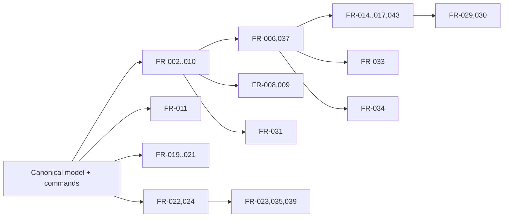

# Document 2 — Product Requirements Document (PRD)

Working name: **GharPlan** (placeholder — check trademark/Play Store availability before use).
Status: Draft v0.1 · 2026-10-10 · Owner: Raghvendr

## 1. Product vision
A fast, honest, mobile-first home planner that lets an Indian homeowner or small contractor draw their house to real dimensions, furnish it, and see it in 3D on a ₹10–20k Android phone — and, as a differentiator, plan **electrical points and fittings** in the same model.

## 2. Target users & personas

| Persona | Description | Main job |
|---|---|---|
| P1 Homeowner "Sunita" | Building or renovating a 2–3 BHK; uses a mid-range Android phone; not technical | See if furniture fits, choose colours, show family |
| P2 Small contractor / electrician "Imran" | Does wiring and interiors for local clients | Quick dimensioned plan + electrical point plan to share on WhatsApp |
| P3 Student / hobbyist | Likes design | Play with layouts, styles |
| P4 Shop owner (Raghvendr) | Sells switches, wires, fans, lights | Turn plans into bills of material / leads (later) |

Market size: **not estimated here** — no verified data was collected for India home-design app demand. Recommended deep research: Play Store category rankings + keyword volume (use Perplexity Pro, Doc 9 §7).

## 3. Jobs-to-be-done
- JTBD-1: "When I am planning a room, I want to check if my furniture fits so I don't buy the wrong size."
- JTBD-2: "When I discuss with family/contractor, I want a 3D picture so everyone imagines the same thing."
- JTBD-3: "When wiring a new house, I want to mark switch/fan/light points on the plan so the electrician follows it."
- JTBD-4: "When I have a builder's plan image, I want it converted so I don't redraw it." (later, AI)

## 4. User problems (from research, Doc 1 §1.8)
Billing confusion, slow apps, lost work, steep learning curve, imperial-first tools.

## 5. Value proposition
Accurate plan in minutes · smooth 3D on budget phones · never lose work · clear pricing · electrical planning built-in.

## 6. Competitive positioning
Not competing on photoreal rendering or catalog size (10K+ items at Planner 5D). Competing on: speed, reliability, Indian context, electrical layer, price.

## 7. Product scope
Android app (Capacitor-wrapped web app) + same app on the web. One shared codebase.

## 8. MVP definition
MVP = **Must** requirements marked "MVP" below: draw walls/rooms with precise dimensions, doors/windows, ~100-item catalog, place/rotate furniture, wall/floor materials, live 3D orbit view, local autosave, project list, PNG export, onboarding, Play subscription for premium catalog/export. No AI, no cloud accounts in the very first MVP (local-only) — cloud sync is the next release.

## 9. Functional requirements

Format per row: ID · Requirement · Priority (MoSCoW) · Release · Dependencies · Acceptance criteria · Verification.
User story pattern: "As P1, I want …, so that …" is given where not obvious.

| ID | Requirement & user story | Pri | Rel | Deps | Acceptance criteria | Verify |
|---|---|---|---|---|---|---|
| PRD-FR-001 | Create blank project with name, units | M | MVP | — | New project opens in ≤1 s; appears in list after app restart | E2E UX-02 |
| PRD-FR-002 | Draw walls by tapping/clicking successive points; double-tap/ Esc ends | M | MVP | FR-013 | Chain of N points creates N-1 walls sharing junctions; closing on first point creates closed loop | GEO-01, E2E UX-04 |
| PRD-FR-003 | Snapping: to existing junctions (≤ 12 px screen), to wall lines, to grid, angle snap 15° (toggle) | M | MVP | FR-002 | Snapped point equals target coordinate exactly (integer mm) | GEO-05 |
| PRD-FR-004 | Type exact wall length (and angle) during/after drawing | M | MVP | FR-002 | Entered 3 450 mm → stored length 3 450 ± 0 mm; connected walls stay joined | GEO-06 |
| PRD-FR-005 | Rectangle room tool (W × D) | M | MVP | FR-002 | Creates 4 walls + 1 room; area = W×D (interior per definition in Doc 4 §2.6) | GEO-03 |
| PRD-FR-006 | Automatic room detection from closed wall loops; show name + area | M | MVP | FR-002 | Any closed loop becomes a room within the same edit; removing a wall merges/removes rooms correctly | GEO-02, GEO-03 |
| PRD-FR-007 | Edit wall thickness (50–600 mm) and height (1 000–6 000 mm) | M | MVP | FR-002 | 3D wall updates; junction miters remain watertight | GEO-04, SYNC-01 |
| PRD-FR-008 | Place doors and windows on a wall from catalog | M | MVP | FR-002 | Opening attaches to host wall; visible as hole in 3D | GEO-07, SYNC-03 |
| PRD-FR-009 | Opening constraints: stays inside wall length, no overlap with other openings, width ≤ wall length − 2× min margin (50 mm) | M | MVP | FR-008 | Invalid drop is rejected with message; drag clamps to valid range | GEO-08 |
| PRD-FR-010 | Select, move, delete walls and junctions; dragging a junction moves all connected walls | M | MVP | FR-002 | Connected walls stay connected; dependent openings keep relative offset or are clamped | GEO-09, GEO-16, SYNC-01 |
| PRD-FR-011 | Undo/redo (≥ 100 steps) for every model edit | M | MVP | Command system | Undo after any sequence returns byte-identical model (canonical JSON) | SYNC-06 |
| PRD-FR-012 | Units: metric (mm/cm/m) and imperial (ft-in) display; internal mm | M | MVP | — | Round-trip display→parse→display stable | GEO-10 |
| PRD-FR-013 | 2D zoom/pan: mouse wheel/drag; touch pinch/two-finger pan | M | MVP | — | Zoom 1:1 000 range; pinch keeps focal point fixed (±2 px) | UX-05 |
| PRD-FR-014 | Furniture catalog: categories, search, thumbnails; free vs premium badge | M | MVP | Asset pipeline | ≥ 100 items at MVP, each with license record | AST-01 |
| PRD-FR-015 | Place, move, rotate (15° snap, free with modifier) furniture in 2D and 3D | M | MVP | FR-014 | Position/rotation identical in 2D and 3D (≤ 1 mm, ≤ 0.1°) | SYNC-02 |
| PRD-FR-016 | Edit furniture W/D/H (scales model) | S | MVP | FR-015 | Bounding box equals entered size ± 1 mm | SYNC-02 |
| PRD-FR-017 | Collision warning: furniture overlapping walls or other furniture is highlighted (not blocked) | S | v1.0 | FR-015 | Overlap detection on 2D footprints (OBB) correct for test fixtures | GEO-11 |
| PRD-FR-018 | Change wall-side paint/material, floor material; furniture colour variants | M (walls/floors), S (furniture) | MVP | Material library | Change visible in 3D in ≤ 200 ms; persisted | SYNC-04 |
| PRD-FR-019 | 3D view always reflects current model (split view on tablet/desktop, toggle on phone) | M | MVP | Doc 4 sync | After any edit, 3D state hash equals model-derived hash | SYNC-01..07 |
| PRD-FR-020 | 3D orbit camera: rotate, pan, zoom; touch gestures; camera cannot go below floor | M | MVP | FR-019 | Camera constraints hold in automated test | REN-04 |
| PRD-FR-021 | First-person walk mode (joystick on touch, WASD on desktop), eye height 1 600 mm, wall collision | S | v1.0 | FR-019 | Cannot pass through walls in test path; can pass through door openings | REN-05 |
| PRD-FR-022 | Local autosave ≤ 2 s after last edit; crash recovery on next launch | M | MVP | Storage | Kill-app test loses ≤ last 2 s of edits | REL-01, REL-02 |
| PRD-FR-023 | Account (Google sign-in) + cloud save/sync; last-write-wins with conflict copy | S | v1.0 | Backend | Conflicting edits create "conflicted copy", never silent overwrite | REL-05 |
| PRD-FR-024 | Project list: open, rename, duplicate, delete (with undo-able trash 30 days for cloud) | M | MVP | FR-022 | Duplicate produces new IDs for all entities; original unchanged | REL-03 |
| PRD-FR-025 | Export 2D plan as PNG/PDF with dimensions; 3D screenshot PNG | M | MVP | FR-019 | Exported PNG shows dimension labels matching model ±1 mm rounding | UX-08 |
| PRD-FR-026 | Multiple floors (add/remove/switch; copy outline of floor below) | S | v1.1 | Data model | Floors stack at correct elevation in 3D | SYNC-08 |
| PRD-FR-027 | Straight staircase object between floors | C | v1.2 | FR-026 | Stair fits floor-to-floor height | GEO-12 |
| PRD-FR-028 | Templates (1BHK, 2BHK, room presets) | S | v1.0 | FR-001 | Template opens as a new editable copy | UX-02 |
| PRD-FR-029 | Subscription via Google Play Billing: premium catalog, PDF export, ad-free, extra floors | M | v1.0 (release) | Billing | Entitlement granted ≤ 10 s after purchase; restored on reinstall; cancellation respected | MON-01..04 |
| PRD-FR-030 | Ads for free users: banner on project list only, never on the editor canvas; optional rewarded ad to unlock one premium item for a project | S | v1.0 | AdMob | No ad overlaps editor; ad-free for subscribers | MON-05 |
| PRD-FR-031 | AI floor-plan import: upload image → AI draft walls/openings → user correction screen → accept | C | v2 | Doc 6 | Output always valid geometry; user can fix every element | AI-01..05 |
| PRD-FR-032 | AI restyle image from 3D screenshot or room photo (visual only, clearly labelled) | C | v2 | Doc 6, credits | Image returned or clear error in ≤ 60 s; credits deducted only on success | AI-06, AI-08 |
| PRD-FR-033 | AI furnish suggestion: proposes furniture placement as editable objects | C | v2 | Doc 6 | All placed objects inside room, no overlaps, door swing clear | AI-07 |
| PRD-FR-034 | Electrical layer: place switch boards, sockets, light/fan points; per-room count list; export list | S | v1.1 | Data model | Point counts in export equal points in model | GEO-13, UX-09 |
| PRD-FR-035 | Share read-only web link | C | v1.1 | FR-023 | Link viewer cannot edit; owner can revoke | SEC-03 |
| PRD-FR-036 | Multi-select, copy/paste, duplicate furniture | S | v1.0 | FR-015 | Duplicates get new IDs, offset 200 mm | SYNC-06 |
| PRD-FR-037 | Room properties: name, type, ceiling height, floor material | M | MVP | FR-006 | Room props survive wall edits that keep the room (room identity rules Doc 4 §2.7) | GEO-14 |
| PRD-FR-038 | First-run onboarding (≤ 4 screens + interactive "draw your first room") | M | MVP | — | ≥ 60% of new users create a room in first session (analytics) | UX-12, Analytics |
| PRD-FR-039 | Account & data deletion in-app and via web URL | M (when accounts exist) | v1.0 | FR-023 | Deletion completes ≤ 30 days; confirmation shown | SEC-05 |
| PRD-FR-040 | Real-time multi-user collaboration | W | — | — | — | — |
| PRD-FR-041 | Photoreal path-traced rendering | W (v1) | — | — | — | — |
| PRD-FR-042 | DWG/DXF export | W (v1); C later (DXF only) | — | — | — | — |
| PRD-FR-043 | Snapping & alignment of furniture to walls (back-to-wall snap) | S | v1.0 | FR-015 | Back face within 1 mm of wall inner face after snap | GEO-15 |

## 10. Non-functional requirements (measurable)

Reference devices (assumption, to be bought/borrowed — Doc 8 §6): **Low** = Android with 3 GB RAM, Mali-G52 class GPU; **Mid** = 6 GB RAM, Adreno 6xx/Mali-G57 class; **Desktop** = any laptop with integrated GPU from 2020+ in Chrome.

| ID | Requirement | Threshold | Verify |
|---|---|---|---|
| PRD-NFR-001 | 2D editor frame rate while dragging a junction, 200-wall plan | ≥ 45 fps Mid, ≥ 30 fps Low | PERF-01 |
| PRD-NFR-002 | 3D frame rate, sample project (6 rooms, 60 furniture items), orbiting | ≥ 30 fps Mid, ≥ 24 fps Low, ≥ 60 fps Desktop | PERF-02 |
| PRD-NFR-003 | Edit-to-3D latency (wall drag commit → mesh visible) | p95 ≤ 100 ms Mid | PERF-03 |
| PRD-NFR-004 | Cold start to project list | ≤ 4 s Mid, ≤ 7 s Low | PERF-04 |
| PRD-NFR-005 | Install size (AAB download) | ≤ 40 MB; catalog assets streamed + cached | PERF-05 |
| PRD-NFR-006 | Texture memory budget | ≤ 256 MB Mid, ≤ 128 MB Low (quality tier switch) | PERF-06 |
| PRD-NFR-007 | Durability | No project loss in 100 forced-kill cycles; ≤ 2 s edit loss | REL-01 |
| PRD-NFR-008 | Geometric precision | Integer mm storage; derived values computed in float64; displayed rounding documented | GEO-10 |
| PRD-NFR-009 | Accessibility | WCAG 2.1 AA contrast for UI chrome; touch targets ≥ 48 dp; every canvas edit also possible via numeric property panel; TalkBack labels on all buttons | UX-10 |
| PRD-NFR-010 | Offline | All MVP features work in airplane mode | REL-04 |
| PRD-NFR-011 | Security | No secret keys in app bundle; row-level security on all user tables | SEC-01, SEC-02, SEC-06 |
| PRD-NFR-012 | Privacy | AI uploads deleted ≤ 30 days; explicit consent before upload | SEC-04 |
| PRD-NFR-013 | Localization | English + Hindi strings; no hard-coded UI text | UX-11 |
| PRD-NFR-014 | Stability | Crash-free sessions ≥ 99.5% (Play Console vitals) | Post-launch metric |
| PRD-NFR-015 | WebGL context loss | Recovers ≤ 3 s, no model data loss | REN-07 |
| PRD-NFR-016 | Project size | Load 500-wall / 1 000-object project ≤ 3 s Mid | PERF-07 |

## 11. User journeys (summary; detailed flows in Doc 4 §7 / Doc 7 Phase 2–8)
J1 First-run → draw first room → add door → add bed → view 3D → autosaved.
J2 Return → open project → change wall colour → export PNG → share on WhatsApp.
J3 Hit premium item → paywall → subscribe → item unlocked.
J4 (v2) Upload builder plan image → AI draft → correct → furnish.

## 12. Feature dependencies

## 13. Mobile usability requirements
- One-hand reachable primary toolbar at bottom; property sheet as bottom drawer.
- Touch: tap = select, long-press = context menu, drag on empty = pan, pinch = zoom, two-finger rotate disabled in 2D (prevents accidental rotation).
- Drawing on touch uses an **offset cursor/loupe** above the finger so the point being placed is visible.
- Numeric keypad for dimension entry.

## 14. Project saving and recovery
Local-first: IndexedDB (web) / Capacitor filesystem-backed storage on Android; journal of commands since last snapshot; recovery dialog on launch if journal is newer than snapshot.

## 15. Monetization requirements
- Free: unlimited projects, basic catalog, PNG export with small watermark, banner ads on non-editor screens.
- Premium (monthly/yearly via Play Billing): full catalog, no ads, PDF export without watermark, multi-floor, electrical layer export.
- Credits (v2): AI features consume credits; Premium includes a monthly allowance; extra credit packs as in-app products.
- Price points: **to be decided after research**; do not copy Planner 5D USD prices — Indian price sensitivity is different.
- Google Play fee: recurring subscriptions now 10% service fee + 5% billing fee when using Play Billing in US/UK/EEA from 30 Jun 2026; other regions roll out until 2027 (secondary sources, verify in Play Console help) — model 15% for India until confirmed.

## 16. Analytics & success metrics
Activation: % new users who create ≥ 1 room in session 1 (target ≥ 60%). Engagement: D7 retention (target set after first cohort; no invented benchmark). Monetization: free→paid conversion, ARPDAU from ads. Quality: crash-free ≥ 99.5%, ANR rate below Play "bad behavior" threshold.
Events: `project_created`, `wall_drawn`, `room_closed`, `furniture_placed`, `view_3d_opened`, `export_done`, `paywall_shown`, `purchase_completed`, `ai_job_*`.

## 17. Prioritization summary
Must (MVP): FR-001–015, 018–020, 022, 024, 025, 037, 038; release-must: FR-029, FR-039 (with accounts).
Should: FR-016, 017, 021, 023, 026, 028, 030, 034, 036, 043.
Could: FR-027, 031, 032, 033, 035.
Won't (v1): FR-040, 041, 042.

## 18. Explicit exclusions (v1)
Real-time collaboration, path-traced photoreal rendering, DWG export, user-uploaded 3D models, roof generator, terrain/landscaping, iOS app, VR/AR.

## 19. Release acceptance criteria (v1.0 to Play Store)
1. All Must FR acceptance criteria pass in Doc 8 automated suites.
2. PRD-NFR-001..007, 015 pass on the Low and Mid reference devices (recorded evidence).
3. Billing tested with Play license testers: purchase, restore, cancel, grace period.
4. Data safety form, privacy policy, account deletion URL complete.
5. No P0/P1 open bugs; closed-testing track ≥ 14 days with ≥ the number of testers Play currently requires for new personal developer accounts (verify the current rule in Play Console; it has been 12 testers for 14 days for new personal accounts).
