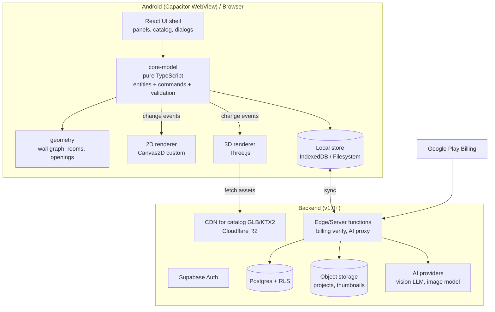

> **Superseded (2026-10-11):** the combined Claude + Codex document [`combined-research.md`](combined-research.md) is now the main reference. This file is kept as history. Electrical planning has been removed from the product scope by owner decision.

# Document 3 — Technical Requirements Document (TRD)

Every decision below is summarized here; the full 11-field analysis (technology, reason, alternatives, pros, cons, licensing, performance, integration complexity, maintenance risk, Claude Code compatibility, confidence) is in **Doc 10 (ADR-xxx)**.

## 1. System overview



## 2. Frontend architecture

| Concern | Choice | ADR |
|---|---|---|
| Language | TypeScript (strict) | ADR-001 |
| UI framework | React 18+ with Vite | ADR-002 |
| App state for UI (panels, selection, tool) | Zustand | ADR-003 |
| Canonical project model | Custom pure-TS module `core-model` (no React/Three imports), immutable snapshots + command pattern | ADR-004 |
| 2D rendering | Custom Canvas 2D renderer (no Konva/Fabric) | ADR-005 |
| 3D rendering | Three.js (imperative, not React Three Fiber for the scene) | ADR-006 |
| Mobile packaging | Capacitor (Android) | ADR-007 |
| Geometry helpers | Own code for wall graph; `clipper2-js`-class polygon library for boolean ops/offsets only if needed (verify license) | ADR-008 |

**Package boundaries (enforced by ESLint import rules):**
```
packages/
  core-model/     # entities, commands, validation, serialization — zero DOM deps
  geometry/       # pure math: vectors, segments, wall graph, faces, mitering
  render-2d/      # Canvas2D drawing + hit testing; reads model, emits intents
  render-3d/      # Three.js scene builder; reads model, never writes it
  catalog/        # asset metadata, loaders, cache
  persistence/    # local store, journal, cloud sync
apps/
  web/            # React shell, tools, panels (also built into Capacitor)
  android/        # Capacitor project
server/
  supabase/       # SQL migrations, RLS policies, edge functions
tools/
  asset-pipeline/ # gltf-transform scripts, validation
```
Rule: **only `core-model` commands may change project data.** Renderers are read-only views (Doc 4 §4).

## 3. Rendering architecture
Defined fully in Doc 4. Key constraints: WebGL2 required (fallback message if unavailable), quality tiers Low/Mid/High chosen by a 2-second GPU probe + device memory, shadows off on Low, one directional light shadow map on Mid/High, KTX2 textures, Meshopt-compressed GLB.

## 4. Backend architecture (from v1.0; MVP is local-only)

| Concern | Choice | ADR |
|---|---|---|
| BaaS | Supabase (Postgres, Auth, Storage, Edge Functions) | ADR-009 |
| Catalog CDN | Cloudflare R2 + public bucket via custom domain | ADR-010 |
| Billing | Google Play Billing via RevenueCat or a maintained Capacitor plugin; server-side verification | ADR-011 |
| Ads | Google AdMob via maintained Capacitor plugin | ADR-012 |
| AI | Provider-agnostic server proxy; vision LLM for structured output, separate image model for visuals | ADR-013 (Doc 6) |

Pricing (VERIFIED on official pages 2026-10-11): Supabase Pro $25/month (100k MAU, 8 GB disk, 100 GB files, 250 GB egress, 7-day daily backups); the Free plan pauses after 1 week of inactivity, so it is not for production. Cloudflare R2 $0.015/GB-month with free egress. See Doc 9 §1–2.

## 5. Database
Postgres; relational tables for users/projects/permissions/billing/jobs; **project content as a versioned JSON document** stored in object storage (large) with metadata row in Postgres. Detailed schema in Doc 5.

## 6. Authentication
Supabase Auth with Google sign-in (native Google sign-in on Android via plugin, then exchange ID token). Anonymous local use allowed; sign-in only required for cloud sync, purchases restore across platforms, and AI features.

## 7. Storage

| Data | Where | Why |
|---|---|---|
| Project document (JSON, gzip) | Device local store (primary), Supabase Storage (cloud copy) | Offline-first, large documents |
| Project metadata, versions index | Postgres | Querying, permissions |
| Thumbnails | Supabase Storage | Binary |
| Catalog GLB/KTX2, thumbnails | R2 + CDN; cached on device (Cache Storage / filesystem) | Zero egress cost, immutable URLs |
| User uploads for AI | Private bucket, 30-day lifecycle delete | Privacy (PRD-NFR-012) |

## 8. Scene serialization
Canonical JSON with `schemaVersion`; integers in mm; IDs are ULIDs; sorted keys when hashing. Migrations are pure functions `vN → vN+1` (Doc 5 §6).

## 9. Project synchronization
v1.0: whole-document sync with `revision` counter and `baseRevision` check → if mismatch, server keeps both and client shows "conflicted copy" (never silent overwrite; addresses Planner 5D sync complaint, Doc 1 R-PM-01). Real-time CRDT collaboration is out of scope (PRD-FR-040).

## 10. Performance requirements → engineering budgets

| Budget | Low | Mid | Desktop |
|---|---|---|---|
| Draw calls (3D) | ≤ 150 | ≤ 300 | ≤ 1 000 |
| Triangles visible | ≤ 300k | ≤ 800k | ≤ 3M |
| Texture memory | ≤ 128 MB | ≤ 256 MB | ≤ 1 GB |
| Max texture size | 1024 | 2048 | 2048 (4096 optional) |
| Pixel ratio cap | 1.0 | 1.5 | devicePixelRatio ≤ 2 |
| Shadows | off (baked AO-like contact shadow decals) | 1 × 1024 map | 1 × 2048 map |

These are **engineering targets, not measured results**; Phase 0 must measure them on real devices.

## 11. AI integration
Server-side only (keys never on device). Every AI result that changes the model is converted into ordinary commands and validated by `core-model` before being applied, so AI cannot create invalid geometry. Full design Doc 6.

## 12. Security
RLS on every table; storage policies per user folder; edge functions validate JWT; Play purchase tokens verified server-side; rate limits on AI endpoints; Content Security Policy in WebView; no `eval`; dependency audit in CI. Detailed in Doc 9 §5.

## 13. Error handling
- Model commands return `Result<Ok, ValidationError[]>`; UI shows message, model unchanged.
- Renderer errors caught per-entity: a broken furniture GLB renders as a labelled bounding box, never crashes the scene.
- Network errors: exponential backoff, offline banner, queue.
- Global error boundary + "Save a copy & reload" escape hatch.

## 14. Logging & monitoring
Sentry (or equivalent) for JS errors with source maps; Play Console vitals for crashes/ANRs; privacy-safe analytics (Firebase Analytics or PostHog — ADR-014). Never log project contents or photos.

## 15. Deployment
Web: static hosting (Cloudflare Pages / Netlify). Android: Capacitor build → AAB → Play internal → closed → production tracks. CI: GitHub Actions running lint, typecheck, unit, Playwright E2E, bundle-size check. Server: Supabase migrations via CLI in CI.

## 16. Testing infrastructure
Vitest (unit/property tests with fast-check), Playwright (E2E + screenshot regression on web), real-device runs via Android Studio + Chrome remote debugging (manual, scripted checklist), WebGL perf harness page. Details Doc 8.

## 17. Scalability
Stateless edge functions; heavy data on CDN; projects as blobs → Postgres load is small. Scales to 100k MAU on managed tiers (cost model Doc 9). AI jobs through a queue table with worker concurrency limits.

## 18. Disaster recovery
Daily Postgres backups (managed plan feature — verify what tier includes PITR); object storage versioning on project bucket; local device copy is a natural backup; RPO 24 h (cloud), RTO 4 h; restore drill quarterly.
