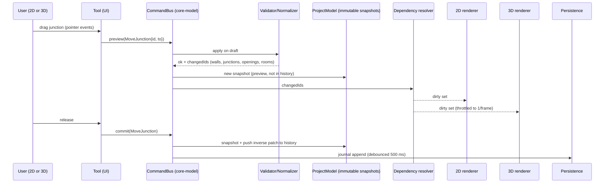

# Document 4 — 2D / 3D Engine & Synchronization Architecture

All content here is **PROPOSED** architecture for our product. It is not a description of Planner 5D's internals.

## 1. Coordinate systems & units

| Space | Units | Axes | Notes |
|---|---|---|---|
| Model (world) | integer **millimetres** | X right, Y "down the plan" (north = −Y), Z up | Stored values are integers; derived values (intersections, miter points) are float64 and never written back unless rounded deliberately |
| 2D screen | CSS pixels | x right, y down | `screen = (world − pan) × zoom` |
| 3D (Three.js) | metres | X = model X, **Y up = model Z**, Z = model Y | Conversion in one function `toThree(p) = (x/1000, z/1000, y/1000)`; scene root has no extra transforms |

Why integers: they make equality exact (snapping, junction sharing, hashing, undo identity) and avoid drift after thousands of edits.

```ts
const worldToScreen = (p: Vec2, v: View) => ({ x: (p.x - v.panX) * v.zoom, y: (p.y - v.panY) * v.zoom });
const screenToWorld = (s: Vec2, v: View) => ({ x: s.x / v.zoom + v.panX, y: s.y / v.zoom + v.panY });
// zoom about focal point f (pinch / wheel)
function zoomAt(v: View, f: Vec2, factor: number): View {
  const w = screenToWorld(f, v); const z = clamp(v.zoom * factor, 0.005, 2);
  return { zoom: z, panX: w.x - f.x / z, panY: w.y - f.y / z };
}
```

## 2. 2D geometry engine

### 2.1 Library evaluation for the 2D editor

| Option | Pros | Cons | Verdict |
|---|---|---|---|
| Canvas 2D (custom) | No dependency, full control of hit testing & draw order, fast for thousands of lines, easy to test with pure functions | Must write hit testing, dirty-rect logic | **Chosen** (ADR-005) |
| SVG | DOM hit testing free, crisp | DOM nodes per element slow on mobile with large plans; hard to control in WebView | Use only for export |
| Konva.js | Scene graph, events, drag | Its own object model duplicates ours → two sources of truth; dragging logic conflicts with constraint engine | Rejected |
| Fabric.js | Rich object editing | Designed for free-form graphics, not constraint CAD | Rejected |
| PixiJS | WebGL-fast 2D | Extra GPU context alongside Three.js on mobile (memory), text rendering complexity | Rejected for v1 |

The **geometry engine is custom regardless of renderer** — no library ships wall graphs with mitered junctions and room detection that we can trust and license for closed source (blueprint3d has a wall/corner model but is old and unmaintained; useful as reading reference only, check license first).

### 2.2 Data structures

```ts
type Id = string;                // ULID
interface Junction { id: Id; x: number; y: number }               // integer mm
interface Wall {
  id: Id; a: Id; b: Id;          // junction ids, a !== b
  thickness: number;             // mm
  height: number;                // mm
  sideMaterial: { left: Id; right: Id };  // left/right relative to a→b
}
interface Opening {              // door or window hosted by a wall
  id: Id; wallId: Id; kind: 'door' | 'window';
  offset: number;                // mm from wall.a along centreline to opening centre
  width: number; height: number; sill: number;   // mm
  flipX: boolean; flipY: boolean; // hinge side / swing direction
  assetId: Id;
}
interface Room { id: Id; floorId: Id; boundary: Id[]; /* ordered junction ids */ name: string; type: string; ceilingHeight: number; floorMaterial: Id }
```
Derived (never stored): `WallGeometry` (4–6 footprint vertices after mitering), `RoomPolygon` (interior polygon), adjacency maps.

### 2.3 Wall graph invariants (validated after every command)

| # | Invariant | Failure if violated |
|---|---|---|
| I1 | Every wall's junctions exist; `a ≠ b` | Dangling refs → crash |
| I2 | Wall length ≥ 10 mm | Degenerate miters, NaN normals |
| I3 | No two walls share both endpoints (duplicate) | Z-fighting, double rooms |
| I4 | Walls intersect only at shared junctions (graph is **planar**) | Room detection wrong |
| I5 | No two junctions closer than 1 mm | Snapping ambiguity |
| I6 | Collinear overlapping walls are merged/split so they don't overlap | Double geometry |
| I7 | Every opening lies within `[margin + w/2, len − margin − w/2]` and openings on one wall don't overlap | Holes outside wall |

The **normalizer** enforces I3–I6 after each wall-changing command: it is the most important (and most test-heavy) function in the project.

### 2.4 Normalization (planarization) algorithm

```
function normalize(model, touchedWallIds):
  candidates = touchedWallIds ∪ walls whose bbox overlaps touched walls (spatial grid index)
  repeat until no change:
    for each pair (w1, w2) in candidates with overlapping bboxes:
      r = segmentIntersect(w1, w2)        // exact via float64, then rounded to integer mm
      case r.type:
        'none': continue
        'point-interior-both':            // X crossing
            j = getOrCreateJunction(round(r.p))
            split(w1, j); split(w2, j)
        'point-at-endpoint-of-one':       // T-junction: endpoint of w2 lies on interior of w1
            split(w1, existingJunctionOf(w2))
        'collinear-overlap':
            merge into minimal set of non-overlapping walls; keep the older wall id for the
            longest piece (stable identity for undo/materials); re-host openings by world position
    merge junctions closer than 1 mm (keep older id), drop walls shorter than 10 mm
    (re-host their openings or reject the command if an opening would be lost)
  return changed ids
```
Rounding to integer mm after intersection can move a point by ≤ 0.5 mm, which can create new tiny overlaps; the loop terminates because each iteration either reduces walls-crossing count or merges junctions (bounded). Add an iteration cap (e.g. 20) that **rejects the command** rather than corrupting the model.

Robust predicate: orientation test `orient(a,b,c) = (b−a)×(c−a)` on integers is exact in float64 while |coords| < 2^26 mm (~67 km), which we guarantee by limiting plan extent to ±1 000 m.

### 2.5 Junction mitering (wall footprint)

For each junction, sort incident walls by angle. For each consecutive pair (w_i, w_{i+1}) in CCW order, intersect the **left offset line of w_i** with the **right offset line of w_{i+1}** (both measured outward from the junction). That point becomes a footprint corner shared by both walls.

```
function wallFootprints(junction):
  ws = incidentWalls(junction) sorted by angle of direction pointing away from junction
  if ws.length == 1:  // free end
     cap with square end at junction
  for i in 0..n-1:
     A = ws[i], B = ws[(i+1) % n]
     p = intersectLines(offsetLine(A, +A.thickness/2), offsetLine(B, -B.thickness/2))
     if p is null (parallel) or |p − junction| > MITER_LIMIT (e.g. 3 × max thickness):
        p = fallback bevel: use the two offset endpoints at junction (adds a small triangle fill)
     A.cornerLeftAt[junction] = p; B.cornerRightAt[junction] = p
```
Edge cases: walls of different thickness at a T (works by the same rule), very acute angles (miter limit → bevel), 180° straight continuation (parallel offsets → shared point is the offset endpoint), 3+ walls at a junction (central polygon filled by "junction cap" polygon = convex hull of corner points ∪ junction).

### 2.6 Room detection (faces of a planar graph)

```
function detectFaces(graph):
  build half-edges: for each wall (a,b) create h(a→b), h(b→a)
  for each vertex sort outgoing half-edges by angle
  next(h: u→v) = the outgoing half-edge at v that is immediately clockwise from twin(h) (v→u)
  traverse unvisited half-edges following next() → cycles
  compute signed area of each cycle (on junction centrepoints)
  faces with positive area (CCW, per our y-down convention verify sign in tests) = interior faces
  discard the single unbounded outer face per connected component
  discard faces whose area < 0.25 m² (configurable) → not rooms
  return faces as ordered junction-id cycles
```
- Dangling walls (dead ends inside a room) appear twice in a cycle; that's allowed (room with a partition stub).
- Holes (a free-standing room inside another, not connected) are separate components: the inner component's outer face becomes a hole in the containing room → handle with point-in-polygon containment between components.
- **Room interior polygon** = offset the junction cycle inward by each wall's half-thickness (use the mitered footprint corners from §2.5 rather than a generic polygon offset → consistent with 3D).
- **Area** shown to user = area of the interior polygon (shoelace), in m² with 2 decimals; documented as "carpet area (inside walls)".

### 2.7 Room identity across edits (keeping names/materials)
After any change, recompute faces and match new faces to old rooms:
1. Exact match on junction-cycle set → same room id.
2. Otherwise match by maximum polygon overlap (IoU ≥ 0.5) → inherit id and properties.
3. A split room: largest piece keeps the id, other gets a new id copying properties.
4. A merge: the larger old room's id survives.
Unmatched old rooms are deleted; this happens inside the same command so undo restores them exactly.

### 2.8 Openings
- Position is parametric (`offset` along host wall), so moving a junction moves openings with the wall automatically.
- When wall length changes: keep `offset` ratio if `keepRelative` else keep absolute offset from `a`; then clamp to I7; if it cannot fit, the command fails with "Door no longer fits on wall".
- When a wall is split by normalization: re-host the opening to the piece that contains its centre; if it straddles the split junction → reject the edit (or move the junction? no — reject; explicit is better).

### 2.9 Snapping
Priority order (first hit within tolerance wins; tolerance is in **screen px** so it feels the same at any zoom):
1. Existing junction (12 px)
2. Point on existing wall centreline (8 px) → creates T-junction
3. Extension/alignment guides: same X or Y as another junction (6 px), shown as dashed line
4. Angle snap of the segment direction (every 15°) with length unchanged
5. Grid (grid size adapts to zoom: 10 / 50 / 100 / 500 / 1000 mm)
Result is always rounded to integer mm.

### 2.10 Hit testing
Spatial hash grid (cell 1 000 mm) of walls, junctions, openings, furniture footprints. Pick order: junction handles > openings > furniture (OBB test, top-most first) > walls (distance to centreline ≤ thickness/2 + 4 px) > rooms (point in polygon).

### 2.11 Editing interactions
| Action | Mouse/keyboard | Touch |
|---|---|---|
| Draw wall | click points, Esc/double-click to end, type length + Enter | tap points with loupe offset; "Done" button |
| Select | click | tap |
| Multi-select | Shift+click, drag marquee | long-press "Select mode" then taps |
| Move | drag | drag (after 150 ms hold to avoid conflict with pan) |
| Rotate furniture | handle drag, R = +15°, Shift = free | rotate handle; two-finger rotate only on selected furniture |
| Delete | Del | trash in context menu |
| Undo/redo | Ctrl+Z / Ctrl+Shift+Z | buttons in toolbar |
| Precise values | property panel | bottom sheet with numeric keypad |

During drags we apply **preview transactions** (not pushed to undo stack) and commit one command on release. Preview runs normalization only for affected walls; full validation on commit.

### 2.12 What needs custom code vs libraries

| Piece | Custom | Library |
|---|---|---|
| Vectors, segment intersection, orientation | Custom (small, tested) | — |
| Wall graph, normalizer, mitering, faces, room identity | **Custom** | none suitable |
| Polygon triangulation (floors, ceilings) | — | `earcut` (ISC) or Three.js `ShapeUtils` (uses earcut) |
| Polygon boolean/offset (only if needed for advanced features) | — | Clipper2 port (verify license of chosen JS port) |
| Spatial index | Custom grid (simple) or `rbush` (MIT) | |
| Property-based testing | — | `fast-check` (MIT) |

### 2.13 Failure scenarios to test (feeds Doc 8)
Drawing a wall exactly over another; T-junction onto wall with a door at that point; dragging a junction across another wall (must split, not cross); closing a loop with 0.4 mm gap (must snap/merge); 1-mm wall; 179.9° nearly straight junction; 5 walls at one junction; deleting a wall that splits a room; undo after normalization merged walls; very large coordinates; NaN input from bad numeric parse.

## 3. 3D engine

### 3.1 Engine comparison

| Criterion | Three.js | Babylon.js | React Three Fiber | Unity | Godot |
|---|---|---|---|---|---|
| License | MIT | Apache-2.0 | MIT | Proprietary (runtime fee terms changed over time — verify) | MIT |
| Web/WebView fit | Excellent, small | Excellent, larger bundle | Wraps Three.js | Web export heavy (WASM, large download) | Web export exists, large; mobile web weaker |
| Shares code with 2D web editor | Yes (same TS app) | Yes | Yes | No (C#, separate app) | No (GDScript/C#) |
| Proven in this product category | Yes — Planner 5D job ad cites Three.js (Doc 1 §1.7); blueprint3d | Yes (many configurators) | Same as Three.js | Yes (native apps) | Less |
| Claude Code suitability | Very high (huge corpus, stable API) | High | High, but declarative layer adds lifecycle subtleties for imperative incremental updates | Medium (editor-centric, scenes are binary/YAML, hard to test headless) | Medium |
| Mobile perf | Good if budgets respected | Good | Same as Three.js + React reconcile overhead | Best native perf | Good native |
| **Verdict** | **Chosen** (ADR-006) | Strong alternative | Use for UI-only overlays at most | Reject for v1 | Reject for v1 |

### 3.2 Scene graph

```
Scene
 ├─ Lights: HemisphereLight (ambient), DirectionalLight "sun" (+ shadow on Mid/High)
 ├─ Floor_<floorId>  (Group, y = floor elevation)
 │   ├─ Walls  (Group) → one Mesh per wall (merged per-material groups on Low tier)
 │   ├─ Floors (Group) → one Mesh per room
 │   ├─ Ceilings (Group, hidden in orbit "doll-house" mode)
 │   ├─ Openings (Group) → door/window GLB instances
 │   ├─ Furniture (Group) → GLB instances / InstancedMesh for repeated items
 │   └─ Electrical (Group, v1.1) → small icons/meshes
 ├─ Helpers: selection outline, grid, measurement labels (CSS2D or sprite)
 └─ Camera (Perspective) + controls (Orbit | Walk)
```
Each mesh has `userData.entityId` for picking and incremental updates.

### 3.3 Wall mesh generation (no CSG)
Openings are cut by building the wall **face as a 2D shape with rectangular holes** on the wall's local (length, height) plane, then extruding through thickness using the mitered footprint for the ends:

```
function buildWallMesh(wall, footprint, openings):
  // local frame: u along a→b (0..L), v up (0..H), w across thickness
  outer = rectangle(0,0,L,H)
  holes = openings.map(o => rect(o.offset - o.width/2, o.sill, o.width, o.height))
  front = triangulate(outer, holes)            // earcut
  back  = same, offset by thickness, using footprint corners for left/right ends (mitered)
  sides = quads for: top edge, mitered end faces, and the 4 reveal faces of each hole
  uv: u,v in metres × material.scale  (world-scale texture so tiles don't stretch)
  groups: front=leftMaterial, back=rightMaterial, top/reveals=wall-edge material
```
Because ends use the same footprint corners as the 2D drawing (§2.5), 2D and 3D always agree. Avoiding CSG libraries keeps it fast (< 1 ms per wall, target to be measured) and deterministic.

Floors: triangulate room interior polygon (earcut) at room floor elevation; ceilings at `ceilingHeight`, normals flipped. Skirting boards (later) are extrusions along the interior polygon.

### 3.4 Materials & lighting
- `MeshStandardMaterial` (PBR metal/rough) everywhere; material library entries = {baseColor, map (KTX2), normalMap (optional, Mid/High only), roughness, metalness, uvScale}.
- Lighting: Hemisphere + Directional sun; optional environment map (small 256 px PMREM from a neutral studio HDR, CC0 from Poly Haven — verify license per asset) on Mid/High.
- Tone mapping ACESFilmic (or AgX if available in the chosen Three.js version), sRGB output.
- Anti-aliasing: MSAA via WebGL2 `antialias: true` on Desktop/Mid; off on Low with pixel ratio 1.
- Light fixtures in v1 are **visual only** (emissive material); real per-fixture lights are expensive on mobile — at most 0–2 dynamic point lights on High.

### 3.5 Performance techniques
| Technique | Where |
|---|---|
| `InstancedMesh` for repeated catalog items (chairs) | Furniture with ≥ 3 copies |
| Geometry merging per material for static walls on Low tier | Walls/floors |
| LOD: catalog assets ship LOD0 (≤ 20k tris) and LOD1 (≤ 3k tris) + 2D icon | Asset pipeline |
| KTX2/Basis textures (GPU-compressed) | All textures |
| Meshopt / Draco geometry compression | GLB delivery |
| Frustum culling (Three default) + room-based visibility in walk mode | Large plans |
| Render on demand (only when something changed or camera moved) | Battery |
| Dispose geometry/material/texture on removal; ref-counted asset cache | Memory |

### 3.6 Navigation
- **Orbit**: OrbitControls with limits: polar angle ≤ 85° (no under-floor), distance 1–200 m, target clamped to plan bbox. Touch: one finger rotate, two finger pan/zoom.
- **Walk**: eye height 1 600 mm; on-screen joystick (touch) / WASD; collision against 2D wall segments with radius 250 mm (cheap 2D circle-vs-segment test; door openings excluded from colliders); no physics engine needed.
- Camera transitions animated ≤ 400 ms; respect `prefers-reduced-motion`.

### 3.7 Asset pipeline
```
source (GLB/FBX/OBJ from licensed source)
 → tools/asset-pipeline: gltf-transform
     - validate (glTF-Validator: 0 errors)
     - normalize: metres, Y-up, origin at bottom-centre of footprint, facing −Z (front)
     - weld, simplify to LOD0 ≤ 20k tris, LOD1 ≤ 3k tris
     - textures → KTX2 (UASTC for normal maps, ETC1S for colour), max 1024/2048
     - meshopt compress
     - render thumbnail (headless Three.js) 256×256 webp
     - compute footprint (W,D,H) mm
 → upload to R2 under content-hash path (immutable caching)
 → catalog.json entry {id, name_en, name_hi, category, tags, dims, lods[], thumb, license{source,url,type,attribution}, tier: free|premium}
```
Every asset must have a license record; build fails without it (AST-01).

### 3.8 Realistic performance targets & assumptions
See PRD-NFR-001..006. Assumptions: sample project size as defined; Chrome-based Android System WebView current version; no other heavy apps open. **Unvalidated** until Phase 0 benchmark; if Low device fails, fallback is reduced pixel ratio, no normal maps, merged walls, and finally "2D-first mode" with on-demand 3D snapshots.

## 4. Single source of truth & synchronization

### 4.1 Principle
There is exactly one mutable thing: the **ProjectModel** inside `core-model`. 2D and 3D are pure projections of it. Neither renderer stores authoritative data; they keep *caches* keyed by entity id + entity revision.



### 4.2 Command pattern
```ts
interface Command { type: string; apply(draft: Draft): void }        // uses Immer-style draft
interface CommitResult { ok: boolean; errors?: ValidationError[]; changed: Set<Id>; patches: Patch[]; inverse: Patch[] }

function execute(cmd: Command, model: ProjectModel): CommitResult {
  const [next, patches, inverse] = produceWithPatches(model, d => { cmd.apply(d); normalize(d, touched(d)); recomputeRooms(d); });
  const errors = validateAll(next, affected(patches));
  if (errors.length) return { ok: false, errors, changed: new Set(), patches: [], inverse: [] };
  commitSnapshot(next); history.push({ cmd: cmd.type, patches, inverse });
  return { ok: true, changed: idsFromPatches(patches), patches, inverse };
}
```
Undo = apply `inverse` patches; redo = apply `patches`. Because normalization and room recomputation happen **inside** the command, their effects are part of the patch, so undo restores the exact prior state (including merged walls and room ids). Immer (MIT) provides `produceWithPatches`.

### 4.3 Dependency graph (what to rebuild)
| Changed entity | Also dirty |
|---|---|
| Junction | incident walls → their openings; walls of neighbouring junctions (miters); rooms touching |
| Wall | its two junctions' incident walls (miters), openings, adjacent rooms (floor/ceiling polygons) |
| Opening | host wall mesh, opening instance |
| Room props | room floor/ceiling mesh |
| Furniture | that instance only |
| Material definition | all meshes using it (material swap only, no geometry rebuild) |

### 4.4 Renderer update loop
```
on changed(ids):
  dirty ∪= expand(ids)                  // §4.3
  scheduleFrame()
frame():
  for id in dirty:
    e = model.get(id)
    if !e: removeAndDispose(id)
    else if cache[id].rev !== e.rev: rebuild(id)
  dirty.clear(); render()
```
Each entity has `rev` (incremented in the command). A **consistency check** in dev/test builds compares `hash(model-derived geometry)` with `hash(rendered geometry)` after each frame (SYNC tests).

### 4.5 Example: user drags a wall in 2D (the 8 steps)
1. Tool computes new junction positions for both endpoints (parallel move) → `MoveWall` preview.
2. Normalizer splits/merges if the wall now crosses another; incident walls' miters recomputed (derived).
3. Rooms recomputed; identity matched (§2.7); validator checks invariants I1–I7.
4. Openings on moved/resized walls re-clamped; failure → preview shows red and commit will be refused.
5. Dirty set → 3D rebuilds only those walls, neighbours, floors/ceilings of affected rooms, and opening instances.
6. Room area labels update in 2D from derived polygons.
7. On release: commit → history push → journal append → autosave snapshot (debounced).
8. Undo applies inverse patches → same dirty-set mechanism restores both views.

### 4.6 Preventing 2D/3D inconsistency
- Renderers have no write API to the model (enforced by package boundaries).
- Both renderers consume the **same derived geometry functions** (footprints, room polygons) from `geometry/`.
- Deterministic derivation: same model JSON → same derived output (tested by hashing).
- Snapshot tests: load fixture → render headless → compare entity-level geometry hashes.

## 5. Persistence & recovery
- Snapshot (full JSON, gzip) every 30 s of activity or 50 commands; journal (commands as patches) between snapshots.
- On start: load latest snapshot + replay journal; if replay fails validation, open last good snapshot and keep the broken file in `recovery/` for support.
- Writes are atomic: write to temp key/file then rename/swap pointer.

## 6. Electrical layer (differentiator, v1.1)
Entities `ElectricalPoint {id, roomId?, wallId?, kind: switchboard|socket|light|fan|ac|db, position, height, circuitId?}`. Wall-hosted points use (wallId, offset, height) like openings, so they move with walls. Export: per-room counts → simple bill of quantities (link to shop catalogue later). **No load calculations or code compliance claims in v1** (liability).

## 7. User flows (Part J)

For each flow: entry → screens → actions → system response → loading/error → recovery → success.

| # | Flow | Key details |
|---|---|---|
| F1 | First-time onboarding | Splash → 3 swipe cards (draw, furnish, 3D) → "Try: draw your first room" interactive coach marks → done. Skip always visible. Success: room created (PRD-FR-038). |
| F2 | Create blank project | Project list → "+" → name & units sheet → editor (2D). Error: storage full → message + "free space" help. |
| F3 | Create a room | Room tool → drag rectangle or enter W×D → room created with 4 walls, label & area. |
| F4 | Draw custom walls | Wall tool → taps with loupe → length bubble updates live → type exact length → close loop → room auto-detected (toast "Room added: 12.4 m²"). Error: invalid geometry → wall turns red, tooltip reason. |
| F5 | Precise dimensions | Select wall → bottom sheet: length, thickness, height; "Which end moves?" toggle (a / b / both). |
| F6 | Doors/windows | Catalog tab "Doors & Windows" → drag onto wall (highlights valid wall) → offset handles + numeric distance to nearest corner. Invalid → snaps back with message. |
| F7 | Add furniture | Catalog → search/categories → tap to place at view centre or drag → auto back-to-wall snap when near wall. Loading: thumbnail placeholder box until GLB loads. Error: download failed → retry icon; box stays. |
| F8 | Edit furniture dimensions | Select → sheet W/D/H (lock proportions toggle). |
| F9 | 2D → 3D | Phone: toggle button top-right; tablet/desktop: split view. Loading: walls appear instantly, furniture streams in. |
| F10 | Navigate 3D | Orbit by default; "Walk" button → joystick; exit returns to orbit. |
| F11 | Change materials | Select wall side/floor in 2D or 3D → material grid → applied instantly. |
| F12 | AI redesign (v2) | 3D view → "AI Style" → choose style → credit cost shown → consent (first time) → progress (≤ 60 s) → result gallery labelled "AI image, not your exact furniture" → save to gallery. Errors: timeout/refusal → no credit charged. |
| F13 | Save & reopen | Autosave indicator (cloud icon states: saved/saving/offline). Reopen from list; if recovery data exists → dialog "Restore unsaved changes?". |
| F14 | Duplicate project | List → ⋮ → Duplicate → "Copy of X" with new IDs. |
| F15 | Export | ⋮ → Export → PNG (free, watermark) / PDF (premium) → Android share sheet. |
| F16 | Upgrade | Paywall from premium item/feature → plan comparison → Play Billing sheet → success → entitlement refresh. Error: pending purchase → "Processing" state; cancelled → back to editor unchanged. |

Responsive layouts: **Phone portrait** — full-screen canvas, bottom toolbar, bottom-sheet properties, 2D/3D toggle. **Tablet/landscape** — left tool rail, right properties panel, optional split 2D|3D. **Desktop web** — same as tablet plus keyboard shortcuts and hover states.
