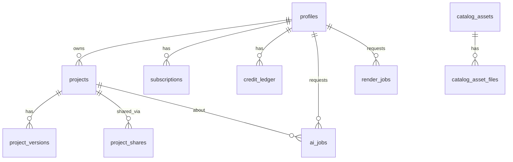

> **Superseded (2026-10-11):** the combined Claude + Codex document [`combined-research.md`](combined-research.md) is now the main reference. This file is kept as history. Electrical planning has been removed from the product scope by owner decision.

# Document 5 — Data Models & API Contracts

## 1. Where data lives

| Data | Store | Format | Reason |
|---|---|---|---|
| Project content (walls, rooms, furniture…) | Device (primary) + object storage (cloud copy) | JSON document, gzip, `schemaVersion` | Edited as a whole, offline-first, can be MBs |
| Edit journal (since last snapshot) | Device only | append-only JSON lines of patches | Crash recovery |
| Users, projects metadata, versions index, sharing, subscriptions, AI jobs, render jobs | Postgres (Supabase) | Relational | Queries, permissions, billing |
| Catalog metadata | Static `catalog.json` on CDN (+ mirrored table for admin) | JSON | Cacheable, versioned |
| Catalog binaries (GLB, KTX2, thumbnails) | R2 + CDN, device cache | Binary, content-hash paths | Immutable caching |
| Thumbnails, exports, AI uploads/results | Object storage (per-user prefix) | Binary | Large |
| UI prefs, last-opened project, quality tier | Device local storage | key/value | Per-device |

## 2. Canonical project document (TypeScript)

The JSON Schema is `docs/examples/project.schema.json`; the full example is `docs/examples/sample-project.json` (2 rooms, 7 walls incl. an interior partition that forms two T-junctions at j2 and j5 with different wall thicknesses (230/115 mm), 2 doors, 2 windows, 4 furniture items, 2 ceiling lights; electrical points removed 2026-10-11). Both are validated in Doc 8 test DM-01.

```ts
export interface ProjectDoc {
  schemaVersion: 1;
  id: Id; name: string; units: 'metric' | 'imperial';
  createdAt: string; updatedAt: string; revision: number;   // revision increments on every cloud save
  floors: Floor[]; junctions: Junction[]; walls: Wall[]; openings: Opening[];
  rooms: Room[]; furniture: FurnitureItem[]; materials: MaterialDef[];
  lights: Light[]; cameras: CameraPreset[];
}
export interface Floor { id: Id; name: string; level: number; elevation: Mm; defaultWallHeight: Mm }
export interface Junction { id: Id; floorId: Id; x: Mm; y: Mm }
export interface Wall { id: Id; floorId: Id; a: Id; b: Id; thickness: Mm; height: Mm; leftMaterial: Id; rightMaterial: Id; rev: number }
export interface Opening { id: Id; wallId: Id; kind: 'door'|'window'|'opening'; assetId: Id; offset: Mm; width: Mm; height: Mm; sill: Mm; flipX: boolean; flipY: boolean; rev: number }
export interface Room { id: Id; floorId: Id; boundary: Id[]; name: string; type: RoomType; ceilingHeight: Mm; floorMaterial: Id; rev: number }
export interface FurnitureItem { id: Id; floorId: Id; assetId: Id; position: {x: Mm; y: Mm}; elevation: Mm; rotationDeg: number; size: {w: Mm; d: Mm; h: Mm}; materialOverrides: Record<string, Id>; groupId?: Id; rev: number }
export interface MaterialDef { id: Id; name: string; baseColor: `#${string}`; textureAssetId?: Id; uvScaleMm?: Mm; roughness: number; metalness: number }
export interface Light {            // lighting entity (renders as emissive fixture; real light only on High tier)
  id: Id; floorId: Id; kind: 'point'|'spot'|'strip'|'ambient'; position: {x: Mm; y: Mm}; height: Mm;
  lumens: number; colorTempK: number; castsShadow: boolean; fixtureAssetId?: Id; rev: number }
export interface CameraPreset { id: Id; name: string; mode: 'orbit'|'walk'; position: [Mm, Mm, Mm]; target: [Mm, Mm, Mm] } // model frame, z up
type Mm = number; // integer millimetres

// Catalog-side entities (not inside the project document)
export interface TextureAsset { id: Id; url: string; sha256: string; widthPx: number; heightPx: number;
  colorSpace: 'srgb'|'linear'; tileSizeMm: Mm; license: LicenseRecord }
export interface CatalogAsset { id: Id; category: string; nameEn: string; nameHi?: string; dims: {w: Mm; d: Mm; h: Mm};
  lods: {lod: 0|1; url: string; bytes: number; sha256: string; tris: number}[]; thumbUrl: string;
  tier: 'free'|'premium'; materialSlots: string[]; license: LicenseRecord; version: number }
export interface LicenseRecord { source: string; url: string; type: 'CC0'|'CC-BY'|'MIT-asset'|'purchased'|'commissioned'|'own';
  attribution?: string; commercialUse: boolean; redistributionInApp: boolean; checkedOn: string }
export interface SharingPermission { id: Id; projectId: Id; granteeUserId?: Id; linkTokenHash?: string;
  role: 'viewer'|'commenter'|'editor'; createdAt: string; revokedAt?: string }   // v1 uses 'viewer' links only
export interface RenderJob { id: Id; userId: Id; projectId: Id; revision: number; cameraId: Id;
  quality: 'draft'|'hd'|'4k'; status: 'queued'|'running'|'succeeded'|'failed'|'canceled';
  outputUrl?: string; costUsdMicros?: number; createdAt: string; finishedAt?: string } // reserved; no server renders in v1
```

Notes:
- **Rooms are stored** (for names/properties) but their `boundary` is re-derived after each wall edit (Doc 4 §2.6–2.7); a load-time check verifies the stored boundary equals the derived one (repairs + logs if not).
- `rev` per entity drives incremental 3D rebuild.
- Transforms: furniture uses position + rotation about Z + size (no general 4×4 matrices). Simpler, exact, sufficient for floor-standing and wall-mounted (elevation) items.

### 2.1 Validation rules (beyond JSON Schema)
Referential integrity (every id reference resolves), invariants I1–I7 (Doc 4 §2.3), consecutive room boundary junctions joined by a wall, opening offsets within host wall, unique ids, floor elevations strictly increasing with level. Implemented as `validateProject(doc): ValidationError[]` in `core-model`; run on load, before save, after every command (affected subset).

### 2.2 Demonstration: the example round-trips
Expected derived values for `sample-project.json` (computed by the check script used to write this doc, rectangle rooms, inset by half wall thickness):

| Room | Interior area |
|---|---|
| r_living | 20.6422 m² |
| r_bed | 15.8722 m² |

Required automated proof (Doc 8 DM-01..04): load → validate (0 errors) → serialize → byte-identical canonical JSON → apply `MoveJunction(j2 → x 4600)` → bedroom area decreases, living increases, both doors still valid → undo → canonical JSON identical to original → build 3D scene headless → 7 wall meshes, 2 floor meshes, 4 opening instances.
**These tests do not exist yet; they are written in Phase 0/1.** Only the schema/integrity check has been run so far.

## 3. Relational schema (Postgres / Supabase)



```sql
create table profiles (
  id uuid primary key references auth.users(id) on delete cascade,
  display_name text, locale text default 'en', units text default 'metric' check (units in ('metric','imperial')),
  created_at timestamptz default now(), deleted_requested_at timestamptz
);

create table projects (
  id text primary key,                         -- same id as ProjectDoc.id (ULID)
  owner_id uuid not null references profiles(id) on delete cascade,
  name text not null check (length(name) between 1 and 120),
  schema_version int not null,
  revision int not null default 0,
  storage_path text not null,                  -- projects/{owner}/{id}/r{revision}.json.gz
  thumbnail_path text,
  size_bytes int, floor_count int, room_count int,
  created_at timestamptz default now(), updated_at timestamptz default now(),
  trashed_at timestamptz
);
create index on projects (owner_id, updated_at desc) where trashed_at is null;

create table project_versions (
  project_id text references projects(id) on delete cascade,
  revision int, storage_path text not null, created_at timestamptz default now(),
  created_by uuid references profiles(id), label text,
  primary key (project_id, revision)
);

create table project_shares (
  id uuid primary key default gen_random_uuid(),
  project_id text references projects(id) on delete cascade,
  token text unique not null,                  -- random 128-bit, url-safe
  role text not null check (role in ('viewer','commenter','editor')),  -- v1 issues 'viewer' only
  grantee_user_id uuid references profiles(id),                    -- null = link share
  created_at timestamptz default now(), revoked_at timestamptz
);

create table subscriptions (
  user_id uuid references profiles(id) on delete cascade,
  platform text check (platform in ('google_play','web')),
  product_id text not null, purchase_token_hash text not null,
  status text check (status in ('active','grace','on_hold','paused','canceled','expired')),
  expires_at timestamptz, updated_at timestamptz default now(),
  primary key (user_id, platform, product_id)
);

create table credit_ledger (                   -- append-only
  id bigint generated always as identity primary key,
  user_id uuid references profiles(id) on delete cascade,
  delta int not null, reason text not null,    -- 'monthly_grant','purchase','ai_job','refund'
  ref_id text, created_at timestamptz default now()
);
create index on credit_ledger (user_id, created_at);

create table ai_jobs (
  id uuid primary key default gen_random_uuid(),
  user_id uuid references profiles(id) on delete cascade,
  project_id text references projects(id) on delete set null,
  kind text check (kind in ('plan_recognition','restyle_image','furnish_suggest')),
  status text check (status in ('queued','running','succeeded','failed','canceled')),
  input_path text, output_path text, provider text, model text,
  cost_usd_micros bigint, credits_charged int default 0,
  error_code text, created_at timestamptz default now(), finished_at timestamptz,
  delete_after timestamptz default now() + interval '30 days'
);
create index on ai_jobs (user_id, created_at desc);
create index on ai_jobs (status) where status in ('queued','running');

create table render_jobs ( -- reserved for future server renders; not in v1
  id uuid primary key default gen_random_uuid(), user_id uuid references profiles(id) on delete cascade,
  project_id text references projects(id) on delete cascade, status text, output_path text,
  created_at timestamptz default now()
);

create table catalog_assets (
  id text primary key, category text not null, tags text[], name_en text, name_hi text,
  w_mm int, d_mm int, h_mm int, tier text check (tier in ('free','premium')),
  license_source text not null, license_url text not null, license_type text not null, attribution text,
  version int not null default 1, published boolean default false
);
create table catalog_asset_files (asset_id text references catalog_assets(id), lod int, url text, bytes int, sha256 text, primary key (asset_id, lod));
create table texture_assets (
  id text primary key, url text not null, sha256 text not null, width_px int, height_px int,
  color_space text check (color_space in ('srgb','linear')), tile_size_mm int,
  license_source text not null, license_url text not null, license_type text not null, attribution text
);
```

**RLS (must exist before any client access):**
```sql
alter table projects enable row level security;
create policy own_projects on projects for all using (owner_id = auth.uid()) with check (owner_id = auth.uid());
-- same pattern for project_versions (via join), subscriptions/credit_ledger/ai_jobs (select only; writes via service role in edge functions)
```
Storage bucket `projects`: path prefix must equal `auth.uid()`.

## 4. Device storage
- Web/WebView: IndexedDB database `gharplan` with stores `projects` (key id → gzip blob + meta), `journal` (key [projectId, seq]), `assetCache` (Cache Storage for GLB/KTX2).
- Android: consider Capacitor Filesystem for project blobs if IndexedDB eviction is observed (WebView storage can be cleared by user/OS; verify behavior in Phase 0 — RISK).
- Request persistent storage (`navigator.storage.persist()`) where supported.

## 5. API contracts (Edge Functions, JSON over HTTPS, JWT auth)

| Method & path | Request | Response | Errors |
|---|---|---|---|
| `GET /projects` | — | `[{id,name,revision,updatedAt,thumbnailUrl}]` | 401 |
| `POST /projects/:id/save` | `{baseRevision, doc(gzip base64) \| uploadUrlUsed:true}` | `{revision}` | 409 `{serverRevision}` → client creates conflicted copy; 413 too large; 422 validation errors |
| `GET /projects/:id` | — | signed URL to latest blob + meta | 403/404 |
| `POST /projects/:id/duplicate` | `{name}` | `{id}` | — |
| `DELETE /projects/:id` | — | soft delete (trash 30 days) | — |
| `POST /shares` | `{projectId}` | `{url}` | 403 |
| `POST /billing/google/verify` | `{productId, purchaseToken}` | `{entitlements:[...], expiresAt}` | 400 invalid token |
| `POST /ai/jobs` | `{kind, projectId?, inputUploadPath, params}` | `{jobId, creditsReserved}` | 402 insufficient credits; 429 rate limit |
| `GET /ai/jobs/:id` | — | `{status, result?, error?}` | — |
| `DELETE /account` | — | `{scheduledFor}` | — |

Save protocol: client uploads blob to signed URL `projects/{uid}/{id}/r{n}.json.gz`, then calls `save` which atomically checks `baseRevision == revision` and bumps it (single SQL `update … where revision = $base returning revision`).

## 6. Versioning & migration
- `schemaVersion` integer in every document. Migrations: `migrations/v1_to_v2.ts` exporting `(doc: V1) => V2`, pure, with fixture tests (old fixture in → expected new out).
- App can read all previous versions; writes only the latest. Never write a newer schema to the cloud from an older client: server rejects `schemaVersion > supported`, older apps show "Update app to open this project".
- Project versions: keep last 20 revisions per project (Premium: 100); older pruned by scheduled function.
- Catalog: assets immutable by content hash; `catalog.json` has `catalogVersion`; projects store `assetId`, and removed assets fall back to a placeholder box with dimensions preserved.
