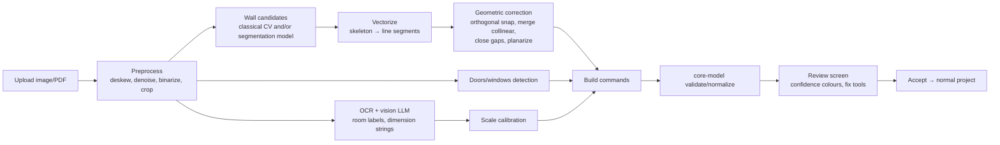

> **Superseded (2026-10-11):** the combined Claude + Codex document [`combined-research.md`](combined-research.md) is now the main reference. This file is kept as history. Electrical planning has been removed from the product scope by owner decision.

# Document 6 — AI Architecture & Feasibility

**Bottom line:** AI is **not** part of the MVP. It is added in Phase 6 only after the core editor works and after a cost/quality spike (Doc 7 Phase 6 gate). No accuracy numbers are claimed anywhere in this document — they must be measured on our own test set.

## 1. Two different problems

| | Visual AI | Structural AI |
|---|---|---|
| Output | A picture (pixels) | Editable, measurable entities (walls in mm, furniture with ids) |
| Example | "Show my room in Scandinavian style" | "Turn this builder's plan image into walls/doors" or "Place a bed and wardrobe in this room" |
| Correctness | Subjective; may hallucinate furniture, change wall positions | Must satisfy geometry invariants exactly (Doc 4 §2.3) |
| Typical tech | Diffusion / image-generation models | Vision models + structured output + **deterministic geometry post-processing + human correction** |
| Failure mode | Pretty but not buildable; users may believe it matches their real furniture | Wrong wall length silently breaks every later decision |

Planner 5D's own products follow this split (Doc 1 §2.4, verified 2026-10-11):
- **Visual:** AI Studio resells third-party image and video models (Nano Banana, GPT Image, Seedream, FLUX, Kling, Veo…) on a credit balance.
- **Structural:** floor-plan recognition takes **10 min–24 h**, accepts only clean top-down plans (no sketches or perspective photos) and cannot be cancelled once started. Together with the round-1 B2B page mentioning designer review, this suggests a human in the loop (INFERRED).
- **Structural AI they already ship:** Smart Wizard, AI Designer and **Copilot**, which turns text instructions into editable projects. NL editing is therefore not unique to us.

**Rule for our product:** structural AI output is never applied directly. It becomes ordinary commands that pass the same validator/normalizer as user edits, and the user confirms on a review screen.

## 2. AI floor-plan recognition (PRD-FR-031)

### 2.1 Pipeline


### 2.2 Stages

| Stage | Approach (PROPOSED) | Notes / risk |
|---|---|---|
| Preprocess | OpenCV (Apache-2.0): grayscale, adaptive threshold, deskew via Hough angle histogram, remove small components (text) | Phone photos of paper plans have perspective → ask user to crop 4 corners (perspective transform) |
| Wall detection v1 | Classical: thick dark strokes → morphology open/close → distance transform → skeleton → Hough/LSD segments | Works on clean CAD prints; fails on hand sketches and textured scans. Cheap, runs server-side in Python |
| Wall detection v2 | Segmentation model trained on **our own consented/licensed plans** | **CubiCasa5K is CC BY-NC 4.0 (non-commercial) — it cannot be used to train a model for this commercial app** (VERIFIED, LICENSE file). It may be used only for private, non-commercial experiments, if at all. Needs GPU hosting or a managed endpoint |
| Doors/windows | v1: gaps in walls + arc symbols (template matching); v2: object detector | Arc symbols vary by country/drafter |
| OCR/dimensions & labels | Vision LLM with structured JSON output: list of room labels with approximate pixel positions, dimension strings ("12'6\"", "3600") with bounding lines | LLMs can misread digits — always show to user |
| Scale calibration | (a) user drags a ruler over a known wall and types its length (always available); (b) auto: match OCR'd dimension to detected wall pixel length, require ≥ 2 consistent dimensions (ratio spread ≤ 2%) | Without calibration, output is unusable — calibration step is mandatory |
| Geometric correction | Snap angles within ±3° to 0/90°; merge collinear segments with gap < wall thickness; extend endpoints to meet within tolerance; quantize to 10 mm; then our normalizer | Deterministic, unit-testable |
| Confidence | Per wall: support ratio (pixel coverage along segment), whether it's in a closed room, OCR agreement | Displayed as green/amber/red |
| Human review | Overlay of original image under detected walls at 50% opacity; tools: delete, add, drag; "Looks right" button | Correction effort is the real product metric |

### 2.3 Metrics to measure (no values assumed)
- Wall F1 at 100 mm tolerance against hand-labelled ground truth (our own 50–100 plans, consent obtained).
- Room count accuracy; area error % after calibration.
- **Median user correction time** and number of edits (key metric — target set after baseline).
- Failure rate (no usable output).

## 3. AI interior design

| Feature | Type | Approach | Risk |
|---|---|---|---|
| Style restyle image (PRD-FR-032) | Visual | Send 3D screenshot (+ optional depth/edge map) to image model with style prompt; return image(s) | Result won't match catalog furniture → label clearly "inspiration image" |
| Photo-based redesign | Visual | Same with user's room photo | Privacy (photos of homes); consent + deletion |
| Furnish suggestion (PRD-FR-033) | Structural | LLM proposes items from **our catalog ids** with rough placement as JSON (schema-constrained); then a deterministic **layout solver** fixes positions: against walls, clearances (door swing, 600 mm walkways), no overlaps; reject/skip items that don't fit | LLM spatial reasoning is unreliable → solver is the real engine |
| Natural-language commands ("make the bedroom wall blue", "add a 2-seater sofa") | Structural | LLM with tool definitions mapping to our commands (`setWallMaterial`, `placeFurniture`…); strict schema; user sees a preview + undo | Ambiguity → ask clarifying question in UI |
| Material/style suggestions | Light | Rule-based palettes first (free), LLM later | Low |

Layout solver sketch:
```
for item in proposal sorted by size desc:
  candidates = sample positions along room walls (back-to-wall) + room centre options, 4 rotations
  score = Σ penalties(overlap, door-swing intrusion, window blocking for tall items, walkway < 600 mm)
          + preference(LLM hint distance, item-type rules e.g. bed headboard on solid wall)
  place best candidate if penalties == 0 else skip and report "Could not fit X"
```

## 4. Technology options

| Need | API options (examples) | Self-hosted options | Recommendation |
|---|---|---|---|
| Vision + structured JSON (OCR labels, furnish proposals, NL commands) | Anthropic Claude (Sonnet/Haiku tiers), Google Gemini API, OpenAI | Open-weight VLMs on rented GPU | API first (no GPU ops for a solo founder) |
| Image generation / restyle | Google image models (Imagen / Gemini image), OpenAI image API, Stability AI | SDXL / FLUX variants on GPU (check each model license for commercial use) | API first; evaluate 2–3 on 20 test rooms |
| Wall segmentation | Few hosted options | PyTorch model on GPU serverless | Start classical CV; only train if correction time is too high |
| Classical CV | — | OpenCV in a Python container (Cloud Run / Fly.io / Supabase isn't suited for heavy Python) | Yes |

#### 4.0 Self-hosted model licenses (VERIFIED from LICENSE files, 2026-10-11)
| Model / library | Use | License | Usable in our closed-source paid app? |
|---|---|---|---|
| OpenCV | Preprocessing, lines, morphology | Apache-2.0 | Yes (keep NOTICE) |
| Tesseract | OCR of dimension text | Apache-2.0 | Yes |
| SAM 2 (Meta) | Interactive segmentation / annotation help | Apache-2.0 | Yes (code); check checkpoint terms at download |
| RT-DETR | Door/window symbol detection | Apache-2.0 | Yes |
| Ultralytics YOLO | Detection | **AGPL-3.0** | **Avoid** unless buying their commercial license (AGPL can force source disclosure of a networked service) |
| CubiCasa5K dataset | Training data | **CC BY-NC 4.0** | **No** commercial use |

Provider rate limits are per account and tier. They are shown in each provider's console and are **not** published as one number, so read them at integration time and set our own per-user limits below them.

### 4.1 Cost per request (official prices read 2026-10-11; per-request totals are estimates)

| Item | Price basis | Source / status |
|---|---|---|
| Claude Sonnet 5.5 | $2 / M input tokens, $10 / M output tokens | VERIFIED Anthropic pricing page (V09) |
| Claude Haiku 5.5 | $0.10 / M input, $0.50 / M output (prompts ≤ 100K tokens) | VERIFIED (V09) |
| Claude Opus 5.5 | $4 / M input, $20 / M output | VERIFIED (V09) |
| Gemini Nano Banana 2.1 (image) | **$0.0336 per 1K image**, $0.0504 per 2K, $0.113 per 4K (standard); half price on Batch | VERIFIED Gemini API pricing page (V07). Free tier: "Used to improve our products: Yes"; paid: No → **use paid tier for user photos** |
| Gemini older Flash Image | $0.039 per 1024×1024 image | VERIFIED (V07) |
| OpenAI gpt-image models | priced per 1M tokens (e.g. gpt-image-2 image output $15/M tokens) | VERIFIED page (V08); per-image cost depends on size/quality — **not converted**, use their calculator |

Worked estimate, floor-plan OCR/labels with Sonnet 5.5: assume ~5k input tokens (image + instructions; real image token count depends on resolution — measure with the token counting endpoint) and ~3k output tokens → 5,000×$2/1M + 3,000×$10/1M ≈ **$0.04 per plan** (+ CV compute, small). Restyle: 4 images × $0.0336 ≈ **$0.13 per request** (Nano Banana 2.1, 1K, standard; ≈ $0.07 on Batch if 24 h delay is acceptable). These are planning numbers only.

**Important for Raghvendr:** ChatGPT Plus and Gemini Pro *consumer* subscriptions do not give you API access for an app; API usage is billed separately on each provider's developer platform. Use the subscriptions for research/prototyping prompts, not as the app's backend.

### 4.2 Reliability, latency, privacy, limits
- Latency: target ≤ 60 s for image jobs, ≤ 20 s for structured calls; async job model with polling/push, cancel button.
- Rate limits: per-user (e.g. 10 AI jobs/hour) + global budget circuit breaker (daily $ cap → disable AI with message).
- Failure handling: retries with backoff for 429/5xx (max 2); schema-validate every structured response; invalid → one repair retry → fail gracefully; **credits charged only on success**.
- Refusals/safety blocks from providers → treat as failed job, no charge, generic message.
- Privacy: explicit consent screen before first upload; images stored in private bucket, auto-deleted after 30 days (`ai_jobs.delete_after`); do not send account identifiers to providers; check each provider's data-use terms (training opt-out) before choosing.
- Abuse: only images; size ≤ 10 MB; strip EXIF location before sending.

## 5. Credit system
Credits decouple price from provider cost. Each job kind has a credit price reviewed monthly against measured cost (`ai_jobs.cost_usd_micros`). Premium includes N credits/month (N set after cost measurement); packs sold as in-app products. Ledger is append-only (Doc 5 `credit_ledger`); reservation on job start, finalization on success, release on failure.

## 6. Validation strategy for AI features (gates)
1. Offline eval set: 50 plans (clean CAD, scanned, phone photo, hand sketch) + 30 room screenshots, labelled.
2. Run each candidate pipeline; record metrics in §2.3 + cost + latency.
3. Ship only if: (a) structural outputs pass validator 100% (guaranteed by design), (b) median correction time is lower than drawing from scratch for the same plan (measure both), (c) cost per job × expected usage fits the subscription margin (Doc 9).
4. A/B the restyle feature as a paid-credit feature before bundling into Premium.
