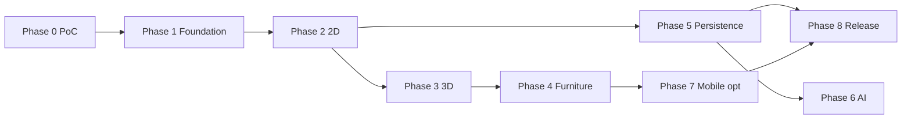

# Document 7 — Claude Code Implementation Roadmap

## 0. How to read effort estimates
Two numbers per phase: **E** = focused days for an experienced web/3D engineer; **B** = calendar estimate for Raghvendr working with Claude Code part-time with no coding background. B is a rough planning guess (≈ 3–5× E), not a measurement. If any phase takes more than 2× its B estimate, stop and get expert help (Doc 9 §6).

## 1. Repository structure (created in Phase 1)
```
/                      pnpm workspace, TypeScript strict, ESLint (import boundaries), Prettier
packages/geometry      pure math + wall graph + faces + mitering        (Vitest + fast-check)
packages/core-model    entities, commands, validation, serialization    (Vitest)
packages/render-2d     Canvas2D renderer + hit testing
packages/render-3d     Three.js scene builder
packages/catalog       catalog types, loader, cache
packages/persistence   IndexedDB store, journal, sync client
apps/web               React + Vite app (also Capacitor web dir)
apps/android           Capacitor Android project
server/supabase        migrations, RLS, edge functions
tools/asset-pipeline   gltf-transform scripts
fixtures/              sample projects incl. docs/examples/sample-project.json
e2e/                   Playwright tests
CLAUDE.md              rules for Claude Code (below)
```

### 1.1 CLAUDE.md rules (to create in Phase 1)
- Never modify project data outside `core-model` commands.
- Every geometry function gets unit tests + at least one property-based test.
- Integers in mm in the model; float only in derived data.
- Run `pnpm check` (lint + typecheck + tests) before every commit; never commit failing tests; never skip/disable tests.
- Small PRs: one task ID per branch/commit.
- Don't add dependencies without recording license in `docs/10-decision-register.md`.

## 2. Phases

### Phase 0 — Proof of concept (validate the riskiest assumptions)
**Objectives:** prove RISK-01 (geometry), RISK-02 (WebView 3D performance), RISK-06 (context loss), and local-save durability.
**Dependencies:** none. **E:** 8–12 days. **B:** 4–8 weeks.

| Task | Description | Test |
|---|---|---|
| T-0.1 | Monorepo skeleton (only `geometry`, `core-model`, `apps/web`), CI with lint/typecheck/test | CI green |
| T-0.2 | `geometry`: vec ops, orientation, segment intersection (incl. collinear), wall graph, normalizer (split/merge), mitering, face detection, interior polygon, area | GEO-01..10 |
| T-0.3 | `core-model`: types per Doc 5, `validateProject`, commands `AddWall`, `MoveJunction`, `DeleteWall`, `AddOpening`, `AddFurniture`, undo/redo via patches | SYNC-06, DM-01..04 |
| T-0.4 | Minimal Canvas2D view: draw walls, drag junctions, show room areas | UX-04 (manual) |
| T-0.5 | Minimal Three.js view: walls with door/window holes (§3.3 Doc 4), floors, orbit controls, incremental rebuild by dirty set | SYNC-01, SYNC-03 |
| T-0.6 | Perf harness page: loads sample + a generated 200-wall/1 000-box plan; logs fps, frame time p95, draw calls, JS heap | PERF-01..03 |
| T-0.7 | Capacitor Android debug build; run harness on Low + Mid devices; record results in `docs/benchmarks/phase0.md` | PERF-01..03, REN-07 |
| T-0.8 | IndexedDB save/load + kill-app test | REL-01 |

**Exit gate (all required):** geometry suite passes incl. 10 000-case property tests; undo/redo identity; 3D ≥ 24 fps on Low device for the sample project, or a documented fallback decision; context-loss recovery works; benchmark evidence (screen recordings + logs) committed. **If the Low device fails badly (< 15 fps), revisit ADR-006/007 before Phase 1.**

Example Claude Code prompt (T-0.2):
> Implement `packages/geometry` per docs/04-2d-3d-architecture.md §2.3–2.6. Integer-mm inputs. Write Vitest unit tests for every function and fast-check property tests: (1) after `normalize`, no two walls intersect except at shared junctions; (2) face detection on random planar rectangle grids returns exactly the grid cells; (3) area of axis-aligned rooms equals hand-computed value. Include the failure scenarios in §2.13 as named tests. Don't change the docs. Run `pnpm test` and show me the output. Explain any test you could not make pass instead of weakening it.

### Phase 1 — Project foundation
**E:** 5–8 days. **B:** 2–4 weeks. Deps: Phase 0 gate.
Tasks: T-1.1 full package layout + import-boundary lint; T-1.2 React shell (routes: project list, editor, settings) with Zustand UI store; T-1.3 i18n (en/hi) scaffolding; T-1.4 error boundary + Sentry (env-gated); T-1.5 Playwright setup + first E2E (create project); T-1.6 CLAUDE.md; T-1.7 schema migrations framework (Doc 5 §6).
Tests: UX-01, UX-02, UX-11. Exit: E2E green in CI; bundle-size budget check in CI (initial JS ≤ 600 KB gz excluding Three.js chunk — target, adjust with evidence).

### Phase 2 — Core 2D editor
**E:** 15–25 days. **B:** 2–4 months. Deps: Phase 1.
Tasks: T-2.1 tools state machine (select, wall, room-rect, opening, pan); T-2.2 snapping (Doc 4 §2.9) with guides; T-2.3 dimension labels + numeric entry; T-2.4 property panel/bottom sheet; T-2.5 openings drag along wall with constraints; T-2.6 multi-select, delete, copy; T-2.7 touch gestures + loupe; T-2.8 units display/parse; T-2.9 room naming/types/ceiling height; T-2.10 PNG export of 2D plan.
Tests: GEO-01..15, UX-03..09, SYNC-06. Exit: all Must 2D FRs pass; manual usability check with 3 non-technical people (record time to draw a 2-room plan).

### Phase 3 — Real-time 3D
**E:** 10–15 days. **B:** 1–3 months. Deps: Phase 2 (can overlap after T-2.5).
Tasks: T-3.1 scene builder per Doc 4 §3.2; T-3.2 wall mesh with holes & miters; T-3.3 floors/ceilings; T-3.4 materials (KTX2 loader); T-3.5 orbit constraints; T-3.6 walk mode + 2D collisions; T-3.7 quality tiers + GPU probe; T-3.8 context loss handling; T-3.9 selection/picking in 3D → same commands; T-3.10 3D screenshot export.
Tests: SYNC-01..05, REN-01..07, PERF-02..03. Exit: sync tests green; perf targets on reference devices.

### Phase 4 — Furniture & materials
**E:** 10–15 days (+ asset sourcing time). **B:** 1–3 months. Deps: Phase 3.
Tasks: T-4.1 asset pipeline scripts (Doc 4 §3.7); T-4.2 license register + CI check; T-4.3 catalog UI (categories, search, thumbnails, premium badge); T-4.4 place/move/rotate/resize; T-4.5 back-to-wall snap; T-4.6 collision warnings; T-4.7 instancing; T-4.8 material library for walls/floors; T-4.9 source 100 MVP items (CC0 + Sweet Home 3D catalog models verified per item + commissioned/purchased as needed).
Tests: AST-01..03, SYNC-02, SYNC-04, GEO-11, GEO-15. Exit: 100 items with license records; all load ≤ 2 s on Mid over 4G (measured).

### Phase 5 — Persistence, accounts, cloud
**E:** 10–15 days. **B:** 1–2 months. Deps: Phase 2 (local), Phase 4 for thumbnails.
Tasks: T-5.1 journal + snapshot + recovery dialog; T-5.2 project list ops (duplicate, rename, trash); T-5.3 Supabase project, migrations, RLS; T-5.4 Google sign-in; T-5.5 cloud save protocol with conflicted copies; T-5.6 version list/restore; T-5.7 account deletion; T-5.8 offline queue.
Tests: REL-01..06, SEC-01..05. Exit: RLS tests prove user A cannot read user B's data; kill/offline tests pass.

### Phase 6 — AI capabilities (only after feasibility spike)
**E:** spike 5 days, build 15–30 days. **B:** 2–4 months. Deps: Phase 5.
Tasks: T-6.0 **spike**: eval set + 2–3 providers, measure cost/latency/quality (Doc 6 §6) → go/no-go doc; T-6.1 AI job queue + credits ledger; T-6.2 restyle image; T-6.3 plan recognition (classical CV + LLM labels) + review screen; T-6.4 furnish suggestion + layout solver; T-6.5 NL commands.
Tests: AI-01..08. Exit: Doc 6 §6 gates met; cost per job logged.

### Phase 7 — Mobile optimization
**E:** 8–12 days. **B:** 1–2 months. Deps: Phases 3–5.
Tasks: T-7.1 profiling on Low device; T-7.2 merge static geometry, texture downscale tier; T-7.3 memory disposal audit (heap snapshots before/after 50 open/close cycles); T-7.4 touch UX polish, haptics; T-7.5 back-button handling (Android); T-7.6 storage persistence verification; T-7.7 offline asset cache.
Tests: PERF-01..07, REN-06, REL-04. Exit: NFR table met on reference devices.

### Phase 8 — Monetization & release
**E:** 8–12 days. **B:** 1–2 months. Deps: all prior Musts.
Tasks: T-8.1 Play Billing integration (plugin/RevenueCat) + server verification + Real-time developer notifications; T-8.2 entitlements gating; T-8.3 AdMob banners (non-editor screens) + consent (UMP) where required; T-8.4 paywall screen with clear renewal terms; T-8.5 analytics events; T-8.6 privacy policy, data safety form, content rating; T-8.7 closed testing track (current tester rule) ; T-8.8 store listing (screenshots, Hindi + English); T-8.9 release checklist.
Tests: MON-01..05, SEC-*, full regression. Exit: PRD §19 release criteria.

## 3. Dependency order

MVP release = Phases 0–5 (local-only subset of 5) + 7 + 8. AI (Phase 6) comes after first release.

## 4. Where Claude Code typically produces plausible-but-wrong code (watch list)
| Area | Typical defect | Mitigation |
|---|---|---|
| Segment intersection / collinear cases | Ignores collinear overlap or endpoint-touching | Named tests + property tests |
| Face detection | Wrong turn direction → returns outer face as room or misses rooms; sign convention flipped with y-down | Grid property test; fixture with nested rooms |
| Mitering | Swapped left/right offsets for walls pointing into vs out of junction | Visual snapshot + numeric corner tests |
| Undo/redo | Normalization effects not captured → undo leaves split walls | Canonical JSON identity test after random sequences |
| Three.js memory | Not disposing geometries/materials/textures | Heap/`renderer.info` checks in perf harness |
| Touch handling | Pointer capture & multi-touch conflicts | Real-device manual checklist |
| Billing | Granting entitlement client-side without server verification | Server-side check, security review |
| RLS | Policies missing on new tables | Automated "every table has RLS" SQL test |
| Units | ft-in parsing errors (5'11", 5' 11, 5.5ft) | Table-driven tests |

Review protocol for every Claude Code task: (1) read the diff summary, (2) run `pnpm check`, (3) run the specific test IDs, (4) for UI, try it on a real phone, (5) ask Claude Code "what edge cases does this not handle?" and add tests for them.
