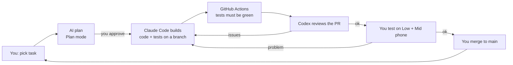

# Build Process Guide: building GharPlan with Claude Code and Codex

**Date:** 2026-10-11 · **For:** Raghvendr (no coding background) · **Based on:** [`combined-research.md`](combined-research.md); section numbers like §E.5 or task IDs like PH0-T02 refer to that document.

**Purpose:** a step-by-step process to build the app using AI coding agents. You act as the **product owner and tester**. Claude Code and Codex write the code. Tests, a second AI's review, your phone checks and a few paid expert reviews decide whether the code is accepted.

**Honesty first:**
- This process lowers the risk. It does **not** guarantee success.
- AI agents can write code that looks right but is wrong; Part 7 shows how we catch that.
- Times and costs are estimates, not promises.
- Tool features and plans change quickly. Facts marked VERIFIED were read on official pages on 2026-10-11; recheck them when you start.

---

## 0. Quick summary (Hinglish)

- **Kaun kya karega:**

  | Kaun | Kaam |
  |---|---|
  | **Aap** | Har task chunna, AI ka plan approve karna, phone par test karna, "merge" button dabana |
  | **Claude Code** | Main builder: code likhna aur tests chalana |
  | **Codex** | Doosra reviewer: Claude ke kaam ki galtiyan dhoondhna. Kuch alag, independent kaam bhi (test fixtures, asset scripts) |
  | **GitHub** | Code ka ghar. GitHub Actions har baar automatic tests chalayega aur Android APK banayega |

- **Har task ka chakkar (loop):**
  1. Task chuno.
  2. AI se plan maango.
  3. Plan padh kar "haan" bolo.
  4. AI code + tests likhe.
  5. Doosra AI review kare.
  6. Aap phone par check karo.
  7. Tests hare (green) hain to merge karo.

  Ek baar mein sirf **ek chhota task**. Kabhi "poora app bana do" mat bolna.
- **Shuruaat:** Phase 0 se karo. Deewar/kamre ka engine aur 3D test, 2 Android phones par. Agar Phase 0 fail ho, to aage mat badho. Pehle expert se baat karo.
- **Sabse zaroori niyam:** tests aur phone par result sach batate hain; AI ki baat aur screenshot nahi.
- **Samay:** part-time 9–19 mahine (estimate).

---

## 1. Roles and the big picture

| Role | Who | Responsibilities |
|---|---|---|
| Product owner + tester | You | Pick the next task, approve plans, test on two phones, decide merge, talk to users |
| Main builder | **Claude Code** | Implements one task at a time with tests; runs checks; opens a pull request (PR) |
| Second builder / reviewer | **Codex** | Reviews every Claude PR for bugs; writes **independent** test fixtures (so code is not checked only by its own author); takes separate, non-overlapping tasks (e.g. asset pipeline scripts) |
| Robot checker | **GitHub Actions** (CI) | On every PR: lint, type check, unit/property tests, build; later builds the Android APK/AAB |
| Paid experts (short) | Freelance geometry/3D dev, security reviewer | 1–2 day reviews at Phase 0, Phase 3 and before launch (§N.5: $500–3,000 total) |
| Real users | 10 people you interview + 12 closed testers | Tell you whether the app is useful (§Q.4) |

**Why two AI tools?**
- **Second opinion:** one model reviewing another's code catches different mistakes.
- **No usage gaps:** if one tool hits its usage limit, the other can continue.
- **Separate test author:** the combined research (Codex audit) warns that tests written by the same author as the code can share the same wrong assumption. Here Codex writes the geometry test fixtures and Claude writes the implementation.

**Rule:** never let both agents edit the **same files** at the same time. Each task has one owner (§5).



---

## 2. What you need (accounts, devices, money)

### 2.1 Accounts

| Account | Needed from | Cost | Notes |
|---|---|---|---|
| GitHub | Now (you have repo `raghvendrprajapat/Home-ai`) | Free | Code storage, PRs, Actions (free minutes for private repos are limited; check your plan's Actions minutes) |
| Claude plan with Claude Code | Now | See §2.3 | Main builder |
| ChatGPT Plus (you have) → **Codex** | Now | Included | VERIFIED: "Codex [is] included in your ChatGPT Free, Go, Plus, Pro, Business, Edu, or Enterprise plan"; Plus ($20/month): "Codex on the web, in the CLI, in the IDE extension, and on iOS", plus "automatic code review" integration. Usage is limited per plan (Codex pricing page, 2026-10-11) |
| Google Play Console | You have it | Already paid | Release from Phase 8; start closed testing early |
| Supabase | Phase 5 | Free for development; Pro $25/month at launch (§N.1) | Free projects pause after 1 week of inactivity |
| Cloudflare (R2) | Phase 4 | ≈ $0 at small scale | Catalog files |
| Sentry (or similar) | Phase 1 | Free tier | Crash reports |
| AdMob | Phase 8 | Free | Ads |

### 2.2 Devices

| Device | Why | Cost |
|---|---|---|
| A Windows/Mac laptop or desktop (8 GB+ RAM recommended) | Run Android Studio, USB-debug the phones, run the app locally. *Possible without it* (cloud agents + GitHub Actions build the APK), but performance debugging on phones needs a computer with Chrome | Existing |
| **Low** Android phone: Samsung Galaxy A0x or Redmi A-series (3–4 GB RAM) | The hardest test target (§F.6) | ≈ ₹7–10k (or borrow) |
| **Mid** Android phone: Samsung Galaxy A3x/A5x (6–8 GB RAM) | Main target | ≈ ₹20–30k (or borrow) |
| USB cable | Phone ↔ computer debugging | — |

### 2.3 AI tool costs and limits (check before starting)

- **Codex:** included with your ChatGPT Plus, with usage limits. Heavy use can run out; extra credits are possible (VERIFIED pricing page). Your exact weekly limit is shown in your account.
- **Claude Code:** needs a plan that includes it. Section 3.2 lists which plans do, from the official docs. Your current free Claude plan may not be enough for daily building.
- **Budget idea (estimate):** about $20/month each for Claude and ChatGPT during building. That is roughly ₹3,500/month for both, at an assumed ₹83/$ before GST; card/GST charges vary.
- **Tip:** do heavy implementation on one tool and reviews on the other, so neither hits its limit.

---

## 3. One-time setup (step by step)

### 3.1 GitHub (Day 1)
1. Open your repository `Home-ai` on github.com. The research docs are on branch `claude/planner5d-reverse-engineering-lvgvo9`.
2. Merge that branch into `main` (ask Claude Code to open the PR; you click **Merge**). From then on `main` holds the docs plus the code.
3. **Settings → Branches → add a rule for `main`:**
   - require a pull request before merging;
   - require status checks (CI) to pass.

   After that, nobody (not even an AI) can put broken code into `main` without you.
4. Create **Issues** for each task in Part 6 (e.g. "PH0-T02 geometry core"). Ask Claude Code to create them from this guide. Use labels `phase-0`, `claude`, `codex`, `needs-phone-test`.

### 3.2 Claude Code
VERIFIED from official Claude Code docs (code.claude.com), 2026-10-11:

- **Plans:** "The free claude.ai plan does not include Claude Code." You need a **Pro**, Max, Team, Enterprise or Console (API) account (setup page). Prices are on Anthropic's pricing page; check before paying.
- **Where it runs:**

  | Option | Notes |
  |---|---|
  | **Web: claude.ai/code** | Cloud sessions on Pro and above, connected to GitHub. Easiest for you; nothing to install |
  | **Desktop app (Code tab)** | Windows, macOS, Linux beta |
  | **VS Code extension** | VS Code 1.94+ |
  | **Terminal** | Windows PowerShell: `irm https://claude.ai/install.ps1 \| iex`; macOS/Linux/WSL: `curl -fsSL https://claude.ai/install.sh \| bash`. Then run `claude` inside the project folder |

  Native Windows works; WSL 2 adds sandboxing.
- **`CLAUDE.md`:** "A markdown file of instructions that Claude reads at the start of every session", kept at the repository root (or `.claude/CLAUDE.md`). `/init` can draft one. The docs advise keeping it short.
- **Plan mode:** press **Shift+Tab** until the status shows plan mode, or start a prompt with `/plan`. In plan mode Claude reads and proposes a plan but does not edit files; approving the plan lets it edit. Skip planning only for one-sentence changes.
- **Permission modes:**
  - **Stay in the default "Manual" mode as a beginner.** It asks before running commands or editing files.
  - Never use `bypassPermissions` on your own computer. The docs say "isolated containers and VMs only".
  - Use `/permissions` to pre-approve safe commands such as `pnpm check`.
- **Hooks:** shell commands that always run at fixed points, e.g. after every file edit, configured in `.claude/settings.json` (view with `/hooks`). We use one to run the linter/tests automatically (PH1-T01).
- **Context:**
  - `/clear` resets between unrelated tasks. The docs suggest it after two failed corrections on the same issue.
  - `/compact` summarizes a long conversation.
  - `Esc Esc` or `/rewind` goes back to an earlier state.
- **Review:** `/code-review` (alias `/review`) reviews your branch locally on all plans. The managed PR "Code Review" is Team/Enterprise only, so on Pro use `/code-review` plus **Codex** as reviewer.
- **GitHub Actions `@claude`:** optional, set up with `/install-github-app`. It needs an API key or `claude setup-token` saved as a GitHub secret. Not needed at the start.
- **Official best practice:** "Explore, plan, code, commit". Always give Claude a check it can run (tests, build).

**Recommendation:**
- Start with **claude.ai/code (web)** connected to `Home-ai`, Manual mode, plan mode for every task.
- Move to the desktop app or terminal when you need to run the app on your laptop and phone (Phase 0 task PH0-T07).


### 3.3 Codex (VERIFIED from official Codex docs, 2026-10-11)
- **Where it runs:** the ChatGPT desktop app, ChatGPT on the web, the Codex CLI, the Codex IDE extension and Codex Cloud.
- **Sign in:** with your ChatGPT account. "The first time you run Codex, choose Sign in with ChatGPT".
- **Install the CLI:** the Quickstart page has separate install options for macOS/Linux, **Windows**, npm and Homebrew. Follow it exactly; commands change between versions.
- **Instructions file:** "Codex reads AGENTS.md files before doing any work." It reads a global file in `~/.codex` and then the project's `AGENTS.md` files from the repository root down. We add an `AGENTS.md` to the repo (§4).
- **Simplest start for you:** use **Codex on the web (Codex Cloud)** connected to your GitHub repo. You ask it to review a PR or do a task, and it works in the cloud. Nothing is installed on your laptop.

### 3.4 Developer tools on your computer (needed from Phase 0 task PH0-T07; Claude Code can guide each install)

| Tool | Why | Note |
|---|---|---|
| Git | Get the code locally | — |
| Node.js LTS + pnpm | Run the web app and tests | Exact versions are pinned in the repo by PH0-T01 |
| Android Studio (includes the Android SDK; JDK as required by the Capacitor version) | Build and install the Android app | Large download |
| Google Chrome | `chrome://inspect` to debug the app running on your phone | — |
| On each phone | Settings → About phone → tap "Build number" 7 times → Developer options → enable **USB debugging** | — |

If you have **no computer**, ask Claude Code to add a GitHub Actions workflow that builds a debug APK on every PR. You download it on the phone from the PR page. Performance profiling then needs a borrowed computer or a paid expert session.

---

## 4. Rule files for the agents (created in PH0-T01)

Both agents must follow the same rules. Claude Code reads `CLAUDE.md`; Codex reads `AGENTS.md`. Keep the content identical: put the rules in `AGENTS.md` and make `CLAUDE.md` say the same, or have one file include the other. Ask Claude Code which mechanism the current versions support.

**Contents (copy into both files):**

```markdown
# Project rules for AI agents (GharPlan)

## Source of truth
- Product/engineering spec: docs/combined-research.md. Task IDs (PHx-Tyy), requirement IDs (PRD-FR/NFR),
  decisions (ADR) and tests (GEO/SYNC/...) come from there. If code and spec disagree, stop and ask.
- Scope exclusions: no electrical/wiring features; no marketing website pages; L0 walls are 0°/90° only.

## Architecture rules (never break)
1. Project data changes ONLY through core-model commands. Renderers (Konva 2D, Three.js 3D) never write the model.
2. Model stores integer millimetres. Floats only in derived data. Plan axes: X east, Y south (down), Z up.
   Three.js mapping: (x/1000, z/1000, y/1000); Three rotation.y = −θ.
3. document.revision = server revision only. localGeneration +1 on every edit/undo/redo, never reused.
   Async/worker results carry {projectId, sessionId, localGeneration, dependencyHash}; stale ones are dropped.
4. Every command is atomic: if validation fails, the model is unchanged.
5. No secrets (API keys, service keys, signing keys) in code, logs or the app bundle.
6. Every dependency: record name, version and license in docs/decisions/dependencies.md before adding.
   Never add GPL/AGPL code or non-commercial assets.

## Working rules
- One task ID per branch and PR. Do not refactor unrelated code.
- Before editing: list the failure modes and assumptions for this task; for anything non-trivial, show a plan first.
- Every geometry function: unit tests + at least one property-based test (fast-check). Use independent
  analytic expected values, not values produced by the same code.
- Run `pnpm check` (lint + typecheck + tests) before every commit. Never skip, delete or weaken a test to
  make it pass; if a test seems wrong, explain why and ask.
- Report actual command output. Screenshots are not evidence of geometry, saving or performance.
- At the end of a task, write a short "Owner summary" in simple English: what changed, how to test it on a phone,
  what is NOT done, known risks.
```

---

## 5. The task cycle (repeat for every task)

| Step | What you do | Who works | Done when |
|---|---|---|---|
| 1. Pick | Open the next issue from Part 6 (in phase order) | You | One task chosen |
| 2. Plan | Paste the task prompt (Part 6) into **Claude Code in plan mode** (§3.2). Read the plan. Ask: "Which tests prove this? What could go wrong? What is out of scope?" | Claude Code | You approve the plan |
| 3. Build | Let it implement on a new branch named after the task (e.g. `ph0-t02-geometry`) | Claude Code | It reports `pnpm check` output: all green |
| 4. PR | Ask it to open a pull request with an "Owner summary" | Claude Code | PR open; GitHub Actions green |
| 5. Review | In Codex: *"Review PR #N in raghvendrprajapat/Home-ai against docs/combined-research.md sections […] and AGENTS.md. List real bugs only, with file and line, and a failing test idea for each."* | Codex | Findings listed |
| 6. Fix | Paste Codex's findings into Claude Code: *"Verify each finding. Fix the real ones with a test; explain why the others are wrong."* | Claude Code | CI green again |
| 7. Phone test | Install the debug build on the Low and Mid phones; follow the "how to test" list in the Owner summary | You | Works as described |
| 8. Merge | Click **Merge** on GitHub; close the issue | You | `main` updated |

**Stop rules (protect your time and money):**
- If a task fails **3 times** on the same problem, stop. Ask the other AI for a fresh diagnosis. If it still fails, note it for the expert review.
- If a phase takes more than **2×** its estimate (Part 6), pause and get expert help (§L.1).
- Never merge with red CI. Never accept "the test was wrong, so I removed it" without your understanding and agreement.

**Context hygiene:**
- Start a **fresh session per task**, so old conversation does not confuse the agent.
- Point it at the exact spec sections instead of pasting the whole document.

---
## 6. Phase-by-phase playbook (with ready prompts)

**Before Phase 0 (1–2 weeks, no code):** talk to 10 people (§Q.4 item 1), screenshot INR paywalls, and try Planner 5D and Homestyler on your phones. Continue only if people show real interest. Write what you learned in `docs/user-research.md`; Claude can format your notes.

### 6.1 Standard task prompt (use for every task; fill the brackets)

```text
Task [PHx-Tyy]: [one-line title from the table below].
Spec: docs/combined-research.md sections [..]; requirements [PRD-FR/NFR ..]; decisions [ADR ..];
tests to make pass: [test IDs]. Follow CLAUDE.md / AGENTS.md.
First, in plan mode: list files you will create/change, the tests you will write (with independent
expected values), failure modes, and anything out of scope. Wait for my approval.
Then implement on branch [ph-x-tyy-name], run `pnpm check`, and open a PR with:
(1) actual test output, (2) an "Owner summary" in simple English: what changed, how I test it
on my phone step by step, what is not done, risks.
Do not change files outside this task. If something in the spec looks wrong, stop and ask.
```

**Standard review prompt (Codex):**
```text
Review PR #[N] in raghvendrprajapat/Home-ai for task [PHx-Tyy].
Check it against docs/combined-research.md sections [..] and AGENTS.md rules.
Report only real problems: file + line, why it is wrong, a concrete failing test case.
Specifically check: units (mm, degrees vs radians, Three.js mapping), atomic commands,
stale-result guard, missing edge cases from §E.13, tests that only repeat the implementation.
```

**Standard "explain to me" prompt (use any time):**
```text
Explain this PR to me as a shop owner with no coding knowledge: what can the app do now that it
could not before, how do I see it on my phone, and what could still go wrong?
```

Below:
- **Owner** = which AI does the task.
- **E/B** = experienced-engineer days / beginner calendar time for the phase (from §L.2).
- **"You check"** = what you personally verify.

### 6.2 Phase 0: proofs (E 8–12 days · B 4–8 weeks)

Goal: prove the hardest parts before building the product: the wall/room engine, 3D on cheap phones, undo, and saving.

| Task | Owner | Specific instruction (add to the standard prompt) | You check |
|---|---|---|---|
| PH0-T01 Repo skeleton + CI | Claude | "Create a pnpm monorepo with only `packages/geometry`, `packages/core-model`, `apps/web` (React + Vite, TypeScript strict). Add a GitHub Actions workflow running lint, typecheck, tests on every PR. Add CLAUDE.md and AGENTS.md with the rules in docs/build-process-guide.md §4. Add `docs/decisions/dependencies.md`. Pin Node LTS and the package manager." | PR shows a green CI check; `main` is protected |
| PH0-T02a Independent geometry fixtures (sub-task added by this guide) | **Codex** | "Write test fixtures ONLY (no implementation) for packages/geometry from combined-research §E.4–E.7, §H.6: the sample project, F-TWO-SQ (14.44 / 16.34 / 0.18 m²), T-junctions, rejected X-crossings and non-orthogonal walls, 0.4 mm closing gap, 9/10/11 mm segments, room split/merge cases. Expected values must be computed by hand/analytically and written as constants with the arithmetic in comments." | A list of fixture files with hand-calculated numbers |
| PH0-T02 Geometry core | Claude | "Implement packages/geometry per §E.4–E.7 (invariants I1–I8, normalizer with lineage, junction footprints with single ownership, half-edge faces, clear area, room identity E.8) so that Codex's fixtures from PH0-T02a pass unchanged. Add fast-check property tests: (1) after normalize no walls cross except at shared junctions, (2) random rectangle grids give exactly the grid cells as rooms, (3) area of rectangles equals the analytic value. L0 rejects X-crossings and non-orthogonal walls." | All GEO tests green; you read the Owner summary |
| PH0-T03 Core model + undo | Claude | "Implement packages/core-model per §G.2–G.3 and §H.2–H.3: types, validateProject, commands AddWall/MoveJunction/MoveWall/DeleteWall/AddOpening/AddFurniture, Immer patch undo/redo, localGeneration rules. Tests DM-001…004 using docs/examples/sample-project.json (MoveWall w7 +100 → 21.1192 / 15.3952 m²), SYNC-007 property test." | DM tests green |
| PH0-T04 Minimal 2D view | Claude | "In apps/web, a Konva canvas that draws the sample project from core-model, lets me drag a junction (one command on release, preview while dragging) and shows room areas. Konva state is never saved (ADR-002)." | On your laptop/phone browser: drag a corner, area changes, undo works |
| PH0-T05 Minimal 3D view | Claude | "Three.js view per §F.2–F.4, §G.4: walls with real door/window holes (no CSG), junction caps, floors, door thresholds, orbit controls, dirty-set rebuild, stale worker results discarded. Tests SYNC-001, SYNC-002, SYNC-006." | Toggle 3D: a hole exists where the door is; drag a wall in 2D → 3D follows |
| PH0-T06 Performance harness page | Claude | "A /perf page that loads the sample and a generated 200-wall / 100-object plan and logs fps, p95 frame time, draw calls, JS heap as downloadable JSON (§M.6)." | The page shows numbers |
| PH0-T07 Android build + phone benchmark | Claude (guides you) | "Add Capacitor Android. Give me exact step-by-step instructions to build, install on my phones via USB, open chrome://inspect, and run /perf both inside the app and in Chrome on the same phone. Create docs/benchmarks/phase0.md with a table I fill in." | **You** run it on Low and Mid, record a video, fill the table |
| PH0-T08 Local save + kill test | Claude | "IndexedDB + Capacitor Filesystem save/load per §D.13, journal + snapshot, recovery dialog. Give me a manual kill-app test script (REL-002)." | Kill the app 10 times while editing → reopens with the work |

**Phase 0 exit gate (all must be true):**
- [ ] GEO/DM/SYNC tests are green, including 10 000-case property tests.
- [ ] Low phone ≥ 24 fps on the sample in 3D. If it is below 15 fps, stop and read §F.6 fallbacks with the expert.
- [ ] WebGL context-loss recovery works (REN-007).
- [ ] Kill test passes.
- [ ] **Paid geometry/3D expert review (1–2 days):** give them combined-research §E–G and the PR links. Ask: "Are the junction, face and opening algorithms correct? What will break?"

### 6.3 Phase 1: foundation (E 5–8 d · B 2–4 weeks)

| Task | Owner | Specific instruction | You check |
|---|---|---|---|
| PH1-T01 Package layout + lint boundaries + hooks | Claude | "Add the remaining packages from §D.3 only when needed; ESLint import boundaries (geometry never imports UI); a Claude Code hook that runs lint after edits." | CI fails if rules are broken (ask for a demo PR) |
| PH1-T02 Schema, validator, migrations | Claude | "§H.3, §H.8: JSON Schema validation, migration framework with a v0→v1 fixture, future-version rejection. Tests REL-001, REL-005." | Green |
| PH1-T03 App shell + i18n | Claude | "React shell: project list, editor, settings; Zustand for UI state only; English + Hindi strings (no hard-coded text). Tests UX-002, UX-011." | Switch language to Hindi on the phone |
| PH1-T04 Persistence + status + JSON export/import | Claude | "Status 'in memory / saved on this phone'; export/import project file. Tests REL-001…003, REL-010." | Export a project, delete it, import it back |
| PH1-T05 Error boundary, Sentry, Playwright | Claude | "Global error boundary with 'Save a copy & reload'; Sentry (consent, no project data); first Playwright E2E." | Review: Codex checks that no personal data goes to Sentry |

**Hindi copy:**
- Ask ChatGPT to translate the UI strings.
- Then have a Hindi-speaking customer read them on the phone.

### 6.4 Phase 2: 2D editor (E 15–25 d · B 2–4 months)

| Task | Owner | Specific instruction | You check |
|---|---|---|---|
| PH2-T01 Transforms, zoom/pan, hit testing, touch + loupe | Claude | "§E.1, §E.11, §E.12; GEO-008, GEO-012, UX-004." | Pinch-zoom and tap on Low phone feel right |
| PH2-T02 Wall + room tools, rooms, names, carpet area | Claude | "§E.5–E.8; FR-004, FR-005, FR-009, FR-010." | Draw a 2-room home; areas match your tape |
| PH2-T03 Snapping, dimensions, numeric entry, units | Claude | "§E.10, §E.12.2; GEO-002, GEO-007, GEO-009, UX-005." | Type 3450 → it's 3450 |
| PH2-T04 Doors/windows | Claude; **Codex reviews with extra fixtures** | "§E.9; GEO-013…015. Codex: write extra opening fixtures for reverse/split/shrink first." | Door can't go past wall end; reverse keeps position |
| PH2-T05 Selection, multi-select, delete, duplicate | Claude | "§E.11; GEO-012, SYNC-009." | Duplicate a sofa, undo |
| PH2-T06 PNG export of plan | Claude | "FR-029; REN-006, UX-009." | Share PNG on WhatsApp |

**Exit:** 3 non-technical people (family or customers) draw a 2-room plan on your phone. Note how long it takes and where they got stuck. Give these notes to Claude as new issues.

### 6.5 Phase 3: 3D (E 10–15 d · B 1–3 months)

| Task | Owner | Specific instruction | You check |
|---|---|---|---|
| PH3-T01 Scene builder (walls, caps, floors, ceilings, thresholds) | Claude | "§F.2–F.4; SYNC-002, SYNC-004." | Doors are real openings; no gaps at corners |
| PH3-T02 Worker + dependency graph + stale guard | Claude; **Codex reviews** | "§G.4–G.5; SYNC-001, SYNC-006 with delayed-result fault injection." | Fast dragging never shows an old wall |
| PH3-T03 Orbit, presets, quality tiers, screenshot | Claude | "§F.6–F.7; REN-001, REN-006, REN-008." | Low phone picks Low tier |
| PH3-T04 Disposal + context loss | Claude | "REN-007, REN-009: 50 open/close cycles, memory back to baseline." | App stays smooth after long use |
| PH3-T05 Picking in 3D → commands | Claude | "SYNC-003 (rotation.y = −θ)." | Rotate sofa in 3D, 2D matches |
| PH3-T06 Walk mode (only if time) | Claude | "§F.7 swept collision; REN-002." | Can't walk through walls |

**Second expert review (half a day):** a 3D/mobile performance check on your benchmark videos.

### 6.6 Phase 4: furniture and materials (E 10–15 d + asset sourcing · B 1–3 months)

| Task | Owner | Specific instruction | You check |
|---|---|---|---|
| PH4-T01 Asset pipeline + license ledger CI | **Codex** (separate tool folder) | "tools/asset-pipeline per §D.12 with gltf-transform; CI fails if any catalog item lacks license fields (AST-001…003)." | A test item without license fails CI |
| PH4-T02 Catalog UI | Claude | "Categories, search, thumbnails, premium badge, lazy load, cancel; UX-007." | Search 'bed' on phone |
| PH4-T03 Place/move/rotate/size, back-to-wall, collision warn | Claude | "SYNC-003, GEO-018, GEO-019." | Sofa snaps to wall; overlap turns red |
| PH4-T04 Materials (per-side paint, floors) | Claude | "SYNC-005, REN-003." | Paint bedroom side; living side unchanged |
| PH4-T05 Source ~30 items | **You + ChatGPT/Perplexity** | Find CC0 models (e.g. Poly Haven, Sweet Home 3D catalog items, checked one by one); record source, license and link per item; Codex runs them through the pipeline | Every item has a license row |

### 6.7 Phase 5: accounts and cloud (E 10–15 d · B 1–2 months)

| Task | Owner | Specific instruction | You check |
|---|---|---|---|
| PH5-T01 Supabase project, migrations, RLS + test | Claude | "§H.4 SQL; RLS; SEC-001, SEC-009. Use a separate dev project. Tell me exactly which keys go where; never put the service key in the app." | You create the Supabase project; keys go into GitHub/Supabase secrets, **not** chat |
| PH5-T02 Google sign-in | Claude | "Native Google sign-in via Capacitor plugin → Supabase Auth (§D.10). SEC-002." | Sign in on phone |
| PH5-T03 Save RPC (CAS + receipts) + client queue | Claude; **Codex reviews + writes race tests** | "§H.5 exactly; REL-006 incl. lost-response retry." | Edit on 2 phones → conflict copy, nothing lost |
| PH5-T04 Conflict UI, versions, restore | Claude | "REL-007, REL-008." | Restore an old version |
| PH5-T05 Account deletion (in-app + web page) + export | Claude | "§O.3; REL-012. The web page is a single simple page (no website)." | Delete a test account |
| PH5-T06 Backup policy + restore drill | Claude guides; you run | "Write a step-by-step restore drill for me; REL-011." | Timed drill result written down |

**Security expert review (1 day)** before any public release that has accounts.

### 6.8 Phase 7: mobile optimization (E 8–12 d · B 1–2 months)

| Task | Owner | Specific instruction |
|---|---|---|
| PH7-T01 Profile Low phone, fix top costs | Claude (+ you running the profiler) | "Use my /perf results; change one thing at a time; re-measure the same fixture." |
| PH7-T02 Merge geometry, texture tiers, LRU | Claude | PERF-006 |
| PH7-T03 Memory audit | Claude | REN-009 |
| PH7-T04 Touch polish, back button, lifecycle | Claude | UX-004, REL-010 |
| PH7-T05 Offline asset cache, airplane mode | Claude | REL-004 |
| PH7-T06 Security + dependency review | **Codex** | SEC-007, SEC-008; license list check |

### 6.9 Phase 8: monetization and release (E 8–12 d · B 1–2 months)

| Task | Owner | Specific instruction | You do |
|---|---|---|---|
| PH8-T01 Play Billing + server verification | Claude | "ADR-018; MON-001…004; list the license-tester steps I must do by hand." | Add license testers in Play Console |
| PH8-T02 Paywall + entitlements | Claude | "Clear renewal terms; existing projects always openable/exportable." | Decide INR prices (from interviews) |
| PH8-T03 AdMob outside editor + consent | Claude | MON-005 | Create AdMob account/app |
| PH8-T04 Analytics events | Claude | §C.9; SEC-004 | — |
| PH8-T05 Privacy-policy page + deletion page + data safety + audience | Claude drafts | §O.3; get a short legal review (₹10k–50k estimate) | Fill Play Console forms |
| PH8-T06 Closed test 12 × 14 days | You | Start **early** (as soon as Phase 2 works), using friends and customers | Keep 12 testers opted in for 14 days |
| PH8-T07 Store listing Hindi + English | ChatGPT/Gemini for text & screenshots | Use only your own app screenshots | Upload |
| PH8-T08 Release checklist + rollback | Claude | §C.10 | Press "release" |

### 6.10 Phase 6: AI (only after the first release)

1. Start with PH6-T01 (spike): Claude writes the evaluation script.
2. You collect 20–60 consented plan photos.
3. Decide go/no-go from the numbers (§I.2, §I.8).
4. Check provider terms first. If you use Gemini, the app audience must be 18+ (§O.3).

---

## 7. How you check quality without reading code

| Check | How | Trust level |
|---|---|---|
| GitHub Actions | Green ✓ on the PR = all automatic tests passed. Red ✗ = do not merge | High (only as good as the tests) |
| Tests exist for the task | Ask: *"List the test IDs from combined-research you implemented and paste their output"* | High |
| Independent tests | Geometry/save tests written by **Codex**, implementation by **Claude** | Higher |
| Second-AI review | Codex review on every PR | Medium-high |
| Phone test | You follow the Owner summary on Low and Mid phones | High for usability |
| Numbers from phones | `/perf` page results in `docs/benchmarks/` | High |
| Expert review | Phase 0, Phase 3, before launch | Highest |
| A screenshot or "it works!" message | — | **Low**: never enough alone |

**Questions that expose weak work (ask the AI):**
- "What happens if the user [drags a wall through another wall / kills the app during save / loses internet]?"
- "Show me the test that fails if I remove this line."
- "Which edge cases from §E.13 are not covered yet?"
- "Did you change or delete any existing test? Why?"

---

## 8. Getting the app onto your phones

| Method | When | Steps |
|---|---|---|
| Browser (fastest) | Phases 0–2 | Ask Claude for a preview link or run `pnpm dev`; open the URL on your phone (same Wi-Fi) |
| Debug APK from GitHub Actions | Any time, no laptop needed | Ask Claude to add a workflow that builds a debug APK on each PR → download it from the PR's "Artifacts" → install (allow "unknown sources") |
| Android Studio + USB | Performance work (PH0-T07, Phase 7) | Phone in USB-debugging mode → Run → `chrome://inspect` on the laptop to see logs and profile |
| Play Console internal/closed track | From Phase 8 (closed test can start earlier) | Upload AAB; testers install from the Play link |

**Signing key (very important):** the app's upload key must be backed up in two safe places, such as a password manager and an offline USB drive. Use Google Play App Signing. If the key is lost, updating the app becomes very hard. Never commit it to GitHub; store it as a GitHub Actions secret if CI signs builds.

---

## 9. Safety rules (non-negotiable)

1. **Never paste secret keys into any AI chat** (Supabase service key, Play service account JSON, signing key passwords, AI provider keys). Put them in Supabase secrets or GitHub Actions secrets yourself; ask the AI only *where* to put them.
2. Keep Claude Code in Manual (default) permission mode. Read before approving commands that delete files, push to `main`, deploy or spend money.
3. The `main` branch is protected; everything goes through PRs.
4. Separate **dev** and **production** Supabase projects. AI agents only ever touch dev.
5. No paid API calls (AI providers) without spending caps set in each provider console first.
6. Licenses:
   - no GPL/AGPL code;
   - no assets without a license record;
   - nothing copied from Planner 5D (code, models, images, UI art).
7. Backups: GitHub holds the code; download a copy of the repo monthly; back up the signing key twice.

---

## 10. When to hire a human expert

| Trigger | Expert | What to ask | Budget (estimate) |
|---|---|---|---|
| End of Phase 0 (always) | Geometry/3D web developer | Review §E–G algorithms and the PRs; "what will break?" | 1–2 days |
| Low phone < 15 fps after fallbacks | Mobile WebGL performance dev | Profile and propose fixes or native-renderer path (ADR-009) | 1–2 days |
| Same bug survives both AIs and 3 attempts | Any senior TypeScript dev | Fix + explain + add test | Hourly |
| Before release with accounts/payments | Security reviewer | RLS, secrets, purchase verification, data deletion | 1 day |
| Privacy policy / terms | Lawyer | DPDP + Play requirements | ₹10k–50k |

Total planned: $500–3,000 for reviews (§N.5) plus optional hourly help. Find people through referrals, local colleges or freelance platforms. Ask for a small paid trial task first.

---

## 11. Troubleshooting

| Problem | What to do |
|---|---|
| AI says "done" but the feature doesn't work on the phone | Reply with exactly what you did and saw (a screen recording helps); ask it to write a failing test first, then fix |
| Tests keep failing after 2 tries | `/clear`, start a fresh session with the task prompt plus the failing output; or give the problem to Codex for a fresh diagnosis |
| AI wants to delete or weaken a test | Refuse unless it explains (simply) why the test is wrong and Codex agrees |
| Wall/room bugs keep returning | Ask Codex to minimize the failing case into a fixture; add it to the regression corpus; consider the expert |
| App slow on Low phone | Follow §F.6 degrade order; measure after each change; never "optimize" without before/after numbers |
| Usage limit reached on one AI | Switch tasks to the other AI (non-overlapping files) or do phone testing/user interviews that day |
| CI red on `main` | Stop new work; ask Claude to fix `main` first |
| You don't understand a PR | Use the "explain to me" prompt; don't merge what you can't test |
| Play Console rejects the app | Paste the rejection text into Claude; check §O.3 checklist |

---

## 12. Weekly routine and progress tracking

- **Each week (part-time; about 10–15 hours assumed):**

  | When | What |
  |---|---|
  | 2–3 sessions | 1–2 tasks through the full cycle (§5) |
  | 1 session | Phone testing + benchmark updates |
  | 1 short session | Update the GitHub issues; write a 5-line weekly note in `docs/progress.md` (done, blocked, next, time spent, money spent) |

- **Each phase end:** check the exit gate, write a 1-page summary, and get an expert review where planned.
- **Monthly:** recheck AI tool limits and vendor prices; back up the repo; ask 2–3 users for feedback.

**Overall timeline (estimate, part-time):**

| Stage | Calendar (B) |
|---|---|
| Validation (interviews) | 1–2 weeks |
| Phase 0 proofs | 4–8 weeks |
| Phase 1 foundation | 2–4 weeks |
| Phase 2 2D editor | 2–4 months |
| Phase 3 3D | 1–3 months |
| Phase 4 furniture | 1–3 months |
| Phase 5 cloud (optional for first release) | 1–2 months |
| Phase 7 mobile optimization | 1–2 months |
| Phase 8 release | 1–2 months (closed test overlaps) |
| **Total to Play Store** | **≈ 9–19 months** |

---

## 13. Your next steps (this week)

1. Do the 10 user interviews (§Q.4 item 1). This is the go/no-go for everything below.
2. Check Claude plan pricing (Claude Code needs Pro or above) and confirm Codex works in your ChatGPT Plus (open Codex on chatgpt.com and connect GitHub).
3. Arrange the Low and Mid test phones (buy or borrow).
4. Ask Claude Code: *"Merge the research branch into main, protect main, and create GitHub issues for all tasks in docs/build-process-guide.md Part 6."*
5. Start **PH0-T01** with the standard prompt (§6.1).
