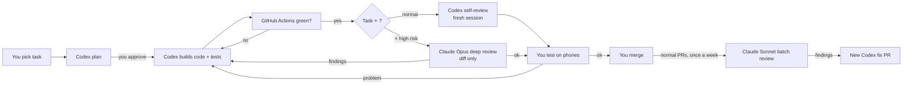

# Build Process Guide: building GharPlan with Codex (main) and Claude Code (specialist)

**Date:** 2026-10-11 (v4: D16 — Codex develops; Claude reviews only, supplies independent cases in PR comments and never pushes) · **Shared context:** [`../AGENTS.md`](../AGENTS.md) + [`codex-start-here.md`](codex-start-here.md), including the prompts to paste into Codex · **For:** Raghvendr (no coding background) · **Based on:** [`combined-research.md`](combined-research.md). Section numbers like §E.5 and task IDs like PH0-T02 refer to that document.

**Purpose:** a step-by-step process to build the app with AI coding agents.
- **Codex** does development, test implementation, fixture transcription and repository changes.
- **Claude Code** reviews only at selected points, replying in PR comments or chat; it does no development work and never pushes (D16).
- **You** are the product owner and tester.
- Tests, independent checks, your phone tests and a few paid expert reviews decide whether code is accepted.

**Honesty first:**
- This process lowers risk; it does **not** guarantee success. AI agents can write code that looks right but is wrong (Part 8 shows how we catch it).
- **There is no published, trustworthy head-to-head study that says "Codex is weak at X".** The Claude Code touchpoints below are not based on a proven Codex weakness. They are placed where the cost of a hidden bug is highest, so a *second, different* AI checking the work adds the most value. If Codex struggles with a type of task, record it (§13), request Claude's diagnosis and consider a human expert; Claude remains review-only.
- Times and costs are estimates. Tool features, plans and limits change often. Facts marked VERIFIED were read on official pages on 2026-10-11.

---

## 0. Quick summary (Hinglish)

- **Kaun kya karega:**

  | Kaun | Kaam |
  |---|---|
  | **Codex** (aapke ChatGPT Plus mein) | **Main builder.** Plan, code, tests, PR aur fixes; Claude ke fixture comment ko exactly copy karke source link dena |
  | **Claude Code** (kam limit) | **Sirf checker:** ⭐ deep review, weekly batch review, security review aur rescue diagnosis; independent cases/expected values PR comment mein. Code/files/PR development aur repo push kabhi nahi (D16) |
  | **Aap** | Task chunna, plan approve karna, phone par test, merge karna |
  | **GitHub Actions** | Har PR par automatic tests; Android APK banana |

- **Claude ki limit bachane ke niyam:**
  - Claude ko poora repo mat padhwao; sirf PR ka diff aur spec ke 1–2 sections do.
  - Har kaam ke liye nayi session; kaam khatam hote hi `/clear`.
  - Simple review ke liye lighter model (`/model sonnet`); bhaari soch ke liye hi bada model.
  - Codex 2 baar fail ho to Claude se sirf diagnosis lo; fixes Codex karega. Claude kabhi development ya push nahi karega.
- **Har task ka chakkar:**
  1. Codex plan banaye.
  2. Aap approve karein.
  3. Codex code + tests likhe.
  4. CI green ho.
  5. Codex khud verify kare (self-review). ⭐ task: Claude Opus ka gehra check, phir merge. Normal task: merge, aur hafte ke ant mein Claude Sonnet saare PRs ek saath check kare.
  6. Aap phone par test karein.
  7. Merge.
- **Andaza:** kul ~56 tasks mein se lagbhag 15 par Claude ki zaroorat (≈ har hafte 1–3 chhoti Claude sessions). Ye estimate hai; asal usage aapka plan/meter batayega.
- **Shuruaat:** pehle 10 logon se baat; phir Phase 0. Agar Phase 0 fail ho, to expert se baat karke hi aage badhein.
- **Samay:** part-time 9–19 mahine (estimate).

---

## 1. Roles

| Role | Who | Responsibilities |
|---|---|---|
| **Main builder** | **Codex** | Plans and implements development tasks with tests; opens/pushes PR branches; transcribes independent comment data exactly; fixes review findings; normal reviews (in a fresh session) |
| **Reviewer** (used sparingly) | **Claude Code** | §1.1 review touchpoints only; replies in PR comments or chat. No development, file edits, commits or pushes; independent case data is a PR comment |
| Product owner + tester | You | Pick tasks, approve plans, phone tests, merge, user interviews |
| Robot checker | GitHub Actions (CI) | On every PR: lint, typecheck, unit/property tests, build; debug APK |
| Paid experts (short) | Geometry/3D dev, security reviewer | Phase 0, Phase 3, pre-launch (§N.5: $500–3,000 total) |
| Real users | 10 interviewees + 12 closed testers | Is the app useful? (§Q.4) |

### 1.1 When Claude Code is used (the ⭐ touchpoints)

| # | Touchpoint | Why Claude here | Typical size |
|---|---|---|---|
| C1 | **Independent cases/expected values**: future PH2-T04a openings and PH5-T03a save races. Claude supplies text in a PR comment; Codex copies it exactly into `tests/fixtures/independent/`, links the comment and verifies the copy. PH0-T02a geometry is already merged in PR #60, before D16 | Independent answers can expose assumptions shared by code and its author's tests. Claude supplies analytic answers; Codex transcribes them without changing any value and implements the code | 1 session each |
| C2 | **Second review of ⭐ PRs**: geometry core, core-model/undo, 3D sync/stale guard, openings, save protocol, RLS/security, billing | A bug here corrupts or loses user data, or leaks it; a different model is more likely to see what the author missed | 1 short session per PR |
| C3 | **Rescue diagnosis only** when Codex fails **2 times** on the same problem; Claude replies in a PR comment or chat, Codex applies fixes | Fresh perspective without transferring development to Claude | Only when needed |
| C4 | **Security review before release** (`/security-review` and `/code-review` on the release diff) | Highest-impact check | 1–2 sessions |
| C5 | **Plan review** of the 3–4 hardest tasks (PH0-T02, PH0-T05, PH3-T02, PH5-T03), before Codex writes code | Catch a wrong design before it is built | 1 short session each |
| C6 | **Weekly batch review** (Claude Sonnet) of all normal PRs merged that week; findings become a new Codex fix PR | The owner wants every Codex task checked by Claude; batching keeps usage low | 1 session per week |

Everything else (UI, catalog, i18n, export, Android setup, ads, analytics, docs) is **built and self-verified by Codex**, then covered by the weekly batch review (C6).

**D16 rule:** Claude never develops, edits development files, commits, opens a fixture PR or pushes, including during rescue. Review/diagnosis results are PR comments or chat; C1 case data must be a PR comment. Codex makes repository changes. Accepted independent fixtures are never altered to make code pass; a disputed value needs owner resolution and a corrected Claude source comment before an approved correction. PR #60's existing geometry fixtures retain their original provenance.



---

## 2. Saving Claude Code usage (VERIFIED commands from official docs, 2026-10-11)

| Habit | How | Why |
|---|---|---|
| Give only what is needed | Paste the PR link + "review only the diff" + the exact spec section (e.g. §E.9), never "read the whole repo" | Reading many files uses context and usage |
| Fresh session per touchpoint | `/clear` between tasks; the docs advise it after two failed corrections | Long chats get expensive and confused |
| Summarize if long | `/compact keep the findings` | Shrinks context |
| Lighter model for routine reviews | `/model sonnet` (routine reviews) or `/model haiku` (simple reviews); `opusplan` uses Opus in plan mode and Sonnet for execution (model-config docs); D16 still forbids development/file edits | Lighter models usually use less of your plan's limits. Check how your plan counts usage |
| Plan mode for C5 | Shift+Tab or `/plan`: Claude reads and plans but does not edit | Short, focused output |
| Don't let Claude run long test suites repeatedly | Let **CI** run tests; paste only the failing output | Saves usage |
| Codex first for everything | Claude only for ⭐ C1–C5 | Main saving |

**If Claude's limit runs out:**
- Do non-⭐ tasks with Codex, or do phone testing/interviews.
- Hold ⭐ PRs (do not merge) until Claude is available again. Never skip the ⭐ review to save time.
- If this happens often, consider a higher Claude plan **only in Phase 0 and before launch**, the two highest-risk periods.

---

## 3. What you need

### 3.1 Accounts

| Account | Needed from | Cost | Notes |
|---|---|---|---|
| GitHub | Now (repo `raghvendrprajapat/Home-ai`) | Free | Free Actions minutes for private repos are limited; check them |
| ChatGPT Plus → **Codex** | Now | You already pay | VERIFIED: Codex is "included in your ChatGPT Free, Go, Plus, Pro, Business, Edu, or Enterprise plan"; Plus ($20/month) has "Codex on the web, in the CLI, in the IDE extension, and on iOS" and "automatic code review"; usage limits apply and ChatGPT credits can extend them (Codex pricing page) |
| Claude **Pro** (or higher) → Claude Code | Now | Check Anthropic pricing | VERIFIED: "The free claude.ai plan does not include Claude Code" |
| Google Play Console | You have it | Paid | Start the closed test early |
| Supabase | Phase 5 | Free dev; Pro $25/month at launch (§N.1) | Free projects pause after 1 week inactive |
| Cloudflare R2 | Phase 4 | ≈ $0 at small scale | Catalog files |
| Sentry | Phase 1 | Free tier | Crash reports |
| AdMob | Phase 8 | Free | Ads |

### 3.2 Devices

| Device | Why | Cost |
|---|---|---|
| Windows/Mac laptop (8 GB+ RAM recommended) | Android Studio, USB debugging, running the app locally. Possible without it (cloud agents + APK from GitHub Actions), but phone performance debugging needs a computer with Chrome | Existing |
| **Low** phone: Galaxy A0x / Redmi A-series (3–4 GB RAM) | Hardest target (§F.6) | ≈ ₹7–10k or borrow |
| **Mid** phone: Galaxy A3x/A5x (6–8 GB RAM) | Main target | ≈ ₹20–30k or borrow |

### 3.3 Monthly AI cost (estimate)
- **Total:** ChatGPT Plus ($20) + Claude Pro (check price) ≈ ₹3,500/month at an assumed ₹83/$, before GST.
- **Codex limits:** if Codex runs out, ChatGPT credits can extend usage (VERIFIED pricing page). The price of credits was not checked; see your account.

---

## 4. One-time setup

### 4.1 GitHub (Day 1)
1. **Merge the research docs:** the docs are on branch `claude/planner5d-reverse-engineering-lvgvo9`. Ask Codex to open a PR into `main`; you click **Merge**.
2. **Protect `main`:** Settings → Branches → rule for `main`:
   - require a pull request;
   - require status checks to pass.

   After this, no AI can put broken code into `main`.
3. **Create the task list:** ask Codex to create GitHub **Issues** for every task in Part 7, with labels `phase-N` and `star` (for ⭐ tasks).

### 4.2 Codex (main tool; VERIFIED from official Codex docs, 2026-10-11)
- **Where it runs:** ChatGPT web and desktop app, Codex CLI, IDE extension, Codex Cloud.
- **Sign in:** with ChatGPT ("choose Sign in with ChatGPT").
- **Start here:** **Codex on the web (Codex Cloud)**, connected to your GitHub repo. It works in the cloud and opens PRs; nothing to install. Use the CLI or IDE later, when you run the app on your laptop.
- **CLI install:** the official Quickstart lists options for macOS/Linux, Windows, npm and Homebrew. Follow it exactly.
- **Instructions:** "Codex reads AGENTS.md files before doing any work." This means our single rule file (§5).
- **Automatic code review:** included on Plus. Turn it on for the repo if your plan shows it; that gives every PR a free first review.

### 4.3 Claude Code (specialist; VERIFIED from code.claude.com docs, 2026-10-11)
- **Plan:** Pro or higher is required.
- **Where it runs:** **claude.ai/code** (web, connected to GitHub; easiest), the desktop app, the VS Code extension, or the terminal:
  - Windows PowerShell: `irm https://claude.ai/install.ps1 | iex`
  - macOS/Linux: `curl -fsSL https://claude.ai/install.sh | bash`
- **Permission mode:** stay in the default **Manual** mode. Never use `bypassPermissions` on your own computer ("isolated containers and VMs only").
- **Useful commands:**
  - plan mode: Shift+Tab or `/plan`;
  - `/code-review` (alias `/review`) for local diff review;
  - `/security-review`;
  - `/clear`, `/compact`, `/model`.
- **Managed PR review:** Code Review is Team/Enterprise only, so on Pro use `/code-review` on the PR branch.

### 4.4 Tools on your computer (needed from PH0-T07; Codex can guide each install)

| Tool | Why |
|---|---|
| Git | Get the code locally |
| Node.js LTS + pnpm | Run the app and tests (versions pinned by PH0-T01) |
| Android Studio (+ JDK required by the Capacitor version) | Build and install the Android app |
| Google Chrome | `chrome://inspect` to debug the app on the phone |
| Phone | Settings → About phone → tap "Build number" 7× → Developer options → **USB debugging** on |

No computer? Ask Codex to add a GitHub Actions workflow that builds a debug APK on every PR, then download it on your phone.

---

## 5. One rule file for both agents: `AGENTS.md` (created in PH0-T01)

**VERIFIED:**
- Codex reads `AGENTS.md`.
- Claude Code also reads `AGENTS.md` directly when the repo has **no** `CLAUDE.md`. This needs Claude Code v2.1.277 or later.
- In sessions where Claude can't read it, ask Codex to create a `CLAUDE.md` whose only line is `@AGENTS.md`. The import syntax is documented. Note: with a `CLAUDE.md` present, Claude reads only `CLAUDE.md`, so the import line is needed. Claude does not edit this file under D16.

So keep **one** file, `AGENTS.md`, under 200 lines (the docs advise this size). **It now exists at the repository root:** [`../AGENTS.md`](../AGENTS.md). Edit it there, never by copying text into chats. It points both agents to [`codex-start-here.md`](codex-start-here.md), which holds the current state, all owner decisions and the first prompts.

---

## 6. The task cycle

### 6.1 Normal task (Codex builds and self-verifies; Claude checks weekly), about 75% of tasks

| Step | You do | Who | Done when |
|---|---|---|---|
| 1. Pick | Open the next issue (Part 7 order) | You | — |
| 2. Plan | Paste the task prompt (§7.1) into Codex; ask it to plan first and wait | Codex | You approve the plan |
| 3. Build | Codex implements on a branch named after the task, runs `pnpm check`, opens a PR with the Owner summary | Codex | CI green |
| 4. Self-verify | Codex automatic review, **or** a *new* Codex session with the review prompt (§7.1). A fresh session does not carry the builder's assumptions | Codex | Findings fixed |
| 5. Phone test | Follow the Owner summary on the Low + Mid phones | You | Works |
| 6. Merge | Click Merge; close the issue | You | Done |
| 7. Weekly | Paste the batch-review prompt (`codex-start-here.md` §8) into Claude Code with `/model sonnet`, listing that week's merged PRs; paste the findings into Codex as one fix task | Claude → Codex | Fix PR merged |

### 6.2 ⭐ task (Codex builds; Claude checks), about 25% of tasks

| Step | Extra Claude step |
|---|---|
| Before build | **C5 plan review** (hardest tasks only): paste Codex's plan into Claude in plan mode with the review prompt (§7.1) |
| Before build | **C1 independent fixtures** (PH2-T04a/PH5-T03a): Codex opens a small fixture-task PR with scope/spec references; Claude supplies cases/expected values as a PR comment; Codex copies them exactly, links that comment and verifies the copy. Merge that fixture PR before the matching implementation. PH0-T02a's historical PR #60 is already merged |
| After CI green | **C2 review:** Claude reviews only the PR diff against the spec section; findings go back to Codex to fix |
| If stuck | **C3 rescue diagnosis** after 2 Codex failures: Claude replies with diagnosis in a PR comment or chat; Codex applies fixes. No Claude development exception |

**Stop rules:**
- A task fails **3 times** (Codex twice + one Claude rescue): stop and note it for the expert.
- A phase takes > **2×** its estimate: pause and get expert help (§L.1).
- Never merge red CI.
- Never accept "I removed or changed the test so it passes", especially for files in `tests/fixtures/independent/`.

---

## 7. Phase-by-phase playbook

**Before Phase 0 (1–2 weeks, no code):**
- Talk to 10 people (§Q.4 item 1).
- Screenshot INR paywalls.
- Try Planner 5D and Homestyler on your phones.

Continue only if people show real interest. Codex can format your notes into `docs/user-research.md`.

### 7.1 Standard prompts

**Task prompt (Codex):**
```text
Task [PHx-Tyy]: [title].
Spec: docs/combined-research.md sections [..]; requirements [PRD-FR/NFR ..]; decisions [ADR ..];
tests to make pass: [test IDs] (+ the independent fixtures in tests/fixtures/independent/[..] if present).
Follow AGENTS.md. FIRST show a plan: files to create/change, tests with independent expected values,
failure modes, out-of-scope items. Wait for my approval.
Then implement on branch [phx-tyy-name], run `pnpm check`, open a PR with actual test output and an
"Owner summary" (what changed, how I test on my phone step by step, what is not done, risks).
Do not change files outside this task. If the spec looks wrong, stop and ask.
```

**Review prompt (Codex fresh session, or Claude for ⭐):**
```text
Review ONLY the diff of PR #[N] in raghvendrprajapat/Home-ai (task [PHx-Tyy]) against
docs/combined-research.md sections [..] and AGENTS.md. Do not read unrelated files.
Report only real problems: file + line, why it is wrong, a concrete failing test case.
Check especially: units (mm, degrees/radians, Three.js mapping), atomic commands, stale-result guard,
edge cases from §E.13, tests that just repeat the implementation, secrets, licences.
Keep the answer short: a numbered list, max 10 items, most serious first. Reply in a PR comment or chat.
For Claude: review only; do not develop, edit files, commit or push (D16).
```

**Independent case prompt (Claude, C1; PH2-T04a/PH5-T03a):**
```text
For Codex's fixture-task PR #[N], supply independent cases and expected values for [module] from
docs/combined-research.md sections [..]. Cover only [cases]. Compute answers by hand/analytically and
show the arithmetic. Respond as text in a PR comment, with complete data blocks ready to copy exactly
into tests/fixtures/independent/[name]/. Never derive expected values from the implementation.
D16: do no development work; do not edit files, commit, open a PR or push. Codex will copy your data
without changing any value and link this source comment. If the spec is ambiguous, report it instead
of inventing an expected value.
```

**Fixture transcription prompt (Codex; PH2-T04a/PH5-T03a):**
```text
Task [PH2-T04a or PH5-T03a]: independent fixture transcription. Follow AGENTS.md and D16.
Show the plan first and wait for my OK. If there is no fixture-task PR yet, open one with a scope README
and the spec/case request for Claude C1; do not invent expected values. Wait for Claude's source PR comment.
Source comment: [URL]. After it exists, copy its complete case data into tests/fixtures/independent/[name]/
exactly as given, without changing any value. Link the source comment in the PR; verify every case/value
against it. Do not silently convert units, repair, omit, weaken or add cases. If the text is incomplete,
not ready to copy or appears wrong, explain the problem and ask the owner for resolution and a corrected
Claude source comment. Preserve existing accepted fixtures, including PR #60; no module implementation.
Run pnpm check, report actual output and retain the required review/CI gates. Merge this fixture PR before
the matching implementation task. Harness/adapter code belongs to Codex in the appropriate later task.
```

**Plan review prompt (Claude, C5; plan mode):**
```text
Here is Codex's plan for task [PHx-Tyy] and spec sections [..]. Review only (D16): no development,
file edits, commits or pushes. Reply in a PR comment or chat.
List up to 7 design problems or missing edge cases that would cause wrong geometry, lost data or stale 3D,
most serious first, each with a one-line fix.
```

**Explain prompt (any AI):**
```text
Explain this PR to me as a shop owner with no coding knowledge: what can the app do now, how do I see it
on my phone, what could still go wrong?
```

Columns in the tables below:
- **Build** = Codex for development/transcription; the completed pre-D16 PH0-T02a row records historical authorship.
- **⭐ Claude** = Claude touchpoints for that task; "—" means none.
- **You check** = your own test.

### 7.2 Phase 0: proofs (E 8–12 days · B 4–8 weeks)

Goal: prove the hardest parts before building the product.

| Task | Build | ⭐ Claude | Specific instruction (add to task prompt) | You check |
|---|---|---|---|---|
| PH0-T01 Repo skeleton + CI | Codex | — | "pnpm monorepo with only packages/geometry, packages/core-model, apps/web (React+Vite, TS strict); GitHub Actions: lint, typecheck, tests on every PR; AGENTS.md already exists at the repo root — only fill its commands section; docs/decisions/dependencies.md; pin Node LTS and pnpm." | Green CI check on the PR |
| PH0-T02a Independent geometry fixtures *(completed before D16)* | **Claude (historical, PR #60)** | **C1 (complete)** | Already merged in [PR #60](https://github.com/raghvendrprajapat/Home-ai/pull/60). Preserve its 10 JSON sets/55 cases and README unchanged; exact sample/moved areas, F-TWO-SQ, L/T, rejected X/diagonals, GEO-016 input stages, segment limits, split/merge and GEO-021 are recorded there. No new Claude file authoring | PR #60 merged; PR/main CI green; geometry runtime execution still pending |
| PH0-T02 Geometry core | Codex | **C5 + C2** | "Begin only after Claude's PH0-T02a fixtures PR is merged. §E.4–E.8: invariants I1–I8, normalizer with lineage, junction footprints with single ownership, half-edge faces, clear area, room identity. Make tests/fixtures/independent/geometry pass unchanged. fast-check: no crossings after normalize; grid rooms = cells; rectangle area = analytic." | All GEO tests green |
| PH0-T03 Core model + undo | Codex | **C2** | "§G.2–G.3, §H.2–H.3: types, validateProject, AddWall/MoveJunction/MoveWall/DeleteWall/AddOpening/AddFurniture, Immer undo/redo, localGeneration. DM-001…004 (MoveWall w7 +100 → exact 21119175/15395175 mm², ±1 mm²; display formatting separate), SYNC-007." | DM tests green |
| PH0-T04 Minimal 2D view | Codex | — | "Konva canvas draws the sample from core-model; drag a junction (preview, one command on release); show areas; Konva state never saved (ADR-002)." | Drag a corner; area changes; undo works |
| PH0-T05 Minimal 3D view | Codex | **C5 + C2** | "§F.2–F.4, §G.4: walls with real holes (no CSG), junction caps, floors, door thresholds, orbit, dirty-set rebuild, stale worker results dropped; SYNC-001, SYNC-002, SYNC-006." | 3D shows a real hole at the door; 2D edit → 3D follows |
| PH0-T06 Perf harness | Codex | — | "/perf page: sample + generated 200-wall/100-object plan; logs fps, p95 frame, draw calls, heap as JSON (§M.6)." | Numbers appear |
| PH0-T07 Android build + phone benchmark | Codex (guides you) | — | "Add Capacitor Android; give me exact steps to build, install via USB, use chrome://inspect, run /perf in the app and in Chrome on the same phone; create docs/benchmarks/phase0.md table." | **You** run it on Low + Mid, record video, fill the table |
| PH0-T08 Local save + kill test | Codex | **C2** | "IndexedDB + Capacitor Filesystem per §D.13, journal + snapshot, recovery dialog; manual kill-test script (REL-002)." | Kill app 10× while editing → work comes back |

**Phase 0 exit gate:**
- [ ] GEO, DM and SYNC tests are green, including 10 000-case property tests.
- [ ] Low phone ≥ 24 fps (if < 15 fps, stop and use §F.6 fallbacks with the expert).
- [ ] REN-007 passes.
- [ ] Kill test passes.
- [ ] **Paid geometry/3D expert review** (1–2 days).

### 7.3 Phase 1: foundation (E 5–8 d · B 2–4 weeks); Codex only

| Task | Build | ⭐ Claude | Specific instruction | You check |
|---|---|---|---|---|
| PH1-T01 Package layout + lint boundaries | Codex | — | "§D.3 packages only when needed; ESLint import boundaries (geometry never imports UI)." | A deliberate bad import fails CI |
| PH1-T02 Schema, validator, migrations | Codex | — | "§H.3, §H.8; REL-001, REL-005." | Green |
| PH1-T03 App shell + i18n | Codex | — | "Project list, editor, settings; Zustand UI-only; English + Hindi strings; UX-002, UX-011." | Hindi on phone |
| PH1-T04 Persistence status + JSON export/import | Codex | — | "Status 'in memory / saved on this phone'; REL-001…003, REL-010." | Export → delete → import |
| PH1-T05 Error boundary, Sentry, Playwright | Codex | — | "'Save a copy & reload'; Sentry with consent and no project data; first E2E." | — |

Hindi copy: ChatGPT translates the strings, then a Hindi-speaking customer reads them on the phone.

### 7.4 Phase 2: 2D editor (E 15–25 d · B 2–4 months)

| Task | Build | ⭐ Claude | Specific instruction | You check |
|---|---|---|---|---|
| PH2-T01 Transforms, zoom/pan, hit test, touch + loupe | Codex | — | "§E.1, §E.11, §E.12; GEO-008, GEO-012, UX-004." | Pinch/tap feel right on Low phone |
| PH2-T02 Wall + room tools, names, carpet area | Codex | C2 (normalizer integration only) | "§E.5–E.8; FR-004, FR-005, FR-009, FR-010." | Draw a 2-room home; areas match tape |
| PH2-T03 Snapping, dimensions, numeric entry, units | Codex | — | "§E.10, §E.12.2; GEO-002, GEO-007, GEO-009, UX-005." | Type 3450 → 3450 |
| PH2-T04a Independent opening fixtures *(added)* | **Codex** | **C1** | Open the fixture-task PR; Claude supplies PR-comment cases/expected values for §E.9: offset/end-guard, overlap, reverse wall (newOffset = L − offset, flipX), split through/beside opening, shrink below clearance, sill + height > wall. Codex copies them exactly into `tests/fixtures/independent/`, without changing values, and links the source comment (D16/§7.1) | Small Codex fixture PR; source-comment link + exact copy verified; merged before PH2-T04 |
| PH2-T04 Doors/windows | Codex | **C2** | "Begin after PH2-T04a's Codex transcription PR is merged. §E.9; GEO-013…015; pass independent opening fixtures unchanged." | Door can't pass wall end; reverse keeps position |
| PH2-T05 Selection, multi-select, duplicate | Codex | — | "§E.11; GEO-012, SYNC-009." | Duplicate sofa, undo |
| PH2-T06 PNG export of plan | Codex | — | "FR-029; REN-006, UX-009." | Share on WhatsApp |

**Exit:** 3 non-technical people draw a 2-room plan on your phone. Note where they got stuck and turn the notes into issues.

### 7.5 Phase 3: 3D (E 10–15 d · B 1–3 months)

| Task | Build | ⭐ Claude | Specific instruction | You check |
|---|---|---|---|---|
| PH3-T01 Scene builder | Codex | — | "§F.2–F.4; SYNC-002, SYNC-004." | No gaps at corners; real door holes |
| PH3-T02 Worker + dependency graph + stale guard | Codex | **C5 + C2** | "§G.4–G.5; SYNC-001, SYNC-006 with delayed-result fault injection." | Fast dragging never shows an old wall |
| PH3-T03 Orbit, presets, quality tiers, screenshot | Codex | — | "§F.6–F.7; REN-001, REN-006, REN-008." | Low phone picks Low tier |
| PH3-T04 Disposal + context loss | Codex | — | "REN-007, REN-009." | Smooth after long use |
| PH3-T05 3D picking → commands | Codex | — | "SYNC-003 (rotation.y = −θ)." | Rotate sofa in 3D, 2D matches |
| PH3-T06 Walk mode (if time) | Codex | — | "§F.7 swept collision; REN-002." | Can't walk through walls |

**Expert:** half a day reviewing the 3D/mobile benchmark videos.

### 7.6 Phase 4: furniture and materials (E 10–15 d + assets · B 1–3 months); Codex only

| Task | Build | ⭐ Claude | Specific instruction | You check |
|---|---|---|---|---|
| PH4-T01 Asset pipeline + license CI | Codex | — | "tools/asset-pipeline per §D.12 (gltf-transform); CI fails without license fields; AST-001…003." | Item without license fails CI |
| PH4-T02 Catalog UI | Codex | — | "Categories, search, thumbnails, premium badge, lazy load, cancel; UX-007." | Search 'bed' |
| PH4-T03 Place/move/rotate/size, back-to-wall, collision warn | Codex | — | "SYNC-003, GEO-018, GEO-019." | Sofa snaps to wall; overlap red |
| PH4-T04 Materials (per-side paint, floors) | Codex | — | "SYNC-005, REN-003." | Bedroom side changes, living side doesn't |
| PH4-T05 Source ~30 items | You + Perplexity/ChatGPT | — | CC0 / checked Sweet Home 3D catalog items; source + license per item; Codex runs the pipeline | Every item has a license row |

### 7.7 Phase 5: accounts and cloud (E 10–15 d · B 1–2 months)

| Task | Build | ⭐ Claude | Specific instruction | You check |
|---|---|---|---|---|
| PH5-T01 Supabase, migrations, RLS + test | Codex | **C2 (security)** | "§H.4; RLS; SEC-001, SEC-009; separate dev project; tell me which keys go where; never put the service key in the app." | You create the project; you put keys in secrets, **not** in chat |
| PH5-T02 Google sign-in | Codex | — | "§D.10; SEC-002." | Sign in on phone |
| PH5-T03a Independent save-race tests *(added)* | **Codex** | **C1** | Open the fixture-task PR; Claude supplies PR-comment cases/expected values for §H.5: two clients at revision 10, lost response after commit + retry with the same commandId, same key with different content → 409 IDEMPOTENCY_MISMATCH, ack arriving after newer local edits. Codex copies them exactly into `tests/fixtures/independent/`, without changing values, and links the source comment (D16/§7.1) | Small Codex fixture PR; source-comment link + exact copy verified; merged before PH5-T03 |
| PH5-T03 Save RPC (CAS + receipts) + client queue | Codex | **C5 + C2** | "Begin after PH5-T03a's Codex transcription PR is merged. §H.5 exactly; REL-006; pass the independent race tests unchanged." | Edit on 2 phones → conflict copy, nothing lost |
| PH5-T04 Conflict UI, versions, restore | Codex | — | "REL-007, REL-008." | Restore old version |
| PH5-T05 Account deletion + export | Codex | — | "§O.3; REL-012; deletion web page is one simple page." | Delete a test account |
| PH5-T06 Backup + restore drill | Codex guides; you run | — | "Step-by-step drill; REL-011." | Timed result written down |

**Human security reviewer (1 day)** before any public release with accounts.

### 7.8 Phase 7: mobile optimization (E 8–12 d · B 1–2 months)

| Task | Build | ⭐ Claude | Specific instruction |
|---|---|---|---|
| PH7-T01 Profile Low phone, fix top costs | Codex (+ you run the profiler) | — | "Use my /perf results; one change at a time; re-measure same fixture." |
| PH7-T02 Merge geometry, texture tiers, LRU | Codex | — | PERF-006 |
| PH7-T03 Memory audit | Codex | — | REN-009 |
| PH7-T04 Touch polish, back button, lifecycle | Codex | — | UX-004, REL-010 |
| PH7-T05 Offline cache, airplane mode | Codex | — | REL-004 |
| PH7-T06 Security + dependency review | Codex first | **C4** | `/security-review` + `/code-review` on the release branch; SEC-007, SEC-008; license list |

### 7.9 Phase 8: monetization and release (E 8–12 d · B 1–2 months)

| Task | Build | ⭐ Claude | Specific instruction | You do |
|---|---|---|---|---|
| PH8-T01 Play Billing + server verification | Codex | **C2** | "ADR-018; MON-001…004; list the license-tester steps I do by hand." | Add license testers |
| PH8-T02 Paywall + entitlements | Codex | — | "Clear renewal terms; existing projects always openable/exportable." | Decide INR prices |
| PH8-T03 AdMob outside editor + consent | Codex | — | MON-005 | Create AdMob app |
| PH8-T04 Analytics events | Codex | — | §C.9; SEC-004 | — |
| PH8-T05 Privacy + deletion pages, data safety, audience | Codex drafts | — | §O.3; short legal review | Fill Play forms |
| PH8-T06 Closed test 12 × 14 days | You | — | Start as soon as Phase 2 works | Keep 12 testers for 14 days |
| PH8-T07 Store listing (Hindi + English) | ChatGPT | — | Own screenshots only | Upload |
| PH8-T08 Release checklist + rollback | Codex | C4 (final diff) | §C.10 | Release |

### 7.10 Phase 6: AI (after the first release)

1. **PH6-T01 spike:** Codex writes the evaluation script.
2. You collect 20–60 consented plans.
3. Make the go/no-go decision from the numbers (§I.2, §I.8). Claude does a C2 review only on the credit ledger (AI-005, MON-006).
4. If you use Gemini, the app audience must be 18+ (§O.3).

### 7.11 Claude usage plan (estimate)

| Phase | Claude touchpoints | Approx. sessions |
|---|---|---|
| 0 | T02a (C1), T02 (C5+C2), T03 (C2), T05 (C5+C2), T08 (C2) | 7–9 |
| 1 | — | 0 |
| 2 | T02 (C2), T04a (C1), T04 (C2) | 3–4 |
| 3 | T02 (C5+C2) | 2–3 |
| 4 | — | 0 |
| 5 | T01 (C2), T03a (C1), T03 (C5+C2) | 4–5 |
| 7–8 | T06 (C4), PH8-T01 (C2), PH8-T08 (C4) | 3–5 |
| Rescues (C3) | As needed | ? |
| Weekly batch review (C6, Sonnet) | Every week while building | ~1 per week |

That is **≈ 20–26 deep (⭐) sessions plus about one light weekly batch session**, over 9–19 months. Deep sessions are mostly bunched in Phase 0 and Phase 5. Whether this fits your plan depends on your actual limits; watch your usage and adjust.

---

## 8. How you check quality without reading code

| Check | How | Trust |
|---|---|---|
| GitHub Actions | ✓ green = tests pass; ✗ red = never merge | High (only as good as the tests) |
| Independent fixtures | Claude supplies expected answers in a PR comment; Codex copies exactly and links/verifies the source (D16). PR #60 is the historical geometry set | Higher |
| Second-model review | Claude on ⭐ PRs | Medium-high |
| Fresh-session review | Codex reviewing in a new session | Medium |
| Phone test | Owner summary steps on Low + Mid | High for usability |
| Phone numbers | `/perf` results in `docs/benchmarks/` | High |
| Expert review | Phase 0, Phase 3, pre-launch | Highest |
| "It works!" message or screenshot alone | — | **Low** |

**Questions that expose weak work:**
- "What happens if the user drags a wall through another wall / kills the app during save / loses internet?"
- "Show me the test that fails if I remove this line."
- "Which §E.13 edge cases are not covered?"
- "Did you change or delete any existing test?"

---

## 9. Getting the app onto your phones

| Method | When | Steps |
|---|---|---|
| Browser | Phases 0–2 | Ask Codex for a preview link or run `pnpm dev`; open it on the phone (same Wi-Fi) |
| Debug APK from GitHub Actions | Anytime, no laptop needed | Download from the PR "Artifacts" → install (allow unknown sources) |
| Android Studio + USB | Performance work (PH0-T07, Phase 7) | Run on the phone; `chrome://inspect` on the laptop |
| Play internal/closed track | Phase 8 (closed test earlier) | Upload AAB; testers install from Play |

**Signing key:**
- Back it up in two safe places (password manager + offline USB drive).
- Use Play App Signing.
- Never commit it to GitHub; use GitHub secrets if CI signs builds.

---

## 10. Safety rules (non-negotiable)

1. **Never paste secrets into any AI chat:** Supabase service key, Play service account JSON, signing passwords, AI keys. Put them in Supabase or GitHub secrets yourself.
2. Claude Code stays in Manual mode and follows D16: review/diagnosis only, no development/file edits/commits/pushes. In Codex, keep approvals on for commands that delete, push to `main`, deploy or spend money.
3. `main` is protected; everything goes through PRs.
4. Keep separate dev and production Supabase projects. AI agents only touch dev.
5. Set spending caps in every paid API console before any AI feature work.
6. Licenses: no GPL/AGPL code, no assets without a license record, nothing copied from Planner 5D.
7. Back up the repo monthly and the signing key twice.

---

## 11. When to hire a human expert

| Trigger | Expert | Ask | Budget (estimate) |
|---|---|---|---|
| End of Phase 0 (always) | Geometry/3D web dev | Review §E–G and the PRs; "what will break?" | 1–2 days |
| Low phone < 15 fps after fallbacks | Mobile WebGL dev | Profile and fix, or the native-renderer path (ADR-009) | 1–2 days |
| Bug survives Codex ×2 + Claude rescue | Senior TypeScript dev | Fix + explain + test | Hourly |
| Before release with accounts/payments | Security reviewer | RLS, secrets, purchase verification, deletion | 1 day |
| Privacy policy/terms | Lawyer | DPDP + Play requirements | ₹10k–50k |

Total for reviews ≈ $500–3,000 (§N.5). Start with a small paid trial task.

---

## 12. Troubleshooting

| Problem | What to do |
|---|---|
| Codex says "done" but the phone shows otherwise | Describe exactly what you did and saw (screen recording); ask it to write a failing test first, then fix |
| Codex fails twice on the same thing | C3 Claude rescue diagnosis after the two failures, in a PR comment or chat; Codex applies findings; if the next attempt fails, use the expert stop rule |
| Codex wants to change an independent fixture | Refuse a change made to get tests green; ask Claude for a short source-comment review, obtain owner resolution and a corrected source comment before an approved correction |
| Claude limit reached | Do non-⭐ tasks; hold ⭐ PRs unmerged until Claude is available |
| Codex limit reached | Phone testing, interviews, asset sourcing; or buy ChatGPT credits if urgent |
| Wall/room bugs return | Ask Codex to shrink the failing case into a fixture; add it to the regression set; consider the expert |
| App slow on Low phone | §F.6 degrade order; measure before/after every change |
| Red CI on `main` | Stop new work; fix `main` first |
| You don't understand a PR | Use the explain prompt; don't merge what you can't test |
| Play Console rejection | Paste the rejection text into Codex; check §O.3 |

---

## 13. Weekly routine and tracking

- **Each week (≈ 10–15 h part-time, assumed):**

  | When | What |
  |---|---|
  | 2–3 sessions | Codex tasks |
  | 0–2 sessions | Claude ⭐ deep checks |
  | 1 session (end of week) | Claude Sonnet batch review of the week's normal PRs → Codex fix task |
  | 1 session | Phone tests + benchmarks |
  | Weekly | 5-line note in `docs/progress.md`: done / blocked / next / time / money |

- **"Agent log" in `docs/progress.md`:** each time Codex struggles with a type of work (e.g. touch gestures, geometry edge cases), write one line. If the same type appears 3 times, ask Claude for diagnosis or consult the expert; development never transfers to Claude under D16. This adapts the review support to evidence instead of guesses.
- **Monthly:** recheck plans, limits and prices; back up the repo; get feedback from 2–3 users.

**Timeline (estimate, part-time):**

| Stage | Time |
|---|---|
| Interviews | 1–2 weeks |
| Phase 0 | 4–8 weeks |
| Phase 1 | 2–4 weeks |
| Phase 2 | 2–4 months |
| Phase 3 | 1–3 months |
| Phase 4 | 1–3 months |
| Phase 5 (optional for first release) | 1–2 months |
| Phase 7 | 1–2 months |
| Phase 8 | 1–2 months |
| **Total to Play Store** | **≈ 9–19 months** |

---

## 14. Your next steps (this week)

1. Do the 10 user interviews (§Q.4 item 1). This is the go/no-go.
2. Open Codex on the ChatGPT web, connect GitHub repo `Home-ai`, and turn on automatic code review if available.
3. Check Claude Pro pricing. You only need it from PH0-T02a, so you can buy it when Phase 0 starts.
4. Arrange the Low and Mid phones.
5. In Codex, paste **Prompt 1 (onboarding)** from [`codex-start-here.md`](codex-start-here.md) §8, then Prompt 2 (repo setup), then Prompt 3 (PH0-T01). These give Codex the same context and plan that Claude has.
6. In Claude Code (when Phase 0 starts), open the same repo; it reads the same `AGENTS.md`.
