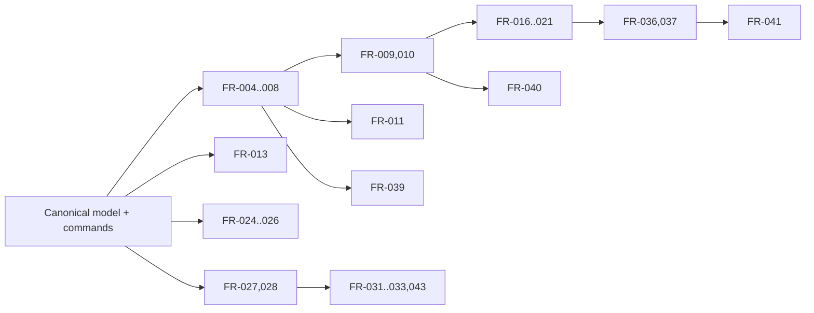
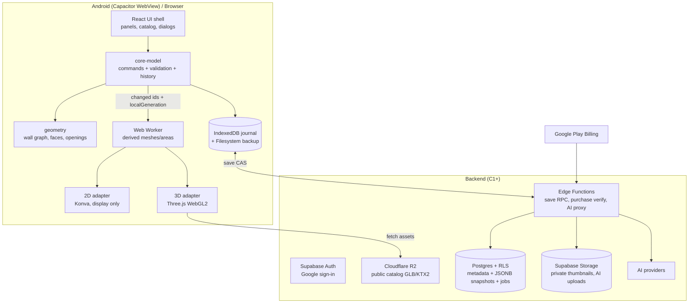
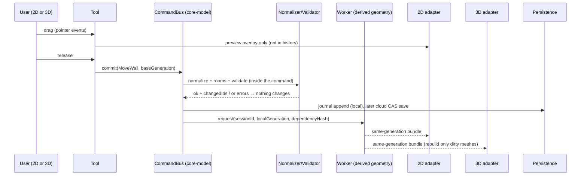
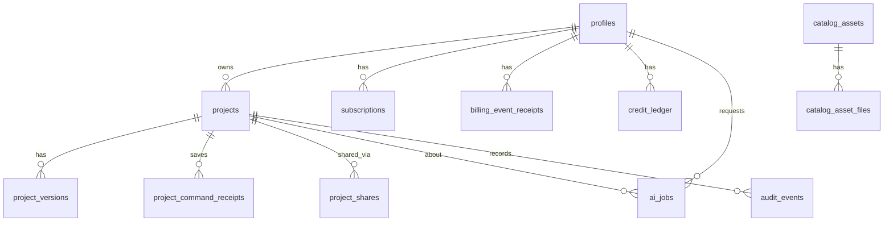
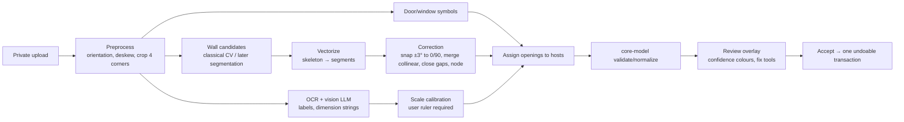
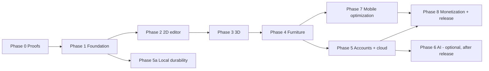

# Combined Research & Engineering Blueprint: Planner 5D-inspired home planner

**Version:** combined v1 · **Date:** 2026-10-11 · **Owner:** Raghvendr
**Built from:** Claude research rounds 1–2 (`docs/01`–`12`, `docs/research/source-log.md`) and the Codex research package (round 2: P01–P42, COMP01–20, TECH01–16, COST01–07, AIV01–12). For each section, the stronger and more detailed version was taken as the base; the other side's unique verified facts were added; conflicts are shown openly with the chosen resolution.

**Scope decisions by the owner (binding for this document):**
1. **No electrical or wiring features.** The app and the electrical shop are separate businesses. (Lighting as a visual design element stays; it is not wiring.)
2. **No marketing website for now:** no home page, About Us, blog or website pricing page. The only exception is what Google Play requires: a hosted privacy-policy URL and a web link for account deletion (§O.3). These are two bare pages, not a website.
3. Platform: **web app + Android app (Capacitor wrapper), mobile-first**, one codebase (decided in round 1).

---

## 0. How to read this document

### 0.1 Evidence labels (used everywhere)

| Label | Meaning |
|---|---|
| **VERIFIED** | Stated on an official page that was opened on 2026-10-11 (source ID given). It confirms the *statement*, not that we measured the behaviour. |
| **OBSERVED** | Seen directly in a public listing (store page, review text) or in a browser test (e.g. the editor failing to load). |
| **INFERRED** | An engineering hypothesis drawn from several observations. Never a claim about Planner 5D's private code. |
| **PROPOSED** | Our own design, budget, estimate or acceptance rule for our product. |
| **UNKNOWN** | Not found in inspected sources, contradictory, or untested. "Not found" is not proof of absence. |

No proprietary code, private API, login-only screen or catalog asset of Planner 5D was used. Statements about Planner 5D internals are INFERRED at most.

### 0.2 Source-ID prefixes

| Prefix | Origin | Content |
|---|---|---|
| **P01–P42** | Codex capture, SHA-256 hashed (Appendix A) | Planner 5D official pages, help articles, Play (US locale) and App Store listings, terms, privacy |
| **CP03a…CP03u, CP05–CP08** | Claude capture | Planner 5D help articles (246 downloaded), **Play India listing**, App Store, job ads, editor shell |
| **COMP01–COMP20** | Codex capture, hashed | Competitor official pages |
| **CC01–CC07** | Claude capture | Competitor pricing pages, Play India competitor listings |
| **TECH / COST** | Codex capture, hashed | Libraries, licenses, Supabase, R2, Stripe |
| **AIV** | Codex capture, hashed | Claude/Gemini/OpenAI docs, SAM2, Ultralytics |
| **V01–V10** | Claude capture | Supabase, R2, Google Play policy pages, AI prices, licenses |
| **RV-x** | Re-verified by Claude for this combined document on 2026-10-11 | Spot checks of Codex-only facts (all passed; §Q.2) |

Full register: Appendix A.

### 0.3 What was taken from where, and why

| Part | Base taken from | Added from the other side | Why this choice |
|---|---|---|---|
| A. Planner 5D research | **Codex** (42 hashed sources, 63-feature inventory, platform scoping, documentation conflicts, legal/privacy) | Claude: India Play snapshot (★4.27, 5 Cr+ installs, top-grossing), floors 6/3, recognition 10 min–24 h, AI Studio credit details, the 246-article details, job-ad tech hint, reviews from India, round-1 corrections | Codex had stronger proof per claim; Claude had the India context and more feature detail |
| B. Competitors | **Codex** official prices for all 6 (incl. HomeByMe, Live Home 3D which Claude could not capture), phone limitations | Claude: Google Play **India** competitor table (installs/ratings), Indian apps, Asian Paints tie-up, rewarded-ad history | Codex prices are official; Claude's India data is unique |
| C. PRD | **Claude** structure (mobile-first Android, MoSCoW, user stories, monetization, Play rules) | Codex: L0/C1 release split, orthogonal-only first release, stricter acceptance criteria, release gates, analytics study | User chose Android-first; Codex acceptance criteria are more testable |
| D. TRD + decisions | **Codex** TRD depth (component ownership, API errors, jobs, DR) | Claude stack (Capacitor, Supabase, R2, Play Billing, AdMob) | Claude stack fits a beginner on Android; Codex engineering detail is better |
| E–G. 2D, 3D, sync engine | Merged | Codex: revision domains, stale-worker guard, junction ownership, door threshold, orthogonal fallback oracle. Claude: invariants I1–I7, shortcuts, mitering, Indian device classes, per-side wall paint | Each side had different strong parts |
| H. Data | **Claude** schema + sample file (validated) | Codex: immutable JSONB snapshots, save/idempotency protocol, CAS SQL, asset version pinning, entity ID rules | Codex save protocol is more correct; Claude's example is executable |
| I. AI | Merged | Claude: newer and cheaper Claude 5.5 prices (re-verified), license table, layout solver. Codex: Gemini **18+ / EEA terms**, approximate-coordinates warning, data structures, eval plan | Codex priced an older model (Sonnet 4.6) |
| J. User flows | **Claude** 16 flows (Android context) | Codex: unsaved-project, view-only, conflict, offline states | — |
| K–L. Feasibility, roadmap | Merged | Codex: per-task tables, agent prompts, person-week envelope. Claude: beginner calendar estimates, Android/Play tasks, CLAUDE.md rules | — |
| M. Tests | **Codex** structure (preconditions, evidence codes) | Claude: PERF on Indian devices, MON (Play Billing), AST, i18n | — |
| N. Cost | Merged and **recomputed** | Codex: PITR $100, compute tiers, Stripe India invite-only, workload model. Claude: Play India 15%, Supabase Free pause, non-infra costs in ₹ | — |
| O. Security/legal | Merged | Codex: P41/P42 legal, Gemini age terms, upload/SSRF rules. Claude: Play deletion/data-safety, license list | — |
| P–Q. Risks, audit | Rebuilt for this document | — | — |

### 0.4 Plain-language summary (Hinglish, for Raghvendr)

- **Planner 5D kya hai:** ek bada, purana product hai. Play India par 5 crore+ downloads, ★4.27, aur "#5 top grossing house & home". Ise ek company kai saalon se bana rahi hai. Iska poora copy banana ek beginner ke liye realistic nahi hai.
- **Hum kya bana sakte hain:** ek chhota, bharosemand app:
  - deewar banana (pehle sirf seedhi aur 90° wali deewarein)
  - kamre aur unka area
  - darwaze aur khidkiyan
  - lagbhag 30 se 100 furniture
  - 3D view
  - undo
  - kaam kabhi na khona
  - Hindi aur English, sasta Android phone
- **Planner 5D ki kamzoriyan (official help se saabit):**
  - Do device par edit karo to purana kaam overwrite ho jaata hai, aur purane version nahi rakhte. Sirf Android par history hai.
  - Grouping sirf web par hai, round walls sirf web par.
  - Paywall ki shikayatein hain, aur Hindi nahi hai.

  In kamzoriyon par hum behtar ban sakte hain.
- **Sabse mushkil kaam:** deewaron ka sahi judna (geometry), 2D aur 3D ka hamesha same rehna, aur saste phone par 3D smooth chalna. AI baad mein aayega, pehle nahi.
- **Paisa aur samay (estimate, vaada nahi):**
  - Server ka kharcha shuru mein ₹0 se ~$25/mahina.
  - Launch tak cash $500–10,000.
  - Aapke liye part-time 9–19 mahine, kuch paid expert help ke saath.
- **Sabse zaroori agla kadam:** 10 logon se baat kijiye, ki kya woh ise use karenge aur paisa denge. Uske baad Phase 0 shuru kijiye.

---
# Part A — Planner 5D product research

## A.1 Snapshot (2026-10-11)

| Item | Value | Status / source |
|---|---|---|
| Company | Planner5D UAB, Vilnius, Lithuania | VERIFIED CP02 (terms/pricing pages) |
| Platforms | Web, iOS/iPadOS, Android, Windows, macOS, visionOS; "Cross-platform" | VERIFIED P01, CP01, CP06 |
| Google Play **India** | ★ 4.27 from 582,492 ratings; **5 Cr+ downloads**; updated 7 Oct 2026; "#5 top grossing house & home"; description says "more than 6,723 elements" | OBSERVED CP05 |
| Google Play (US locale) | Updated Oct 7, 2026; "Online / Offline Mode"; "Ratings and reviews are verified" label | VERIFIED P09 |
| App Store (US) | ★ 4.4 from 42K ratings; version 5.11.1 ("4d ago"); **963.4 MB**; iOS 17+; 24 UI languages, **no Hindi** | VERIFIED P10, OBSERVED CP06 |
| Scale claims | "100M+ homeowners and pros … over 540M homes" (home); "Trusted by 120M+" (pricing); "400M+ interior design projects" (App Store) | VERIFIED as **company claims**; not audited; numbers differ between pages |
| Catalog size | "more than 8,000 items" (P01); "10K+" with Premium (P02); "8,400+" Premium items (P10); "6,723 elements" (CP05) | VERIFIED but **inconsistent** across official pages |
| Free catalog | "Access to 50% of the furniture catalog" (P02) vs "150+ decor items" free on iOS (P10); "Free catalog items may vary by platform" (P15) | VERIFIED; conflict unresolved |

## A.2 Pricing and entitlements

| Plan | Price (context) | Includes |
|---|---|---|
| Free | $0 | Unlimited projects (P02), web + mobile, 50% of catalog, Design Battles (win Premium) |
| Premium | **US$19.99/month or US$59.99/year** (P02 FAQ, "published US prices"); A$29.99/month or A$89.99/year on the AUD card the page served (P02) | Full 10K+ catalog, AI floor-plan recognition, 3D models from photos, standard renders, Budget widget, **100 AI Studio credits/month (1,200/year)** |
| Professional | **US$49.99/month or US$399.99/year** (P02 FAQ); A$74.99/month or A$599.99/year | Watermark-free 4K renders, upload .obj/.fbx/.blend/.stl, 360° panorama and walkthrough, **CAD export**, Specs & Docs, Price Estimator, branded profile, **1,000 AI credits/month (12,000/year)** |
| Enterprise | Custom | White-label planner, own catalog, product configurator, cart/CRM/ERP APIs |

- **App Store IAP list (P10, CP06):** $7.99 weekly; $9.99/month in the description; $19.99 monthly "House design"; $29.99–$119.99 yearly variants; "Interior design: annual use" $69.99 (conflicts with the $59.99 in the description); $6.99 "full catalog for 30 days"; $15.99 "full catalog 1 year"; PRO $399.99/year. **Prices differ by platform and region** (CP03h).
- **Trials (CP03h):** 3-day yearly Premium trial (iOS, macOS); 7-day PRO trial (Web, iOS, Android, Windows); one trial per person; **no partial or full refunds** under the refund policy.
- **AI credits (P02, CP03l):**
  - Image, video and Agent generation all draw on one balance.
  - "100 credits can create about 50 Nano Banana 2 images at 1K or about 12 standard five-second AI video clips".
  - Credits **expire every 30 days**.
  - Plan recognition, Copilot (P27) and Home Scan (P28) use **separate credit types**; do not assume they are interchangeable.
- **Models resold inside AI Studio (P02):** Nano Banana 1/2, GPT Image 1.5/2, Seedream 5 Lite; video: Seedance, FLUX 3, Kling, Veo 3.1, Luma Ray 2; editing: FLUX Fill Pro, Fast Inpaint, Real-ESRGAN. INFERRED: Planner 5D's visual AI is built on third-party models.
- **INR prices on Google Play: UNKNOWN.** The listing shows only "In-app purchases". The price list needs a signed-in Indian device (owner task, §Q.4).
- **Free-project limit conflict (Codex ISA-006):** P02 says unlimited projects. The un-initialised editor HTML contains the template text "You can have 1 active project on a free plan" (interface record). Because the app bundle never loaded, this does **not** prove the limit applies. UNKNOWN until tested on a device.

## A.3 Technology hints (all INFERRED; no reverse engineering)

- **Android app appears native.** The current Android Team Lead job ad asks for Kotlin/Java and "2D/3D graphics (Canvas, OpenGL, Vulkan, or Google Filament)", and mentions "CRDT" (CP07). A round-1 Three.js job ad now returns 404. This raises our WebView performance risk (RISK-02).
- **The data model is probably room-centric, not a shared wall graph.** Evidence:
  - Help says to create each room separately, and that one big space "leads to layer conflicts" (CP03).
  - Wall "join points" must be stacked to avoid textures showing through (CP03t).
  - Thickness can be changed per room or per wall (P13).
  - Android users must split a wall into four pieces to make a partition (P12).
  - A user review says a shared wall between two rooms cannot be worked on as a single wall (CP06).

  Our shared-wall graph (§E) targets this weakness.
- **Sync is last-write-wins without server history.** "The most recent local version replaces older versions on other devices." and "we do not store previous versions of projects and are unable to restore or revert an overwritten project" (P21).
- **The iOS app is very large (963.4 MB).** Assets are likely bundled (INFERRED). We stream assets instead (NFR-006).
- **Web editor:** the public `/editor` page returned HTTP 200. Its static CSS/JS from `static.planner5d.com` (bundle path `…/web/js/7.44.4/build/app.js`) was blocked by the environment proxy with 403, so **no canvas initialised** (OBSERVED, Codex P5D-IF-001..005). The bundle path version is not evidence of framework or architecture. Claude's capture of the shell found no identifiable 3D-library strings (CP08). Investigation stopped there by choice.

## A.4 Feature inventory (F01–F63 from Codex, plus Claude additions F09a, F28a–c, F37a–b, F47a, F64, F65)

F-IDs are stable investigation IDs, not requirements. "Our scope" uses the merged requirement IDs of Part C.

### A.4.1 Floor planning and structure

| ID | Feature | Planner 5D behaviour (status · source) | Our scope (PROPOSED) |
|---|---|---|---|
| F01 | Room creation | VERIFIED: Web/iOS predefined shapes or drawing; Android predefined shapes (P11). Help warns against rooms inside rooms (CP03) | Must L0: rectangle tool writing to the shared wall graph (FR-004) |
| F02 | Wall drawing | VERIFIED: Web Pencil, click points, double-click to end (P11); Android needs a split-wall workaround for partitions (P12); Android reviews complain single-wall drawing is missing (P09) | Must L0: straight walls, orthogonal first (FR-005) |
| F03 | Wall joining/snapping | VERIFIED: snapping settings exist (P27, P31); junction tolerances/ownership UNKNOWN; texture conflicts at misaligned joins (CP03t) | Must L0: endpoint/projection snap that splits topology (FR-006, FR-008) |
| F04 | Thickness/height | VERIFIED: thickness for all walls in a room or one wall (P13). **Height conflict:** P14 says "there's no way to change the height of a single wall. Only the whole room" (re-verified RV-4), while the newer partition article P12 shows a partition-height control | Must L0: per-wall integer-mm thickness and height (FR-007) |
| F05 | Precise measurements | VERIFIED: metric/imperial, internal/external dimension display (P15, P36); type a length + Enter (P36); "Object Distance" setting (CP03u) | Must L0: label centreline vs clear (inside) dimensions explicitly (FR-007) |
| F06 | Grid/rulers | VERIFIED: grid large square 0.5 m, small 0.1 m (P30 Android; CP03 web); rulers and snaps (P31) | Should: adaptive grid + snap toggle (FR-006) |
| F07 | Room resizing | VERIFIED: drag a wall, or type length in the bottom bar + Enter (P36) | Must L0: constrained edits with preview (FR-007, FR-008) |
| F08 | Multiple rooms | VERIFIED: adjacent separate rooms workflow (P11, P12); shared-wall representation UNKNOWN | Must L0: adjacent rooms share one wall entity (FR-008) |
| F09 | Multiple floors | VERIFIED: **Web up to 6 floors, apps up to 3**; 6-floor projects don't sync to apps (Windows excepted) (CP03b); copy rooms/furniture to another floor on Web (P37) | Later: floors with elevation in schema (FR-034) |
| F10 | Doors/windows | VERIFIED: Android drag window to wall, width/height/sill, "changes will be saved automatically" (P32); doors open/close in 3D (P17). Review: "A door's representation in 2D and 3D often do not match" (CP06) | Must L0: wall-hosted parametric openings (FR-011) |
| F11 | Stairs | VERIFIED workaround: place stair object, then draw a small room on the floor above with its floor switched off (CP03s). Review: stairs through ceilings look transparent (CP06) | Later (FR-035); never pretend a stair mesh connects floors |
| F12 | Floor materials | VERIFIED broadly (P17, P10) | Must L0: room floor material (FR-022) |
| F13 | Ceilings | VERIFIED: room height per room, "pick each room… one by one" (CP03); ceiling light options for renders (P20) | Should: simple flat ceiling, hidden in orbit (FR-023) |
| F14 | Roofs | VERIFIED: iOS "Construction → Roofs" catalog objects resized manually (P33); "Magic Cube" for custom parts (CP03s) | Excluded first release (FR-035) |
| F15 | Undo/redo | VERIFIED Ctrl/Cmd+Z (CP03r); redo not documented; granularity UNKNOWN | Must L0: one gesture = one command (FR-013) |
| F09a | Round walls | VERIFIED: "This feature is currently available on the Web Editor only." and "it will not be reflected in the app" (P34, RV-5); iOS workaround: split a wall many times (CP03s) | Excluded L0 |

### A.4.2 Interior design

| ID | Feature | Planner 5D behaviour (status · source) | Our scope (PROPOSED) |
|---|---|---|---|
| F16 | Furniture catalog | VERIFIED counts conflict 6.7K/8K/8.4K/10K+ (A.1); free subset per platform (P15) | Must: ~30 rights-cleared items at L0, ~100 by v1.0 (FR-016) |
| F17 | Drag placement | VERIFIED: click or drag from catalog; editable in 2D and 3D (P17, CP03) | Must L0: ghost preview + explicit commit (FR-017) |
| F18 | Rotation/scaling | VERIFIED rotation/resize handles; "3-axis rotation", "slant items" (CP03q) | Must L0: yaw + uniform scale (FR-017, FR-018) |
| F19 | Object dimensions | VERIFIED: Basic plan can edit dimensions of free items; Premium all items (CP03h, P15) | Must: real asset dimensions shown (FR-018) |
| F20 | Collision | UNKNOWN; "levitating objects" help articles exist (CP03) | Warn, don't block (FR-020) |
| F21 | Materials/textures | VERIFIED: 600+ colours/textures free; custom texture upload (Basic); copy texture from object (web) (CP03h) | Must: vetted material library (FR-022) |
| F22 | Colours/finishes | VERIFIED Style control (P17) | Must: per-slot colour (FR-022) |
| F23 | Grouping | VERIFIED: "At the moment you can only group objects using the Web platform." (P18); **Lock furniture web only** (CP03q); a newer iOS grouping article is indexed (conflict) | Should: grouping that works the same on every platform (FR-019) |
| F24 | Copy/duplicate | VERIFIED: duplicate, Ctrl/Cmd copy-paste (P16, P17), cross-floor copy (P37) | Must L0: fresh IDs (FR-019) |
| F25 | Alignment | VERIFIED Android "Snap to points", "Snap to rulers" (P31) | Should (FR-019, FR-021) |
| F26 | Object snapping | VERIFIED Web object snapping / snap to grid settings (P27) | Should (FR-021) |
| F27 | Lighting objects | VERIFIED: "To turn the lights on, you'll need to enable automatic lights when creating a render." (P38) | Should: visual light entity with budget (FR-023) |
| F28 | Decorations | VERIFIED decor catalog (P09, P10); no rights for us to reuse (P41) | Should: small cleared set (FR-016) |
| F28a | Upload own 3D models | VERIFIED: Premium from image/URL; PRO .obj/.fbx/.blend/.stl; conversion up to 15 min (P02, CP03u) | Excluded v1 |
| F28b | Budget widget / price estimator | VERIFIED Premium budget widget; PRO price estimator (P02) | Not planned (electrical/shop BOQ removed by owner decision) |
| F28c | Item search | VERIFIED text search and AI image search (CP03) | Must: text search only v1 (FR-016) |

### A.4.3 3D visualization

| ID | Feature | Planner 5D behaviour (status · source) | Our scope (PROPOSED) |
|---|---|---|---|
| F29 | 2D↔3D switch | VERIFIED toggle (P09, P10); old review: crash/black screen when switching, later fixed per reviewer (CP06) | Must L0: two views of one model (FR-024) |
| F30 | Live 3D updates | VERIFIED "Preview every update in 3D" (P08); cadence UNKNOWN | Must L0: incremental rebuild (FR-024) |
| F31 | Camera rotate/orbit | VERIFIED Web: left-drag rotate, right-drag move, wheel zoom (P19); target-pivot semantics UNKNOWN | Must L0: bounded orbit (FR-025) |
| F32 | First-person walk | VERIFIED eye-level by zooming in, **WASD**, +/− height (P19); separate paid 360° walkthrough output (P02, P29) | Should v1.0 after collision proof (FR-026) |
| F33 | Room navigation | VERIFIED camera height/reposition (P19) | Should: camera presets (FR-025) |
| F34 | Camera collision | UNKNOWN | Should: capsule collision (FR-026) |
| F35 | Lights/shadows | VERIFIED render lighting, sunlight, automatic lights (P20, P38); real-time parity UNKNOWN | Must: ambient + one sun, bounded shadows (FR-023) |
| F36 | Material rendering | VERIFIED rendered textures/lighting (P10, P20); PBR/backend UNKNOWN | PBR GLB materials in WebGL2 (FR-022) |
| F37 | Realistic renders | VERIFIED server renders: Draft 1–2 min (no render slot), HD 2–15 min, Full HD/QHD (Web) ~30 min, 4K ~30 min, panorama/360 walkthrough 30 min–24 h, queued (P29, CP03p) | Won't v1 (FR-045); in-app screenshot only |
| F37a | Graphics quality setting | VERIFIED Low/Medium/High (Windows) (CP03u) | Auto quality tiers + manual override (NFR-003) |
| F37b | AR | VERIFIED AR room visualisation, AR try-on (iOS) (P10, CP05) | Excluded v1 |
| F38 | Scene export | VERIFIED: DWG/DXF **PRO only, 2D only**: "The project will be exported in 2D, as we currently do not have an option to export it in 3D." (P25); **PDF report for all plans** (home report, blueprint, 2D plan, renders, elevation) (CP03j); Scanner adds 2D/3D floor-plan PDF, CAD, home report (P28) | Must: our JSON file (FR-028); PNG/PDF (FR-029); DWG Won't v1 (FR-046) |
| F39 | Image rendering flow | VERIFIED camera → render type → aspect/quality → sunlight → Render → My Renders; Draft does not use a render slot (P20, P29) | Should: viewport PNG (FR-029) |

### A.4.4 AI features

| ID | Feature | Planner 5D behaviour (status · source) | Our scope (PROPOSED) |
|---|---|---|---|
| F40 | AI room design (Smart Wizard) | VERIFIED: "Smart Wizard helps you build and furnish a room in a chosen style." Room type, shape, size, style, Shuffle → editable room; Web/iOS/Android (P26). P26 does not establish an ML implementation | Later: deterministic templates first (FR-003, FR-040) |
| F41 | AI furnishing | VERIFIED Smart Wizard furnishing; AI Designer (magic wand): room → type + style → shuffle → Save Result (CP03); Auto Furnish "Get early access" (P04) | Later: catalog-constrained solver (FR-040) |
| F42 | Image redesign | VERIFIED AI Studio canvas: improve render, edit image, swap material, inpaint, upscale, populate people, video (P02, CP03l) | Later: labelled visual concept (FR-038) |
| F43 | Floor-plan recognition | VERIFIED: **paid plans only**; formats include ".png, .jpg, .pdf, .bmp, … .dxf, .dwg" (P03); one floor per image; perspective photos, hand sketches and "artistic" plans **not supported**; multi-page PDF on web; **10 min–24 h** with email when done; cannot be cancelled once started (CP03f, CP03g); "Work with the recognized plan as you would with a regular project." (P03). Long processing suggests human review (INFERRED) | Research gate; human-reviewed import (FR-039) |
| F44 | Layout generation | VERIFIED Smart Wizard layouts; Copilot editable projects (P26, P27) | Later: deterministic candidate search (FR-040) |
| F45 | Style recommendation | VERIFIED Wizard styles, Copilot restyle (P26, P27) | Later (FR-040) |
| F46 | AI image generation | VERIFIED AI Studio models and credits (P02) | Later behind provider adapter (FR-038) |
| F47 | AI editing (Copilot) | VERIFIED: text prompt → credits → previews and a description of changes → review in 2D/3D → manual refinement; "Copilot-generated projects remain editable in the Planner 5D Editor." and "Each new Copilot action can use additional credits." (P27). **Natural-language editing already exists at the market leader**, so it is not unique for us | Later: validated command proposals (FR-040) |
| F47a | Home Scan | VERIFIED: phone video → 2D/3D plan; "Videos shorter than 10 seconds or longer than 12 minutes cannot be processed." (P28, RV-6); Basic scan 1 credit, Full scan 3 credits; Full detects catalog furniture, textures and fixtures (CP03o); "Scan & Design is currently available on iOS only and is not yet available on Android." (P28) | Excluded (needs CV/LiDAR R&D) |

### A.4.5 Project management, money, legal

| ID | Feature | Planner 5D behaviour (status · source) | Our scope (PROPOSED) |
|---|---|---|---|
| F48 | Save/load | VERIFIED autosave statement for window edits (P32); projects created without an account **cannot be saved/restored** (CP03d) | Must L0: local-first autosave without account (FR-027) |
| F49 | Cloud sync | VERIFIED: same account + internet; newest local replaces older; warning that the same project open on two devices can lose changes (P21) | Must C1: revision CAS + conflict copy (FR-031, FR-032) |
| F50 | Templates | VERIFIED Wizard shapes/styles (P26); editor "Templates" button exists in page source (interface record) | Should: 1BHK/2BHK templates (FR-003) |
| F51 | Duplicate project | VERIFIED Web Space → Floor Plans → … → Duplicate; iOS long-press; "synchronized across all platforms" (P35) | Must (FR-002) |
| F52 | Export formats | See F38 | FR-028, FR-029 |
| F53 | Sharing | VERIFIED: "Shared projects are view-only by default."; "Can view"/"Can edit"/revoke (P39) | Could v1.1: read-only link (FR-033) |
| F54 | Collaboration | VERIFIED real-time on Web and iOS: "This feature is currently available on Web and iOS platform." and "For now the latest change (if made simultaneously) will be applied!" (P22). Pricing page: "Yes, shared editing is available on all Planner 5D plans, including free." (P05), which conflicts in emphasis | Won't (FR-044) |
| F55 | Version history | VERIFIED Android dated history (P23); "restoring a project to a previous version is only available on the Android app" (P24); generic sync article says no versions stored (P21), a conflict | Must C1: versions on all platforms (FR-032) |
| F56 | Free/premium split | VERIFIED (A.2) | Free useful local editor; premium catalog/export (FR-036) |
| F57 | Subscriptions | VERIFIED monthly/annual/IAP with contradictions (A.2) | Play Billing (FR-036) |
| F58 | Paid rendering | VERIFIED render slots by plan; Draft no slot; Pro 4K (P20, P29) | Won't v1 |
| F59 | Catalog restrictions | VERIFIED (A.1); free status determined per platform (CP03h) | Our own license ledger (NFR-014) |
| F60 | AI credits | VERIFIED (A.2) | Later separate credit ledger (FR-041) |
| F61 | Commercial use | VERIFIED: personal use = "personal, non-commercial or non-revenue generating purposes" (P41); commercial accounts allow revenue-generating use and watermark-free renders; Education accounts separate. Mapping of legal account type to named subscription is UNKNOWN | Legal review before paid "commercial use" claims (§O) |
| F62 | Releases | VERIFIED Android updated 2026-10-07 (P09); iOS 5.11.1 with generic notes "Speed and functionality improvements" (P10, CP06) | Track our own version matrix |
| F63 | User pain | VERIFIED displayed reviews (P09, P10, CP05): unexpected paywalls when editing on Android after PC; missing Android single-wall drawing; limited customisation/search; door 2D/3D mismatch; shared-wall editing; crashes (older iOS). Indian users complain features moved behind the paywall; Planner 5D **used to let users unlock furniture by watching ads for 72 hours** (2020 review with developer reply, CP05). Reviews are reports, not reproduced bugs or prevalence | 5–10 user interviews + device tests (§Q.4) |
| F64 | Account deletion | VERIFIED in-app (web/Android) and other platforms; data deleted within 30 days; subscription cancelled separately (CP03u) | Must when accounts exist (FR-043) |
| F65 | Learning | VERIFIED: "Design School is only available on our web platform." (P40) | In-app onboarding (FR-030) |

### A.4.6 Interface entry points seen in the editor page source (not working features)

Codex captured these strings from the public editor HTML; the app itself did not load, so they are **source text, not tested behaviour** (VERIFIED as text, Codex P5D-IF-006..015):
- "Start from scratch", "Smart Wizard", "Import a plan" / "Recognize plan from image", "Templates".
- "You have an unsaved project. What do you want to do?", with "Create new without saving" and "Register and save".
- Recognition copy: "Make sure you upload architectural/blueprint-like images." Error states "Something went wrong", "Recognition failed", "Reupload".
- View modes: "This is a view mode only. Copy project to make edits." and "…Sign in to edit and copy projects."
- Render help: "Use your keyboard to adjust the view. Press the W, A, S, D buttons…", "Rendering successfully launched!"

These are useful UX leads for our own flows (§J). They prove nothing about Planner 5D's internal behaviour.

## A.5 Source-documented workflows → engineering implications

| Source / job | Documented sequence (VERIFIED as documentation; not exercised) | Implication for us (PROPOSED) |
|---|---|---|
| P11/P12/P36 measurable rooms | Web: preset or Pencil, double-click to end; drag a wall or type length + Enter. Android: predefined rooms; partitions need a 4-piece split | One consistent wall tool on every platform; avoid the Android workaround |
| P13/P14/P15 dimensions | Room selection changes all wall thicknesses; one wall changes one; metric/imperial; internal/external arrows | Per-wall height and thickness; clear area must subtract wall offsets |
| P17/P18 furniture | Selection box; Style/Duplicate/Flip/Delete/Rotate; door open state in 3D; Web-only grouping | Same commands on all platforms; stable pivots |
| P19 navigation | Switch to 3D; wheel to eye level; right-drag move; left-drag rotate; WASD; height arrows | Orbit first; collision walk later; eye-level camera ≠ 360° render |
| P20/P29 renders | Camera → realistic/panorama → quality → sun/lights → Render → My Renders | Keep any future render service separate from the live viewport |
| P26 Wizard | Room type → shape → size → style → preview → Shuffle → Complete/Next | Template candidates can solve this job before ML |
| P03/P28 real-space input | Plan upload → processing → email → editable project; video scan with queue states and Re-Upload | Calibration and human correction are essential |
| P27 Copilot | Prompt → credits → previews → review → manual refinement; follow-ups cost credits | Proposals must be validated, previewed, undoable and cost-capped |
| P21–P24 recovery | Newest local wins; Web/iOS live collaboration with "latest change" wins; Android-only history | Conflict-safe save and versions before any multiplayer |

## A.6 Highest-risk assumptions (merged register)

| ID | Assumption | Evidence / update | How we validate |
|---|---|---|---|
| RISK-01 | Wall graph stays correct under edits (L/T junctions, rooms, clear areas) | Planner 5D users report shared-wall and join problems (CP03t, CP06): hard **and** valuable | Phase 0 fixtures and property tests (GEO-*) + geometry specialist review |
| RISK-02 | Three.js in Android WebView is fast enough on budget phones | Market leader appears native on Android (CP07); only anecdotal WebView reports | Phase 0 benchmark on named Indian devices vs Chrome on the same phone; fallback ADR-009 |
| RISK-03 | 2D and 3D never diverge, including after undo and async work | Generic risk; review complains of door mismatch (CP06) | Single source of truth + stale-result guard (SYNC-*) |
| RISK-04 | Openings survive wall split/reverse/resize | Generic geometry risk | GEO-013..016 |
| RISK-05 | Legal, optimised catalog | Sweet Home 3D catalog statement and blueprint3d MIT (CC05, V10); per-item checks needed | AST-001..003, SEC-006 |
| RISK-06 | AI recognition accurate and editable | Leader limits inputs and takes 10 min–24 h (CP03f); CubiCasa5K is non-commercial | Doc gates in Part I |
| RISK-07 | AI cost vs revenue | Official prices verified (Part I); leader uses expiring credits | Credits + caps (FR-041) |
| RISK-08 | WebGL context loss / memory on phones | Generic | REN-007, REN-009, NFR-017 |
| RISK-09 | Beginner can maintain AI-written geometry code | Generic | Small tasks, tests as spec, expert review (§K) |
| RISK-10 | Differentiation | NL editing exists (Copilot); grouping/history/collab are platform-uneven at the leader | Customer interviews before Phase 2 ends |
| RISK-11 | Local save actually durable (WebView storage can be cleared) | Generic Android risk | REL-007, REL-010; filesystem backup + export |

## A.7 Uncertainty register

| ID | Question | Status 2026-10-11 |
|---|---|---|
| U-01 | Free catalog size | Partly resolved: pages disagree (50% vs 150+); per-platform (P15) |
| U-02 | Stairs/roof/terrain | Resolved: workarounds and catalog roofs (CP03s, P33) |
| U-03 | Version history | Resolved: Android only (P23, P24); generic article conflicts (P21) |
| U-04 | Play rating/installs | Resolved (A.1) |
| U-05 | Mobile rendering tech | Partly: Android native stack INFERRED (CP07) |
| U-06 | **INR prices** | **Open**: needs Indian device (owner) |
| U-07 | blueprint3d license | Resolved MIT (V10) |
| U-08 | CubiCasa5K license | Resolved CC BY-NC 4.0, no commercial use (V10) |
| U-09 | Collision/snapping semantics | Partly: options documented; behaviour untested |
| U-10 | Floorplanner subscription prices | Open (JS-rendered; both captures saw placeholders) |
| U-11 | HomeByMe / Live Home 3D prices | **Resolved for Live Home 3D** (COMP12, RV-7); HomeByMe paid amounts blank in HTML (COMP08) |
| U-12 | AdMob India eCPM | Open: no official figure |
| U-13 | Planner 5D web 3D engine | Open; not pursued (no reverse engineering) |
| U-14 | Wall height per wall or per room | Open: P14 vs P12 conflict; needs a device test |
| U-15 | Free plan "1 active project" | Open: template text only (A.2) |
| U-16 | Collaboration semantics | Open: P05 "shared editing on all plans" vs P22 "latest change applied" |
| U-17 | Editor behaviour hands-on (snapping, undo, collision) | Open: editor CDN blocked for both researchers; owner can test on a phone |

## A.8 Corrections to earlier research (kept for honesty)

| Earlier statement | Finding |
|---|---|
| Round 1: "No competitor advertises electrical layout" | Wrong (Homestyler has a plumbing/electrical tool; Planner 5D allows placing sockets). **Now moot**: electrical removed from scope by owner decision |
| Round 1: "Planner 5D uses Three.js" (job ad) | That ad is gone (404); current Android job points to native graphics |
| Round 1: "AI recognition 1–3 min (B2B)" | Consumer help says 10 min–24 h |
| Round 1: Floors "3-floor limit" | Web 6, apps 3 |
| Round 1: Play fee "15% (verify)", tester rule "(verify)" | Both confirmed (V03, V04) |
| Codex: Claude prices Sonnet 4.6 $3/$15 | Correct for that model, but Sonnet 5.5 ($2/$10) is newer and cheaper on the same page (re-verified RV-1); combined doc uses 5.5 |
| Claude: Live Home 3D/HomeByMe prices from aggregators | Replaced by Codex's official captures (COMP08, COMP12) |
| Claude: snapshots stored as files in object storage | Replaced by JSONB snapshots in Postgres (ADR-012) for atomic saves |
| Claude: 2D renderer custom Canvas | Replaced by Konva as a display-only layer (ADR-002), to cut beginner workload |

---
# Part B — Competitor benchmark

## B.1 Google Play India snapshot (OBSERVED CC06/CP05, 2026-10-11)

| App | Developer | ★ | Ratings | Installs | Updated |
|---|---|---|---|---|---|
| Planner 5D | Planner 5D | 4.27 | 582,492 | 5 Cr+ | 7 Oct 2026 |
| Home Planner AI / Room Planner | Room Planner Ltd | 4.37 | 240,744 | 1 Cr+ | 8 Oct 2026 |
| Floor Plan Creator | Marcin Lewandowski | 4.12 | 132,569 | 1 Cr+ | 25 Aug 2026 |
| magicplan | Sensopia | 4.34 | 128,128 | 1 Cr+ | 6 Oct 2026 |
| Homestyler | HomestylerApp | 3.42 | 91,296 | 1 Cr+ | 27 Aug 2026 |
| Home Design 3D | HOME DESIGN 3D SRL | 4.01 | 46,935 | 1 Cr+ | 17 Sep 2026 |
| HomeByMe | Dassault Systèmes | 4.31 | 26,060 | 10 L+ | 29 Sep 2026 |
| Live Home 3D | Belight Software | 4.30 | 2,345 | 10 L+ | 10 Oct 2026 |
| Sweet Home 3D (mobile) | AI Photo Editor Lab srl | 3.63 | 2,693 | 5 L+ | 25 Nov 2025 |
| ArcSite | ArcSite | 4.55 | 2,960 | 5 L+ | 24 Sep 2026 |
| Shree Naksha Ghar (Indian) | nakshaghar.in | 4.42 | 223 | 50K+ | 9 Sep 2025 |

Notes:
- Room Planner advertises **Asian Paints** colours (OBSERVED). This is a brand tie-up model that could work later with Indian paint or tile brands.
- Install counts show interest in the category. They are **not** a market-size or revenue estimate.

## B.2 Capability comparison (official pages; Codex COMP01–20 + Claude CC01–CC05)

"Not established" means not found in the fetched pages, not that the capability is absent. No ranking of performance or ease of use is claimed (not measured).

| Product | Editor & 2D/3D | Catalog / materials | Outputs | AI | Sources |
|---|---|---|---|---|---|
| Planner 5D | Live 2D/3D; server renders | 6.7K–10K+ items (conflicting) | PDF all plans; DWG/DXF PRO 2D only; 4K/360 renders | Recognition, AI Studio, Smart Wizard, AI Designer, Copilot, Home Scan | Part A |
| Floorplanner | Browser; draw rooms, move walls, doors/windows: "Draw your rooms, move walls, and add doors and windows with ease…" (COMP01); free up to 5 projects, 3 floors/3 designs | Library at no extra catalog cost; home page claims >260,000 models | Free export SD 960×540 with watermark: "These exports are 960x540 pixels and have a Floorplanner watermark on each image." (COMP07); paid renders up to 8K | Not established | COMP01, COMP07, CC01 |
| HomeByMe | Create/import plan; "Design in 2D, Decorate in 3D, and visualize in 4K images" (COMP02); avatar navigation (COMP13) | Branded catalog; counts conflict 20k–90k+ (COMP08, COMP19); own-model upload on paid plans | Screenshots, HD/4K, 360°, video; "Our entire catalog is available on the app." (COMP19) | Mobile page describes auto-furnished rooms; not verified as AI | COMP02, 08, 13, 19 |
| RoomSketcher | "Changes update instantly in both 2D and 3D." (COMP03); snap-fitting walls | Furniture limited in free, full in Pro/Team | 2D/3D plans, 3D Photos, 360, Live 3D | AI Convert (blueprint → editable project; vendor claims "under five seconds", not measured); AI Render | COMP03, 09, 16, CC02 |
| Sweet Home 3D | "Draw straight, round or sloping walls with precise dimensions using the mouse or the keyboard." (COMP14); doors/windows cut walls automatically | Searchable extensible catalog; paid mobile version "contains more than 10.000 pieces of furniture and 400 textures" (COMP10) | Photos/videos; PDF, images, OBJ export | Not established | COMP04, 10, 14, 18, CC05 |
| Homestyler | Web 2D drawing, auto 3D, multi-floor; "Upload a floor plan or sketch in 2D, and Homestyler AI will convert it into an editable 3D house model with one click" (COMP05) | Model counts conflict (10M+/1M+/100k+) | Cloud photoreal images, panoramas, tours; "One-click export BOM, floor plan and dwg drawings." (COMP17) | Plan conversion, decoration, image/text-to-3D, conversational agent | COMP05, 11, 17, 20, CC03 |
| Live Home 3D | Native multi-platform; terrain/roofs by edition | 2,400 models / 2,100 materials | ProRender/Cycles offline ray tracing (Mac) (COMP15); many 3D exports | "AI Render (Cloud, Credit-Based)" (COMP12) | COMP06, 12, 15 |
| blueprint3d | Open-source web library (Three.js) | — | — | — | MIT (V10); reading reference only |

## B.3 Platform reality: phone editing is rare

| Product | What official pages say about phones | Source |
|---|---|---|
| RoomSketcher | "No, the app is not available on phones." (editing app is for Windows/Mac/iPad/Android tablet; phones can only use the web portal) | COMP16, re-verified RV-2 |
| Homestyler | Phone app is a lighter workflow; "Pro Membership and Master Membership are currently designed for the web version" | COMP20 |
| Planner 5D | Full apps on phones, but features differ by platform (grouping/lock/round walls web-only; history Android-only; Scan & Design iOS-only) | Part A |
| Floorplanner | Browser workflow; no native phone editor established | COMP01 |

**Implication (PROPOSED):** a smooth, complete editor on a cheap Android phone is a real gap. It is also the hardest technical bet (RISK-02), so Phase 0 must prove it before we promise it.

## B.4 Pricing (official public pages, USD unless stated; not checkout quotes)

| Product | Public offer | Caveats |
|---|---|---|
| Planner 5D | Premium $19.99/mo or $59.99/yr; Professional $49.99/mo or $399.99/yr (P02) | INR unknown; platform prices differ |
| Floorplanner | Free (5 projects, 3 floors/3 designs, SD watermark). Credit packs: 5 credits $8.15; 10 $16.30; 30 $48.90; 100 $163.00 (COMP07, CC01) | Subscription amounts render as `$0` placeholders in HTML: **UNKNOWN** (both captures) |
| HomeByMe | "On HomeByMe, you can create up to 2 projects and 5 realistic images per account for free." (COMP08, RV-8); Essentials and Pro/Pro+ paid | Paid amounts blank in static HTML: UNKNOWN |
| RoomSketcher | Free $0 (2 credits, first AI conversion free); Pro $24/month or $12/month billed $144/year; Team $70/month or $35/month billed $420/year (5 users); "All prices are in USD and exclusive of Sales Tax (VAT)." (COMP09, CC02) | Credits per operation need checkout check |
| Homestyler | Basic free (unlimited 1K renders); Pro+ "Starts from $6.8 /month" (75 each 2K/4K renders, 180 AI credits/month); Master+ "Starts from $11.8 /month" (unlimited 4K, 380 AI credits); Team $19.6/seat (COMP11, CC03) | "Starts from" = promotional/term basis; not guaranteed renewal price |
| Live Home 3D | Mac lifetime Standard $59.99 (promo; $79.99 struck), Pro $129.99 (promo; $149.99 struck); in-app Standard $5.99/month or $19.99/year; Pro $14.99/month or $39.99/year promo ($49.99 struck) (COMP12, RV-7) | Promotions change; platform-specific purchases |
| Sweet Home 3D | Free desktop (GPL); paid Mac/Microsoft Store/mobile editions with larger catalog (COMP10) | Store prices not captured: UNKNOWN |

## B.5 Minimum genuinely useful product, and where a small team can compete

**Core that every competitor has:** draw rooms → real dimensions → doors/windows → furniture → 3D → save/share/export.

**Documented weak spots at the leader, which are our openings:**
- Overwrite on sync with no history (Web/iOS).
- Shared-wall editing problems.
- 2D/3D door mismatch reports.
- Platform feature gaps (grouping, lock, round walls, history, scan).
- Paywall frustration.
- No Hindi.
- Phone editing missing or limited at several competitors.

**Expensive enhancements to defer:**
- Photoreal/offline rendering.
- 360° tours.
- Huge branded catalogs.
- Roofs/terrain.
- DWG/BIM.
- AI recognition.
- Conversational agents.
- Native multi-platform parity.
- Multiplayer.

None of these compensates for broken geometry or lost projects.

**Common benchmark protocol (for later, PROPOSED):**
- Use the same 2-room fixture (shared wall, 2 doors, 2 windows, 20 furniture items, 2 material variants).
- On each product: build it, edit dimensions, move the shared wall, undo, switch views, reopen, export.
- Measure success, dimensional error, task time, interaction count and lost work on the same Low/Mid phones.
- No scores are invented before this is run.

---
# Part C — Product Requirements (PRD)

Working name: **GharPlan** (placeholder; check trademark and Play Store availability first). Status: PROPOSED specification; nothing here is implemented or tested.

## C.1 Vision and boundaries

A fast, honest, mobile-first home planner. An Indian homeowner or small contractor can draw their home to real dimensions, furnish it and see it in 3D on a ₹10–20k Android phone, and never lose their work. The core promise is **trustworthy geometry and recoverable projects**. A pretty image that cannot be edited or measured does not meet this promise.

It is an interior-planning tool. It is **not** certified architectural, structural, building-code or permit software, and the app must say so.

**Releases (merged naming):**

| Release | Contents | Distribution |
|---|---|---|
| **L0: local MVP** | One floor; straight walls at 0°/90° (orthogonal) with L and T junctions; rectangle rooms; dimensions; doors/windows; ~30 cleared furniture items; materials; 3D orbit; undo/redo; local autosave + recovery; JSON export/import; PNG export; onboarding; Hindi + English | Android internal/closed test + web |
| **C1: Play Store v1.0** | L0 + ~100 items; Play Billing subscription; ads outside editor; optional Google sign-in + cloud save with conflict copies + versions; account deletion; analytics; walk mode if collision proof passes | Play production |
| **v1.1** | Multiple floors; read-only share link; free-angle walls (after their geometry gate) | — |
| **v2** | AI (visual redesign, plan import, furnish suggestions) behind measured gates | — |
| Excluded | Collaboration, photoreal server renders, DWG/BIM, roofs/stairs (until specialist proof), iOS app, AR, user-uploaded 3D models, **electrical planning**, **marketing website** | — |

Why orthogonal-only first (from Codex): it removes the hardest geometry cases (angled offsets, rational intersection points, X-crossings) from the first release. Indian residential plans are mostly rectangular. Free angles return in v1.1 after their own tests pass.

## C.2 Users, problems, jobs

| Persona | Situation | Main job | Assumption to validate |
|---|---|---|---|
| P1 Homeowner "Sunita" | Building or renovating a 2–3 BHK; mid-range Android; not technical | See whether furniture fits, choose colours, show family | Interview 5–8 people; observe measuring errors |
| P2 Small contractor / interior designer "Imran" | Does interiors for local clients | Quick dimensioned plan + 3D view to share on WhatsApp | Check sharing and export needs |
| P3 Tenant / student | Small budget; no CAD skills | Try furniture layouts; save and export a view | Is local-only saving understood? |
| P4 Furniture/interior seller | Wants to show products in a customer's room | Load cleared product models at true size | Asset rights and catalog ingestion effort |

Jobs to be done:
- **JTBD-1:** "When I plan a room, I want to check whether my furniture fits, so I don't buy the wrong size."
- **JTBD-2:** "When I discuss with family or a contractor, I want a 3D picture, so everyone imagines the same thing."
- **JTBD-3:** "When I change my plan on another phone, I don't want to lose my work."
- **JTBD-4 (later, AI):** "When I have a builder's plan image, I want it converted, so I don't redraw it."

**Market size:** not estimated in numbers. Install counts (B.1) show demand for the category only.

**Value proposition:**
- Accurate plan in minutes.
- Smooth 3D on budget phones.
- Work is never lost.
- Clear pricing.
- Hindi.
- The same features on web and Android.

We do **not** compete on photoreal rendering or catalog size.

## C.3 Requirement conventions

- **MoSCoW** priority per release: Must / Should / Could / Won't.
- IDs are permanent and never reused.
- Every FR has a user story (Appendix C), acceptance criteria and tests (Part M).

Common fixtures:
- **F-TWO:** the example project in §H.6.
- **F-SMALL:** 2 rooms, 12 walls incl. a T-junction, 3 doors, 2 windows, 10 objects.
- **F-LOW / F-MID:** 100 walls, 100 objects on Low/Mid phones.
- **F-DESKTOP:** the same scene with desktop budgets.

All budgets are PROPOSED, not measured.

## C.4 Functional requirements

| ID | Requirement | Pri · Release | Depends on | Acceptance criteria | Tests |
|---|---|---|---|---|---|
| PRD-FR-001 | **Canonical project model**: one versioned document in integer millimetres; both views read it | M · L0 | — | Every entity has a unique stable ID; all references resolve; values finite; unsupported schema version rejected without replacing the open project | DM-001, DM-002, GEO-017, SYNC-011, REL-001 |
| PRD-FR-002 | **Project list**: create (name, units), open, rename, duplicate, delete to trash (30 days for cloud) | M · L0 | FR-001 | New project opens ≤ 1 s and is listed after restart; duplicate gets new IDs for all entities and original is unchanged; cancelling create never overwrites another project | UX-002, REL-008 |
| PRD-FR-003 | **Templates**: 1BHK, 2BHK, room presets | S · C1 | FR-001 | Template opens as a new editable copy with valid geometry | UX-002, DM-001 |
| PRD-FR-004 | **Rectangle room tool** (W × D, drag or typed) | M · L0 | FR-005 | Creates 4 centreline walls + 1 room atomically when clear area is positive; adjoining existing walls are split/reused; preview shows centreline and inside (clear) sizes; W or D < 300 mm or nonpositive clear area rejected with message and no change; small positive rooms follow E.7 | GEO-001, GEO-010, GEO-021, UX-003 |
| PRD-FR-005 | **Draw straight walls**: tap/click points, live length, double-tap/Esc/"Done" ends; L0 = 0°/90° only | M · L0 (free angle S · v1.1) | FR-006, FR-008 | Chain of N points → N−1 walls sharing junctions; closing on first point creates a loop; endpoint on a wall makes a T-junction; X-crossing or non-orthogonal segment rejected before commit in L0; segment < 10 mm rejected; preview leaves no trace | GEO-001, GEO-003, GEO-016, UX-004 |
| PRD-FR-006 | **Snapping & grid**: junction > wall line (T) > alignment guide > grid; screen-pixel tolerance; hold-to-disable | M · L0 | FR-015 | Snap acquire 12 px for junctions / 8 px others, release at 1.5× acquire; snapped point equals target exactly (integer mm); no flicker at threshold; grid steps adapt to zoom (10/50/100/500/1000 mm) | GEO-009 |
| PRD-FR-007 | **Exact dimensions & wall properties**: type length; edit thickness 50–1000 mm and height 1000–6000 mm; choose which end moves | M · L0 | FR-005, FR-008 | Typed 3 450 mm stores 3 450 mm exactly; connected walls stay joined; out-of-range values rejected; label says centreline or inside length | GEO-002, GEO-007, UX-005 |
| PRD-FR-008 | **Junction & wall editing**: drag junctions/walls; connected walls follow | M · L0 | FR-001 | Shared junction keeps one ID; move is all-or-nothing; collinear overlaps merged or rejected by a documented rule; openings never left dangling; impossible move leaves the model unchanged and shows the conflicting wall | GEO-004, GEO-005, GEO-006, SYNC-001 |
| PRD-FR-009 | **Automatic rooms & carpet area** | M · L0 | FR-008 | Every valid closed face with positive clear area becomes a room in the same edit; < 0.25 m² kept with small-space warning, nonpositive clear area rejects the command unchanged (E.7); open loops show "not closed" and no area; area = inside walls ("carpet area"), never centreline; deleting a wall merges rooms correctly | GEO-001, GEO-010, GEO-011, GEO-021, SYNC-004 |
| PRD-FR-010 | **Room properties**: name (incl. pooja room, balcony), type, ceiling height, floor material | M · L0 | FR-009 | Properties survive edits that keep the room; on split/merge the documented identity rule applies and ambiguous cases ask the user | GEO-011 |
| PRD-FR-011 | **Doors & windows** on walls: offset, width, height, sill, swing side | M · L0 | FR-008 | Opening stays within its wall with end margin; overlaps rejected; door sill = 0; sill + height ≤ wall height; reversing a wall keeps world position; wall shrink that breaks an opening is refused or previewed before commit; hole visible in 3D | GEO-013, GEO-014, GEO-015, SYNC-002, UX-006 |
| PRD-FR-012 | **Selection**: tap/click, multi-select, delete with dependency notice | M · L0 (multi S) | FR-013 | Top-most eligible item selected, with cycling for overlaps; delete shows dependent openings; one delete = one undo entry | GEO-012, UX-005 |
| PRD-FR-013 | **Undo/redo** ≥ 100 steps for every model edit | M · L0 | FR-001 | One drag = one entry; undo returns byte-identical canonical JSON; new edit after undo clears redo; save acknowledgements are not history | DM-004, SYNC-007, SYNC-008, REL-009 |
| PRD-FR-014 | **Units**: metric (mm/cm/m) and ft-in display; storage in mm | M · L0 | — | Display→parse→display stable; 100 unit switches change no stored coordinate | GEO-002, GEO-007 |
| PRD-FR-015 | **2D zoom/pan & touch gestures** | M · L0 | — | Pinch/wheel keeps focal point fixed (≤ 2 px); two fingers pan/zoom never move furniture; pointer-cancel reverts drafts | GEO-008, UX-004 |
| PRD-FR-016 | **Furniture catalog**: categories, text search, thumbnails, real dimensions, free/premium badge | M · L0 (~30 items), C1 (~100) | Asset pipeline | Every item has a license record; dimensions immutable per saved asset version; failed load shows retry/placeholder | AST-001, AST-002, SEC-006, UX-007 |
| PRD-FR-017 | **Place, move, rotate furniture** (15° snap, free with modifier) in 2D and 3D | M · L0 | FR-016 | One commit = one ID + one undo entry; position/rotation identical in 2D and 3D (≤ 1 mm, ≤ 0.1°); cancel leaves no object | SYNC-003, UX-007 |
| PRD-FR-018 | **Furniture size**: uniform scale in L0; per-axis W/D/H only for assets that declare resizable axes (later) | M · L0 uniform; S · v1.1 per-axis | FR-017 | Displayed size = native size × scale; bounding box equals entered size ± 1 mm; negative/NaN/infinite rejected | SYNC-003, REN-004 |
| PRD-FR-019 | **Copy/duplicate, align, group** | M · L0 duplicate; S · C1 align/group | FR-012 | Duplicates get new IDs, offset 200 mm; group transform = one undo; same behaviour on every platform | SYNC-009 |
| PRD-FR-020 | **Collision warnings**: overlap with walls/furniture highlighted, not blocked | S · C1 | FR-017 | Oriented-box overlap correct on fixtures; warning visually distinct from errors | GEO-018 |
| PRD-FR-021 | **Back-to-wall snap** for furniture | S · C1 | FR-017 | Back face within 1 mm of wall inner face | GEO-019 |
| PRD-FR-022 | **Materials**: each wall side, room floor, furniture colour variants | M · L0 (walls/floors), S (furniture) | Material library | Painting one side of a shared wall never changes the other room's side; 2D swatch and 3D use the same material ID; change visible ≤ 200 ms; texture failure keeps base colour | SYNC-005, REN-003 |
| PRD-FR-023 | **Lighting & ceilings (visual)**: ambient + sun presets; light fixtures; ceilings hidden in orbit | S · L0 presets; C · C1 fixtures | FR-024 | Light count/shadow caps enforced per quality tier; ceilings follow room polygons; no claim of physical lighting accuracy | REN-005 |
| PRD-FR-024 | **Synchronized 3D view** (split view on tablet/desktop, toggle on phone) | M · L0 | FR-001, FR-008 | After every commit both views show the same model state; stale async results never shown; 3D state hash = model-derived hash | SYNC-001…006, SYNC-011 |
| PRD-FR-025 | **Orbit camera**: rotate, pan, zoom, focus, reset, presets; touch gestures | M · L0 | FR-024 | Camera never NaN, never below floor; distance/angle limits hold; focus frames selection | REN-001, UX-008 |
| PRD-FR-026 | **Walk mode**: joystick/WASD, eye height 1 600 mm, wall collision | S · C1 (after proof) | FR-024 | Cannot pass through walls even at 250 ms frame stalls; passes through door openings; exit always visible | REN-002, UX-008 |
| PRD-FR-027 | **Local autosave & crash recovery**, no account needed | M · L0 | FR-001 | Saved ≤ 2 s after last edit; force-kill loses ≤ 2 s of edits; status shows "on this phone" vs "in cloud"; storage failure warns and offers export | REL-001, REL-002, REL-003, REL-010 |
| PRD-FR-028 | **Project file export/import** (versioned JSON) | M · L0 | FR-027 | Round-trip keeps canonical content and IDs; invalid import rejected atomically; ≤ 2 MiB typical, hard cap 10 MiB decompressed; no account data inside | REL-001, REL-005, SEC-007 |
| PRD-FR-029 | **Image/PDF export**: 2D plan PNG/PDF with dimensions; 3D screenshot PNG | M · L0 PNG; S · C1 PDF | FR-024 | Labels match model (±1 mm rounding); never reports success for a blank/failed file; lower resolution offered on memory error | REN-006, UX-009 |
| PRD-FR-030 | **First-run onboarding** inside the app (≤ 4 screens + "draw your first room") | M · L0 | — | Skippable; reach a project within 3 actions after welcome; WebGL missing → "2D works" message | UX-001 |
| PRD-FR-031 | **Accounts & cloud save** (Google sign-in; optional) | S · C1 | FR-027, backend | Server checks permission on every operation; saves use expected server revision; "saved to cloud" only after durable commit | REL-006, SEC-001, SEC-002, SEC-009 |
| PRD-FR-032 | **Conflict handling & version history** | S · C1 (Must if FR-031 ships) | FR-031 | Stale save → 409 and **no overwrite**; conflicted copy keeps both; restore creates a new head revision; versions visible on every platform | REL-006, REL-007, REL-008 |
| PRD-FR-033 | **Read-only share link** | C · v1.1 | FR-031 | Viewer cannot edit; token unguessable and stored hashed; owner can revoke; indexing off by default | SEC-003, SEC-005 |
| PRD-FR-034 | **Multiple floors** (add/switch, copy outline of floor below) | S · v1.1 | Data model | Floors stack at correct elevation; no cross-floor dangling references | SYNC-010 |
| PRD-FR-035 | **Stairs & roofs** | C · v1.2+ (roofs Won't v1) | FR-034 | Stair fits floor-to-floor height; specialist-reviewed fixtures before release | GEO-020, SYNC-010 |
| PRD-FR-036 | **Subscription via Google Play Billing**: full catalog, no ads, PDF without watermark, extra floors | M · C1 | Billing | Entitlement ≤ 10 s after purchase; restored on reinstall; cancellation/grace respected; server-side verification | MON-001…004 |
| PRD-FR-037 | **Ads for free users**: banner on project list only, never on the editor; optional rewarded ad unlocks one premium item for 72 h | S · C1 | AdMob | No ad overlaps the editor; no ads for subscribers; consent where required | MON-005 |
| PRD-FR-038 | **AI visual redesign** of a 3D screenshot or room photo (image only, labelled) | C · v2 | Part I gates | Labelled "AI image, not your exact furniture"; credits charged only on success; consent before upload; original kept | AI-001, AI-005, AI-006, AI-007, AI-008 |
| PRD-FR-039 | **AI floor-plan import**: image → draft walls/openings → user correction → accept | C · v2 (research) | Part I | User confirms a known length (scale) first; output always passes the validator; every element correctable; no accuracy claim without evaluation | AI-001, AI-002, AI-007 |
| PRD-FR-040 | **AI structural assistance**: furnish suggestions and text commands as previewed, undoable commands | C · v2 | Part I | Only catalog IDs; all objects inside room, no overlaps, door swing clear; one atomic undo; nothing applied without user acceptance | AI-001, AI-003, AI-004, SYNC-008 |
| PRD-FR-041 | **AI credit ledger**: reserve, settle, refund per job | M if paid AI ships | FR-036 | Concurrent jobs cannot overspend; one success = one debit; retries never double-charge | AI-005, MON-006 |
| PRD-FR-042 | **Product analytics**, privacy-safe | S · C1 | Privacy policy | Events have no project contents, photos or prompts; opt-out honoured | SEC-004 |
| PRD-FR-043 | **Account & data deletion/export**: in-app path and web link | M · C1 (when accounts exist) | FR-031 | Access disabled immediately; active data removed ≤ 30 days; backup expiry disclosed (≤ 90 days); AI vendor retention disclosed | REL-012, SEC-004 |
| PRD-FR-044 | Real-time multi-user collaboration | W | — | — | — |
| PRD-FR-045 | Photoreal / server-rendered images | W · v1 | — | — | — |
| PRD-FR-046 | DWG/DXF export | W · v1 (DXF Could later) | — | — | — |
| PRD-FR-047 | Marketing website (home page, About Us, blog, web pricing page) | W · now (owner decision) | — | Only the Play-required privacy-policy URL and deletion web link exist (§O.3) | — |

## C.5 Non-functional requirements

Reference devices (§F.6): **Low** = Samsung Galaxy A0x or Redmi A-series class (3–4 GB RAM); **Mid** = Samsung Galaxy A3x/A5x class (6–8 GB RAM); **Desktop** = 2020+ laptop with integrated GPU, Chrome stable. Record exact model, Android, WebView and app build for every result. Measurement protocol from Codex: 3 runs × 5 minutes after warm-up, report p50/p95/p99 and thermal state.

| ID | Requirement | Threshold (PROPOSED) | Tests |
|---|---|---|---|
| PRD-NFR-001 | Geometric precision | Integer-mm storage; display error ≤ 1 mm; area within 0.01 m² of analytic value; exact serialization round-trip | GEO-002, GEO-007, GEO-010 |
| PRD-NFR-002 | 2D editing responsiveness (200-wall plan, junction drag) | ≥ 45 fps Mid, ≥ 30 fps Low; commit validation p95 ≤ 100 ms Mid | PERF-001 |
| PRD-NFR-003 | 3D frame rate, orbit (6 rooms, 60 items; and F-LOW/F-MID) | ≥ 30 fps Mid, ≥ 24 fps Low, ≥ 60 fps Desktop (sample); F-MID median ≥ 30 fps, p95 frame ≤ 33.3 ms | PERF-002, REN-008 |
| PRD-NFR-004 | Edit-to-3D latency (commit → valid mesh visible) | p95 ≤ 100 ms Mid, ≤ 200 ms Low | PERF-003 |
| PRD-NFR-005 | Cold start to project list | ≤ 4 s Mid, ≤ 7 s Low | PERF-004 |
| PRD-NFR-006 | Install size | AAB download ≤ 40 MB; catalog streamed and cached | PERF-005 |
| PRD-NFR-007 | Memory | Texture budget ≤ 256 MB Mid, ≤ 128 MB Low (tier switch); 50 open/close cycles show no growing resource count | PERF-006, REN-009 |
| PRD-NFR-008 | Durability | No project loss in 100 forced-kill cycles; ≤ 2 s of edits lost; never show "saved" before durable write | REL-001, REL-002 |
| PRD-NFR-009 | Accessibility | WCAG 2.1 AA contrast; touch targets ≥ 48 dp; every canvas action also possible via numeric panel / entity list; TalkBack labels | UX-005, UX-010 |
| PRD-NFR-010 | Touch & responsive layouts | Tested at 360×800, 768×1024, 1440×900; two-finger gestures never edit; loupe while drawing | UX-004 |
| PRD-NFR-011 | WebView/browser support | Android System WebView current; Chrome/Edge desktop current and previous; Firefox/Safari current. No WebGL2 → usable 2D mode with message | REN-010 |
| PRD-NFR-012 | Offline | All L0 features work in airplane mode | REL-004 |
| PRD-NFR-013 | Security | No secrets in app bundle; RLS on every table; server-side authorization and purchase verification | SEC-001, SEC-002, SEC-008, SEC-009 |
| PRD-NFR-014 | Privacy & asset rights | Every shipped asset has a license record; AI uploads need consent and are deleted ≤ 30 days; no project contents in logs | SEC-004, SEC-006, AST-001 |
| PRD-NFR-015 | Localization | English + Hindi; no hard-coded UI text | UX-011 |
| PRD-NFR-016 | Stability | Crash-free sessions ≥ 99.5% (Play vitals) | Post-launch metric |
| PRD-NFR-017 | WebGL context loss | Recover ≤ 3 s, no model data loss; else 2D mode | REN-007 |
| PRD-NFR-018 | Project size | Load a 500-wall / 1 000-object project ≤ 3 s Mid; L0 coordinate domain ±100 000 mm | PERF-007, REL-005 |
| PRD-NFR-019 | Schema migration | Every old fixture migrates; future version rejected with "update app"; original kept on failure | REL-001, REL-005 |
| PRD-NFR-020 | Cloud recovery objectives | Beta: RPO ≤ 24 h, RTO ≤ 8 h. Paid launch target: RPO ≤ 1 h, RTO ≤ 4 h **only after a restore drill proves it** | REL-011 |
| PRD-NFR-021 | Maintainability | Geometry/model packages have no DOM/WebGL imports; CI runs lint, types, unit, property tests | GEO-017, SYNC-006 |
| PRD-NFR-022 | Honest AI & render claims | AI images never presented as measured plans; no accuracy number without stored evaluation | AI-002, AI-007, UX-012 |

## C.6 Mobile UX rules

- **Layout:** primary toolbar at the bottom (one-hand reach); property sheet as a bottom drawer; numeric keypad for dimensions.
- **Gestures:**

  | Gesture | Action |
  |---|---|
  | Tap | Select |
  | Long-press | Context menu (never the only way to an action) |
  | Drag on empty space | Pan |
  | Pinch | Zoom |

  - Two-finger rotate is disabled in 2D.
  - A gesture owns its pointers. A second finger cancels an unfinished wall preview.
- **Drawing:** uses an offset cursor/loupe above the finger.
- **Accessibility:** screen-reader users get an entity list and labelled numeric fields. Placing furniture at typed coordinates must not need precise dragging.
- **Screen sizes:**

  | Screen | Layout |
  |---|---|
  | Phone portrait | Full-screen canvas + bottom sheet + 2D/3D toggle |
  | Tablet/landscape | Tool rail + right panel + optional split 2D/3D |
  | Desktop web | Tablet layout + keyboard shortcuts |

## C.7 Saving and recovery

- **Local-first:** IndexedDB in the browser and WebView, with a Capacitor Filesystem backup on Android.
- **Journal:** a journal of commands since the last snapshot is kept. On launch, a recovery dialog appears if the journal is newer than the snapshot.
- **Status:** the save status always distinguishes *in memory* / *saved on this phone* / *saved in cloud*.
- **Cloud (when signed in):** conflicts create a copy and never overwrite silently (§G, §H).

## C.8 Monetization requirements

- **Free:**
  - Unlimited local projects.
  - Basic catalog.
  - PNG export with a small watermark.
  - Banner ads on non-editor screens.
  - A rewarded ad unlocks one premium item for 72 h. Planner 5D used this model in 2020 (F63).
  - Consider a free watermarked PDF, because Planner 5D gives a PDF report on every plan (F38).
- **Premium (monthly/yearly via Play Billing):**
  - Full catalog.
  - No ads.
  - PDF without watermark.
  - Multiple floors.
  - Cloud versions.
- **Credits (v2):**
  - AI features consume credits.
  - Premium includes a monthly allowance.
  - Extra packs are sold as in-app products.
  - Credits expire monthly (competitor practice).
  - Never offer unlimited AI on a low-price plan.
- **Price points:** decide after customer interviews and INR paywall screenshots. **Do not copy USD prices.**
- **Google Play service fee in India:** see §N.1.
- **Guarantee:** never lock a user's existing projects or their export behind a payment. Cancelling a subscription keeps projects readable and exportable.

## C.9 Analytics and success metrics

- **Events** (names fixed before collecting): `project_created`, `wall_drawn`, `room_closed`, `furniture_placed`, `view_3d_opened`, `local_save_ok`, `cloud_save_ok`, `export_done`, `recovery_offered`, `recovery_done`, `command_rejected`, `context_lost`, `paywall_shown`, `purchase_completed`, `ai_job_*`. No project contents or photos.
- **Targets** (PROPOSED, revise after the first cohort):

  | Measure | Target |
  |---|---|
  | Activation: new users who close a room in session 1 | ≥ 60% |
  | Crash-free sessions | ≥ 99.5% |
  | Acknowledged-save loss | Zero |

- **Pilot study (from Codex):** at least 8 novices do the task "two-room plan, five items, resize a wall, save, reopen, export". Gate: ≥ 6/8 finish without help. Report median and maximum times.
- **Unknown until pilot data exists:** D7 retention, conversion and willingness to pay. No invented benchmarks.

## C.10 Release acceptance (C1 to Play production)

1. All Must FR acceptance criteria pass in the Part M suites.
2. NFR-002…008 and NFR-017 pass on the Low and Mid reference devices, with recorded evidence.
3. Billing is tested with license testers: purchase, restore, cancel, grace period.
4. Data safety form, privacy-policy URL and account-deletion web link are complete (§O.3).
5. No P0/P1 bugs are open.
6. Closed test with **≥ 12 testers opted in continuously for 14 days** (VERIFIED V04, for personal accounts created after 13 Nov 2023).

## C.11 Dependencies



---
# Part D — Technical Requirements (TRD) and decision register

All of Part D is PROPOSED independent architecture. Nothing here describes Planner 5D internals. Numbers are budgets to validate, not results. Requirement IDs: `TRD-NNN`; decisions: `ADR-NNN` (§D.25).

## D.1 System boundary and ownership — TRD-001

| Component | Owns | Must not own |
|---|---|---|
| `geometry` package | Wall graph, noding, junction footprints, faces, areas, validation | React, canvas, Three.js, network |
| `core-model` (command store) | Current document, immutable snapshots, command history, local generation | GPU buffers, duplicated wall coordinates |
| 2D adapter (Konva) | Screen transforms, drawing, hit hints, gestures | Any authoritative project data |
| 3D adapter (Three.js) | GPU resources, camera, derived meshes | Room topology or any writes to the model |
| Persistence | IndexedDB/Filesystem journal, snapshots, cloud save client | Deciding conflicts silently |
| Backend (Supabase) | Auth, authorization (RLS + RPC), revision compare-and-swap, versions, jobs | Trusting client validation as security |
| Asset pipeline | Metadata, conversion, previews, license records | Accepting unvetted uploads into the public catalog |
| Job worker (later) | AI/render jobs with retries | Provider keys in the client |

## D.2 Deployment architecture — TRD-002



Start as a modular monolith: one app plus Supabase. No microservices, Kubernetes, Redis or event streaming until measurements demand them (Codex TRD).

## D.3 Frontend and build — TRD-003

- **Stack:** TypeScript (strict), React + Vite, Zustand for UI state only. Project data lives in `core-model`, not in Zustand.
- **Tooling:** pin exact versions with a committed lockfile and one package manager (pnpm). Record the Node LTS used.
- **React's role:** React renders panels and inspectors. Per-frame drag and camera work stays outside React re-renders.

**Package layout (ESLint import boundaries):**

```text
packages/geometry      pure math, wall graph, noding, footprints, faces, areas
packages/core-model    entities, commands, validation, serialization, migrations, history
packages/render-2d     Konva adapter + hit testing (reads model, emits intents)
packages/render-3d     Three.js scene builder (reads model, never writes)
packages/catalog       asset metadata, loaders, cache
packages/persistence   IndexedDB/Filesystem journal, snapshots, cloud save client
apps/web               React shell (also the Capacitor web dir)
apps/android           Capacitor Android project
server/supabase        SQL migrations, RLS, RPC, edge functions
tools/asset-pipeline   gltf-transform scripts, license check
fixtures/              sample projects (incl. docs/examples/sample-project.json)
e2e/                   Playwright tests
```

Create packages only when a phase needs them (Codex). Geometry never imports rendering or app code.

## D.4 Geometry contract — TRD-004

Integer millimetres; axes, invariants and algorithms in Part E. Key rules:
- **Commands return a typed result:** each command returns `{nextState, changedIds, diagnostics}` or a typed rejection.
- **L0 coordinate domain:** ±100 000 mm per coordinate. Thickness 50–1000 mm; height 1000–6000 mm; segment ≥ 10 mm.
- **Two-layer validation:**
  - The schema guard (±1 000 000 mm) only catches corrupt files.
  - The semantic validator enforces the L0 domain on load, import and server save.
- **Areas:** centreline length and clear (inside) dimensions are different values, and both are labelled. Room area is always the clear area.

## D.5 2D adapter — TRD-005

- **Konva** is a display and interaction layer only. ADR-002 explains why we moved from custom Canvas2D.
- **Layers:**
  - grid
  - walls/rooms
  - furniture
  - selection/measurements
  - drawing preview

  Each Konva layer has a scene canvas and a hit-graph canvas (TECH04), so keep the layer count small and measured.
- **Never save Konva state.** Its serialization saves a view, not topology.
- **Pointer mapping:** `world = inverse(view) × screen`. Snap tolerance is in screen pixels and converted to mm only for queries.
- **Hit testing:** handles > openings > furniture (oriented box) > walls > rooms. A spatial grid index gives candidates; exact checks decide.

## D.6 3D adapter — TRD-006

- **Renderer:** imperative Three.js with WebGL2. Three.js says "This renderer uses WebGL 2 to display scenes. WebGL 1 is not supported since r163." (TECH01).
- **Capability check:** detect support before creating the renderer. If WebGL2 is missing, 2D mode keeps working.
- **Meshes:** derived from the validated model with procedural wall meshing and no CSG (§F.3). Junction and footprint data are shared with 2D.
- **Lighting:** hemisphere/ambient + one directional sun; shadows by quality tier.
- **Rendering cadence:** render on demand; continuous only while the camera or a drag is active.
- **Resources:** reference-counted geometry/material/texture cache; dispose on removal. On context loss, pause and rebuild from the model (NFR-017).

## D.7 Synchronization — TRD-007

See Part G. Summary:
- Both views are projections of one snapshot. There is no reverse parsing of canvas or mesh.
- Commits are atomic.
- Async results carry `{projectId, sessionId, localGeneration, dependencyHash}`, and stale ones are discarded.

## D.8 Backend and API — TRD-008

**Supabase** handles Auth, Postgres, Storage and Edge Functions. Writes that need atomicity (cloud save, credits) go through **Postgres RPC functions** called by edge functions. The client never writes these tables directly. Runtime schema validation runs on every request; TypeScript types alone cannot validate JSON.

| Method / route | Behaviour | Critical check |
|---|---|---|
| `GET /projects` | List own projects (cursor, limit 1–100) | Owner from JWT |
| `GET /projects/:id` | Latest authorized snapshot + metadata (ETag = revision) | Owner/share role |
| `PUT /projects/:id/snapshot` | `{expectedServerRevision, commandId, document}` → atomic CAS (§H.5) | Revision + idempotency in one transaction; ≤ 10 MiB |
| `GET /projects/:id/versions` | Version list | Same access |
| `POST /projects/:id/restore` | Restore old version as a new head | CAS |
| `POST /projects/:id/duplicate` | New project, new IDs | Quota |
| `POST /shares` / `DELETE /shares/:id` | Create or revoke a view-only link (v1.1) | Owner only; token stored hashed |
| `POST /billing/google/verify` | Verify a purchase token with Google Play Developer API; return entitlements | Server-side only |
| `POST /ai/jobs`, `GET /ai/jobs/:id` | Queue or check an AI job (v2) | Consent, quota, idempotency key, credit reservation |
| `DELETE /account` | Schedule deletion | Recent auth |

Error shape: `{code, message, requestId, details?}`.

| Status | Meaning |
|---|---|
| 401 | Not signed in |
| 403 | No permission |
| 404 | Not found (also used to hide resources the user may not know about) |
| 409 | Revision conflict or idempotency mismatch |
| 413 | Too large |
| 422 | Invalid geometry or schema |
| 429 | Rate limit |
| 503 | Temporary failure |

Responses never include stack traces or keys.

## D.9 Database — TRD-009

- **Contents:** Postgres holds users, projects, versions, shares, subscriptions, credits, jobs and audit records.
- **Snapshots:** each project revision is an **immutable JSONB snapshot**. `projects.current_revision` advances in the same transaction that inserts the snapshot (ADR-012).
- **Single source of geometry:** there are never duplicate authoritative wall rows.
- **Document size:** PostgreSQL warns that "any update acquires a row-level lock on the whole row" and advises "limiting JSON documents to a manageable size" (TECH10). Hence immutable bounded snapshots (≤ 2 MiB typical) and short head-row transactions.
- **Indexes:** owner + updated_at, unique `(project_id, revision)`, job status, unique billing event ID. No GIN index on scene JSON until a query needs one.

## D.10 Authentication — TRD-010

- **Login:** Supabase Auth with Google sign-in. On Android, native sign-in via a plugin, then the ID token is exchanged. Anonymous local use is always allowed.
- **When sign-in is required:** cloud save, purchase restore across devices, and AI.
- **User identity:** map `(issuer, subject)` to an internal user ID. Never use email as the permanent key.
- **Authorization:** every project/version/job/object lookup checks permission. Knowing an ID grants nothing.

## D.11 Storage and delivery — TRD-011

| Data | Where | Why |
|---|---|---|
| Project document | Device (primary) + Postgres JSONB snapshots (cloud) | Offline-first; atomic cloud save |
| Thumbnails, exports, AI uploads/results | Supabase Storage, private, per-user prefix; AI uploads deleted after 30 days | Privacy |
| Catalog GLB/KTX2/thumbnails | Cloudflare R2 public bucket, content-hash paths, cached on device | "Egressing directly from R2 … does not incur data transfer (egress) charges" (COST03) |

Object keys never contain emails or user-typed paths. Supabase database backups **do not** include Storage objects (COST02, RV-3), so private objects need their own backup policy.

## D.12 Asset pipeline and budgets — TRD-012

Pipeline: licensed source → `tools/asset-pipeline` (gltf-transform, MIT, TECH14) with these steps:
1. glTF-Validator reports 0 errors.
2. Normalize to metres, Y-up, base-centre pivot, front −Z.
3. Create LOD0 (≤ 20k triangles) and LOD1 (≤ 3k triangles).
4. Convert textures to KTX2 (ETC1S colour, UASTC normal); max 1024 px on Low, 2048 px on Mid/Desktop.
5. Compress with meshopt or Draco. Pick one after measuring on devices.
6. Make a 256 px thumbnail.
7. Record W/D/H in mm.
8. Upload to R2 under a content hash.

`catalog.json` entries carry `{id, version, name_en, name_hi, category, tags, dims, lods, thumb, license{source,url,type,attribution,commercialUse,redistributionInApp,checkedOn}, tier}`. **The build fails if any item lacks a license record.** A permissive engine license never covers furniture models.

## D.13 Persistence, offline and conflicts — TRD-013

- **Local save:** a snapshot every 30 s of activity or 50 commands, plus a journal (patches) in between. Writes are atomic: write temporarily, then swap the pointer. Request `navigator.storage.persist()`.
- **Android backup:** mirror to the Capacitor Filesystem, because the user or OS can clear WebView storage.
- **Recovery:** on start, load the snapshot and replay the journal. If replay fails validation, open the last good snapshot and keep the broken file for support.
- **Cloud saves:** coalesced and serialized per editor session. Rules in §H.5.
- **Two devices:** a 409 conflict gives three choices: view cloud version / keep mine as a copy / replace after reviewing. There is no automatic geometry merge and no last-write-wins.

## D.14 Jobs — TRD-014

- **Queue:** a Postgres job table. Workers claim jobs with `FOR UPDATE SKIP LOCKED` and hold a time-limited lease kept alive by heartbeats.
- **Retries:** only transient failures retry, with backoff and jitter. Validation, license and payment failures are terminal.
- **Idempotency:** store the provider request ID before any retry, so paid work never runs twice.

## D.15 AI integration — TRD-015

- **Server-side only:** provider keys never reach the device.
- **Visual and structural AI are separate:**
  - Visual AI produces labelled images.
  - Structural AI produces command proposals that pass the same validator, preview and undo path as manual edits.
- **Detail:** Part I.

## D.16 Security and privacy — TRD-016

See Part O. Summary:
- RLS on every table, plus RPC for writes.
- Upload limits and type checks.
- No `eval`.
- Content Security Policy in the WebView.
- Provider and Play secrets kept in Supabase secrets.
- Logs carry no tokens, signed URLs or project contents.

## D.17 Payments and entitlements — TRD-017

- **Android:** Google Play Billing is required for digital goods in Play-distributed apps (VERIFIED V06).
- **Entitlements:** computed only on the server from verified purchase state. Google Real-time Developer Notifications drive updates. Events are deduplicated and reconciled when out of order.
- **Web purchases deferred:** Stripe in India is "available by invite only" and "The Stripe business can't be an individual" (COST06, RV-9). Revisit with another India-available provider if a paid web version is ever needed.
- **AI/render credits:** an append-only ledger with reserve → settle → refund (§H.4).

## D.18 Errors, logging, monitoring — TRD-018

- **Model commands:** return `Result<Ok, ValidationError[]>`. On error, the UI shows the reason and the model is unchanged.
- **Asset failures:** a broken GLB renders as a labelled box and never crashes the scene.
- **Network:** backoff, offline banner and queue.
- **Global escape:** an error boundary with "Save a copy & reload".
- **Monitoring:** Sentry (or equivalent) with consent and scrubbing; Play vitals; one privacy-safe analytics tool. Log request ID, revision and algorithm version, **never** project content or photos.

## D.19 Testing and CI — TRD-019

- **Tools:** Vitest + fast-check (unit/property), Playwright (E2E, screenshots), a real-device perf harness page, and a disposable Postgres for RPC/RLS/CAS race tests.
- **CI order:** install from lockfile → typecheck → lint → unit/property → DB integration → build → E2E → license/dependency report → bundle-size check.
- **Evidence:** screenshots never replace geometry assertions (Part M).

## D.20 Deployment — TRD-020

- **Web:** static hosting (Cloudflare Pages or Netlify free tier; verify limits).
- **Android:** Capacitor build → AAB → Play internal → closed → production tracks.
- **Supabase:** migrations via CLI in CI. Separate dev and prod projects and credentials.
- **Feature flags:** can switch off AI or a faulty quality tier without a release.

## D.21 Performance budgets — TRD-021

| Budget | Low | Mid | Desktop |
|---|---|---|---|
| Draw calls (3D) | ≤ 150 | ≤ 300 | ≤ 1 000 |
| Visible triangles | ≤ 300k | ≤ 800k | ≤ 3M |
| Texture memory (estimated from allocations) | ≤ 128 MB | ≤ 256 MB | ≤ 1 GB |
| Max texture size | 1024 | 2048 | 2048 (4096 optional) |
| Pixel-ratio cap | 1.0 | 1.5 | ≤ 2 |
| Shadows | off (contact decals) | 1 × 1024 map | 1 × 2048 map |
| Local journal write | p95 ≤ 500 ms after commit | same | same |
| Cloud save (≤ 2 MiB) | p95 ≤ 2 s online | same | same |

These are **targets, not measurements**; Phase 0 measures them. Browser APIs do not expose exact GPU memory, so report it as an estimate (Codex).

## D.22 Scalability — TRD-022

- **Rendering load:** rendering and editing run on users' devices, so server load is saves, catalog and jobs.
- **Capacity planning:** MAU alone is not a capacity model. Load-test real save payloads before 100k MAU.
- **Tenancy:** RLS plus RPC authorization. No per-tenant databases.
- **Rate limits:** must work across replicas. Do not rely on in-memory counters.

## D.23 Disaster recovery and migration — TRD-023

- **Beta:** Supabase Pro daily backups kept 7 days (V01), giving RPO 24 h. The device copy is a second natural backup for local-first users.
- **Paid launch:** consider PITR, which needs at least Small compute and costs ~$100/month (COST02, RV-3), for RPO ≤ 1 h. Promise it only after a timed restore drill.
- **Restore drill (quarterly):** restore to an isolated project; open a multi-room fixture; check that RLS still denies other users.
- **Schema migrations:**
  - Every document has `schemaVersion`.
  - Migrations are pure `vN → vN+1` functions with fixtures.
  - Never overwrite an old immutable snapshot. Migrate on the next save as a new revision.
  - SQL changes follow expand → migrate → contract.

## D.24 Definition of technical completion (L0) — TRD-024

A user can do all of these on a Low and a Mid phone and on desktop web:
- build two adjoining rooms;
- type exact dimensions;
- place valid doors and windows;
- add licensed furniture;
- see a synchronized 3D view;
- undo and redo;
- kill the app and recover;
- export and re-import.

Evidence required: geometry/property reports, canonical round-trip checks, device performance captures, leak checks, asset license ledger. None exist yet.

## D.25 Decision register (11 fields each)

Fields: **Choice · Reason · Alternatives · Pros · Cons · License · Performance · Integration complexity · Maintenance risk · Claude Code fit · Confidence**. License facts were verified on 2026-10-11 where a source is cited. Re-check each package's LICENSE at install time.

| ADR | Choice | Reason | Alternatives | Pros | Cons | License | Performance | Integration | Maintenance risk | Claude Code fit | Confidence |
|---|---|---|---|---|---|---|---|---|---|---|---|
| ADR-001 | TypeScript + React + Vite web app, mobile-first, wrapped for Android | One language for UI, geometry, 3D, edge functions; huge AI-coding corpus | Flutter, React Native, Kotlin native, Vue/Svelte | Web + Android from one codebase; geometry testable without UI | Bundle discipline; WebView variance | TypeScript Apache-2.0; React/Vite MIT (re-check) | Fine for panels; per-frame work kept outside React | Low | Low | Very high | High |
| ADR-002 | **Konva** as display/interaction layer; custom geometry owns data | Saves writing hit testing, layers, touch events: less code for a beginner. Codex's argument accepted; Claude's worry (two object models) is solved by never saving Konva state | Custom Canvas2D (Claude round 2), SVG, Fabric, PixiJS | Faster to build; events and layers ready | Per-node overhead must be measured on Low phones; canvas needs a DOM mirror for accessibility | MIT, "No dependencies" (TECH05) | Measure 200-wall drag on Low (PERF-001); fall back to raw Canvas if it fails | Medium | Low–Medium | High | Medium-High (until PERF-001) |
| ADR-003 | Zustand for UI state only | Tiny; readable outside React | Redux Toolkit, Jotai, MobX | Little boilerplate | Less structure | MIT (V10) | Good | Low | Low | High | High |
| ADR-004 | Integer millimetres; L0 domain ±100 000 mm | Exact equality for snapping, hashing, undo identity | Float metres, fixed-point 0.1 mm, rationals | No drift; with \|coord\| ≤ 10⁵ mm, coordinate differences ≤ 2×10⁵ and products ≤ 4×10¹⁰ < 2⁵³, so orientation tests on integers are exact in plain JS numbers (no BigInt needed in L0) | Rotations/intersections need explicit rounding policy | n/a | Fast | Low (one conversion module) | Low | High (lint rule + schema `integer`) | High |
| ADR-005 | Noded wall graph with derived room faces | Shared walls, T-junctions and openings need explicit relationships | Independent room rectangles (Planner 5D-like, INFERRED), polygon-only rooms, CAD B-rep | One topology for dimensions, areas, meshes | Room identity across edits is hard; needs specialist review | Custom | Rebuild only affected subgraph | High | Medium | Medium (tests as spec) | Medium (Phase 0 gate) |
| ADR-006 | Command pattern + Immer patches; separate `localGeneration`/`sessionId` from server `revision` | Exact undo includes normalization effects; stale async results detectable | Mutable scene graph, Redux of everything, CRDT from day one | Deterministic, testable without DOM | Discipline: every tool uses commands | Immer MIT (V10) | Structural sharing; bounded history (100 steps / 20 MiB) | Medium | Medium | High if invariants specified | High |
| ADR-007 | Three.js imperative, WebGL2 | Granular control of incremental rebuilds and disposal; large corpus | Babylon.js (Apache-2.0, TECH07), R3F (MIT, TECH09), Unity, Godot | Small, flexible, KTX2/meshopt support | Fewer built-in editor tools; pin versions | MIT (TECH02, V10); homepage shows r186 (TECH03), npm 0.186.1 (V10) | Depends on budgets; WebView variance (RISK-02) | Medium | Medium (upgrade quarterly) | Very high | High (Medium for low-end phones until Phase 0) |
| ADR-008 | Procedural wall meshing, no general CSG; one owner per junction region | Deterministic, fast, same footprints as 2D; prevents z-fighting at junctions | three-bvh-csg, separate wall pieces, shader cut-outs | No CSG numerical failures; incremental | Custom triangulation for reveals | earcut ISC (TECH16); robust-predicates Unlicense (TECH15) | ~1 ms/wall expected (to measure) | Medium | Low–Medium | Medium-High (well specified) | High |
| ADR-009 | Capacitor for Android | Same web code; native plugins for billing, ads, sign-in, filesystem | React Native, Flutter, TWA, native Kotlin + Filament | One codebase, web version free | WebView performance and storage-eviction risk; leader appears native (CP07) | MIT (@capacitor/core 8.5.3, V10) | Risk until Phase 0; **fallback:** keep pure-TS model, render 3D natively later via plugin | Low–Medium | Medium | High | Medium |
| ADR-010 | glTF/GLB catalog, small and rights-cleared (~30 → ~100) | Manageable licensing and budgets | Thousands of marketplace assets, procedural-only, user uploads | Validated quality | Manual curation work | glTF format grants no asset rights; gltf-transform MIT (TECH14) | LODs, KTX2 | Medium | Medium (ongoing) | High for pipeline | High |
| ADR-011 | Supabase (Postgres, Auth, Storage, Edge Functions, RLS) | Least ops for a beginner; SQL is portable | Codex's Node/Fastify monolith, Firebase, Appwrite | One vendor; free tier for development | Edge functions are Deno; Free projects "paused after 1 week of inactivity" (V01, COST01) | Apache-2.0 (self-hostable) | Adequate at our scale | Low–Medium | Low | High | Medium-High |
| ADR-012 | **Immutable JSONB snapshots** in Postgres (Codex) instead of files in object storage (Claude round 2) | Snapshot insert and head update in one transaction: no orphan files, simpler correctness | Object-storage blobs + pointer row; normalized wall rows; event log | Atomic save, easy restore | DB disk grows (~4.8 MB/user at 12 revisions; §N); prune versions | PostgreSQL License (TECH11) | Short transactions; ≤ 2 MiB documents (TECH10) | Medium | Low | High for schema, Medium for transactions | High |
| ADR-013 | Save protocol: optimistic CAS `{expectedServerRevision, commandId, document}` + idempotency receipt + conflicted copy | Never lose work silently; lost responses resolved safely | Last-write-wins (Planner 5D behaviour, P21), JSON merge, CRDT | Simple, safe, offline-friendly | User picks a copy on conflict; no live co-editing | n/a (Yjs MIT if ever added) | One small conditional transaction | Medium | Low | Medium (race tests mandatory) | High |
| ADR-014 | IndexedDB journal + snapshot; Filesystem mirror on Android | Recovery without cloud | localStorage, cloud-only, File System Access API | Works offline | Eviction/quota vary; not a guaranteed backup | Browser API | Coalesced writes ≤ 500 ms p95 | Medium | Medium | High (Medium for crash semantics) | High |
| ADR-015 | Cloudflare R2 for public catalog | Free direct egress (COST03, V02) | Supabase Storage (egress billed), S3 + CloudFront, Bunny | Cheap at scale | Another vendor account | n/a | Global delivery | Low | Low | High | High |
| ADR-016 | Postgres job queue (`FOR UPDATE SKIP LOCKED`), no Redis | Fewer services; transactional credit reservation | Redis/BullMQ, managed queues | Inspectable, durable | DB coupling; lease logic | PostgreSQL | Fine at beta scale | Medium | Medium | Medium (double-run risk) | Medium-High |
| ADR-017 | AI behind server adapters; visual vs structural separation | Keys server-side; swap providers; never trust AI geometry | Client-side calls, self-hosted models, no AI | Safety, flexibility | Extra hop; provider terms | Per provider terms (Part I) | Async jobs | Medium | Medium | High for adapters | High (architecture), Low (quality until spike) |
| ADR-018 | Google Play Billing (RevenueCat or maintained plugin) + server verification; no web payments for now | Required by Play policy (V06); Stripe India invite-only, not for individuals (COST06) | Direct plugin + own verification; Stripe/web checkout | Trusted purchase sheet | Fees; plugin maintenance | SDK licenses (verify at selection) | n/a | Medium | Medium | Medium-High | Medium (pick in Phase 8) |
| ADR-019 | AdMob, banners/rewarded only outside the editor | Standard on Android; protects UX | No ads, other networks | Simple | Low India eCPM (no official figure); consent rules | Plugin (verify) | Lazy-load, never on editor | Low | Medium | High | Medium |
| ADR-020 | Sentry + one privacy-safe analytics (Firebase Analytics or PostHog) | Crash visibility and funnels | Play vitals only | Field debugging | Data-safety disclosures | SDKs open-source (verify) | Small, background | Low | Low | High | Medium |
| ADR-021 | Executable correctness before visual polish | Screenshots hide wrong dimensions, topology, undo, auth bugs | Screenshot-only, manual demos | Real evidence at every gate | Fixture/oracle upkeep | Vitest, Playwright, fast-check MIT (V10) | Device tests separate from CI timing | Medium | Medium | High for harnesses | High |
| ADR-022 | Incremental gated scope (Phase 0 → 8) | Test the riskiest assumptions before sunk cost | Build all features at once, AI-first demo | Each phase delivers a validated capability | Visual features arrive later | n/a | Budgets fixed in Phase 0 | Medium | Low | High for bounded tasks | High |

**Cross-decision consistency:**
- ADR-004, ADR-005 and ADR-008 must use the same wall direction, offset and dimension rules in 2D and 3D.
- Under ADR-006 and ADR-007, renderers own only derived resources.
- Under ADR-012, ADR-013 and ADR-014, a recovered local copy can never silently overwrite a newer cloud revision.
- ADR-010 with ADR-015: publishing an asset requires validation **and** redistribution rights.
- ADR-016 with ADR-017: retried paid work is never duplicated.

**Open choices (decide in their phase):**
- RevenueCat vs a direct plugin.
- Meshopt vs Draco.
- Clipper2 binding (license check) if general polygon unions are needed.
- Firebase Analytics vs PostHog.
- AI provider after the spike.
- Snapshot retention count.

---
# Part E — 2D geometry engine

## E.1 Coordinate systems and units

| Space | Units | Axes | Notes |
|---|---|---|---|
| Model (plan) | integer **millimetres** | X = east (right), **Y = south (down the plan, same as screen)**, Z = up | Stored values are integers. Derived values (miter points, offsets) are float64 and are written back only by an explicit, documented rounding step |
| 2D screen | CSS pixels | x right, y down | `screen = (world − pan) × zoom` |
| 3D (Three.js) | metres | X = plan X, **Y = up = plan Z**, Z = plan Y | One function: `toThree(x, y, z) = (x/1000, z/1000, y/1000)` |

**Why Y-down (Claude) and not Codex's Y-up?** Both are valid and both preserve handedness in 3D: east × up = south in a right-handed world, which matches Three.js X × Y = Z. Y-down was kept for three reasons:
1. Screen and plan use the same direction, which means fewer sign bugs for a beginner.
2. `robust-predicates` "assume[s] y axis is oriented downwards" (TECH15).
3. The validated sample file already uses it.

**Rotation rule:** a positive plan rotation θ (radians, stored in degrees in the file) turns **clockwise on screen**. In Three.js, set `object.rotation.y = −θ`. Test this explicitly (SYNC-003). It is the most common transform bug.

```ts
const worldToScreen = (p: Vec2, v: View) => ({ x: (p.x - v.panX) * v.zoom, y: (p.y - v.panY) * v.zoom });
const screenToWorld = (s: Vec2, v: View) => ({ x: s.x / v.zoom + v.panX, y: s.y / v.zoom + v.panY });
function zoomAt(v: View, f: Vec2, factor: number): View {   // wheel or pinch about focal point f
  const w = screenToWorld(f, v); const z = clamp(v.zoom * factor, 0.005, 2);
  return { zoom: z, panX: w.x - f.x / z, panY: w.y - f.y / z };
}
```

During a drag, compute from the pointer-down original plus the total displacement. Never keep rounding small deltas, which drifts (Codex). Pinch uses the midpoint and the ratio of finger distances. Pan and zoom never send model commands.

## E.2 2D library evaluation

| Option | Pros | Cons | Verdict |
|---|---|---|---|
| Canvas API (custom) | No dependency; full control | Must write picking, layers, touch handling, dirty-region logic | Fallback if Konva fails PERF-001 |
| SVG | DOM hit testing, crisp, accessible hooks | Many DOM nodes slow on low phones | Export/print only |
| **Konva** | Scene graph, events, layers, transforms, handles; MIT, no dependencies (TECH05) | Must not become a second data model; per-node cost on Low phones must be measured | **Chosen** (ADR-002) as display layer only |
| Fabric | Rich object editing | Free-form graphics model, not constraint CAD | Rejected |
| PixiJS | GPU 2D batching | Extra GPU context alongside Three.js on phones; more custom handles | Rejected for v1 |

**Custom geometry is required regardless of renderer.** No library offers a wall graph with junctions, room detection and opening hosting that we can trust and license for closed source. blueprint3d (MIT) is a reading reference only.

## E.3 Data structures (summary; full contract in Part H)

```ts
type Id = string;                                   // ULID
interface Junction { id: Id; floorId: Id; x: Mm; y: Mm }            // integer mm
interface Wall { id: Id; floorId: Id; a: Id; b: Id; thickness: Mm; height: Mm;
                 leftMaterial: Id; rightMaterial: Id; rev: number } // left/right relative to a→b
interface Opening { id: Id; wallId: Id; kind: 'door'|'window'|'opening'; assetId: Id;
                    offset: Mm;   // from wall.a along centreline to the opening CENTRE
                    width: Mm; height: Mm; sill: Mm; flipX: boolean; flipY: boolean; rev: number }
interface Room { id: Id; floorId: Id; boundary: Id[] /* ordered junction ids */; name: string;
                 type: RoomType; ceilingHeight: Mm; floorMaterial: Id; rev: number }
```

Derived, never stored:
- wall footprints (mitered corners);
- junction cap polygons;
- room clear polygons and areas;
- adjacency maps;
- spatial index.

Each derived cache is tagged with the local generation.

## E.4 Wall-graph invariants (validated after every command)

| # | Invariant | If violated |
|---|---|---|
| I1 | Every wall's junctions exist; `a ≠ b`; all on the same floor | Dangling references, crash |
| I2 | Wall length ≥ 10 mm (plus stronger junction/opening checks) | Degenerate miters, NaN normals |
| I3 | No two walls share both endpoints | Z-fighting, duplicate rooms |
| I4 | Walls meet only at shared junctions (planar graph); in L0 every wall is horizontal or vertical | Wrong room detection |
| I5 | No two junctions closer than 1 mm | Snapping ambiguity |
| I6 | Collinear overlapping walls are split/merged so none overlap | Double geometry |
| I7 | Openings lie inside their wall with an end guard (junction footprint extent + 50 mm, configurable, **not a building-code rule**) and do not overlap; `sill + height ≤ wall height`; door sill = 0 | Holes outside walls |
| I8 | All coordinates within the L0 domain (±100 000 mm) | Overflow and unsupported scenes |

The **normalizer** enforces I3–I6. It is the most important and most heavily tested function.

## E.5 Normalizing a wall insertion or move

1. Reject zero-length or < 10 mm candidates. Query nearby walls through the spatial grid (1 000 mm cells).
2. Classify each pair with the integer orientation test:
   - disjoint;
   - endpoint touch;
   - **T-junction**: an endpoint lies on another wall's interior;
   - **proper X crossing**;
   - collinear overlap.

   In **L0, an X crossing or non-orthogonal wall is rejected before any change**. Later modes split both walls at a shared junction, but only after the X-junction proof-of-concept passes.
3. Compute the split positions, deduplicate them, and sort them along each wall. Orthogonal intersections are always integers in L0.
4. Split into child walls with a **lineage record** (old interval → child IDs). The older ID is kept on the longest piece, for stable undo and material identity.
5. Re-host openings through the lineage (E.9).
6. Rebuild faces, room identities and clear regions.
7. Validate everything, then commit all-or-nothing.

```text
normalize(model, touchedWallIds):
  candidates = touched ∪ walls whose bbox overlaps touched (spatial grid)
  repeat until no change (cap 20 iterations → reject command, never corrupt):
    for each pair with overlapping bbox:
      r = classify(w1, w2)                      // integer orientation, exact in L0 (ADR-004)
      'X crossing'       → L0: reject   | later: j = junction(r.p); split(w1,j); split(w2,j)
      'T (endpoint on w1)'→ split(w1, existingJunctionOf(w2))
      'collinear overlap'→ merge to minimal non-overlapping set; keep older id on longest piece;
                           conflicting thickness/height/material → reject (or user-approved merge later)
    merge junctions closer than 1 mm (keep older id); drop walls < 10 mm (reject if an opening would be lost)
  return changedIds, lineage
```

For large plans, checking all pairs is O(E²), which is fine only for test oracles. Use the spatial index, and keep a full-validation mode for tests and exports to catch index bugs. The algorithm must be deterministic for the same input, schema version and algorithm version.

## E.6 Junction footprints (thick walls)

**Production algorithm (Claude), applied at each junction:**
1. Sort the incident walls by the angle of their direction away from the junction.
2. For each consecutive CCW pair (A, B), intersect A's left offset line (+A.thickness/2) with B's right offset line (−B.thickness/2). That point is a shared footprint corner.
3. If the lines are parallel, or the point is farther than `MITER_LIMIT` (3 × the largest thickness), use a **bevel** instead.
4. With three or more walls, fill the central area with a **junction cap polygon**.
5. A free end gets a square cap.

**Ownership rule (Codex):** every piece of occupied floor area has **exactly one owner**: either a wall body (clipped at the junction) or that junction's cap. Never generate full wall boxes *plus* a junction patch; that overlaps and causes z-fighting. Differing wall heights at a junction need height bands, so each band uses its own active footprints instead of flattening to the tallest.

**L0 test oracle (Codex):** for orthogonal-only plans, an independent check rasterizes axis-aligned wall rectangles and junction patches on an exact half-millimetre grid with coordinate compression. A cell is solid if its midpoint lies in any rectangle. Emit the boundary between solid and empty cells only, and cap the cells (e.g. 250 000). This is a *test oracle* for footprints and clear areas, not a general CAD kernel.

**Libraries:**

| Library | Role / limit |
|---|---|
| earcut (ISC) | Triangulates already-valid polygons: "Earcut does not guarantee a correct triangulation on arbitrary input" (TECH16) |
| robust-predicates (Unlicense) | Orientation tests only. It does not node, offset or solve |
| Clipper2 JS binding | Only if general unions are needed, after a license and binding check |

## E.7 Room detection (faces of the planar graph)

```text
detectFaces(graph):
  for each wall (a,b): half-edges h(a→b), h(b→a), twins of each other
  at each junction sort outgoing half-edges by angle (robust comparison; stable id only breaks exact ties)
  next(h: u→v) = outgoing half-edge at v immediately clockwise from twin(h) (v→u)
  walk unvisited half-edges following next() → cycles (each half-edge visited once; ≤ 2E steps)
  signed area (shoelace on junction centrepoints) → classify bounded faces vs the outer face
  discard outer face per connected component; retain every bounded face regardless of size
  return faces as ordered junction-id cycles
```

- **Sign convention:** with Y-down plan coordinates, a cycle that looks clockwise on screen has a positive shoelace value. Fix the interior-face sign with a fixture test (GEO-001), not by assumption.
- **Dead-end walls** inside a room appear twice in its cycle. That is allowed (a partition stub).
- **Islands and holes:** a free-standing loop inside a room becomes a hole of the smallest enclosing face (point-in-polygon probe off the edges). Holes are rejected in L0 until fixtures exist.
- **Clear (carpet) area:** the room polygon offset inward using the junction footprint corners from E.6, so it matches the 3D floor exactly. Show it in m² with 2 decimals, labelled "carpet area (inside walls)".
- **Small closed rooms (owner decision D12):** after computing the clear region from E.6, keep every bounded face whose clear (inside) area is positive as a room. If `0 < clearAreaMm2 < 250000` (0.25 m²), keep its room ID, boundary and area and show a warning label such as "very small space — shaft/niche?". At exactly 250000 mm² or above, do not show this small-space warning. Compare the unrounded clear area, not the centreline area or displayed label; the threshold is a warning only, never a face-discard filter. The warning is derived from the current clear area and updates when the room is resized.
- **Invalid clear area:** zero or negative clear (inside) area is an invalid drawing. Reject the entire creating/editing command with a clear error such as "These walls leave no usable space inside the room"; the model and undo history remain unchanged. Validate this before committing wall/junction normalization and room recomputation. This does not change the signed centreline-face orientation convention above: winding is normalized before evaluating usable clear area. See GEO-021.
- **Openings do not create rooms.** A doorway cuts the wall mesh, but the wall is still a separator in the topology.

## E.8 Room identity across edits

After each change, match new faces to old rooms:
1. **Exact match:** same junction cycle or the same boundary lineage keeps the ID.
2. **Overlap match:** otherwise use polygon overlap (IoU). Inherit the ID only if IoU ≥ 0.8 and there is one clear best candidate (Codex's conservative threshold; tune with fixtures).
3. **Split:** the piece containing ≥ 50% of the old area keeps the ID if unique. The other pieces get new IDs with copied properties and a "check room names" hint.
4. **Merge:** the larger old room's ID survives.
5. **Ambiguous cases:** never silently move a name or material to the wrong room. Ask the user.

This happens inside the same command, so undo restores names and IDs exactly.

## E.9 Openings on walls

- **Position:** `offset` is the distance from `wall.a` to the opening **centre**, along the centreline. When a junction moves, the opening moves with its wall automatically.
- **Wall reversed (a↔b):** `newOffset = L − offset`. Toggle `flipX` so the hinge keeps its world position and the swing side keeps its meaning.
- **Wall split:** attach the opening to the child that contains its **whole** interval, with `childOffset = offset − childStartDistance`. If the split goes through the opening, **reject** the edit; explicit is better than guessing.
- **Wall length change:** the user chooses "keep distance from end a / b" or "keep centred". If the opening no longer fits (I7), the command fails with "Door D1 no longer fits on wall W3" and is undoable.
- **Vertical rule:** `sill + height ≤ wall height`. Windows keep solid wall below the sill. Stacked openings that overlap along the wall are rejected in L0.

## E.10 Snapping

Priority (first hit within tolerance wins; tolerance in **screen pixels**, so it feels the same at any zoom; capped at 250 mm in world units):

| Priority | Target | Acquire |
|---|---|---|
| 1 | Existing junction | 12 px |
| 2 | Point on a wall centreline → creates a T-junction (split preview) | 8 px |
| 3 | Alignment guide: same X or Y as another junction (dashed line) | 6 px |
| 4 | Angle snap: 90° in L0; 15° steps when free angles are enabled (v1.1) | — |
| 5 | Grid (10 / 50 / 100 / 500 / 1000 mm by zoom) | — |

- **Hysteresis:** release at 1.5 × the acquire distance, so it does not flicker (Codex).
- **Ties:** the nearest target wins; equal distances are broken by stable ID.
- **Disable:** holding Shift, or a toggle on touch, disables snapping.
- **Commit rules:** a snap changes adjacency only when the command commits. The result is always an integer number of mm.
- **Touch profile:** a larger 14/21 px option is an experiment for touch. It is adopted only after the UX test updates the spec.

## E.11 Hit testing

- **Index:** a spatial hash grid with 1 000 mm cells holding walls, junctions, openings and furniture footprints.
- **Pick order:**
  1. Junction handles
  2. Openings
  3. Furniture (oriented-box test, top-most first)
  4. Walls (distance to centreline ≤ thickness/2 + 4 px)
  5. Rooms (point in polygon)
- **Overlaps:** cycle through overlapping items with repeated taps/clicks.
- **Selection identity:** the final selection always resolves to a model entity ID, never a Konva node or mesh child.

## E.12 Editing interactions

| Action | Mouse/keyboard | Touch |
|---|---|---|
| Draw wall | Click points; Esc/double-click ends; type length + Enter | Tap points with loupe; "Done" button |
| Select | Click | Tap |
| Multi-select | Shift+click, drag box | "Select mode" then taps |
| Move | Drag | Drag after 150 ms hold (avoids pan conflict) |
| Rotate furniture | Handle drag; Q/E = ∓15°; Shift = free | Rotate handle; two-finger rotate only on selected furniture |
| Delete | Del | Trash in context menu |
| Undo/redo | Ctrl/Cmd+Z, Ctrl/Cmd+Shift+Z | Toolbar buttons |
| Precise values | Property panel | Bottom sheet with numeric keypad |

**Drag lifecycle:**

```text
onPointerDown:  capture pointer; create preview(originalEntities, originalPointer, generation)
onPointerMove:  candidate = original + total world delta; query snaps; draw preview (≤ 1/frame); show provisional dimensions/invalid areas
onPointerUp:    command = quantize(preview); prepare(command, currentGeneration)
                if valid: atomic commit + inverse patch    else: keep original; show which constraint failed
onEscape / pointercancel / lost capture: discard preview, release pointer, no history entry
```

### E.12.1 Keyboard shortcuts (desktop web)

| Key | Action |
|---|---|
| W / R / D / O / F | Wall tool / room rectangle / door / window / furniture catalog |
| V or Esc | Select tool / cancel drawing |
| Enter | Confirm typed value |
| Del / Backspace | Delete selection |
| Ctrl/Cmd+Z, Ctrl/Cmd+Shift+Z (or Ctrl+Y) | Undo / redo |
| Ctrl/Cmd+C, V, D | Copy / paste / duplicate |
| Ctrl/Cmd+A | Select all furniture on the current floor |
| Arrows (Shift ×10) | Nudge 10 mm (100 mm) |
| Q / E | Rotate selected furniture −15° / +15° |
| Shift (hold) | Disable snapping |
| Space + drag, wheel | Pan / zoom |
| 2 / 3 / Tab | 2D / 3D / toggle |
| G (in 3D) | Walk mode; WASD move, mouse look, +/− eye height |

Every action also has a button (touch) and a DOM control (accessibility, NFR-009).

### E.12.2 Constraint handling

**Hard constraints (the command is rejected if any is violated):**
- I1–I8.
- Thickness 50–1000 mm.
- Height 1000–6000 mm.
- Openings fit their host.
- Furniture size > 0.

**Soft constraints (allowed, but warned):**
- Furniture overlap (FR-020).
- Furniture outside any room.
- Door swing hitting furniture.

**How one change propagates:**
- **Wall length edit:** the user picks which end moves (a, b, or both symmetrically). The moving junction keeps its other walls attached. Before commit, the connected orthogonal group is checked. If any wall would drop below 10 mm, cross another wall, or break an opening, the command is rejected and the conflicting wall is highlighted. The rest of the house is never moved silently (Codex).
- **Room W × D edit (rectangle rooms):** the right-side or bottom-side junctions move. Neighbouring rooms that share those walls resize too, and a preview shows this before commit.
- **Angle lock:** 0°/90° walls keep their angle when a connected junction moves, by sliding the neighbour junction along the wall axis, not by a general solver.
- **No general constraint solver in v1.** Dimensions do not "drive" geometry as in CAD; this is a deliberate scope limit.

## E.13 Failure scenarios (feed Part M)

| Failure | Why naive code fails | Prevention / test |
|---|---|---|
| T-junction only *looks* joined | Nearby coordinates, separate IDs | Shared-node and half-edge degree test (GEO-003, GEO-004) |
| Shared wall drawn twice | Rooms store their own walls | One wall entity; interval uniqueness (GEO-005) |
| Acute miter spike | Unbounded offset intersection | Miter limit + bevel; area/triangle bounds (GEO-006) |
| Door moves when wall reverses | Offset from the wrong end | Reversal formula + world-position test (GEO-014) |
| Door disappears on split | Lineage not used | Re-host or reject; undo restores IDs (GEO-014) |
| Area includes wall thickness | Centreline polygon labelled as carpet area | Independent clear-area oracle (GEO-010) |
| Stale 3D after fast edits | Worker results arrive out of order | Generation/session guard (SYNC-006) |
| Undo updates only the canvas | Display object mutated directly | Renderers have no write API; canonical identity test (SYNC-007) |
| Room name jumps after merge | Nearest-centroid matching | IoU rule + ambiguity prompt (GEO-011) |
| Furniture 1000× too big | Metres multiplied twice | Asset metadata ↔ native bounds contract (REN-004) |
| Door filled in 3D | Box wall + decorative door model | Mesh void probe (SYNC-002) |
| Window opens a floor gap | Every opening treated as a door | Solid below sill probe (SYNC-002) |
| Mesh cracks at a junction | Overlapping or gapped caps | Single ownership + edge/manifold test (GEO-006) |
| Closing a loop with a 0.4 mm gap | Float comparison | Snap/merge < 1 mm (GEO-016) |
| Dragging a junction across another wall | Crossing not detected | Reject in L0 / split later (GEO-003) |
| 5 walls at one junction; 179.9° near-straight join | Miter blow-up | Cap polygon + miter limit (GEO-006) |
| Deleting a wall that splits a room; undo after a merge | Normalization effects lost | Patch-based undo (SYNC-007) |
| NaN from a bad numeric parse; huge coordinates | No range check | Validator I8 (GEO-016, GEO-017) |

---
# Part F — 3D engine

## F.1 Engine comparison

| Criterion | Three.js | Babylon.js | React Three Fiber | Unity | Godot |
|---|---|---|---|---|---|
| License | MIT (TECH02) | Apache-2.0 (TECH07) | MIT (TECH09) | Proprietary terms (verify) | MIT (verify release) |
| Web/WebView fit | Excellent, small | Excellent, larger bundle; WebGPU since 5.0 with WebGL fallback (TECH06) | A React renderer for Three.js (TECH08), not a separate engine | Heavy WASM web export | Web export exists; mobile web weaker (verify) |
| Shares code with the 2D editor | Yes | Yes | Yes | No (C#) | No |
| Category precedent | blueprint3d (MIT) and many web planners; Planner 5D Android appears native (CP07) | Many configurators | Same as Three.js | Native apps | Less |
| Claude Code fit | Very high | High | High, but lifecycle subtleties for imperative incremental updates | Medium (editor-centric, hard to test headless) | Medium |
| **Verdict** | **Chosen** (ADR-007) | Strong alternative | UI overlays at most | Reject v1 | Reject v1 |

No engine benchmark was run. The choice is about ownership and control, not a proven speed advantage (Codex). WebGPU is a later experiment and is not assumed on Android WebViews.

## F.2 Scene graph

```
Scene
 ├─ Lights: HemisphereLight (ambient) + DirectionalLight "sun" (shadow on Mid/High)
 ├─ Floor_<floorId> (Group, y = floor elevation)
 │   ├─ Walls      one mesh per wall body + junction caps (merged per material on Low)
 │   ├─ Floors     one mesh per room clear polygon; door threshold quads (F.4)
 │   ├─ Ceilings   hidden in orbit "doll-house" mode
 │   ├─ Openings   door/window GLB instances aligned to holes
 │   ├─ Furniture  GLB instances / InstancedMesh for ≥ 3 copies
 │   └─ Lights     visual fixtures (emissive); real point lights only on High tier
 ├─ Helpers: selection outline, grid, measurement labels
 └─ Camera (Perspective) + controls (Orbit | Walk)
```

Every mesh carries `userData.entityId`, used for picking and incremental updates. The GPU scene is derived and never saved.

## F.3 Wall mesh generation (no CSG)

Work in the wall's local frame: u runs along a→b (0…L), v is up (0…H), w runs across the thickness.

```
buildWallMesh(wall, footprint, openings):
  outer = rectangle(0, 0, L, H)
  holes = openings.map(o => rect(o.offset − o.width/2, o.sill, o.width, o.height))
  front = triangulate(outer, holes)        // earcut; or cell decomposition below
  back  = same at thickness, ends use the mitered footprint corners (E.6)
  sides = top edge, end faces (clipped at junction ownership), 4 reveal faces per hole
  uv    = continuous world metres × material.uvScale (no restart per cell → no seams)
  groups: front = leftMaterial, back = rightMaterial, top/reveals = edge material
```

**Equivalent cell method (Codex), useful as a test oracle and for many openings:**
1. Sort the u breakpoints {0, L, opening edges} and the v breakpoints {0, H, sills, tops}.
2. Mark each cell solid or void using its midpoint.
3. Emit only the faces of solid cells. Merge coplanar neighbours. Add jamb, lintel and sill faces.

Naive grids grow O(N²) with many openings. Cap openings per wall and use strip decomposition for long façades.

**Rules:**
- The structural hole stays even if the door/window model fails to load. A fallback box must never fill an opening.
- Because the ends use the same footprint corners as 2D (E.6), 2D and 3D always agree.
- Expected cost is about 1 ms per wall. This must be measured in Phase 0.

## F.4 Floors, ceilings, door thresholds

- **Floors:** triangulate each room's clear polygon (earcut) at floor elevation. Normals point up.
- **Ceilings:** placed at `ceilingHeight` with flipped normals. Hidden in orbit/cutaway mode. Differing neighbour heights are flagged, never averaged.
- **Door threshold (Codex):** the clear floor polygons stop at the wall faces, so a doorway would show a gap. For each door with sill 0, generate **one** floor quad across the wall thickness over the opening width.
  - The quad is owned by the opening, not by either room.
  - It is **not** added to either room's area. Example: a 900 mm door in a 200 mm wall gives 0.18 m², counted in neither room.
  - Windows get no threshold.
  - The quad is also the walk-mode portal (F.7).
- **Not in scope:** roofs, stairs, floor slabs and multi-storey traversal need their own schemas and tests (FR-035).

## F.5 Materials, lighting, colour

- **Materials:** `MeshStandardMaterial` (PBR) everywhere. Library entries are `{baseColor, map (KTX2), normalMap (Mid/High only), roughness, metalness, uvScaleMm}`.
- **Colour spaces:** sRGB for base colour and emissive maps; linear for roughness, metalness and normal maps. Use the same tone mapping (ACESFilmic, or AgX if available) and exposure for the live view and for exports.
- **Lighting:** hemisphere + directional sun. On Mid/High, an optional small environment map (≤ 256 px PMREM, licensed, e.g. CC0 Poly Haven; verify per asset).
- **Light fixtures:** visual only (emissive). At most 0–2 real point lights, and only on High. Never one shadow map per lamp.
- **Anti-aliasing:** MSAA (`antialias: true`) on Desktop/Mid; off on Low with pixel ratio 1.
- **Texture memory is decoded size, not file size.** A 2048² RGBA8 texture is ~16 MiB, or ~21.3 MiB with mipmaps, however small its JPEG is (Codex). Budget by decoded size.
- **Photoreal rendering is out of scope** for real-time phones (FR-045).

## F.6 Performance techniques and reference devices

| Technique | Where |
|---|---|
| `InstancedMesh` | Furniture with ≥ 3 copies |
| Merge static walls/floors per material | Low tier |
| LOD0 ≤ 20k tris, LOD1 ≤ 3k tris, 2D icon | Asset pipeline |
| KTX2/Basis textures | All textures (measure transcode cost; TECH13) |
| Meshopt or Draco | GLB delivery (choose by device measurement) |
| Frustum culling + room visibility in walk mode | Large plans |
| Render on demand | Battery |
| Ref-counted cache; dispose on removal; ≤ 4 concurrent model downloads | Memory |

**Reference devices (PROPOSED). Buy or borrow them and record the exact model, RAM, GPU, Android version and WebView version before testing:**

| Tier | Device class | Why |
|---|---|---|
| Low | Samsung Galaxy A0x or Redmi A-series (≈ ₹7–10k, 3–4 GB RAM) | Large share of Indian users (press reports of IDC data, 2026) |
| Mid | Samsung Galaxy A3x/A5x (≈ ₹20–30k, 6–8 GB RAM) | Main growth segment in India (press, 2026) |
| Desktop | 2020+ laptop, integrated GPU, Chrome stable | Web version |

Codex used a Pixel 6a / iPhone 13 / RTX 3060 desktop. Those are good *reproducible* references, but they are not representative of our users. We keep Codex's **protocol** (fixed scene, warm-up, 3 × 5-minute runs, p50/p95/p99, thermal state) with Indian devices.

Every Phase 0 benchmark also runs the same page in **Chrome on the same phone**, so WebView overhead is separated from our own code. If the Low phone fails, degrade in this order:
1. Pixel ratio 1.
2. No normal maps.
3. Merged walls.
4. "2D-first mode" with on-demand 3D snapshots.
5. Native renderer (ADR-009 fallback).

## F.7 Cameras and walk-mode collision

- **Orbit:**
  - Polar angle ≤ 85° (never under the floor); distance 1–200 m; target clamped to the plan bounding box.
  - Touch: one finger rotates, two fingers pan/zoom.
  - Focus on selection; reset; saved camera presets (stored only when the user saves a bookmark).
  - Camera motion never triggers autosave.
- **Walk mode (FR-026):**
  - Eye height 1 600 mm; capsule radius 250 mm (adjustable).
  - On-screen joystick on touch; WASD + pointer lock on desktop, with Exit always visible.
- **Collision:**
  - First version (Claude): cheap 2D circle-vs-segment tests against wall footprints, with door thresholds as passages.
  - Required upgrade before release (Codex): **swept** motion with fixed time-steps and sub-steps, so a 250 ms frame stall cannot tunnel through a thin wall.
  - Door passage needs width ≥ 2 × radius + margin and a lintel above head height. Windows are never passages.
  - Stairs, gravity and steps are a later milestone.
- **Transitions:** camera transitions ≤ 400 ms; respect `prefers-reduced-motion`.

---

# Part G — Single source of truth and 2D/3D synchronization

## G.1 Principle

There is exactly one mutable thing: the **ProjectModel** in `core-model`. 2D and 3D are pure projections of it. Renderers keep only caches, keyed by entity ID + entity `rev`, and have **no write API**; package boundaries enforce this.

## G.2 Three different counters (Codex; prevents a whole class of bugs)

| Counter | Meaning | Changes when |
|---|---|---|
| `document.revision` | Last **server-confirmed** cloud revision | Only after a successful cloud save |
| `localGeneration` | Per-editor-session commit counter | +1 on every accepted edit, **undo and redo** (never reused, never decremented) |
| `sessionId` | New opaque ID each time a project is opened | On open |
| `schemaVersion` | Document format | On migration |

Undo restores old *content* in a **new** generation. Reusing an old number would let a stale worker result look current.

## G.3 Command pattern and undo

```ts
interface Command { type: string; apply(draft: Draft): void }        // Immer draft
interface CommitResult { ok: boolean; errors?: ValidationError[]; changed: Set<Id>; patches: Patch[]; inverse: Patch[] }

function execute(cmd: Command, rt: EditorRuntime): CommitResult {
  if (cmd.baseGeneration !== rt.localGeneration) return reject('STALE');
  const [next, patches, inverse] = produceWithPatches(rt.document, d => {
    cmd.apply(d); normalize(d, touched(d)); recomputeRooms(d);     // effects become part of the patch
  });
  const errors = validateAll(next, affected(patches));
  if (errors.length) return { ok: false, errors, changed: new Set(), patches: [], inverse: [] };
  rt.document = next; rt.localGeneration += 1; history.push({ cmd: cmd.type, patches, inverse });
  journal.append(patches, rt.localGeneration);                        // IndexedDB, coalesced ≤ 500 ms
  worker.request(rt.document, rt.sessionId, rt.localGeneration, dependencyHash(patches));
  return { ok: true, changed: idsFromPatches(patches), patches, inverse };
}
```

- **Undo** applies `inverse`; **redo** applies `patches`. Both bump `localGeneration`.
- Normalization and room recomputation happen *inside* the command, so undo restores merged walls and room IDs exactly.
- History: ≥ 100 steps within a 20 MiB bound. A new edit after undo clears redo.
- Selection, hover and drag previews are UI state. They are never in history or the file.

## G.4 Stale-result guard for the worker

```text
onWorkerResult(r):
  if r.projectId != rt.document.id      → discard
  if r.sessionId != rt.sessionId        → discard   // old editor of a reopened project
  if r.generation != rt.localGeneration → discard
  if r.dependencyHash != expectedHash(r.affectedIds) → discard
  if derived-resource failure → keep last complete bundle, label adapter error (model stays valid)
  else atomically expose the whole bundle (walls + floors together) to both adapters
```

- **When to wait for the worker:** if validating a command needs heavy topology work in the worker, `prepare` waits for it *before* commit. Never commit invalid geometry and hope the renderer repairs it.
- **Buffers:** transferable typed arrays are fine for derived buffers. Never transfer or detach buffers the store still reads.

## G.5 Dependency graph (what to rebuild)

| Changed | Also dirty |
|---|---|
| Junction | Incident walls → their openings; neighbouring junction caps; touching rooms |
| Wall | Its junctions' caps/miters, its openings, adjacent rooms' floors/ceilings |
| Opening | Host wall mesh, opening instance, threshold quad |
| Room properties | That room's floor/ceiling mesh |
| Furniture | That instance only |
| Material definition | Material swap only, no geometry rebuild |
| Camera | Re-render only |
| Asset version | That object's footprint and mesh (late loads for deleted objects are disposed) |

```
on changed(ids): dirty ∪= expand(ids); scheduleFrame()
frame(): for id in dirty: e = model.get(id); if !e removeAndDispose(id) else if cache[id].rev !== e.rev rebuild(id)
         dirty.clear(); render()
```

## G.6 Event flow: user drags a wall in 2D



**Steps:**
1. The tool shows a preview from the original coordinates + total delta.
2. On release, a `MoveWall` command is created with the current generation.
3. Normalization splits or merges if needed. Miters, rooms and room identity are recomputed. Invariants I1–I8 are checked.
4. Openings are re-hosted or clamped. Any failure rejects the whole command.
5. On commit: history push, generation +1, journal append.
6. The worker rebuilds only the dirty walls, junction caps, room floors/ceilings and opening instances.
7. Area labels update from the same derived polygons used by 3D.
8. A debounced cloud save sends the snapshot with `expectedServerRevision`. "Saved to cloud" shows only after the server confirms.
9. Undo goes through the same path with new generation numbers.

## G.7 Preventing 2D/3D inconsistency

- Renderers cannot write to the model.
- Both renderers use the **same** derived geometry functions (footprints, clear polygons) from `geometry`.
- Derivation is deterministic: the same model JSON, schema version and algorithm version always give the same output, tested by hashing.
- Dev/test builds compare `hash(model-derived geometry)` with `hash(rendered geometry)` after each frame (SYNC tests).
- Saving serializes the model. It never waits for GPU work.

---
# Part H — Data models and API contracts

## H.1 Where data lives

| Store | Authoritative content | Never use it for |
|---|---|---|
| Device: IndexedDB + Android Filesystem mirror | Working document, command journal, last confirmed server revision, pending save, bounded asset cache, UI prefs | Guaranteed permanent backup |
| Postgres (Supabase) rows | Users, project ownership/head, versions metadata, shares, subscriptions, billing receipts, credit ledger, jobs, catalog registry, audit | A second editable copy of walls/rooms |
| Postgres **immutable JSONB snapshots** | The whole validated project per server revision | GPU buffers, selection, pointer positions |
| Supabase Storage (private) | Thumbnails, exports, AI uploads/results (30-day delete) | Public files |
| Cloudflare R2 (public) | Vetted catalog GLB/KTX2/thumbnails, content-hash paths | User data |

Snapshots: ≤ 2 MiB typical, hard cap 10 MiB decompressed. The parser enforces the cap *while* decoding.

## H.2 Canonical project document (TypeScript)

The JSON Schema is `docs/examples/project.schema.json`; the complete example is `docs/examples/sample-project.json` (§H.6). Electrical entities were removed by owner decision; furniture now pins `assetVersion` (from Codex).

```ts
type Mm = number;          // integer millimetres
type Id = string;          // ULID-like opaque string, ^[A-Za-z0-9_-]{2,40}$

export interface ProjectDoc {
  schemaVersion: 1;
  id: Id; name: string; units: 'metric' | 'imperial';
  createdAt: string; updatedAt: string;
  revision: number;        // last SERVER-confirmed revision; never changed by local edits (G.2)
  floors: Floor[]; junctions: Junction[]; walls: Wall[]; openings: Opening[];
  rooms: Room[]; furniture: FurnitureItem[]; materials: MaterialDef[];
  lights: Light[]; cameras: CameraPreset[];
}
export interface Floor { id: Id; name: string; level: number; elevation: Mm; defaultWallHeight: Mm }
export interface Junction { id: Id; floorId: Id; x: Mm; y: Mm }
export interface Wall { id: Id; floorId: Id; a: Id; b: Id; thickness: Mm; height: Mm;
  leftMaterial: Id; rightMaterial: Id; rev: number }               // per-side paint (FR-022)
export interface Opening { id: Id; wallId: Id; kind: 'door'|'window'|'opening'; assetId: Id;
  offset: Mm; /* wall.a → opening centre */ width: Mm; height: Mm; sill: Mm;
  flipX: boolean; flipY: boolean; rev: number }
export interface Room { id: Id; floorId: Id; boundary: Id[]; name: string; type: RoomType;
  ceilingHeight: Mm; floorMaterial: Id; rev: number }
export interface FurnitureItem { id: Id; floorId: Id; assetId: Id; assetVersion: number;
  position: { x: Mm; y: Mm }; elevation: Mm; rotationDeg: number;   // [0,360), clockwise on screen (E.1)
  size: { w: Mm; d: Mm; h: Mm };   // L0: must equal native size × one uniform scale (FR-018)
  materialOverrides: Record<string, Id>; groupId?: Id; rev: number }
export interface MaterialDef { id: Id; name: string; baseColor: `#${string}`; textureAssetId?: Id;
  uvScaleMm?: Mm; roughness: number; metalness: number }
export interface Light { id: Id; floorId: Id; kind: 'point'|'spot'|'strip'|'ambient';
  position: { x: Mm; y: Mm }; height: Mm /* floor-relative */; lumens: number; colorTempK: number;
  castsShadow: boolean; fixtureAssetId?: Id; rev: number }
export interface CameraPreset { id: Id; name: string; mode: 'orbit'|'walk';
  position: [Mm, Mm, Mm]; target: [Mm, Mm, Mm] }                   // plan frame, z up, absolute

// Catalog-side (not inside the project document)
export interface CatalogAsset { id: Id; version: number; category: string; nameEn: string; nameHi?: string;
  dims: { w: Mm; d: Mm; h: Mm };  // native size; pivot = base centre; front = −Z in glTF
  lods: { lod: 0|1; url: string; bytes: number; sha256: string; tris: number }[];
  thumbUrl: string; tier: 'free'|'premium'; materialSlots: string[];
  resizableAxes?: ('w'|'d'|'h')[];   // later (FR-018); absent = uniform only
  license: LicenseRecord }
export interface TextureAsset { id: Id; url: string; sha256: string; widthPx: number; heightPx: number;
  colorSpace: 'srgb'|'linear'; tileSizeMm: Mm; license: LicenseRecord }
export interface LicenseRecord { source: string; url: string;
  type: 'CC0'|'CC-BY'|'MIT-asset'|'purchased'|'commissioned'|'own';
  attribution?: string; commercialUse: boolean; redistributionInApp: boolean; checkedOn: string }
export interface SharingPermission { id: Id; projectId: Id; granteeUserId?: Id; linkTokenHash?: string;
  role: 'viewer'|'commenter'|'editor'; expiresAt?: string; createdAt: string; revokedAt?: string } // v1.1 issues 'viewer' only
export interface RenderJob { id: Id; userId: Id; projectId: Id; revision: number; cameraId: Id;
  quality: 'draft'|'hd'|'4k'; status: 'queued'|'running'|'succeeded'|'failed'|'canceled';
  outputUrl?: string; costUsdMicros?: number; createdAt: string; finishedAt?: string } // reserved; none in v1
```

**Notes:**
- **Rooms** are stored for names and properties, but their `boundary` is re-derived after every wall edit (E.7, E.8). A load-time check compares the stored and derived boundaries, repairs and logs any difference, and never silently drops a room.
- **`rev` per entity** drives incremental 3D rebuilds.
- **Furniture transform** is position + rotation about Z + size. There are no general 4×4 matrices. This is exact and enough for floor and wall-mounted items.
- **Asset versions are pinned.** A catalog update never silently resizes saved furniture. A removed asset shows as a dimensioned placeholder box.

## H.3 Validation rules (beyond JSON Schema)

`validateProject(doc): ValidationError[]` lives in `core-model`. It runs on load, after every command (affected subset) and on the server before a save. It checks:
- Referential integrity: every ID reference resolves.
- Unique IDs.
- Invariants I1–I8 (E.4).
- Consecutive room-boundary junctions are joined by a wall.
- Opening offsets inside the host wall.
- Floor elevations strictly increasing with level.
- L0: exactly one floor and orthogonal walls.
- Finite numbers only.

JSON Schema checks shape and ranges only. It cannot prove topology, URI ownership, licenses or entitlements (Codex).

## H.4 Relational schema (Postgres / Supabase)



```sql
create table profiles (
  id uuid primary key references auth.users(id) on delete cascade,
  display_name text, locale text default 'en', units text default 'metric' check (units in ('metric','imperial')),
  created_at timestamptz default now(), deleted_requested_at timestamptz
);

create table projects (
  id text primary key,                                   -- = ProjectDoc.id
  owner_id uuid not null references profiles(id) on delete cascade,
  name text not null check (length(name) between 1 and 120),
  current_revision int not null default 0,
  thumbnail_path text, room_count int, size_bytes int,
  created_at timestamptz default now(), updated_at timestamptz default now(),
  trashed_at timestamptz
);
create index on projects (owner_id, updated_at desc) where trashed_at is null;

create table project_versions (                          -- immutable
  project_id text references projects(id) on delete cascade,
  revision int not null,
  snapshot jsonb not null,
  sha256 text not null,                                  -- canonical JSON (sorted keys) computed by server
  created_at timestamptz default now(), created_by uuid references profiles(id), label text,
  primary key (project_id, revision),
  check (octet_length(snapshot::text) <= 10485760),
  check ((snapshot->>'revision')::int = revision and snapshot->>'id' = project_id)
);

create table project_command_receipts (                  -- idempotent saves (Codex)
  project_id text references projects(id) on delete cascade,
  command_id text not null,
  actor uuid not null references profiles(id),
  request_digest text not null,
  base_revision int not null, committed_revision int not null,
  created_at timestamptz default now(),
  primary key (project_id, command_id)
);

create table project_shares (                            -- v1.1
  id uuid primary key default gen_random_uuid(),
  project_id text references projects(id) on delete cascade,
  token_hash text unique not null,                       -- SHA-256 of a 128-bit random token; raw token never stored
  role text not null check (role in ('viewer','commenter','editor')),  -- v1.1 issues 'viewer' only
  grantee_user_id uuid references profiles(id),          -- null = link share
  expires_at timestamptz, created_at timestamptz default now(), revoked_at timestamptz
);

create table subscriptions (
  user_id uuid references profiles(id) on delete cascade,
  platform text check (platform in ('google_play')),
  product_id text not null, purchase_token_hash text not null,
  status text check (status in ('active','grace','on_hold','paused','canceled','expired')),
  expires_at timestamptz, updated_at timestamptz default now(),
  primary key (user_id, platform, product_id)
);

create table billing_event_receipts (                    -- dedupe Play RTDN events
  provider text not null, event_id text not null, digest text not null,
  processed_at timestamptz default now(), primary key (provider, event_id)
);

create table credit_ledger (                             -- append-only
  id bigint generated always as identity primary key,
  user_id uuid references profiles(id) on delete cascade,
  delta int not null check (delta <> 0),
  reason text not null check (reason in ('monthly_grant','purchase','reserve','settle','release','refund')),
  idempotency_key text unique not null, ref_id text, created_at timestamptz default now()
);
create index on credit_ledger (user_id, created_at);

create table ai_jobs (
  id uuid primary key default gen_random_uuid(),
  user_id uuid references profiles(id) on delete cascade,
  project_id text references projects(id) on delete set null, input_revision int,
  kind text check (kind in ('plan_recognition','restyle_image','furnish_suggest')),
  status text check (status in ('queued','running','succeeded','failed','canceled','cancel_requested')),
  idempotency_key text unique not null, provider text, model text, provider_request_id text,
  lease_until timestamptz, attempts int default 0,
  input_path text, output_path text, cost_usd_micros bigint, credits_charged int default 0,
  error_code text, created_at timestamptz default now(), finished_at timestamptz,
  delete_after timestamptz default now() + interval '30 days'
);
create index on ai_jobs (status, created_at) where status in ('queued','running');

create table catalog_assets (
  id text, version int not null, category text not null, tags text[], name_en text, name_hi text,
  w_mm int, d_mm int, h_mm int, tier text check (tier in ('free','premium')),
  license_source text not null, license_url text not null, license_type text not null, attribution text,
  commercial_use boolean not null, redistribution_in_app boolean not null, checked_on date not null,
  published boolean default false, primary key (id, version)
);
create table catalog_asset_files (asset_id text, version int, lod int, url text, bytes int, sha256 text,
  primary key (asset_id, version, lod), foreign key (asset_id, version) references catalog_assets(id, version));
create table texture_assets (
  id text primary key, url text not null, sha256 text not null, width_px int, height_px int,
  color_space text check (color_space in ('srgb','linear')), tile_size_mm int,
  license_source text not null, license_url text not null, license_type text not null, attribution text
);
create table audit_events (id bigint generated always as identity primary key,
  project_id text, actor uuid, kind text not null, safe_meta jsonb, created_at timestamptz default now());
```

**RLS (must exist before any client access):**
```sql
alter table projects enable row level security;
create policy own_projects on projects for select using (owner_id = auth.uid());
-- project_versions: select via join on owner; NO client insert/update — writes only through the save RPC
-- subscriptions / billing_event_receipts / credit_ledger / ai_jobs: select own rows only; writes by service role
-- a CI test asserts every table has RLS enabled (SEC-009)
```

Storage buckets: `private/{auth.uid()}/…` only. The catalog is not in Supabase at all.

## H.5 Save protocol (exact; merged from Codex, implemented as one Postgres RPC)

```text
save_snapshot(projectId, expectedServerRevision = r, commandId = k, document):
  authenticate; check owner (or editor role later)
  bound payload ≤ 10 MiB; validate shape + semantics (H.3); assert document.id == projectId; assert document.revision == r
  digest = sha256(canonicalJSON(projectId, r, k, document))
  transaction:
    lock projects row
    if receipt(projectId, k) exists:                       -- checked BEFORE the head check
        require same actor and same digest else 409 IDEMPOTENCY_MISMATCH
        return the previously committed snapshot           -- lost-response retry is safe
    if projects.current_revision != r → 409 REVISION_CONFLICT {currentServerRevision}
    next = document with revision = r + 1
    insert project_versions(projectId, r + 1, next, sha256(next))
    update projects set current_revision = r + 1, updated_at = now()
    insert receipt(projectId, k, actor, digest, r, r + 1); insert audit event
  return { serverRevision: r + 1, sha256, savedAt }
```

**Client rules:**
- Only **one** save is in flight per editor.
- If the user edits while a save is in flight, the new edits stay local. When the response arrives, update `expectedServerRevision` and `document.revision` **without replacing newer local geometry**. Then send another save.
- "Saved to cloud" shows only when the acknowledged generation equals the current generation.
- A retry reuses the exact same request and key. Reusing a key with new content is an error.
- **409 conflict:** keep the local work and offer three choices: inspect cloud version, save mine as a copy, or replace after review. There is never an automatic merge.
- **Restore** of an old version creates a new head revision (r + 1). The head never moves backwards.
- **Version retention:** the last 20 revisions, or 100 for Premium. Older ones are pruned by a scheduled function.

**Local recovery:** IndexedDB atomically checkpoints `{document, localGeneration, expectedServerRevision, lastAckHash}`. On start, if the local generation is newer than the last cloud acknowledgement, offer: restore local / open cloud / keep both.

## H.6 Complete example project and expected results

- **File:** `docs/examples/sample-project.json` (schema `project.schema.json`).
- **Status:** validated on 2026-10-11 with Draft 2020-12 + integrity script: **0 schema errors, 0 integrity problems**. The old electrical entities are removed; furniture pins `assetVersion: 1`.

**Contents:**
- One floor.
- Six junctions; walls are 230 mm brick outside and a 115 mm partition.
- Seven walls: w7 is the interior partition from j2 to j5, forming **two T-junctions** at j2 and j5.
- Two rooms: Living 4.5 × 5 m and Bedroom 3.5 × 5 m.
- Two doors and two windows (900 mm sill).
- Four furniture items: sofa, TV unit, queen bed, wardrobe.
- Five materials: per-side paint, vitrified tile, wood laminate.
- Two lights and one camera.

```text
y=0     j1 ──w1── j2 ──w2── j3        (x = 0, 4500, 8000)
        │         │w7       │
       w6  Living │ Bedroom w3
        │         │         │
y=5000  j6 ──w5── j5 ──w4── j4
```

| Expected result | Value |
|---|---|
| Living carpet area (inside walls: 4500 − 115 − 57.5 by 5000 − 230) | **20.6422 m²** |
| Bedroom carpet area (3500 − 57.5 − 115 by 4770) | **15.8722 m²** |
| Main door (w5) interval | 1000…2000 mm from j5; end guard 165 mm satisfied |
| Bedroom door (w7, 115 mm wall) interval | 550…1450 mm |
| Living window (w1) | 1500…3000 mm, sill 900, height 1200 → solid wall below 900 mm |

**Required automated proof (DM-001…004; written in Phase 0/1, not yet run):**
1. load → validate (0 errors) → serialize → byte-identical canonical JSON;
2. `MoveWall(w7, +100 mm in X)` (moves j2 and j5 together, so the partition stays orthogonal as L0 requires) → living becomes **21.1192 m²** (+0.4770) and bedroom **15.3952 m²** (−0.4770), and all openings stay valid;
3. undo → canonical JSON identical to the original;
4. headless 3D build → 7 wall meshes, 2 floor meshes, 2 door thresholds, 4 opening instances.

**Second analytic fixture (Codex F-TWO-SQ, for GEO-010):** two 4 m × 4 m centreline rooms with 200 mm walls.

| Check | Expected |
|---|---|
| Clear area per room | 3.8 × 3.8 = **14.44 m²** (total 28.88 m²) |
| East exterior nodes moved +500 mm in X | East room = 4.3 × 3.8 = **16.34 m²**; only walls w2, w3, w5 change |
| Shared door threshold 900 × 200 mm | **0.18 m²**, counted in neither room |

## H.7 Device storage

- **IndexedDB `gharplan` stores:**
  - `projects`: id → gzip blob + meta;
  - `journal`: [projectId, seq] → patches;
  - `checkpoints`.
- **Cache Storage:** GLB/KTX2 files.
- **Android:** mirror projects to the Capacitor Filesystem. If storage is cleared, the user is told and offered cloud restore or a file import (REL-010).

## H.8 Versioning and migration

- `schemaVersion` is an integer. Migrations are pure functions `migrations/v1_to_v2.ts`, each with old → expected-new fixtures.
- The app reads all older versions and writes only the latest.
- The server rejects `schemaVersion > supported`. Older apps show "Update app to open this project".
- The schema has `additionalProperties: false`, so unknown future fields are rejected, never silently dropped.
- The catalog is immutable by content hash. `catalog.json` carries `catalogVersion`.

## H.9 API

The endpoint table is in §D.8. Example save request:

```json
{ "expectedServerRevision": 7, "commandId": "save-deviceA-0009",
  "document": { "schemaVersion": 1, "id": "prj_sample_2room", "revision": 7, "...": "full document" } }
```
Success: `200 {serverRevision: 8, sha256, savedAt}`. Conflict: `409 {code: "REVISION_CONFLICT", details: {currentServerRevision: 8}}`.

---
# Part I — AI architecture and feasibility

**Bottom line:** AI is **not** in the MVP. It comes in Phase 6, only after the manual editor works and a cost/quality spike passes its gates. No accuracy number is claimed anywhere; accuracy must be measured on our own test set. The core product must work with AI switched off.

## I.1 Two different problems

| | Visual AI | Structural AI |
|---|---|---|
| Output | Pixels | Editable, measurable entities (walls in mm, furniture with IDs) |
| Example | "Show my room in Scandinavian style" | "Turn this builder's plan into walls/doors", "place a bed and wardrobe" |
| Correctness | Subjective; may invent furniture or move windows | Must satisfy invariants exactly (E.4) |
| Failure mode | Pretty but not buildable; users may think it matches real furniture | A wrong wall length breaks every later decision |

A photoreal image does not establish wall coordinates, scale or object sizes. Valid JSON from a model does not establish that a sofa fits through a door (Codex).

**What Planner 5D already ships (VERIFIED, Part A):**
- **Visual:** AI Studio resells third-party image and video models on credits.
- **Structural:** plan recognition is slow (10 min–24 h) and limited to clean plans.
- **Text editing:** Smart Wizard, AI Designer and **Copilot** (text → editable project).

**Rule for our product:** structural AI output is never applied directly. It becomes ordinary commands that pass the same normalizer and validator, shown on a review screen, accepted by the user, and undoable as one step.

| Capability | First implementation | Output | Main limitation | Release posture |
|---|---|---|---|---|
| Style/material suggestions | Rules first; LLM chooses from an allowlist of our material IDs | Existing IDs + explanation | Taste, catalog coverage | First AI candidate |
| Text commands | LLM tool calls → validated commands | Bounded proposal | Ambiguous references | Few verbs + confirmation |
| Furnish suggestions | Deterministic layout solver; LLM only hints | Editable transforms | LLM spatial reasoning unreliable | Single-room experiment |
| Photo/3D restyle | Paid image API | Labelled image | Geometry may change | Separate visual feature |
| Plan recognition | Classical CV + vision LLM labels + human review | Calibrated topology candidate | Scale, symbols, scans | Research beta |
| 3D from one photo | — | — | Hidden surfaces, scale | Excluded |

## I.2 Floor-plan image → editable geometry (FR-039)



| Stage | Approach (PROPOSED) | Notes / risk |
|---|---|---|
| Input | PNG/JPEG, PDF pages rasterized; ≤ 15 MB, ≤ 25 MP decoded, one page per request; reject encrypted PDFs; strip EXIF location | Validate magic bytes before decoding (Codex) |
| Preprocess | OpenCV (Apache-2.0): grayscale, adaptive threshold, deskew via Hough angles, remove small components; keep a grayscale copy for OCR | Phone photos need 4-corner perspective crop |
| Walls v1 | Thick dark strokes → morphology → distance transform → skeleton → Hough/LSD segments; estimate thickness from paired lines | Works on clean prints; fails on sketches/textured scans |
| Walls v2 | Segmentation model trained on **our own consented plans** | **CubiCasa5K is CC BY-NC 4.0, so it cannot train a commercial model** (V10) |
| Doors/windows | Gaps + arc symbols (template matching); later a detector | Symbols vary by drafter; door arcs are not walls |
| OCR/labels | Vision LLM with structured JSON; Claude docs: "Claude's coordinate and localization outputs are approximate." (AIV02) | Always shown to the user; never authoritative |
| Scale | (a) user drags a ruler over a known length (always required at least once): `mm_per_px = d_mm / ‖b − a‖`; (b) auto-suggest from ≥ 2 OCR dimensions agreeing within 2% | Without scale the output is unusable; a single scale cannot fix perspective |
| Correction | Snap ±3° to 0/90°, merge collinear segments with gaps < wall thickness, extend to meet within tolerance, quantize to 10 mm, then our normalizer; L0 rejects non-orthogonal/X candidates until those features ship | Deterministic, unit-testable; never silently "fix" uncertain rooms |
| Confidence | Per wall: pixel support ratio, closed-room membership, OCR agreement → green/amber/red. Raw model scores are **not** calibrated probabilities | Separate uncertainty per stage (detection, scale, host, topology) |
| Review | Original image under detected walls at 50%; delete/add/drag tools; issue list (UNKNOWN_SCALE, AMBIGUOUS_HOST, OVERLAP, OPEN_BOUNDARY, LOW_CONFIDENCE, ANCHOR_CONFLICT) with jump-to | **User correction time is the real product metric** |

```ts
type RecognitionCandidate = {                      // Codex
  id: string; sourceArtifactId: string;
  transform: { originalToProcessed: number[]; mmPerPixel?: number };
  anchors: { pixelA: [number, number]; pixelB: [number, number]; mm: number }[];
  walls: { id: string; aPx: [number, number]; bPx: [number, number]; thicknessPx?: number; score?: number }[];
  openings: { id: string; kind: 'door' | 'window'; hostCandidateId?: string; offsetMm?: number; widthMm?: number; score?: number }[];
  issues: { code: string; entityCandidateIds: string[]; explanation: string; blocking: boolean }[];
  modelVersion: string; pipelineVersion: string;
};
```

```text
importCandidate(candidate, userDecisions, stamp):
  require userDecisions.scaleConfirmed
  geometry = toIntegerMm(candidate, userDecisions) → applyReviewedCorrections → nodeAllIntersections
  if validate(geometry) has blocking problems: return reviewRequired
  require stamp == {projectId, sessionId, localGeneration}       // no stale import over newer edits
  proposal = diffAsCommands(current, geometry); preview = dryRun(proposal)
  if preview.invalid: return reviewRequired
  commit as ONE undoable transaction; then normal local save + cloud CAS
```

**Evaluation plan (no numbers assumed):**
- **Data set:** 60–100 consented, licensed plans before beta: clean CAD, scans, phone photos, hand sketches, Hindi/English labels, mixed units, multi-floor sheets. Families of buildings are kept separate from tuning data.
- **Metrics:**
  - Wall F1 at 100 mm tolerance.
  - Endpoint error after calibration.
  - Room-count and adjacency accuracy.
  - Opening detection and correct host.
  - Area error.
  - Scale failure rate.
  - Invalid-import rate (must be 0 committed).
  - **Median and p95 user correction time vs drawing from scratch** for the same plan.
- **Gate:** ship only if outputs pass the validator 100% (by design), correction time is lower than manual drawing, and the cost fits the margin (§N).

## I.3 Structural layout and text commands (FR-040)

**Layout solver (deterministic engine; the LLM only proposes items and hints):**
```
for item in proposal sorted by size desc:
  candidates = positions along room walls (back-to-wall) + centre options, 4 rotations, configurable grid
  reject: outside clear polygon, overlaps, door-swing intrusion, tall items blocking windows, walkway < 600 mm
  score  = penalties + preferences (LLM hint distance, rules e.g. bed headboard on a solid wall)
  place best if penalties == 0 else report "Could not fit X"
return several valid alternatives (deterministic seed, strict timeout), never one "optimal" layout
```

**Text commands:**
- **Early verbs:** move, rotate, change material, add a catalog item. A wall length change is allowed only if the solver keeps topology.
- **Format:** strict tool schemas carrying explicit IDs and units.
- **Ambiguity:** ask a clarifying question ("make this bigger" with nothing selected).

```ts
type AIEditProposal = {
  sourceStamp: { projectId: string; editorSessionId: string; localGeneration: number };
  expectedServerRevision: number; explanation: string; questions: string[];
  commands: Array<
    | { type: 'MoveFurniture'; id: string; positionMm: [number, number] }
    | { type: 'RotateFurniture'; id: string; rotationDeg: number }
    | { type: 'SetMaterial'; entityId: string; slot: string; materialId: string }
    | { type: 'AddFurniture'; assetId: string; assetVersion: number; positionMm: [number, number]; rotationDeg: number }>;
};
```

**Proposal rules:**
- A proposal with a stale `sourceStamp` is rejected or re-reviewed.
- Structured output improves syntax but is not geometry. Claude's docs say some SDK helpers "Remove unsupported constraints" (AIV03), so always re-validate against **our original schema** and the geometry dry run.
- Text inside uploaded images or catalog descriptions is untrusted. It can never grant file access, billing or sharing (prompt injection, AI-004).

## I.4 Visual redesign pipeline (FR-038)

1. The user picks an image they own (3D screenshot or room photo) and a style. They see the credit cost and the provider privacy notice. Consent is asked the first time.
2. The backend stores it privately, strips metadata and creates a bounded job.
3. The provider receives only the image and the prompt, never account identifiers.
4. Record the provider request ID, model/config version, billable units and retries.
5. Show the result labelled "AI image: measurements and furniture may differ from your plan". Material suggestions can be applied manually.
6. Delete the upload and result after 30 days. Do not promise provider-side deletion beyond what the provider's terms verify.

Masks and depth/edge conditioning may preserve walls and windows better. That must be evaluated, not assumed.

## I.5 Providers, licenses, terms (VERIFIED sources; behaviour on our data UNKNOWN)

| Candidate | Verified facts | Fit | Remaining gate |
|---|---|---|---|
| Claude API | Image input; localization "approximate" (AIV02); strict tool use (AIV03); prices in I.6 (V09, AIV01, RV-1) | Structured proposals, OCR/label help, commands | Account availability; retention policy page was blocked for Codex (AIV-B07): check before launch |
| Gemini API | Image generation/editing; "All generated images include a SynthID watermark." (AIV05); quotas "applied per project, not per API key" (AIV07); prices in I.6 | Paid visual concepts | **Terms:** "You must be 18 years of age or older to use the APIs" and API clients must not be "directed towards or … likely to be accessed by individuals under the age of 18"; only Paid Services for EEA/Switzerland/UK users; do not send personal data to unpaid services (AIV06, RV-11). **Consequence:** set Play target audience 18+ for any build with Gemini features, or choose another provider for those features |
| OpenAI API | Default "We do not train our models on your data by default"; API data may be retained up to 30 days; ZDR only for eligible endpoints (AIV09). Current pricing page now readable (RV-10) | Alternative visual provider | Endpoint-specific retention guide still unchecked |
| SAM 2 (Meta) | Code/checkpoints/demo Apache-2.0 (AIV10/11, V10) | Interactive masks, annotation help | Floor-plan accuracy unknown; pin commit + checksum |
| Ultralytics YOLO | "AGPL-3.0 License" or Enterprise License (AIV12) | Possible detector | **Avoid** unless buying the enterprise license |
| OpenCV, Tesseract, RT-DETR | Apache-2.0 (V10) | Preprocessing, OCR, symbol detection | Keep NOTICE files; evaluate on fixtures |
| CubiCasa5K dataset | CC BY-NC 4.0 (V10) | — | **No commercial use** |

- **Rate limits:** they depend on the account, model and tier, and are read from each console at integration time. Set our own per-user limits below them; one extra API key does not add quota.
- **Consumer subscriptions are not an API:** ChatGPT Plus and Gemini Pro do not give API access for an app. API usage is billed separately on each developer platform.

## I.6 Prices and cost per request (official pages, 2026-10-11; USD before tax)

| Model | Standard price | Source |
|---|---|---|
| Claude Sonnet 5.5 | $2 / M input, $10 / M output | V09, re-verified RV-1 |
| Claude Haiku 5.5 | $0.10 / M input, $0.50 / M output (prompts ≤ 100K tokens) | V09, RV-1 |
| Claude Opus 5.5 | $4 / M input, $20 / M output | V09, RV-1 |
| Claude Sonnet 4.6 (older; used in Codex's estimate) | $3 / M input, $15 / M output | AIV01, RV-1 |
| Gemini Nano Banana 2.1 (update of 3.1 Flash Image) | Image output $30/M tokens ≈ **$0.0336 per 1K image**, $0.0504 per 2K, $0.113 per 4K; input $1.50/M | V07, AIV04, RV-12 |
| Gemini 3.1 Flash Image | Image output $60/M tokens ≈ **$0.067 per 1K image** (exact 1120 × 60/1M = $0.0672); input $0.50/M; text/thinking output $3/M | AIV04, RV-12 |
| OpenAI gpt-image-2 | Image tokens: input $4/M, output $15/M; per-image cost depends on size/quality (use their calculator; not converted) | V08, RV-10 |

**Worked estimates (assumed token counts, not measured; record real usage):**

| Request | Arithmetic | Cost |
|---|---|---|
| Text command proposal, Sonnet 5.5, 4,000 in / 1,000 out | 4000×2/1M + 1000×10/1M | **$0.018** (Codex's $0.027 used Sonnet 4.6) |
| Plan OCR/labels, Sonnet 5.5, ~5,000 in / 3,000 out | 5000×2/1M + 3000×10/1M | **≈ $0.04 per plan** (+ CV compute) |
| Restyle, 4 images, Nano Banana 2.1 1K | 4 × $0.0336 | **≈ $0.134 per request** (≈ $0.07 on Batch if a 24 h delay is fine) |
| One visual concept, Gemini 3.1 Flash Image, 500 in / 2,000 text out / 1 image | 500×0.5/1M + 2000×3/1M + 1120×60/1M | **$0.07345** (Codex) |

Cost per *accepted* result is what matters (Codex):
`C_accept = (C_input + C_output + C_image + C_retry + C_storage + C_egress) / P_accept`. `P_accept` must be observed, never assumed.

## I.7 Jobs, credits, reliability, privacy

- **Job states:** `queued → running → succeeded | failed | canceled`, plus `cancel_requested`. Store the provider request ID before any retry. A timeout can happen *after* the provider has billed, so never retry blindly.
- **Credits:** reserve atomically before queueing; settle on success; release on failure. **Charged only on success** (refusals and timeouts are free to the user). Per-user limits (e.g. 10 AI jobs/hour) plus a global daily budget circuit breaker.
- **Latency budgets (PROPOSED):** structured ≤ 15–20 s; images ≤ 60–90 s; recognition ≤ 120 s, then async with progress and cancel.
- **Validation:** schema-validate every response; one repair retry, then fail gracefully with a message.
- **Privacy:**
  - Consent screen before the first upload.
  - Private bucket; auto-delete after 30 days (`ai_jobs.delete_after`).
  - Strip EXIF location; images ≤ 10–15 MB.
  - Logs hold request IDs only, never images or prompts.
  - Use only **paid** tiers for user photos.
- **API vs self-hosted:**
  - API first: no GPU operations for a solo founder.
  - Self-hosting only when measured demand or privacy justifies it. Its cost is `C_self = G·s/(3600·u) + m + storage + egress` (GPU price, seconds per request, utilization, support).

## I.8 AI validation gates (tests in Part M)

AI-001 to AI-008 cover:
- Invalid output never commits.
- No commit without calibration; metrics recorded.
- Stale proposals are rejected and accepted ones are atomic.
- Prompt injection gets no privilege.
- Idempotent credits.
- Timeout/429 handling with bounded spend.
- "Concept image" labelling.
- Deletion works as promised.

**Ship only if all of these hold:**
- A privacy-approved provider contract.
- No invalid committed geometry.
- Measured reduction of user work.
- Sustainable cost per accepted result.

The first AI experiment should be **allowlisted material suggestions on a valid room**. Recognition is a separate research track and is never a prerequisite for the planner.

---
# Part J — User flows (16)

Each flow gives **Entry · Screens · Actions → response · Loading · Error → recovery · Success**. The flows are PROPOSED; we do not claim Planner 5D uses these screens. The "unsaved / view-only / conflict / offline" states come from leads in Planner 5D's page source (A.4.6) and from Codex's flows.

| # | Flow (FR) | Entry | Screens | Actions → response | Loading | Error → recovery | Success |
|---|---|---|---|---|---|---|---|
| UF-01 | First-time onboarding (FR-030) | First app launch | Splash → 3 cards → editor with coach marks | Swipe/skip → "tap 4 corners" → room appears with area; choose units | Splash ≤ 2 s; thumbnails lazy-load | No WebGL2 → "3D not supported on this phone, 2D works"; storage blocked → "work in memory, export to keep" mode; skip always available | First room closed (`room_closed`) within 3 actions after welcome |
| UF-02 | Create blank project (FR-002) | Project list "+" | Name & units sheet → editor | Name (optional), metric/imperial → empty grid; status "not yet saved" → "saved on this phone" | Instant | Storage write fails → "Phone storage full" + export help; project kept in memory | Project listed after restart |
| UF-03 | Create a room (FR-004) | Room tool | Editor + W×D sheet | Drag rectangle or type 3600 × 3000 → 4 walls + label + carpet area | — | W or D < 300 mm → field error, nothing created; overlap shows the affected wall; cancel removes preview | Correct area (GEO-010); one undo entry |
| UF-04 | Draw custom walls (FR-005/006/008) | Wall tool | Editor with loupe | Tap points; live length bubble; type exact length; tap first point → "Room added: 12.4 m²" | — | Non-orthogonal or crossing (L0) → wall red + reason; model unchanged; undo available | Closed room detected; T-junction shares a node |
| UF-05 | Precise dimensions (FR-007) | Select wall/room | Bottom sheet | Edit length/thickness/height; choose which end moves (a/b/both); preview of neighbours | — | "Door D1 doesn't fit" → value reverts; impossible coupled change highlights the wall | Stored = typed value (GEO-002) |
| UF-06 | Doors/windows (FR-011) | Catalog "Doors & Windows" | Catalog → editor | Drag/tap onto a wall (valid walls highlight) → offset handles + distance to corners; numeric offset on phone | GLB placeholder frame until loaded | Off-wall/overlap/too tall → snaps back with reason; asset fails → hole stays, frame retried | Same position in 2D symbol and 3D hole (SYNC-002) |
| UF-07 | Add furniture (FR-016/017/021) | Catalog | Catalog sheet → editor | Search/category → tap places at view centre or drag → back-to-wall snap; overlap warning | Dimensioned box until GLB loads | Download fails → retry icon on the box; box keeps size so work continues; never silently substitute another model | Same transform in 2D and 3D |
| UF-08 | Furniture size (FR-018) | Select item | Property sheet | Edit size; L0 shows "uniform: width, depth and height change together" | — | ≤ 0 or > 10 m → field error, no change | Bounding box = entered size |
| UF-09 | 2D → 3D (FR-024) | Toggle (phone) / split view (tablet) | 3D view | Scene builds from the model at the current generation; selection kept | Walls/floors first; furniture streams; progress chip | Context lost → "Restoring 3D…"; fails twice → 2D-only message; stale results never shown | 3D hash = model hash |
| UF-10 | Navigate 3D (FR-025/026) | 3D view | Orbit; "Walk" button | Drag rotate, pinch zoom, two-finger pan; Walk = joystick + look | — | Lost/stuck camera → "Reset view"; walk exit always visible | Cannot pass through walls in walk mode |
| UF-11 | Change materials (FR-022) | Select a wall side / floor (2D or 3D) | Material grid sheet | Tap swatch → applied to that side only | Placeholder colour until KTX2 loads | Texture fails → base colour kept, retry | Change persists after reload; other room's side untouched |
| UF-12 | AI redesign (FR-038/041, v2) | 3D view → "AI Style" | Style picker → consent (first time) → progress → gallery | Choose style → credit cost shown → job starts | Progress with cancel, ≤ 60–90 s target | Timeout/refusal/offline → message, **no credits charged**, retry | Image saved and labelled "AI image, not your exact furniture" |
| UF-13 | Save & reopen (FR-027/031/032) | Automatic; project list | Status icon; recovery dialog; conflict chooser | Each edit saved locally; cloud icon: saved / saving / offline / conflict | Large project: progress bar | Journal newer than snapshot → "Restore unsaved changes?"; cloud 409 → "Keep both: conflicted copy created" or inspect/replace; corrupted file → previous good checkpoint + export | Reopened project identical (SYNC-011) |
| UF-14 | Duplicate project (FR-002) | List ⋮ | — | Duplicate → "Copy of X" with all new IDs | — | Storage full → message; original untouched | Both edit independently (REL-008) |
| UF-15 | Export (FR-028/029) | ⋮ → Export | Format sheet → Android share sheet | Project file (JSON, always); PNG (free, watermark); PDF (Premium or watermarked free) | Rendering progress | Out of memory → lower resolution offered; never "success" for a blank file | File shared to WhatsApp etc. |
| UF-16 | Upgrade (FR-036) | Premium item/feature tap | Paywall → Play Billing sheet | Plan comparison with renewal terms → purchase → entitlement refresh from server | "Processing purchase…" while pending | Cancelled → back, unchanged; pending → keeps checking + restore button | Premium unlocked ≤ 10 s (MON-001) |

**Extra states (Codex leads):**
- **View-only:** a shared link opens read-only with "Copy to edit" (v1.1).
- **Unsaved project at exit:** "Keep on this phone / Discard". Local save needs no account, unlike Planner 5D (F48).
- **Upgrade is never required** to open, recover or export existing work.

**Layouts:**
- **Phone portrait:** full-screen canvas, bottom toolbar, bottom-sheet properties, 2D/3D toggle.
- **Tablet/landscape:** left tool rail, right properties panel, optional split 2D | 3D.
- **Desktop web:** tablet layout + keyboard shortcuts + hover states.

---

# Part K — Can a beginner build this with Claude Code?

## K.1 Feasibility per subsystem

| Subsystem | Class | What the agent can do | What still needs people / services | Proof before release |
|---|---|---|---|---|
| App shell, project list, settings, i18n | Straightforward with existing libraries | Components, routing, state | Product + accessibility review | Keyboard/touch E2E |
| 2D editor rendering + tools | Feasible, significant custom engineering | State machine, Konva adapter, commands | UX review of gestures | Geometry suite + real-phone gesture tests |
| Geometry/constraint engine | **High complexity, high risk** | Pure functions + property tests | Geometry/CAD specialist review | Adversarial fixture corpus |
| 3D scene generation | Feasible, significant custom engineering | Mesh builders, loaders, invalidation | Graphics review of meshes/performance | Mesh invariants + device benchmarks |
| Furniture catalog | Requires external assets | Pipeline, metadata, placement | Asset sourcing, rights audit, clean-up | License ledger + dimension checks |
| Photoreal rendering | Not realistic in v1 on phones | — | GPU service + artists | Excluded |
| Mobile optimization | Feasible, needs real devices + profiling skill | Quality tiers, profiling hooks | Device testing, possibly expert hours | Sustained traces on Low/Mid |
| AI plan recognition | High risk; research | Pipeline scaffolding, review UI | CV engineer, consented dataset | Held-out evaluation + correction time |
| AI images | Straightforward via APIs; costly | Adapter, jobs, credits | Provider contract, cost control | Billing fault tests |
| Cloud sync (whole document) | Feasible with Supabase | RPC, client queue, conflict UI | Security review, restore drill | Race + RLS tests |
| Real-time multiplayer | Not realistic within constraints | — | Distributed-systems design | Excluded |
| Subscriptions (Play Billing) | Feasible with plugin/RevenueCat | Integration, server verification | License testers (manual) | MON tests |
| Full Planner 5D parity | Not realistic for one beginner | — | Multi-year, multi-person team | — |

## K.2 Where agents produce plausible-but-wrong code (watch list)

| Area | Typical defect | Defence |
|---|---|---|
| Segment intersection | Ignores collinear overlap / endpoint touch | Named tests + property tests |
| Face detection | Wrong turn direction; outer face returned as a room; sign flipped with Y-down | Grid property test; nested-room fixture |
| Mitering / junctions | Swapped left/right offsets; caps overlapping wall bodies | Numeric corner tests; single-ownership test |
| Units & transforms | Mixed degrees/radians, rotation sign in Three.js, metres multiplied twice | SYNC-003; REN-004 |
| Undo/redo | Normalization effects missing; generation reused | Canonical-JSON identity after random sequences; SYNC-006 |
| Three.js memory | Not disposing geometries/materials/textures | Heap + `renderer.info` checks |
| Openings | Door mesh with no real hole | Mesh void probe |
| Touch | Pointer capture and multi-touch conflicts | Real-device checklist |
| Saving | Revision checked outside the transaction; ack marks newer edits as saved | Race tests; REL-006 |
| Billing | Entitlement granted on client | Server verification; MON-004 |
| RLS | New table without policy | "Every table has RLS" SQL test (SEC-009) |
| Units parsing | ft-in formats (5'11", 5' 11, 5.5ft) | Table-driven tests |

**Rule:** code generation is not an acceptance test. Check invariants and failure behaviour before appearance.

## K.3 Working method with Claude Code

- **One task per session:** a bounded task ID with linked FRs, ADR, fixtures and a definition of done. Never "build the whole app".
- **`CLAUDE.md` rules (create in Phase 1):**
  1. Never change project data outside `core-model` commands.
  2. Every geometry function gets unit tests + at least one property test.
  3. Store integer mm in the model; floats only in derived data.
  4. Run `pnpm check` (lint + types + tests) before every commit. Never skip or weaken a test.
  5. One task ID per branch.
  6. Record the license of every new dependency in the decision register.
  7. Report actual command output. Screenshots are not evidence of geometry or performance.
- **Review protocol for every task:**
  1. Read the diff summary.
  2. Run `pnpm check`.
  3. Run the task's test IDs.
  4. For UI work, try it on a real phone.
  5. Ask "what edge cases does this not handle?" and add tests for them.

**Reusable prompt:**

```text
Task: [PHx-Tyy], implements [PRD-FR IDs], decision [ADR ID].
Read: docs/combined-research.md sections [..], fixtures [..].
Constraints: integer mm; renderers never write the model; no new dependency without license note;
no secrets in client code; no unrelated refactor.
Before editing: list failure modes and assumptions. Deliver: code + meaningful tests + actual test output.
If validation fails, the model must stay unchanged; explain the recovery behaviour.
Done only when the listed acceptance criteria pass, or the blocker is documented.
```

---

# Part L — Implementation roadmap

## L.1 Effort: two independent estimates (they differ, so plan with the higher one)

| Source | Experienced engineer | Beginner with Claude Code, part-time |
|---|---|---|
| Claude (sum of phase E-ranges, Phases 0–5, 7, 8) | 75–115 focused days (≈ 15–23 person-weeks) | **9–19 months** (≈ 3–5× E per phase; a guess, not a measurement) |
| Codex (Phases 0–5, 7, 8) | 24–39 person-weeks; **28–49 with 15–25% contingency** | "Longer, uncertain"; no multiplier claimed |

**Rules:**
- If any phase takes more than **2×** its B estimate, stop and get expert help.
- AI recognition, multiplayer and photoreal rendering are **not** inside these numbers.

## L.2 Phases (E = experienced-engineer days; B = beginner calendar)



L0 = Phases 0–4 + local durability. C1 (Play v1.0) = L0 + Phase 5 (cloud optional) + 7 + 8. AI (Phase 6) comes **after** the first release, and a failed AI spike is an acceptable result.

### Phase 0: Proofs (E 8–12 days · B 4–8 weeks)
**Objective:** prove RISK-01 (geometry), RISK-02 (WebView 3D), RISK-08 (context loss) and local-save durability **before** building the product.

| Task | Work | Evidence |
|---|---|---|
| PH0-T01 | Monorepo skeleton (`geometry`, `core-model`, `apps/web`), CI: lint/types/tests | CI green |
| PH0-T02 | `geometry`: orientation, intersection incl. collinear, wall graph, normalizer, footprints/caps, faces, clear area; L0 rejects X/non-orthogonal | GEO-001…017, GEO-021 geometry cases; analytic fixtures (H.6); command/UI/recovery assertions at their dependent tasks |
| PH0-T03 | `core-model`: types per Part H, `validateProject`, commands AddWall/MoveJunction/MoveWall/DeleteWall/AddOpening/AddFurniture, undo via patches, generations | DM-001…004, SYNC-007 |
| PH0-T04 | Minimal Konva view: draw walls, drag junctions, show areas | UX-004 (manual) |
| PH0-T05 | Minimal Three.js view: walls with door/window holes, thresholds, floors, orbit, dirty-set rebuild, stale guard | SYNC-001, SYNC-002, SYNC-006 |
| PH0-T06 | Perf harness page: sample + generated 200-wall / 100-object plan; logs fps, p95 frame, draw calls, heap | PERF-001…003 |
| PH0-T07 | Capacitor Android debug build; run harness on Low + Mid **and in Chrome on the same phones**; results in `docs/benchmarks/phase0.md` | PERF-001…003, REN-007 |
| PH0-T08 | IndexedDB + Filesystem save/load + kill-app test | REL-002 |

**Exit gate (all required):**
- Geometry suite passes, including 10 000-case property tests.
- Undo/redo identity holds.
- 3D reaches ≥ 24 fps on the Low device for the sample project, or a fallback decision is written down.
- Context-loss recovery works.
- Benchmark evidence (screen recordings + logs) is committed.
- **If Low < 15 fps:** revisit ADR-007/ADR-009 before Phase 1.

**Reviewer:** a geometry specialist (1–2 days, paid).

### Phase 1: Foundation (E 5–8 d · B 2–4 wk)

| Task | Work | Evidence |
|---|---|---|
| PH1-T01 | Full package layout + import-boundary lint + `CLAUDE.md` | Lint fails on forbidden imports |
| PH1-T02 | Schema, validator, migrations framework, deterministic serialization | REL-001, REL-005 |
| PH1-T03 | React shell (project list, editor, settings), Zustand UI store, i18n en/hi | UX-002, UX-011 |
| PH1-T04 | Persistence: journal + snapshot + recovery dialog + status ("in memory / on this phone"), JSON export/import | REL-001…003, REL-010 |
| PH1-T05 | Error boundary + Sentry (env-gated); Playwright + first E2E | UX-001 |

**Exit:**
- E2E is green in CI.
- Initial JS ≤ 600 KB gzip, excluding the Three.js chunk (a target to adjust with evidence).
- A failed save can never show "saved".

### Phase 2: 2D editor (E 15–25 d · B 2–4 months)

| Task | Work | Evidence |
|---|---|---|
| PH2-T01 | Transforms, zoom/pan, grid, hit testing, touch state machine + loupe | GEO-008, GEO-012, UX-004 |
| PH2-T02 | Wall tool + rectangle tool through the normalizer; rooms, names, carpet area | GEO-001, GEO-003…006, GEO-010, GEO-011 |
| PH2-T03 | Snapping + guides, dimension labels, numeric entry, units | GEO-002, GEO-007, GEO-009, UX-005 |
| PH2-T04 | Doors/windows with host rules (offset, reverse, split, shrink) | GEO-013…015, UX-006 |
| PH2-T05 | Selection, multi-select, delete, duplicate | GEO-012, SYNC-009 |
| PH2-T06 | PNG export of the plan with dimensions | REN-006, UX-009 |

**Exit:**
- All Must 2D FRs pass.
- 3 non-technical people each draw a 2-room plan; record the time.

### Phase 3: Real-time 3D (E 10–15 d · B 1–3 months)

| Task | Work | Evidence |
|---|---|---|
| PH3-T01 | Scene builder: wall meshes with holes and junction caps, floors, ceilings, thresholds | SYNC-002, SYNC-004 |
| PH3-T02 | Worker + dependency graph + stale-result guard | SYNC-001, SYNC-006 |
| PH3-T03 | Orbit limits, presets, quality tiers + GPU probe, 3D screenshot | REN-001, REN-006, REN-008 |
| PH3-T04 | Disposal, ref-counted cache, context-loss recovery | REN-007, REN-009 |
| PH3-T05 | Picking in 3D → same commands | SYNC-003 |
| PH3-T06 | Walk mode with swept collision (C1, only if it passes) | REN-002 |

**Exit:**
- Sync tests are green.
- Performance targets are met on the reference devices.

### Phase 4: Furniture and materials (E 10–15 d + asset sourcing · B 1–3 months)

| Task | Work | Evidence |
|---|---|---|
| PH4-T01 | Asset pipeline + license register; CI fails without license | AST-001…003 |
| PH4-T02 | Catalog UI (categories, search, thumbnails, premium badge), lazy loading, cancel | UX-007 |
| PH4-T03 | Place/move/rotate/uniform size; back-to-wall snap; collision warnings; instancing | SYNC-003, GEO-018, GEO-019 |
| PH4-T04 | Material library: per-side wall paint, floors, furniture variants | SYNC-005, REN-003 |
| PH4-T05 | Source ~30 items for L0, ~100 for C1 (CC0 + Sweet Home 3D catalog items checked one by one + bought/commissioned) | SEC-006 |

**Exit:**
- Every item has a license record.
- Items load in ≤ 2 s on Mid over 4G (measured).

### Phase 5: Accounts and cloud (E 10–15 d · B 1–2 months)

| Task | Work | Evidence |
|---|---|---|
| PH5-T01 | Supabase project, migrations, RLS, every-table-RLS test | SEC-001, SEC-009 |
| PH5-T02 | Google sign-in (native) | SEC-002 |
| PH5-T03 | Save RPC (CAS + receipts) + client save queue | REL-006 |
| PH5-T04 | Conflict UI, versions list, restore, duplicate | REL-007, REL-008 |
| PH5-T05 | Account deletion in-app + web link; data export | REL-012, SEC-004 |
| PH5-T06 | Backup policy + timed restore drill | REL-011 |

**Exit:**
- Tests prove user A cannot read user B's data.
- Kill, offline and two-device tests pass.

### Phase 6: AI, optional, after release (spike E 5 d, build 15–30 d · B 2–4 months)

| Task | Work | Evidence |
|---|---|---|
| PH6-T01 | **Spike:** eval set + 2–3 providers; measure cost/latency/quality; check terms (Gemini 18+, retention) → go/no-go | AI-002 report |
| PH6-T02 | Job queue + credit ledger | AI-005, AI-006, MON-006 |
| PH6-T03 | Allowlisted material suggestions / text commands | AI-001, AI-003, AI-004 |
| PH6-T04 | Restyle images | AI-007, AI-008 |
| PH6-T05 | Plan recognition + review screen | AI-001, AI-002 |
| PH6-T06 | Furnish solver | AI-001, SYNC-008 |

### Phase 7: Mobile optimization (E 8–12 d · B 1–2 months)

| Task | Work | Evidence |
|---|---|---|
| PH7-T01 | Profile on Low device; fix top costs, then re-measure the same fixture | PERF-001…003 |
| PH7-T02 | Merge static geometry, texture tiers, bounded LRU cache | PERF-006 |
| PH7-T03 | Memory audit: 50 open/close cycles before/after | REN-009 |
| PH7-T04 | Touch polish, Android back button, app lifecycle, storage persistence check | UX-004, REL-010 |
| PH7-T05 | Offline asset cache; airplane-mode full flow | REL-004 |
| PH7-T06 | Security + dependency review of the release build | SEC-007, SEC-008 |

### Phase 8: Monetization and release (E 8–12 d · B 1–2 months)

| Task | Work | Evidence |
|---|---|---|
| PH8-T01 | Play Billing (plugin/RevenueCat) + server verification + RTDN | MON-001…004 |
| PH8-T02 | Entitlement gating + paywall with clear renewal terms | MON-001, MON-003 |
| PH8-T03 | AdMob banners/rewarded outside editor + consent (UMP) where required | MON-005 |
| PH8-T04 | Analytics events (C.9) | SEC-004 |
| PH8-T05 | Privacy-policy page + deletion web page (the only web pages), data safety form, content rating, target audience (18+ if Gemini features) | Checklist |
| PH8-T06 | Closed test: ≥ 12 testers × 14 days (start early; friends and customers) | C.10 |
| PH8-T07 | Store listing in Hindi + English | Checklist |
| PH8-T08 | Release checklist + rollback plan | C.10 |

## L.3 Risks per phase

| Phase | Key risks | Mitigation |
|---|---|---|
| 0 | Geometry edge cases; WebView 3D too slow on Low phone | Property tests; Chrome comparison; ADR-009 fallback decided before Phase 1 |
| 1 | Over-engineering; dependency sprawl | Only listed packages; license note per dependency |
| 2 | Touch imprecision; snapping feels wrong; undo misses normalization effects | Loupe + numeric entry; 3-person test; SYNC-007 |
| 3 | Leaks; context loss; corner mismatch 2D vs 3D | REN-007/009; shared footprint function |
| 4 | Licensing; heavy models; wrong scale/origin | AST CI gate; LOD budgets; REN-004 |
| 5 | WebView storage eviction; conflicts; RLS mistakes | Filesystem mirror; conflicted copies; SEC-009 |
| 6 | Cost overrun; poor recognition; dataset licensing; Gemini age terms | Spike gates; credits; own dataset; provider choice |
| 7 | Thermal throttling; lifecycle/back-button bugs | Quality tiers; device checklist |
| 8 | Play rejection (deletion, data safety, billing); 12-tester/14-day delay | Checklist from V03–V06; start closed test early |

---
# Part M — Test and quality plan

**Status: no application tests have been executed.** Only the sample-project schema and integrity check has been run (H.6).

## M.1 Conventions

- **Tools:** Vitest + fast-check (unit/property; seeds logged), Playwright (E2E, screenshots), perf harness page, real devices via Chrome remote debugging, disposable Postgres for RPC/RLS/CAS.
- **Default preconditions:** a clean install or a fresh test DB, with `fixtures/sample-project.json` loaded, unless the row says otherwise.
- **Device runs:** record device model, RAM, Android version, WebView version, build hash and date. Run 3 × 5 minutes after warm-up. Report p50/p95/p99 and thermal state. Do one comparison run in Chrome on the same phone.
- **Pass rule:** a test with no numeric threshold passes only on exact equality or 100%. Invalid commands must leave canonical content unchanged.
- **Evidence codes (Codex):**

  | Code | Evidence |
  |---|---|
  | J | Canonical JSON + hashes before/after |
  | U | Assertion output + seed |
  | B | Browser trace |
  | P | Performance trace |
  | V | Screenshot + camera metadata |
  | A | API/DB evidence |
  | M | Manual checklist / screen recording |

  Evidence is stored as CI artifacts or in `docs/benchmarks/`.
- **What does not count:** screenshots never prove areas, topology, saves or security. Schema-valid JSON is not proof of valid geometry. An average FPS is not proof of tail latency or absence of leaks.

## M.2 Data model (DM)

| ID | Requirement | Input | Expected / pass | Mode | Evidence |
|---|---|---|---|---|---|
| DM-001 | FR-001, FR-003 | `sample-project.json` (+ templates) | Schema + `validateProject` → 0 errors | Auto | U |
| DM-002 | FR-001 | Load → canonical serialize | Byte-identical | Auto | J |
| DM-003 | FR-007, FR-009 | `MoveWall(w7, +100 mm X)` | Living 21.1192 m², bedroom 15.3952 m² (±1 mm²); all openings valid | Auto | J,U |
| DM-004 | FR-013 | Undo after DM-003 | Canonical JSON equals original | Auto | J |

## M.3 Geometry (GEO)

| ID | Requirement | Input | Expected / pass | Mode | Evidence |
|---|---|---|---|---|---|
| GEO-001 | FR-004, FR-005, FR-009 | Rectangles; 5-point chain closed on first; one boundary opened | Exact intended faces; open loop shows "not closed", no area; interior-face sign fixed by fixture | Auto | U,J |
| GEO-002 | FR-007, FR-014, NFR-001 | "4 m", "4000 mm", "13' 1.48\"", 0, negative, huge, NaN | Equivalent values quantize to ≤ 1 mm; invalid → no change | Auto | U,J |
| GEO-003 | FR-005 | Endpoint onto a wall; X-crossing; non-orthogonal segment | T splits at a shared node; X and non-orthogonal rejected atomically in L0 | Auto | U,J |
| GEO-004 | FR-008 | Move shared T node / whole wall | Same junction ID everywhere; no dangling refs; impossible move → identical hash | Auto/property | U,J |
| GEO-005 | FR-008 | Collinear overlaps 25% / 100% / opposite direction | Documented merge or rejection; no duplicate solids | Auto | U,J |
| GEO-006 | FR-008 | Junctions with 2–5 walls, mixed thickness (L0: 90° only; later 1°–179°) | Footprints non-self-intersecting; single ownership; union area equals oracle (half-mm raster, E.6); no gap > 1 mm | Auto + specialist review | U,J,V,M |
| GEO-007 | FR-014, NFR-001 | 100 unit switches + edits | No canonical change from display; ≤ 1 mm quantization | Auto | U,J |
| GEO-008 | FR-015 | Zoom/pinch about point at several zooms/DPRs | Anchor drift ≤ 1 CSS px (≤ 2 px pinch); screen↔world ≤ 1 mm | Auto | U,B |
| GEO-009 | FR-006 | Pointer across junction/wall/guide/grid thresholds | Priority order holds; hysteresis no flicker; snapped point exact; disable works | Auto + manual | U,B,M |
| GEO-010 | FR-004, FR-009, NFR-001 | Sample rooms; Codex F-TWO-SQ (14.44 / 16.34 / 0.18 m²); random rectangles | Clear area = analytic value (≤ 0.01 m²; ≤ 1 mm² for integer fixtures); threshold not counted in rooms | Auto | U,J |
| GEO-011 | FR-009, FR-010 | Split, merge, move common wall with names/materials | Identity rules E.8; ambiguous → user prompt; never wrong-room label | Auto + UX review | U,J,M |
| GEO-012 | FR-012 | Overlapping handle/opening/object/wall at 1×/4× zoom | Pick order E.11; cycling reaches each; delete = one history entry | Auto | U,J,B |
| GEO-013 | FR-011 | Openings at wall ends, overlapping, taller than wall | Valid accepted; end-guard/overlap/vertical violations rejected atomically | Auto/property | U,J |
| GEO-014 | FR-011 | Reverse host wall; split before/after/through opening | World centre unchanged ≤ 1 mm; hinge meaning kept; through-split rejected; undo restores IDs | Auto | U,J,V |
| GEO-015 | FR-011 | Shrink wall below opening clearance | Rejected or previewed choice; never silently clipped/moved | Auto | U,J,B |
| GEO-016 | FR-005 | Segments 9/10/11 mm; 0.4 mm closing gap; huge coords; NaN | < 10 mm rejected; < 1 mm junctions merged; out-of-domain rejected | Auto/property | U,J |
| GEO-017 | FR-001, NFR-021 | 10 000 seeded random command sequences (CI corpus) | Every accepted command passes all invariants; rejected → unchanged; failing seeds minimized and kept | Auto/property | U,J |
| GEO-018 | FR-020 | Furniture oriented-box pairs | Overlap flags correct | Auto | U |
| GEO-019 | FR-021 | Back-to-wall snap | Back face within 1 mm of wall inner face | Auto | U |
| GEO-020 | FR-035 (later) | Stair fixture | Fits floor-to-floor height; specialist fixture | Auto later | U,M |
| GEO-021 | FR-004, FR-008, FR-009, FR-013 | Closed orthogonal faces with positive clear areas below/at/above 250000 mm²; create/edit yielding zero or negative clear area | Every positive face retained; warning iff unrounded clear area < 250000 mm²; nonpositive area → clear error, rejected command, unchanged canonical model and undo history | Auto (geometry/core) + warning UI check | U,J,B |

**GEO-021 cases (specified here; execution pending):** face retention and analytic clear-area cases gate PH0-T02. Atomic command rejection and undo/redo gate PH0-T03; warning display gates the room UI task PH2-T02; save/reload checks gate PH0-T08. Later checks do not require those systems to exist in PH0-T02. Use isolated rectangular centreline loops with uniform wall thickness, so positive inside dimensions are `width − thickness` and `depth − thickness`. Compute expected values analytically; Claude authors the independent fixture data before PH0-T02.

| Case | Centreline dimensions / thickness (mm) | Expected |
|---|---|---|
| Positive tiny room | 300 × 300 / 200 | Inside 100 × 100 = 10000 mm² (0.01 m²); one room retained with warning, although its centreline area is only 0.09 m² |
| Just below warning threshold | 700 × 699 / 200 | Inside 500 × 499 = 249500 mm²; room retained with warning |
| Exact threshold | 700 × 700 / 200 | Inside 500 × 500 = 250000 mm²; room retained without small-space warning |
| Above threshold | 701 × 700 / 200 | Inside 501 × 500 = 250500 mm²; room retained without small-space warning |
| No usable inside width | 300 × 700 / 300, then / 400 | Zero inside width, then overlapping inward offsets: both invalid; clear error, command rejected, canonical document and undo history equal the pre-command state. Do not accept a negative/degenerate region by multiplying signed dimensions |
| Resize and recovery | Resize the positive cases across the warning threshold; undo/redo and save/reload | Room stays present, identity follows E.8, area and derived warning track the current geometry; rejected edits add no undo entry |

Also exercise the nonpositive-area validation branch with an invalid clear-region result whose computed usable area is negative; it must reject rather than drop the face or commit other affected rooms. Verify warning display in the 2D UI when available. Until the geometry/core commands and UI exist, these are specified acceptance cases, not passing executable geometry tests.

## M.4 2D/3D consistency (SYNC)

| ID | Requirement | Input | Expected / pass | Mode | Evidence |
|---|---|---|---|---|---|
| SYNC-001 | FR-008, FR-024, NFR-004 | Drag shared wall (100 pointer updates) then commit | One atomic command; 2D bounds and 3D mesh bounds agree ≤ 1 mm; only dependent meshes rebuilt | Auto | J,U,P |
| SYNC-002 | FR-011, FR-024 | Change opening width/offset/sill; reverse host | 2D symbol centre = 3D hole centre ≤ 1 mm; no triangle fills the hole; solid below window sill; threshold quad present for doors | Auto + visual | J,U,V |
| SYNC-003 | FR-017, FR-018, FR-024 | Move, rotate 90° and 37°, scale 1.5, raise elevation | Mapping (x/1000, z/1000, y/1000); Three `rotation.y = −θ`; bounds ≤ 1 mm, ≤ 0.1° | Auto | J,U,V |
| SYNC-004 | FR-009, FR-024 | Resize/split room, undo | Floor meshes follow clear polygons; area label = derived area | Auto | J,U,V |
| SYNC-005 | FR-022 | Paint one side of a shared wall; undo | Only that side's material changes; no geometry rebuild | Auto | J,U,V |
| SYNC-006 | FR-024, NFR-021 | Worker results for generation 10 delayed past 11; undo; close/reopen; toggle views | Old generation/session/project/dependency-hash results discarded; undo never reuses a generation | Auto fault-injection | J,U,B |
| SYNC-007 | FR-013 | 1 000 random command + undo/redo runs | Final canonical JSON = replayed expectation; 3D hash = fresh rebuild hash | Auto/property | J,U |
| SYNC-008 | FR-013, FR-040 | Gesture / AI proposal then undo then new edit | One transaction each; redo branch cleared; caches never in history | Auto | J,U |
| SYNC-009 | FR-019 | Duplicate items/group/project | Unique IDs; source unaffected; group pivot same in both views | Auto | J,U |
| SYNC-010 | FR-034, FR-035 (later) | Floor elevation change | Correct ownership/elevation; no cross-floor references | Auto later | J,U |
| SYNC-011 | FR-001, FR-024, FR-027 | Save → reload | Fresh scene hash = pre-save hash | Auto | J |

## M.5 Rendering (REN)

| ID | Requirement | Input | Expected / pass | Mode | Evidence |
|---|---|---|---|---|---|
| REN-001 | FR-025 | Scripted orbit, extreme zoom/pan, focus, reset | Never below floor/beyond limits; no NaN; deterministic reset | Auto | B,V |
| REN-002 | FR-026 | Walk path at 16/33/250 ms steps, thin wall, narrow and normal door | Never tunnels; passes valid doors; blocked by narrow; exit always available | Auto + device | U,B,M |
| REN-003 | FR-022 | Material/lighting corpus with fixed camera | Correct UV scale/orientation, colour space; baseline diff threshold set after reviewed baseline | Auto visual + review | V,M |
| REN-004 | FR-016, FR-018 | All catalog items | No load errors; bbox = metadata dims ± 1%; pivot/front convention | Auto | U,V |
| REN-005 | FR-023 | Ceilings toggle; exceed light limit per tier | Caps enforced; room readable with ceiling hidden | Auto + manual | U,V |
| REN-006 | FR-029 | PNG/PDF export; forced memory failure; blocked texture | Correct resolution and labels; failure reported; no blank "success" | Auto + manual | B,V |
| REN-007 | NFR-017 | `WEBGL_lose_context` | Restored ≤ 3 s, model unchanged; else 2D mode | Auto + device | B,J,M |
| REN-008 | NFR-003 | Quality-tier probe on Low/Mid/Desktop | Correct tier chosen; manual override works | Manual | M |
| REN-009 | NFR-007 | Open/close project 50× | `renderer.info.memory` back to baseline; heap growth ≤ 10% | Auto/manual | P,U |
| REN-010 | NFR-011 | WebGL2 disabled; supported WebView/browser matrix | 2D editing/export works with clear message | Auto + manual | B,M |

## M.6 Performance on devices (PERF)

| ID | Requirement | Scenario | Pass |
|---|---|---|---|
| PERF-001 | NFR-002 | 2D junction drag, 200-wall plan | ≥ 45 fps Mid, ≥ 30 fps Low; validation p95 ≤ 100 ms Mid |
| PERF-002 | NFR-003 | 3D orbit, sample project and F-LOW/F-MID | NFR-003 thresholds in all 3 runs |
| PERF-003 | NFR-004 | Wall commit → valid 3D visible | p95 ≤ 100 ms Mid, ≤ 200 ms Low |
| PERF-004 | NFR-005 | Cold start to project list | ≤ 4 s Mid, ≤ 7 s Low |
| PERF-005 | NFR-006 | AAB download size (CI) | ≤ 40 MB |
| PERF-006 | NFR-007 | Estimated texture bytes from allocations | ≤ budget per tier |
| PERF-007 | NFR-018 | Load 500 walls / 1 000 objects | ≤ 3 s Mid |
| PERF-008 | NFR-003 | Cold cache, 20 Mbps / 80 ms network, small project | Usable 2D ≤ 5 s; first valid 3D ≤ 10 s on phone |

## M.7 Assets (AST)

| ID | Requirement | Expected | Mode |
|---|---|---|---|
| AST-001 | FR-016, NFR-014 | Every catalog entry has source/url/type/commercialUse/redistributionInApp/checkedOn | Auto (CI) |
| AST-002 | FR-016 | glTF-Validator 0 errors; tris ≤ LOD budgets; textures ≤ max size | Auto |
| AST-003 | FR-016, FR-018 | Origin/orientation: bbox min z = 0, centred, front −Z, metres | Auto |

## M.8 Reliability (REL)

| ID | Requirement | Scenario | Expected / pass | Mode | Evidence |
|---|---|---|---|---|---|
| REL-001 | FR-001, FR-027, FR-028, NFR-008, NFR-019 | Save/load/export/import; migrate old fixtures | Exact round-trip; failed migration leaves source intact | Auto | J,U |
| REL-002 | FR-027, NFR-008 | Force-kill during edits ×100 (adb), before/during/after write | 100/100 open; ≤ 2 s edits lost; no false "saved" | Manual scripted | J,M |
| REL-003 | FR-027 | Quota exceeded / permission denied | Memory state kept; visible warning; export offered; older checkpoint not overwritten | Auto | J,B |
| REL-004 | NFR-012 | Airplane mode full L0 flow; two tabs | Works; sync queued; no silent inter-tab overwrite | Manual + auto | J,M |
| REL-005 | FR-028, NFR-018, NFR-019 | Truncated, oversize, malicious, future-version imports | Rejected before replacing the open project; bounded decompression | Auto | J,U |
| REL-006 | FR-031, FR-032 | Two clients save at revision 10; lost response after commit; retry | One gets 11, other 409; retry returns the same result (receipt); no overwrite | Auto API | A,J |
| REL-007 | FR-032 | Local unsynced edits + newer cloud head | Both recoverable via conflicted copy; no destructive merge | Auto E2E | A,J,B |
| REL-008 | FR-002, FR-032 | Duplicate; restore version; edit copy | New IDs/lineage; restore appends a new head; original snapshots unchanged | Auto | A,J |
| REL-009 | FR-013 | History beyond 100 steps / 20 MiB | Eviction disclosed; no fake undo; saves not in history | Auto | J,U |
| REL-010 | FR-027, RISK-11 | WebView storage cleared (`pm clear`) / storage full / private mode | Detects missing data or failed write; warns; offers cloud restore or file import; no crash | Manual | M |
| REL-011 | NFR-020 | Restore backup to isolated project | Timed RPO/RTO recorded for the tested tier; snapshots validate; RLS still denies others | Manual drill | A,P,M |
| REL-012 | FR-043 | Delete account (twice); restore an expired backup in isolation | Access disabled; active data gone within SLA; no resurrection; shares revoked | Auto + audit | A,M |

## M.9 Security (SEC)

| ID | Requirement | Expected | Mode |
|---|---|---|---|
| SEC-001 | FR-031, NFR-013 | User A cannot read/write B's projects/versions/jobs/storage by guessing IDs on any endpoint | Auto matrix |
| SEC-002 | FR-031 | Tampered/expired JWT, revoked session, logout | Rejected; no private data after logout |
| SEC-003 | FR-033 | Share link is view-only; revoked → 404; signed URLs expire | Auto |
| SEC-004 | FR-042, FR-043, NFR-014 | Logs/analytics contain no geometry/photos/prompts/tokens; AI uploads deleted after 30 days | Auto (sink inspection + scheduled-job test) |
| SEC-005 | FR-033 | Token entropy ≥ 128 bit, stored hashed, absent from logs/referrers; no indexing | Auto + review |
| SEC-006 | FR-016, NFR-014 | 100% shipped assets have rights records; no Planner 5D assets | Manual audit + manifest lint |
| SEC-007 | FR-028 | Hostile JSON/GLB/image corpus (scripts, bombs, huge textures, remote URLs) | No execution/SSRF; limits enforced | Auto fuzz |
| SEC-008 | NFR-013 | Secret patterns in APK/bundle/logs; forged purchase token | None found; forged token rejected | Auto (CI) |
| SEC-009 | NFR-013 | Every table has RLS enabled | Auto SQL test |

## M.10 UX and accessibility (UX)

| ID | Requirement | Flow | Pass |
|---|---|---|---|
| UX-001 | FR-030 | Onboarding incl. WebGL-missing and storage-blocked cases | Project reached in ≤ 3 actions; skip works |
| UX-002 | FR-002, FR-003 | Create project / template | Pass (Playwright) |
| UX-003 | FR-004 | Rectangle by mouse, touch and keyboard only | Same canonical result |
| UX-004 | FR-005, FR-015, NFR-010 | Draw walls by touch (emulated + real) with loupe; second finger cancels draft | No duplicate commits; targets ≥ 48 dp |
| UX-005 | FR-007, FR-012, NFR-009 | Edit a wall via entity list + numeric field with TalkBack | Announced units/meaning; keyboard completes edit |
| UX-006 | FR-011 | Doors/windows flow | Pass |
| UX-007 | FR-016, FR-017 | Furniture flow incl. slow/failed downloads | Progress/retry visible; cancel leaves nothing |
| UX-008 | FR-025, FR-026 | 3D navigation, reset, reduced motion, 2D fallback | Operable, no traps |
| UX-009 | FR-029 | Export labels match model | Exact label list |
| UX-010 | NFR-009 | axe-core on non-canvas screens; TalkBack walkthrough | 0 critical issues |
| UX-011 | NFR-015 | Lint for hard-coded strings; Hindi layout | Pass |
| UX-012 | NFR-022, C.9 | 8 novices: two-room plan, five items, resize, save, reopen, export | ≥ 6/8 without help; zero acknowledged-save loss; report median/max time |

## M.11 AI (Phase 6)

| ID | Requirement | Expected | Mode |
|---|---|---|---|
| AI-001 | FR-038, FR-039, FR-040 | Malformed output, unknown IDs, NaN, huge or invalid topology → no mutation; only catalog IDs | Auto |
| AI-002 | FR-039, NFR-022 | Held-out plans: metrics (I.2) recorded per category; no commit without confirmed scale; no fabricated confidence | Auto + expert annotation |
| AI-003 | FR-040 | Proposal after intervening edits → stale rejected; accepted one atomic and undoable | Auto |
| AI-004 | FR-040, NFR-013 | Prompt injection in image/text/metadata → no privileged action or data access | Auto adversarial |
| AI-005 | FR-041 | Duplicate requests, concurrent jobs, ambiguous provider success → one charge; never negative | Auto |
| AI-006 | FR-038 | 429/5xx/timeout/refusal/cancel → bounded retries, no credit charged, clear message | Auto (mocked) |
| AI-007 | FR-038, NFR-022 | UI labels concept images; recognition keeps calibration uncertainty visible | Manual + UI assertions |
| AI-008 | FR-038 | Upload → process → delete → artifacts removed under policy; provider limits disclosed | Integration + audit |

## M.12 Monetization (MON)

| ID | Requirement | Expected | Mode |
|---|---|---|---|
| MON-001 | FR-036 | Purchase with license tester → entitlement ≤ 10 s | Manual |
| MON-002 | FR-036 | Reinstall → restore | Manual |
| MON-003 | FR-036 | Cancel/expire/grace → entitlement removed at period end; projects stay readable/exportable | Manual (fast test renewals) |
| MON-004 | FR-036 | Forged or replayed purchase token / RTDN event rejected or deduplicated server-side | Auto |
| MON-005 | FR-037 | Ads never on editor or for subscribers; consent shown where required | Auto + manual |
| MON-006 | FR-041 | Two jobs reserving 8 of 10 credits concurrently → exactly one succeeds | Auto DB concurrency |

## M.13 Release gates

| Gate | Requires |
|---|---|
| Merge to main | Lint, types, unit, property, E2E green; bundle budget |
| Phase 0 exit | GEO-001…017, DM, SYNC-001/002/006/007, PERF-001…003 on devices, REN-007, REL-002 + specialist review |
| Internal track | + manual device checklist on Low & Mid |
| Closed testing | + REL-002, REL-004, REL-010, MON-001…003, SEC-001…009 |
| Production | C.10 complete; crash-free ≥ 99.5% in closed test |
| AI release | AI-001…008 + MON-006 + spike report |

Flaky tests are fixed, never retried until green. Topology corruption, data loss, auth bypass and wrong charging can never be waived.

---
# Part N — Cost model

All vendor prices are list prices read on official pages on 2026-10-11 (V01, V02, COST01–03, V03). Workloads are **assumptions**, not forecasts. Totals are **priced subtotals**, not complete invoices: tax, FX, support and unquoted services come on top. Prices change, so recheck them on the day you pay.

## N.1 Verified vendor inputs

| Vendor | Verified facts |
|---|---|
| Supabase Free | 50,000 MAU, 500 MB database, max 2 projects; "Free projects are paused after 1 week of inactivity" → **development only** (V01, COST01) |
| Supabase Pro | From $25/month incl. $10 compute credit; 100,000 MAU then $0.00325/MAU; 8 GB disk then $0.125/GB; 250 GB egress then $0.09/GB; 250 GB cached egress then $0.03/GB; 100 GB file storage then $0.0213/GB; daily backups kept 7 days (V01, COST01) |
| Supabase compute | Micro $10, Small $15, Medium $60, Large $110, 2XL $410 per month (COST01) |
| Supabase PITR | Needs "at least a Small compute add-on"; 7-day retention ≈ $100/month ($0.137/hour); database backups "do not include objects you store via the Storage API" (COST02, RV-3) |
| Cloudflare R2 | $0.015/GB-month; Class A $4.50/M; Class B $0.36/M; free tier 10 GB, 1M Class A, 10M Class B; direct egress free; usage rounded up to billing units (COST03, V02) |
| Google Play fee (India) | **15%** on auto-renewing subscriptions; alternative billing in India = Play fee − 4% (**11%**); the new 10%/20% structure applies to EEA/UK/US (from 30 Jun 2026) and AU/JP (from 30 Sep 2026) only (V03) |
| Stripe India | 2% domestic Visa/Mastercard, 3% international, +2% conversion, Billing +0.7%; **"available by invite only in India"**; business "can't be an individual" (COST05, COST06, RV-9) → not used (ADR-018) |

## N.2 Workload assumptions (PROPOSED; worst case: every active user also uses the cloud)

| Assumption | Value |
|---|---|
| Projects per user | 2 |
| Retained cloud revisions per project | 12 (free) |
| Snapshot size | 0.2 MB (conservative; the sample file is ~10 KB) → **4.8 MB/user** of database disk |
| Thumbnails | 0.2 MB × 2 = 0.4 MB/user in Supabase Storage (private) |
| Cloud saves | ~60 coalesced snapshot writes/user/month (pointer moves never hit the server) |
| Catalog | 2–5 GB on R2; ~200 asset requests/user/month after caching |
| Busy-hour concurrency | MAU × 0.15 (deliberately demanding; Codex) |

Local-first means many users may never sign in. Real cloud usage is likely lower than this table, but it must be measured.

## N.3 Monthly infrastructure (no AI)

| MAU | Database disk | Plan + compute (hypothesis, not benchmarked) | Disk overage | R2 | **Beta total** (daily backups) | **With PITR** (+$100, Small compute minimum) |
|---|---|---|---|---|---|---|
| 100 | 0.48 GB | Pro $25, Micro covered by credit | $0 | ≈ $0 | **≈ $25** (Free tier possible for testing only) | ≈ $130 |
| 1,000 | 4.8 GB | Pro $25, Micro | $0 | ≈ $0 | **≈ $25–30** | ≈ $130 |
| 10,000 | 48 GB | Pro $25 + Medium ($60 − $10 credit) | 40 GB × $0.125 = $5 | ≈ $0.5 | **≈ $80** | ≈ $180 |
| 100,000 | 480 GB | Pro $25 + Medium…2XL ($50…$400) | 472 GB × $0.125 = $59 | ≈ $4–6 | **≈ $140–490** | ≈ $240–590 |

- **Disagreement:** the earlier estimates disagreed on 100k MAU. Claude said ≈ $150–250 with Medium compute; Codex said $590.51 with 2XL + PITR. The range above covers both.
- **At 100k MAU, compute size is an untested hypothesis.** Load-test the real save payloads first.
- **Not included:** web hosting (free tiers; verify), domain (≈ $10–15/year), monitoring (free tier at first), extra Supabase egress beyond 250 GB ($0.09/GB), MAU beyond 100,000 ($0.00325 each), and taxes.

**Highest marginal costs, in order:**
1. AI image generation.
2. AI plan recognition (human review/GPU).
3. Server rendering (excluded).
4. Unpruned version history.

## N.4 AI scenarios (only if Phase 6 ships; usage figures are assumptions)

| Scenario | 100 MAU | 1,000 MAU | 10,000 MAU | 100,000 MAU |
|---|---|---|---|---|
| A (Claude): 10% of users restyle 3×/month at $0.134 (4 × Nano Banana 2.1 1K) + 2% one plan recognition at ≈ $0.04 | ≈ $4 | ≈ $41 | ≈ $410 | ≈ $4,100 |
| B (Codex): 0.2 visual attempts/user/month at $0.07345 (Gemini 3.1 Flash Image) | $1.47 | $14.69 | $146.90 | $1,469 |
| B + 10% retries (hypothetical) | $1.62 | $16.16 | $161.59 | $1,615.90 |

- Batch pricing (half price, 24 h turnaround) roughly halves restyle cost.
- AI must be **credit-gated** with monthly expiry (competitor practice) and a global daily cap. Never unlimited on a low-price plan.

## N.5 Non-infrastructure costs (estimates)

| Item | Estimate | Notes |
|---|---|---|
| Google Play developer account | Already owned | — |
| Your own time | 9–19 months part-time (L.1) | The biggest cost |
| Paid developer help | 20–60 hours at an assumed ₹1,500–4,000/hour ≈ **₹30k–2.4 lakh** | Assumed rate; get 2–3 quotes |
| Expert reviews | Geometry/3D after Phase 0 (1–2 days) + security before launch (1 day) ≈ **$500–3,000** | Estimate |
| Test phones | Low + Mid ≈ **₹30k–40k** new; ₹0 if borrowed | Estimate |
| Closed testers | 12 people × 14 days (V04): time only | Friends/customers |
| 3D assets (~100 items) | $0 (CC0 + Sweet Home 3D catalog items, checked one by one) to ~$1,000–3,000 bought/commissioned | Estimate |
| Legal review (privacy policy/terms) | ₹10k–50k one-time | Estimate |
| Maintenance | ~10–20% of build effort per year (WebView/library/Play policy updates) | Rule of thumb, not data |
| AI coding tools | Your existing plans | Not estimated |

**Cash to launch (excluding your time): roughly $500–10,000.** The low end means free assets, borrowed phones and one short review. The high end means bought assets, both phones, legal review and about 60 paid developer hours (INR converted at an assumed ≈ ₹83/$; not a quoted rate).

Codex's labour view for comparison: 28–49 experienced person-weeks × an assumed loaded rate gives $21,000–$147,000 if everything were hired out. That is why doing most of the work yourself with Claude Code, and buying only expert reviews, is the realistic path.

## N.6 Revenue models (no revenue is promised)

| Model | Pros | Cons / evidence |
|---|---|---|
| Ads (banner outside the editor) | No friction | India eCPM: only unofficial sources (banner ≈ $0.10–1.00; one developer reported $0.08 banner / $0.70 interstitial). **No official figure**; measure in your own AdMob account |
| Rewarded ad → one premium item for 72 h | Used by Planner 5D in 2020 (F63) | Revenue per view unknown |
| **Freemium subscription (recommended core)** | Predictable; every competitor uses it | Needs clear value: full catalog, no ads, PDF, floors, cloud versions |
| AI credits | Matches variable cost | Show cost in ₹; monthly expiry |
| One-time unlock | Simple for Indian users | No recurring money for assets/AI |
| Brand tie-ups (paint/tiles/furniture) | Room Planner shows Asian Paints colours (B.1) | Needs traction first |

**Break-even:**

`monthly_profit = paying_users × price × (1 − 0.15) + ad_revenue − infra − AI − tools`

Contribution per subscriber is `P·(1 − fee) − v − h` (variable service cost v, support h). If it is ≤ 0, more subscribers do not help. Measure conversion in the closed test; do not assume it.

---

# Part O — Security, legal and IP

## O.1 Independent implementation
- **Nothing copied from Planner 5D:** no code, catalog, models, textures, UI artwork, trademarks, or private/B2B APIs. P41 terms reserve these rights and do not license redistribution.
- **Own name and look:** check the name "GharPlan" for trademarks before use.

## O.2 Licenses
- **Code licenses:** prefer MIT/Apache/BSD/ISC. **Avoid GPL code in the closed app** (e.g. the Sweet Home 3D application, GPL v2+, COMP18). Sweet Home 3D's default catalog models/textures are stated to be usable commercially (CC05), but record the source of every item.
- **Assets:**
  - CC0 is preferred.
  - CC-BY needs an attribution screen.
  - For marketplace assets, check "use in apps / redistribution". A GLB inside an app can be extracted, and many marketplace licenses forbid that.
  - An engine or format license never covers furniture models (TECH02, TECH12).
- **AI models and data:**
  - Avoid AGPL Ultralytics unless buying the Enterprise license (AIV12).
  - CubiCasa5K is non-commercial (V10).
  - SAM 2, OpenCV, Tesseract and RT-DETR are Apache-2.0: keep their NOTICE files.

## O.3 Google Play requirements (the only web pages we will publish)
- **Account deletion:** an **in-app path and a web link**, plus the Data safety deletion answers (V05). The web link is one simple hosted page, e.g. on Supabase or a free static host. It is **not** a website with a home or About Us page.
- **Privacy policy:** a hosted privacy-policy URL in the Play listing. Same rule: one page.
- **Payments:** Play Billing for digital goods (V06).
- **Data safety and content rating:** fill both truthfully, covering analytics, crash reporting, AI uploads and ads.
- **Target audience:** if any build calls the Gemini API, the Gemini terms require users to be **18+** and the app must not be "likely to be accessed by individuals under the age of 18" (AIV06, RV-11). Set the target audience accordingly, or use a different provider for that feature.
- **Closed test:** ≥ 12 testers for 14 continuous days (V04).

## O.4 Privacy (DPDP and others: get a short qualified review)
- **Local-first by default:** projects stay on the phone unless the user signs in.
- **Uploads:** AI uploads need explicit consent; they go to a private bucket, have EXIF location stripped and are deleted after 30 days.
- **Our promise vs the leader:** Planner 5D's privacy policy says: "Following anonymization of any Personal Data in the User Contributions, we may use such content to improve our Services, including to train our AI algorithms." (P42, RV-13). **We should promise the opposite:** user plans and photos are never used for training without separate opt-in consent. This is a simple trust differentiator.
- **Providers:** never send account identifiers to AI providers. Use paid tiers only; Gemini unpaid tiers may use data to improve products (V07, AIV06).
- **Logs and analytics:** never hold project geometry, photos, prompts, tokens or signed URLs.
- **Deletion:** disable access immediately; active data ≤ 30 days; backups expire ≤ 90 days, and this is disclosed.

## O.5 Application security
- **Data access:**
  - RLS on every table (SEC-009).
  - Writes through RPC/edge functions only.
  - Signed URLs are short-lived.
  - Share tokens are stored hashed.
- **Secrets:** provider and Play secrets live only in Supabase secrets, never in the APK (SEC-008). Rotate any key that leaks.
- **Uploads and imports:**
  - Check type and size.
  - Bounded decompression.
  - glTF imports may not reference external URLs.
  - The backend never fetches URLs supplied by users (no SSRF).
- **WebView:** Content Security Policy; no `eval`.
- **Purchases:** verified server-side; webhook/RTDN events deduplicated.
- **Product disclaimer:** "Planning tool only, not construction, structural or building-code advice."

---

# Part P — Risk register (merged)

| ID | Risk | Likelihood / impact (judgment) | Mitigation | Gate / test | Owner |
|---|---|---|---|---|---|
| RK-01 | Geometry bugs corrupt projects (junctions, rooms) | High / critical | Invariants, normalizer, property tests, specialist review | Phase 0; GEO-* | Dev |
| RK-02 | 2D and 3D diverge; stale mesh shown | Medium-high / high | Single model, generation guard | SYNC-006 | Dev |
| RK-03 | Openings lost on split/reverse/undo | High / high | Lineage rules, reject through-splits | GEO-013…015 | Dev |
| RK-04 | 3D too slow / memory on Low Android WebView | Medium-high / high | Tiers, Chrome comparison, 2D-first fallback, native fallback | Phase 0, PERF-* | Dev |
| RK-05 | Local or cloud data loss (incl. WebView storage cleared) | Medium / critical | Journal + Filesystem mirror, CAS, versions, export | REL-* | Dev |
| RK-06 | User data exposed across accounts/shares | Medium / critical | RLS + RPC, negative tests | SEC-001…005, SEC-009 | Dev |
| RK-07 | Asset licensing violation | Medium / high | License ledger + CI gate | AST-001, SEC-006 | Owner |
| RK-08 | AI gives plausible but wrong/unscaled plans | High / high | Calibration, review, validator | AI-001…003 | Dev |
| RK-09 | AI/retry cost exceeds revenue | Medium-high / high | Credits, caps, idempotency | AI-005, MON-006 | Owner |
| RK-10 | Beginner can't debug AI-written code | High / high | Small tasks, tests as spec, CLAUDE.md, paid expert hours | Every phase | Owner |
| RK-11 | Wrong entitlement from purchase events | Medium / high | Server verification, dedupe, reconciliation | MON-004 | Dev |
| RK-12 | Scope creep (multiplayer, photoreal, roofs, website) | High / medium | Explicit exclusions (C.1, FR-044…047) | Release scope review | Owner |
| RK-13 | Schema migration breaks old projects | Medium / critical | Fixtures per version; immutable snapshots | REL-001 | Dev |
| RK-14 | Play policy rejection (deletion, data safety, billing, audience) | Medium / medium | O.3 checklist | Phase 8 | Owner |
| RK-15 | Provider/dependency/policy change (incl. Gemini 18+ terms) | Medium / medium | Adapters, pinned versions, manual product works without AI | Phase 6 | Owner |
| RK-16 | Cost forecast misses retention/support | High / medium | Actual-vs-budget review monthly | Post-launch | Owner |
| RK-17 | Users treat plans as construction advice | Medium / high | Disclaimer, no code-compliance claims | UX review | Owner |
| RK-18 | Trademark/IP claim (name, look-alike UI) | Low / high | Own name, own UI, no Planner 5D assets | Pre-launch | Owner |
| RK-19 | Crowded market; weak differentiation | Medium / high | Validate with 10 users first: Hindi, cheap-phone editing, never-lose-work, consistent features | Before Phase 2 ends | Owner |

---
# Part Q — Audit, traceability and final recommendation

## Q.1 Traceability matrix (evidence → requirement → design → task → test)

| FR | Evidence (Part A) | Design (TRD / ADR / section) | Tasks | Tests |
|---|---|---|---|---|
| FR-001 | F29, F48 | TRD-004/007; ADR-004/006; §H.2 | PH0-T03, PH1-T02 | DM-001, DM-002, GEO-017, SYNC-011, REL-001 |
| FR-002 | F51 | TRD-013; §H.5 | PH1-T03, PH5-T04 | UX-002, REL-008 |
| FR-003 | F50, F40 | §H.2 | PH1-T03 | UX-002, DM-001 |
| FR-004 | F01, F07 | TRD-004; ADR-005; §E.5 | PH2-T02 | GEO-001, GEO-010, UX-003 |
| FR-005 | F02, F09a | TRD-004; ADR-005; §E.5 | PH0-T02, PH2-T02 | GEO-001, GEO-003, GEO-016, UX-004 |
| FR-006 | F03, F06 | TRD-005; ADR-002; §E.10 | PH2-T03 | GEO-009 |
| FR-007 | F04, F05, F07 | TRD-004; §E.12.2 | PH2-T03 | GEO-002, GEO-007, UX-005 |
| FR-008 | F03, F08 | TRD-004; ADR-005; §E.5–E.6 | PH0-T02, PH2-T02 | GEO-004, GEO-005, GEO-006, SYNC-001 |
| FR-009 | F01, F08 | §E.7 | PH0-T02, PH2-T02 | GEO-001, GEO-010, GEO-011, SYNC-004 |
| FR-010 | F13 | §E.8 | PH2-T02 | GEO-011 |
| FR-011 | F10 | ADR-008; §E.9, §F.3 | PH0-T05, PH2-T04 | GEO-013, GEO-014, GEO-015, SYNC-002, UX-006 |
| FR-012 | F17 | TRD-005; §E.11 | PH2-T05 | GEO-012, UX-005 |
| FR-013 | F15 | ADR-006; §G.3 | PH0-T03 | DM-004, SYNC-007, SYNC-008, REL-009 |
| FR-014 | F05 | ADR-004 | PH2-T03 | GEO-002, GEO-007 |
| FR-015 | F31 | TRD-005; §E.1 | PH2-T01 | GEO-008, UX-004 |
| FR-016 | F16, F28, F28c | TRD-012; ADR-010/015 | PH4-T01, PH4-T02, PH4-T05 | AST-001, AST-002, SEC-006, UX-007 |
| FR-017 | F17, F18 | §F.2; §E.1 | PH4-T03 | SYNC-003, UX-007 |
| FR-018 | F18, F19 | §H.2 | PH4-T03 | SYNC-003, REN-004 |
| FR-019 | F23, F24, F25 | ADR-006 | PH2-T05, PH4-T03 | SYNC-009 |
| FR-020 | F20 | §E.12.2 | PH4-T03 | GEO-018 |
| FR-021 | F25, F26 | §E.10 | PH4-T03 | GEO-019 |
| FR-022 | F12, F21, F22, F36 | §F.5; §H.2 | PH4-T04 | SYNC-005, REN-003 |
| FR-023 | F13, F27, F35 | §F.5 | PH3-T01, PH3-T03 | REN-005 |
| FR-024 | F29, F30 | TRD-006/007; ADR-006/007; Part G | PH0-T05, PH3-T01, PH3-T02 | SYNC-001…006, SYNC-011 |
| FR-025 | F31, F33 | §F.7 | PH3-T03 | REN-001, UX-008 |
| FR-026 | F32, F34 | §F.7 | PH3-T06 | REN-002, UX-008 |
| FR-027 | F48 | TRD-013; ADR-014 | PH0-T08, PH1-T04 | REL-001, REL-002, REL-003, REL-010 |
| FR-028 | F38, F52 | §H.8 | PH1-T04 | REL-001, REL-005, SEC-007 |
| FR-029 | F38, F39 | §F.5 | PH2-T06, PH3-T03 | REN-006, UX-009 |
| FR-030 | F65 | §J UF-01 | PH1-T05 | UX-001 |
| FR-031 | F49 | TRD-008/009/010; ADR-011/012/013 | PH5-T01, PH5-T02, PH5-T03 | REL-006, SEC-001, SEC-002, SEC-009 |
| FR-032 | F49, F55 | ADR-013; §H.5 | PH5-T04 | REL-006, REL-007, REL-008 |
| FR-033 | F53 | TRD-010; §H.4 | v1.1 task (to plan) | SEC-003, SEC-005 |
| FR-034 | F09 | §H.2 | v1.1 task (to plan) | SYNC-010 |
| FR-035 | F11, F14 | specialist track | later | GEO-020, SYNC-010 |
| FR-036 | F56, F57 | TRD-017; ADR-018 | PH8-T01, PH8-T02 | MON-001…004 |
| FR-037 | F63 | ADR-019 | PH8-T03 | MON-005 |
| FR-038 | F42, F46 | TRD-015; ADR-017; §I.4 | PH6-T04 | AI-001, AI-005…008 |
| FR-039 | F43 | §I.2 | PH6-T05 | AI-001, AI-002, AI-007 |
| FR-040 | F41, F44, F45, F47 | §I.3 | PH6-T03, PH6-T06 | AI-001, AI-003, AI-004, SYNC-008 |
| FR-041 | F60 | TRD-014/017; §H.4 | PH6-T02 | AI-005, MON-006 |
| FR-042 | — (own need) | TRD-018; ADR-020 | PH8-T04 | SEC-004 |
| FR-043 | F64 | TRD-016; §O.3 | PH5-T05 | REL-012, SEC-004 |
| FR-044…047 | F54, F37/F58, F38, owner decision | Exclusions | — | — |

NFR coverage: every NFR row in §C.5 names its tests. NFR-016 (crash-free ≥ 99.5%) is a post-launch metric with no pre-release test, by design.

## Q.2 What was checked for this combined document

| Check | Result |
|---|---|
| Codex-only facts re-fetched live on 2026-10-11 (RV-1…RV-13): Anthropic prices; RoomSketcher "not available on phones"; Supabase PITR + storage-backup exclusion; P14 wall height; P34 round walls; P28 Home Scan limits; Live Home 3D prices; HomeByMe free limits; Stripe India invite-only; OpenAI pricing; Gemini 18+ terms; Gemini image prices; Planner 5D AI-training clause | **All found as quoted.** |
| Anthropic price discrepancy (Codex $3/$15 vs Claude $2/$10) | Both are correct, for different models (Sonnet 4.6 vs Sonnet 5.5); the newer and cheaper one is used |
| OpenAI pricing (Codex: blocked; Claude: read) | Page now readable; gpt-image-2 image input $4/M, output $15/M (RV-10) |
| Example files after removing electrical | `project.schema.json` + `sample-project.json`: 0 schema errors, 0 integrity problems, areas 20.6422 / 15.8722 m² |
| Electrical / wiring content | Removed from scope, the PRD, data model, examples and tests. Only "removed by owner decision" notes remain |
| Marketing website | Excluded (FR-047); only the 2 Play-required pages remain (§O.3) |
| ID cross-references | Checked by script (FR/NFR/test/ADR/TRD/task IDs: every referenced ID is defined) |

**Codex findings carried over and resolved:**
- AUD-002: the whole-wall material limit was replaced by per-side materials in the schema.
- AUD-003: uniform scale only in L0, with `groupId` optional.
- AUD-004: JSONB snapshots are authoritative.
- AUD-005: separate revision domains.
- AUD-007: beta vs paid RPO/RTO.
- AUD-013: robust predicates. ADR-004 shows that integer orientation is exact within the L0 domain.
- AUD-014: calibration required before an AI import.

## Q.3 Coverage of the master prompt (Parts A–Q)

| Part | Where | Status |
|---|---|---|
| A. Product research | Part A (65+ items, workflows, legal, reviews) | **Partial**: hands-on editor tests and INR prices need the owner (Q.4) |
| B. Competitors | Part B | **Mostly complete**: Floorplanner/HomeByMe paid amounts not in HTML; no performance comparison (not measured) |
| C. PRD | Part C + Appendix B | Complete |
| D. TRD + decisions (11 fields) | Part D | Complete |
| E. 2D engine | Part E | Complete (design; not implemented) |
| F. 3D engine | Part F | Complete (design; device numbers pending Phase 0) |
| G. Single source of truth | Part G | Complete |
| H. Data models + example | Part H + `docs/examples/` | Complete (example validated) |
| I. AI | Part I | Complete as design; no accuracy measured |
| J. User flows (16) | Part J | Complete |
| K. Claude Code feasibility | Part K | Complete |
| L. Roadmap | Part L | Complete |
| M. Test plan | Part M | Complete as plan; **0 tests executed** |
| N. Cost (100/1k/10k/100k MAU) | Part N | Complete; 100k compute size untested |
| O. Security/legal/IP | Part O | Complete; qualified legal review still advised |
| P. Risks | Part P | Complete |
| Q. Audit + final recommendation | Part Q | Complete |

## Q.4 Still open (needs real-world action, not more desk research)

1. **Customer interviews (most important):** 5–10 homeowners and 3–5 small contractors/interior designers. Ask:
   - How do you plan rooms today (paper, WhatsApp photos, a draftsman)?
   - Would a Hindi, phone-first planner that never loses work help you?
   - What would you pay per month?
2. **INR prices:** open the Planner 5D, Homestyler and Room Planner paywalls on an Indian phone and take screenshots.
3. **Hands-on tests on your phone:** Planner 5D and Homestyler free versions for 30 minutes each. Note:
   - What is free and what is paid?
   - Does wall height work per wall or per room (U-14)?
   - Is there a "1 active project" limit (U-15)?
   - How smooth is 3D on a cheap phone?
4. **AdMob India eCPM:** measure it in your own account with a test app.
5. **Recheck vendor prices** on the day you start paying.

## Q.5 Final recommendation

**Can a beginner using Claude Code realistically build a useful Planner 5D-inspired app?** A **narrow version: yes, possibly, but not quickly and not alone.** A full Planner 5D equivalent (10K-item catalog, 4K/360 server renders, AI recognition, collaboration, six platforms) is a multi-year, multi-person product and is not realistic.

- **Build first:** Phase 0.
  - Shared-wall graph with room detection and carpet area.
  - Live 3D walls with real door/window holes.
  - Undo and local save that survives a killed app.
  - Tests, plus a benchmark on a Low and a Mid Android phone.
- **Hardest parts:** wall-junction geometry and keeping 3D smooth on cheap phones. Both have explicit fallbacks:
  - orthogonal-only L0;
  - 2D-first mode;
  - native renderer.
- **Do not attempt initially:** AI, photoreal rendering, collaboration, multiple floors, roofs/stairs, iOS, user-uploaded models, electrical planning, a marketing website.
- **Stack:** TypeScript, React, Vite, Zustand, Konva (display only), custom `geometry` + `core-model` (Immer patches), Three.js, Capacitor, Supabase (Postgres JSONB snapshots, Auth, RLS, RPC), Cloudflare R2, gltf-transform, earcut, Vitest, fast-check, Playwright, Google Play Billing, AdMob.
- **Effort and money (estimates, not promises):**
  - **9–19 months part-time** with some paid expert review.
  - **$500–10,000 cash** to launch.
  - Infrastructure **≈ $25/month** up to a few thousand cloud users and ≈ $80/month at 10k.
- **Where we can genuinely win (hypotheses to validate):**
  - Never lose work: conflict copies + versions on every platform, where Planner 5D overwrites (P21).
  - Correct shared walls and 2D = 3D.
  - The same features on web and Android.
  - A complete editor on a ₹10k phone.
  - Hindi.
  - Honest pricing, and no training on user plans.
- **Next 2 steps:**
  1. Talk to 10 people (Q.4.1).
  2. If at least half say they would use it, start Phase 0 with Claude Code, one task at a time.

---

# Appendix A — Source register

**Planner 5D (Codex captures, SHA-256 in Codex `planner-evidence.md`):**

| ID | Source |
|---|---|
| P01 | planner5d.com home |
| P02 | /pricing |
| P03 | /ai/floor-plan-to-3d-model |
| P04 | /afa |
| P05 | /collaboration-tool |
| P06 | /pro |
| P07 | /mobile/ios |
| P08 | /mobile/android |
| P09 | Google Play (US locale) |
| P10 | App Store (US) |
| P11 | Help: add a room |
| P12 | Partition walls |
| P13 | Wall thickness |
| P14 | Wall height |
| P15 | Dimensions & units |
| P16 | Keyboard shortcuts |
| P17 | Edit an object |
| P18 | Grouping |
| P19 | 3D navigation |
| P20 | Renders on Web |
| P21 | Synchronize projects |
| P22 | Live collaboration |
| P23 | History (Android) |
| P24 | Restore version (iOS) |
| P25 | DWG/DXF export |
| P26 | Smart Wizard |
| P27 | Copilot |
| P28 | Home Scan |
| P29 | Render processing times |
| P30 | Grid scale (Android) |
| P31 | Align objects (Android) |
| P32 | Add windows (Android) |
| P33 | Roof (iOS) |
| P34 | Round wall (Web) |
| P35 | Duplicate project |
| P36 | Resize room |
| P37 | Copy floor plan to another floor |
| P38 | Lights |
| P39 | Share projects |
| P40 | Learn the basics |
| P41 | Terms |
| P42 | Privacy policy |

**Planner 5D (Claude captures; URLs in `docs/research/source-log.md`):**

| ID | Source |
|---|---|
| CP01/CP02 | Home and pricing |
| CP03 | Help center: 246 articles, including CP03a…CP03u |
| CP05 | **Google Play India listing** (rating, installs, top-grossing, reviews) |
| CP06 | App Store listing (size, languages, IAP, reviews) |
| CP07 | Job ads (Android native graphics; old Three.js ad 404) |
| CP08 | Editor shell |

**Competitors:**
- **Codex:** COMP01–COMP20 (Floorplanner, HomeByMe, RoomSketcher, Sweet Home 3D, Homestyler, Live Home 3D official pages; listed in B.2 and B.4).
- **Claude:**

  | ID | Source |
  |---|---|
  | CC01 | Floorplanner pricing |
  | CC02 | RoomSketcher pricing |
  | CC03 | Homestyler pricing |
  | CC04 | Homestyler forum guide (secondary; used only for the old electrical correction) |
  | CC05 | Sweet Home 3D license |
  | CC06 | Google Play India competitor listings |
  | CC07 | HomeByMe/Live Home 3D pages not captured (now covered by COMP08/COMP12) |

**Technology and cost (Codex, hashed):**

| ID | Source |
|---|---|
| TECH01–03 | Three.js renderer, license, homepage r186 |
| TECH04–05 | Konva |
| TECH06–07 | Babylon |
| TECH08–09 | R3F |
| TECH10–11 | PostgreSQL JSON and license |
| TECH12–13 | glTF, KTX |
| TECH14 | glTF Transform |
| TECH15 | robust-predicates |
| TECH16 | earcut |
| COST01 | Supabase pricing |
| COST02 | Supabase backups/PITR |
| COST03 | R2 pricing |
| COST04–05 | Stripe US/India pricing |
| COST06 | Stripe India availability |
| COST07 | Stripe webhooks |

**AI (Codex, hashed):**

| ID | Source |
|---|---|
| AIV01 | Claude pricing |
| AIV02 | Claude vision |
| AIV03 | Structured outputs |
| AIV04 | Gemini pricing |
| AIV05 | Gemini image generation |
| AIV06 | Gemini terms |
| AIV07 | Gemini rate limits |
| AIV08 | OpenAI image API launch (historical) |
| AIV09 | OpenAI enterprise privacy |
| AIV10–11 | SAM 2 repo + LICENSE |
| AIV12 | Ultralytics licensing |
| AIV-B01…B08 | Blocked or unusable sources; the OpenAI pricing block is now resolved by RV-10 |

**Vendors and policies (Claude):**

| ID | Source |
|---|---|
| V01 | Supabase pricing |
| V02 | R2 pricing |
| V03 | Play service fees (India 15%/11%) |
| V04 | Play closed-test rule (12 testers / 14 days) |
| V05 | Play account deletion requirement |
| V06 | Play payments policy |
| V07 | Gemini pricing |
| V08 | OpenAI pricing |
| V09 | Anthropic pricing |
| V10 | LICENSE files / npm (three 0.186.1, Capacitor 8.5.3, earcut, Immer, Zustand, fast-check, glTF-Transform 4.5.1, OpenCV, Tesseract, SAM 2, RT-DETR, Ultralytics AGPL-3.0, CubiCasa5K CC BY-NC 4.0, blueprint3d MIT) |

**Re-verification for this document (Claude, 2026-10-11, live fetch; all HTTP 200, quotes found):**

| ID | Checked |
|---|---|
| RV-1 | Anthropic pricing: Sonnet 5.5 $2/$10, Haiku 5.5 $0.10/$0.50, Opus 5.5 $4/$20, Sonnet 4.6 $3/$15 |
| RV-2 | RoomSketcher: app not on phones |
| RV-3 | Supabase PITR needs Small compute, ~$100; Storage objects not in database backups |
| RV-4 | P14 single-wall height |
| RV-5 | P34 round walls web-only |
| RV-6 | P28 Home Scan 10 s–12 min; Scan & Design iOS only |
| RV-7 | Live Home 3D store prices |
| RV-8 | HomeByMe 2 projects / 5 images free |
| RV-9 | Stripe India invite-only, not individuals |
| RV-10 | OpenAI pricing: gpt-image-2 $4/$15 per M image tokens |
| RV-11 | Gemini terms: 18+, not for under-18 audiences, paid services for EEA/CH/UK |
| RV-12 | Gemini prices: Nano Banana 2.1 $0.0336 / 1K, 3.1 Flash Image $0.067 / 1K |
| RV-13 | Planner 5D privacy: anonymized user contributions used to train AI |

**Secondary sources (labelled where used):**
- AdMob India eCPM: forums only.
- WebView vs Chrome WebGL: forum anecdotes only.
- Indian smartphone market: IDC Q1 2026 via press; used only to choose device classes.

# Appendix B — User story for every functional requirement

Personas: P1 homeowner, P2 small contractor / interior designer, P3 tenant/student, P4 furniture/interior seller (§C.2).

| ID | User story |
|---|---|
| PRD-FR-001 | As P1, I want one plan that both 2D and 3D show, so that what I see matches my real measurements. |
| PRD-FR-002 | As P2, I want to create, rename and duplicate projects, so that I can make versions for clients. |
| PRD-FR-003 | As P1, I want 1BHK/2BHK templates, so that I start from something close to my home. |
| PRD-FR-004 | As P1, I want to create a room by typing width × depth, so that simple rooms take seconds. |
| PRD-FR-005 | As P1, I want to tap corner points to draw walls, so that I can trace my real layout. |
| PRD-FR-006 | As P1, I want walls to snap to corners and lines, so that they join without gaps. |
| PRD-FR-007 | As P2, I want to type exact lengths and set 230 mm or 115 mm walls, so that the plan matches my tape and the real walls. |
| PRD-FR-008 | As P1, I want to drag a corner and have connected walls follow, so that editing stays tidy. |
| PRD-FR-009 | As P1, I want rooms and carpet area to appear automatically, so that I know the area without maths. |
| PRD-FR-010 | As P1, I want to name rooms (including pooja room and balcony) and set ceiling height, so that the plan is clear. |
| PRD-FR-011 | As P1, I want to put doors and windows on walls and be stopped if they don't fit, so that my plan is possible. |
| PRD-FR-012 | As P1, I want to select and delete things easily, even when they overlap, so that editing is not frustrating. |
| PRD-FR-013 | As P1, I want undo/redo, so that I can experiment without fear. |
| PRD-FR-014 | As P3, I want feet-inches or metres, so that I can use the unit I know. |
| PRD-FR-015 | As P1, I want to pinch-zoom and pan, so that I can work on a small phone screen. |
| PRD-FR-016 | As P1, I want to browse and search furniture with real sizes, so that I find a bed or sofa quickly. |
| PRD-FR-017 | As P1, I want to move and rotate furniture, so that I can try arrangements. |
| PRD-FR-018 | As P4, I want furniture shown at its true size, so that customers trust the fit. |
| PRD-FR-019 | As P1, I want to copy and group furniture, so that I can repeat chairs quickly. |
| PRD-FR-020 | As P1, I want overlaps highlighted, so that I notice when things don't fit. |
| PRD-FR-021 | As P1, I want furniture to snap flush to walls, so that it looks right. |
| PRD-FR-022 | As P1, I want to paint each side of a wall and choose floor tiles, so that I can decide finishes with family. |
| PRD-FR-023 | As P1, I want simple lighting and hidden ceilings in 3D, so that rooms are easy to see. |
| PRD-FR-024 | As P1, I want the 3D view to always match my 2D edits, so that I can trust it. |
| PRD-FR-025 | As P1, I want to rotate and zoom the 3D view, so that I understand the space. |
| PRD-FR-026 | As P1, I want to walk through at eye height, so that it feels real. |
| PRD-FR-027 | As P1, I want my work saved automatically on my phone, so that a crash never loses it. |
| PRD-FR-028 | As P2, I want to export and import a project file, so that I have a backup and can move it. |
| PRD-FR-029 | As P2, I want a dimensioned plan image/PDF, so that I can share it on WhatsApp. |
| PRD-FR-030 | As a new user, I want a short guided first room, so that I learn in a minute. |
| PRD-FR-031 | As P2, I want my projects on phone and web, so that I can show clients anywhere. |
| PRD-FR-032 | As P2, I want conflicts to keep both versions and a version history, so that I never lose a client's plan. |
| PRD-FR-033 | As P2, I want a view-only link, so that a client can see the plan without installing the app. |
| PRD-FR-034 | As P1, I want several floors, so that I can plan a G+1 house. |
| PRD-FR-035 | As P1, I want stairs and roofs, so that the 3D model is complete (later). |
| PRD-FR-036 | As P1, I want to subscribe through Google Play, so that paying and cancelling are simple and trusted. |
| PRD-FR-037 | As a free user, I want ads only outside the editor and an ad-to-unlock option, so that I can use the app without paying. |
| PRD-FR-038 | As P1, I want an AI-styled picture of my room, so that I get decoration ideas. |
| PRD-FR-039 | As P2, I want to convert a builder's plan image, so that I don't redraw it. |
| PRD-FR-040 | As P1, I want furniture suggestions I can accept or undo, so that I get a starting layout. |
| PRD-FR-041 | As a paying user, I want clear AI credits that are only charged on success, so that I trust the cost. |
| PRD-FR-042 | As the owner, I want privacy-safe usage numbers, so that I know what to improve. |
| PRD-FR-043 | As any user, I want to delete my account and data, so that I control my privacy. |
| PRD-FR-044 | (Won't) As P2, I want to edit live with a client. |
| PRD-FR-045 | (Won't v1) As P1, I want photoreal renders. |
| PRD-FR-046 | (Won't v1) As P2, I want DWG/DXF for AutoCAD. |
| PRD-FR-047 | (Won't now) As the owner, I want a marketing website: deferred by decision. |
