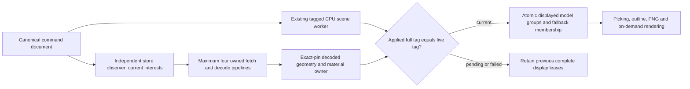

# D42 — Exact-version furniture models (PH4-T03 stage B)

2026-10-15 · Codex under D17; D36 scopes remain unstarted. Follows PR #88, reviewed head `1b47cfd27d1d941f84cd7f6d706722a738548825`, Check/Android SUCCESS in run38730499295; merge `da740234df4e9c5dff1f1b33ad305cc2b542e085`.

Catalog choices and saved furniture retain exact `assetId/assetVersion`. Root application injects a public renderer `FurnitureAssetSource`; render3d never imports catalog/storage. CatalogSource caches only completed immutable packaged metadata. Each caller owns its abort controller, byte/deadline/hash checks and exact LOD lookup. Missing pins never silently upgrade or substitute. The three legacy sample pins are absent from the original catalog and remain honest measured boxes with an unavailable status and retry.

The browser uses the existing Three.js GLTFLoader, with no new dependency. Admission deliberately matches the original publisher's flat, static, untextured GLB2 profile: one scene, at most64 flat positive-TRS mesh nodes, one indexed triangle primitive each, bounded interleaved FLOAT positions/normals and integer indices. Accessor spans/counts, referenced vertex/triangle budgets and no external resources/extensions are checked before parsing. This is runtime artifact validation, not an uploaded-model feature or a general importer. Actual decoded values, normals, triangle count and native extrema are checked afterwards. Node world transforms bake into owned geometry once; original parser geometry/materials are deduplicated and disposed. Cloned material sharing remains per renderer.

Native bounds must match declared dimensions at `1e-5 m` (0.01mm), minY0 and X/Zcentred. Front is -Z, demonstrated by the original desk's asymmetric front drawer. FR-018/SYNC-003's final1mm requirement takes precedence over REN-004's looser1% allowance: presentation checks final rotated bounds too, including legacy per-axis scaling. Unsupported imported finish overrides or amplified size discrepancies receive an explicit nonretryable measured fallback. PH4-T04 will implement finish variants. Model transform is `T(x,floorElevation+elevation,y) × Ry(-theta) × S(w/nativeW,h/nativeH,d/nativeD)` in metres; no box half-height is added to a grounded model.

## Ownership and stale results

Current interests and displayed leases are separate. Deleting an unfinished load aborts immediately, including after CPU failure unsubscribes the ScenePipeline. An already displayed decoded bundle stays owned while the previous intact scene remains visible. A successful presentation replaces displayed groups, then collects entries with neither interest nor display ownership. Source/decode completion only stores CPU resources and requests refresh; it never acknowledges a scene generation. ThreeView presents only when the full applied project/session/generation/hash tag equals the live tag and context is available. Attempt object identity rejects cancelled/replaced results. Unabortable parse work retains a concurrency slot until actual settlement, then late resources are disposed.

One per-renderer ResourcePool owns composite decoded bundles and separate instance buffers. Three or more compatible exact-pin/LOD objects use one InstancedMesh per baked primitive on every quality tier; fewer use individual meshes sharing geometry/materials. Stable membership reuses instance buffers; 3→2→3 and reordering replace only the relevant display buffers. Loaded IDs leave fallback instance membership. Hidden canonical boxes remain for selection outlines/framing. Every visible primitive/instance maps to the canonical furniture ID. Model materials forward PBR shader uniforms into the existing per-renderer ShaderTextures owner; model cleanup precedes LUT and renderer cleanup.

The prototype32MiB cap counts **accepted decoded geometry typed-array backing buffers**, deduplicated within a bundle. It excludes instanceMatrix buffers, temporary parser/cloning peaks, JS objects, textures, driver allocations, process/native memory and GPU residency. Resource-pool `live` counts composite ownership entries, not individual GL geometries. Separate actual renderer counters and model mesh/triangle audits are exposed for executable checks. These are lifecycle safeguards, not physical phone or mobile-optimization evidence.

Independent cleanup steps are always attempted. Collection, retry, late-result and display-transition disposal faults are contained and counted; close aggregates all owners even if a disposer throws. An underlying throwing disposer cannot be proven to have freed its own internal allocation: the evidence proves attempted cleanup of all independent owners, cleared references and recorded failures, not universal physical deallocation.

## UI, verification and limits

Model status is transient, bilingual and paged20items; every item can reach its status and meaningful retry. Loading/error/retry never writes drawing/history. HTTP, hash, decode, unknown pin and allocation failures retain measured boxes without changing structural openings or CPU acknowledgement. Unsupported finish/size states explain their fallback without a fake Retry action.

Analytic/property tests are Codex-authored, not independently authored Claude fixtures. Tests use the real shipped GLB, ordered native axes, asymmetric front,37/90degree transforms,1.5scale/elevation, actual adapter rays/fallback membership, concurrency and cancellation, exact pin mismatch, stale attempts, residue budget and multiple injected cleanup failures. Browser tests add actual72triangle/six-part drawing,216triangle shared copies, failure/retry, delayed delete, pending/failed CPU fences, previous-display deletion and actual WebGL loss/restoration. Fresh read-only Codex review supplied additional fault probes; final Claude/device/external review remains pending under D36.

Stage C still needs pointer drag/rotate/nudge and back-to-wall/collision advisories. Materials and ~30original catalog items follow PH4-T04/T05. Generic textures/compression/CDN, D36 scopes and physical phone claims remain unimplemented. No schema, historical asset/blob, accepted fixture or owner research changes are part of this task.
