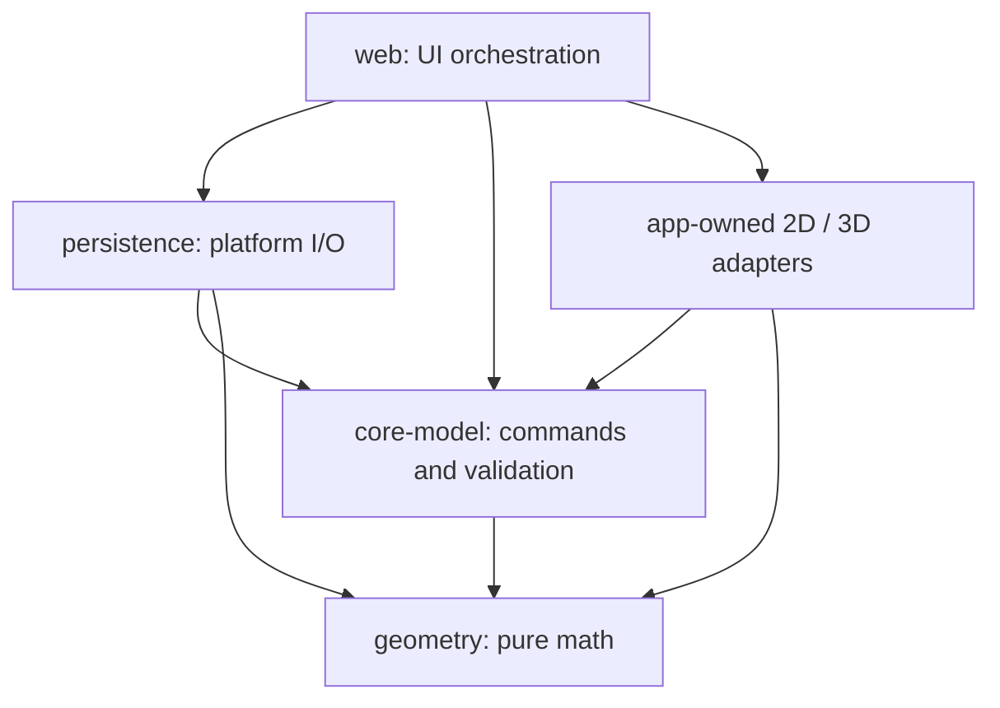

# PH1-T01 — package and import boundaries

Decision D22, 2026-10-12, under D17. Keep packages only when needed. The current application has four workspace packages; extracting adapters/catalog/server tooling waits for their actual tasks. No new dependency, package move, canonical schema or accepted fixture change is part of this task.

| Layer | Admitted runtime dependencies | Forbidden direction |
|---|---|---|
| geometry | Internal helpers only | Model, renderers, app, persistence, platform/native/network modules |
| core-model | Geometry public API, Immer, AJV and AJV Formats | UI, rendering, persistence/native modules |
| persistence | Geometry/core public APIs, Immer, Capacitor core/Filesystem | UI and renderer code |
| app-owned editor/render3d | Core/geometry public APIs, React, Konva, Three; internal adapters and pure perf metrics | Storage and app orchestration |
| web shell | Public workspace APIs and registered application libraries | Relative/private package implementation paths |

The repository-local ESLint rule in `scripts/architecture-boundaries.mjs` checks static imports, re-exports, literal dynamic imports, TypeScript import types/import-equals and direct `require`. Worker/SharedWorker loads must use a literal `new URL(..., import.meta.url)` and obey the same target policy, including direct and window/self/globalThis constructors. Calculated loads are rejected in protected source paths. It checks TS/TSX/MTS/CTS/JS/JSX/MJS/CJS source; unknown package layers fail until registered. Workspace private subpaths, rooted/URL module imports (including Vite `/@fs`), relative escapes and traversal inside bare package names are rejected. Separator normalization and exact directory boundaries prevent lookalike/traversal admission. Test-only Vitest/fast-check/fake-indexeddb and JSON files under `docs/examples`/`tests/fixtures` are explicit exceptions, not runtime permission to import app code. Existing tests/fixtures remain unchanged.

The four Node regression tests invoke actual ESLint with the current flat config on deliberate forbidden/allowed imports, check path matching and assert runtime/optional/peer dependency declarations plus the exact public `exports` source entry point obey the same matrix. They run in `pnpm check` along with the SDK regression; removing a file glob/rule must fail the negative tests. Adding a package/dependency requires a reviewed matrix update, exact version/license record and normal validation.

The generated AJV validator remains excluded from handwritten lint and is regenerated/byte-checked by `pnpm schema:check`; generation tooling is not a pure runtime package. Root scripts/build configs are tooling, outside the production-layer policy. This static rule is not a security sandbox, arbitrary JavaScript side-effect detector or proof that renderers never mutate objects. Frozen canonical documents, command-only changes, consistency tests, reviewed source and device/runtime checks remain necessary. Indirect loader aliases, filesystem symlink tricks and arbitrary runtime code are not claimed to be resolved by import lint.
