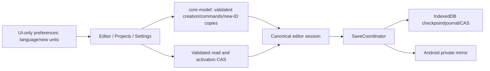

# PH1-T03 — local project collection and bilingual shell

D24, 2026-10-12, under continuous-development authorization D17. FR-002 / NFR-015 / UX-002 / UX-011. Production project schema and storage envelope remain **1**. The local IndexedDB database becomes **2** without transforming project bytes.

Zustand 5.0.15 (MIT, React >=18 optional peer) holds navigation, return destination, language, preferred new-project units, and welcome/settings acknowledgement. LocalStorage contains only those versioned preferences, with unavailable/invalid/quota fallback; never drawings, renderer state or history. Existing package interfaces stay public. Renderer locale is injected and its pure message helper imports only geometry, never UI state/storage. English/Hindi message pairs are typed and tested for matching placeholders. HTML language follows the preference. User names and saved content are never rewritten by language/unit-preference changes. Canonical dimensions remain integer mm; imperial area is derived using exact 304.8 mm/ft. Current precision inputs remain mm.

New projects have independently generated project/floor/material IDs, one empty floor, revision 0 and validated content. Clock/IDs/default content labels are application-injected. The optional starter uses the existing atomic AddRectangle command: 4000 x 4000 centreline mm, 200 mm walls, 2700 mm height; **inside** area is 14,440,000 mm², not 16 m². Full drawing tools follow PH2. Duplication remaps every entity/reference, sets revision 0, and applies the copy name through a core command. Existing originals remain untouched. Project thumbnails are generic placeholders; asset previews are a later task.

The bounded list permits 1000 local metadata entries. Invalid entries warn without rewriting them; an oversized collection fails rather than silently truncating. Open validates checkpoint/replay and checks the latest head and trash flag, including when reusing the current session. Both the reuse and new-session paths await transactional activation CAS. List cards cannot authorize stale data. Background save never changes the active selection. Rename uses canonical commands. Session switches first flush; only saved or primary-local-complete/extra-native-pending states may leave. Error/conflict/memory-only work stays available for editing/export. Export by itself does not unlock navigation; restore saving or retain the page. A newly created drawing whose initial save fails remains in memory with truthful status.

Local trash adds `trashedAt` to metadata only, removes the active selector when needed and detaches that editor. Restore removes the flag; original checkpoints, journals, geometry and native files remain. No permanent delete or local automatic expiry is implemented. Native recovery hides known trashed project IDs; if all browser metadata is lost, a surviving native copy may still be explicitly recovered as a **new** drawing. Neither uninstall/app-data clearing nor OS/OEM durability is guaranteed. Cloud's planned 30-day trash policy is separate.

Database v2 forces correctly implemented old v1 connections to close; old cached code explicitly opening version 1 then receives VersionError, so it cannot silently erase the new trash flag. An externally held connection that does not close causes a reported blocked-open error; data is not removed. The upgrade creates missing stores only and preserves v1 rows/packed bytes. Future database upgrades require equivalent compatibility tests.

Dialogs use native modality, Escape cancellation, focus placement/restoration and disabled completion buttons during operations. Settings repeated entry preserves its return route. A saved-work failure prevents replacement. Mobile cards/settings wrap at 360px, with 44px shell controls; desktop browser touch emulation is not phone hardware evidence.

`localization/bilingual-ui` rejects static JSX prose, literal accessible labels/placeholders/titles/alt and literal text-expression children. GharPlan branding, symbols/data and the engineering `/perf` bootstrap are intentional exceptions. Arbitrary computed/runtime service strings and translation quality still need review; this is not proof that every possible string is translated. Core content labels remain stored content. Failure/repair hints are localized; room-repair proposals disclose possible names/material resets.

No full import/native share, accounts/cloud, catalog, broad editing toolbar, AI, permanent deletion or release certification is added. Physical Hindi layouts on Low/Mid devices remain issue #14; physical performance/recovery remain #10/#11. Claude's review remains deferred under D17.
