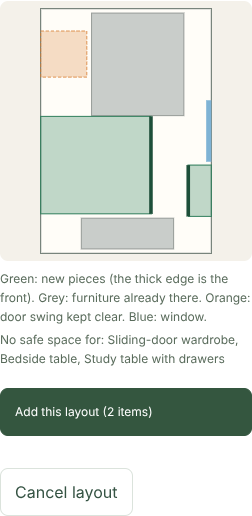
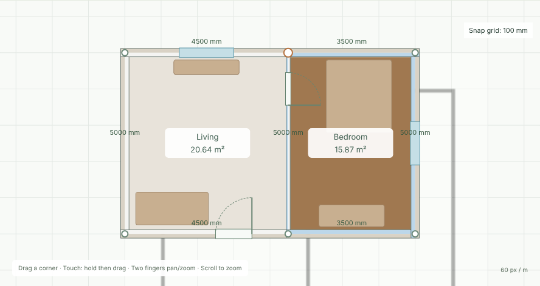
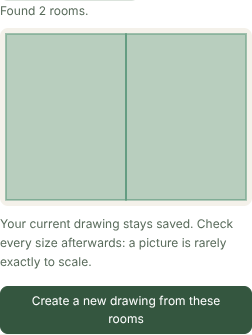

# D73 AI furniture ideas, layout and photo-to-plan verification

These checks are Claude-authored. They are not independent fixtures, not a phone test, and not a test of any real hosted model; no hosted model is connected.

## Unit tests: `apps/web/src/ai/furniture-suggest.test.ts` (14 tests)
Every expected list and number was worked out by hand from the rules:
- 600 mm walkway;
- 50% floor budget;
- at most 6 ideas.

### fitsRoom
- **Five hand cases.** For example, 2000×900 fits a 1900×3000 room when turned. A 1000×400 item fits a 1000×1000 room exactly, but not a 1000×999 room.
- **Property test:**
  - an item that fits also fits any larger room;
  - an item that is wider and deeper than the room never fits.

### acceptSuggestions
- **Budget case:** a 3000×2000 room has a budget of 3,000,000 mm².
  - Kept: 1,800,000, then 720,000.
  - Dropped: 640,000, because only 480,000 is left.
  - Kept: 240,000.
- **Dropped entries:** unknown IDs, repeats, items already in the room, items that do not fit, and malformed entries.
- **Answers that are not a list** give no ideas.
- **Limits:** at most 6 ideas, and only the first 50 entries are read.
- **Reasons:** a reason is kept only when it is a known kind or valid two-language text.
- **Property test:** accepted items are always:
  - known, unique and new to the room;
  - fitting with a walkway;
  - at most half the floor area in total.

### roomBrief
- The sample living room's clear area of 4327.5 × 4770 becomes 4327 × 4770 (rounded down).

### Offline stand-in
Furniture sizes are copied by hand from the catalog.

| Room | Floor budget | Ideas |
|---|---|---|
| Sample living room, 4327 × 4770 | 10,319,895 mm² | L-shape sofa, TV unit, coffee table, armchair, side table, rug. The plant is cut by the 6-idea limit. |
| Sample bedroom, 3327 × 4770 | 7,934,895 mm² | King bed, sliding wardrobe, bedside table, dressing table, study table |
| Small bedroom, 2400 × 3000 | 3,600,000 mm² | Queen bed only. The king bed needs 4,085,000; after the queen bed's 3,483,000 only 117,000 is left. |

- A room that already has a king bed and a bedside table gets the queen bed instead and no second bedside table.
- A pooja room gets no ideas.
- **Kitchen, bathroom and utility** (furniture only):
  - Kitchen 2800 × 2200: island (960,000 mm²) and base cabinet (360,000 mm²).
  - Kitchen 2000 × 1300: island only. It fits only when turned, and leaves 340,000 of the 1,300,000 budget, which is less than the base cabinet's 360,000.
  - Kitchen 1300 × 1300: base cabinet only. The island needs 1400 mm across either way.
  - Bathroom 1600 × 2000: vanity.
  - Utility 1800 × 1500: shoe cabinet, then sideboard.
- A request that was already cancelled is rejected.

### Size preference, options and swapping (Part A)
**Size preference.** Every list below was worked out by hand.

| Room | Size | Budget (mm²) | Ideas |
|---|---|---|---|
| Bedroom 3327 × 4770 | balanced | 7,141,405.5 | queen bed (3,483,000), three-door wardrobe, bedside table, dressing table, study table |
| Bedroom 3327 × 4770 | compact | 5,554,426.5 | double bed, two-door wardrobe, then the same three |
| Living room 4327 × 4770 | compact | 7,223,926.5 | the two-seat sofa first; six of the seven that fit |
| Bedroom 2400 × 3000 | balanced | 3,240,000 | the double bed only; the queen bed is over the budget |

- Spacious gives the same list as before.

**Options.**
- The balanced bedroom's bed options are king, queen, double, single. The queen bed's reason is "fits", not "biggest".
- An unknown option is dropped, and so are a repeated one and a number.
- These are dropped too:
  - an option already in the room;
  - an option that is shown as the next idea;
  - an option that does not fit either way.
- The shown piece is put first when it is not listed.

**Swapping.**
- Balanced bedroom: the other ideas use 2,250,000 of 7,934,895, so the bed cycles double → single → king → queen.
- In the 2400 × 3000 room (budget 3,600,000), the king bed (4,085,000) is skipped, so single → queen.
- The bedside table has no other option.

### Mutation check
Each of these code changes was made separately and made at least one test fail; the file was then restored:
- floor share changed to 1;
- walkway changed to 500 mm;
- the "already in the room or repeated" check removed;
- the limit raised to 7;
- the swap budget check, the "shown as another idea" and the room-fit/new-to-room option filters, and putting the shown piece among the options;
- compact starting one size down instead of two, and balanced using a 50% budget instead of 45%;
- the "biggest choice" reason.
- rounding changed from down to nearest;
- the 50-entry read limit removed.

## Browser tests: `tests/e2e/ai-furniture.spec.ts` (2 tests)
- **The panel shows "Test mode".**
- **Bedroom ideas:** the five bedroom ideas appear in the expected order. The first idea shows "1900 × 2150 mm" and the "biggest choice" reason.
- **Asking for ideas does not change the drawing.**
- **Placing an idea:** "Place in this room" opens the normal form at the bedroom's clear centre, (6221, 2500) mm. Adding saves king bed version 2 at that position.
- **Living room:** switching to the living room clears the old list. Asking again gives the six living-room ideas.
- **Hindi:** the panel, its button and "इस कमरे में रखें" work in Hindi.
- **Size choice:**
  - "Balanced" is the default, and a tip line is shown.
  - The balanced bedroom gives the queen bed first, at 1620 × 2150 mm with the "fits" reason.
  - "Show another option" changes it to the double bed (1460 × 2150 mm), then the single bed.
  - The bedside table has no such button.
  - The drawing is unchanged.
  - Choosing "Compact" clears the list; asking again gives the double bed and the two-door wardrobe first.
- The two earlier tests pick "Spacious" explicitly, so their expected lists are unchanged.

## AI-2 layout: `apps/web/src/ai/layout.test.ts` (12 tests), `packages/core-model/src/furniture-batch.test.ts` (3 tests)
These checks are Claude-authored. Every expected position below was worked out by hand. In the stated geometry, 0° faces north (−Y), 90° east, 180° south and 270° west, matching the app's furniture footprint (`back = (−sin θ, cos θ)`).

### AddFurnitureBatch
- Three items are added in order with rev 0.
- One Undo gives back the exact saved document; Redo adds the items again.
- A batch is rejected as a whole, with the model unchanged, when any of these holds:
  - it is empty, or has 21 items;
  - an ID is repeated or already used;
  - a coordinate is fractional or outside the drawing;
  - the floor or material does not exist;
  - an entry is null, or the list is not a list.
- A property test with 60 runs: any batch of 1–20 valid items is added exactly and undone exactly.

### Geometry
Footprints and walkways at all four turns.
- Touching boxes do not overlap.
- On an L-shaped floor, only boxes covered by the clear rectangles count as on the floor.

### placementProblem
Room: 3000 × 4000 mm.
- Door swing: [0,1000,900,1900].
- Window: [1000,0,2000,100], sill 900.
- Existing pieces: a 700 mm tall item at [2500,3500,3000,4000], and a flat rug.

Each refusal reason gets one case:
- **outside:** a bedside table at x 2900; its box reaches x 3125.
- **overlap:** a bedside table on the 700 mm item.
- **door:** a bedside table turned 90° at (500, 1400); its box [300,1175,700,1625] meets the swing.
- **window:** a 2100 mm wardrobe under the 900 mm sill.
- **allowed under the sill:** an 800 mm cabinet under the same sill is accepted.
- **walkway:**
  - a wardrobe on the south wall facing the wall;
  - a bedside table whose walkway, y 3100–3700, meets the 700 mm item.
- **flat rug:** may lie on the existing rug.

With a king bed at (1500, 1075, 180°), whose walkway is y 2150–2750:
- a 450 mm coffee table in that walkway is allowed;
- a 520 mm bedside table there is refused;
- a bedside table on the bed overlaps.

### acceptLayout
- Order is kept.
- These are dropped:
  - unknown IDs, repeats (including a repeat at a free spot), fractions, strings, null;
  - an overlapping bedside table;
  - 360° and '0' turns (a 270° turn at the same spot is accepted).

### Stand-in layouts

| Room | Expected layout (x, y, turn) |
|---|---|
| 3000 × 4000 bedroom | King bed (1500, 1075, 180°), centred on the north wall. Bedside table (325, 200, 180°), touching the bed's west side at x 550. Sliding wardrobe (900, 3675, 0°), in the south-west corner; the north wall is taken. |
| 4000 × 5000 living room, door swing [0,3600,900,4500] | 3-seat sofa (2000, 430, 180°). TV unit (2000, 4800, 0°), facing it. Coffee table (2000, 1560, 180°), a 400 mm gap from the sofa front at y 860. Rug (2000, 1550, 0°), the 50 mm grid point nearest the table centre (2000, 1560). |
| 4000 × 3500 dining room | Six-seat set at (2000, 1750, 0°) |
| 3500 × 4000 dining room | Six-seat set at (1750, 2000, 90°) |
| 2000 × 4000 room | King bed (1000, 1075, 180°). The bedside table is left out: no spot within 150 mm of the bed (x 50–1950) is outside the bed's walkway. |
| 2400 × 2000 room | The king bed is left out, because 2150 + 600 > 2400 and 2150 > 2000. The bedside table goes to (225, 200, 180°). |

- **Property test** (40 random rooms with 0–2 doors and random item sets): every stand-in answer passes acceptLayout unchanged.

### layoutRoom on the sample plan
- **Bedroom:**
  - Floor: [4557.5,115,7885,4885].
  - Door swing from the partition (offset 1000, width 900, partition centreline x 4500, half-thickness 57.5): [4557.5,550,5457.5,1450].
  - East window: [7785,1900,7885,3100], sill 900.
  - Existing bed: [5550,200,7350,2200]. Existing wardrobe: [5350,4200,7150,4800].
- **Living room:**
  - Main door, measured from j5 (4500, 5000) toward j6 (0, 5000), so its centre is at x 3000: [2500,3885,3500,4885].
  - Bedroom door on this side: [3542.5,550,4442.5,1450].
  - North window: [1500,115,3000,215].

### Mutation check
Each of these rules was removed separately, and at least one test then failed. The file was restored afterwards.
- door;
- window;
- walkway on the floor;
- existing tall item in the walkway;
- tall item in another item's walkway;
- flat-obstacle exception;
- quarter-turn check;
- repeat check;
- door zones on the far side of a wall;
- the "on the floor" check.
- the 150 mm "beside" limit for bedside and side tables (in the stand-in).

### Layout choices (Part A)
These checks are in `layout.test.ts`, 17 tests. Every expected position was worked out by hand.

- **Options.**
  - A queen bed may stand for the king-bed idea.
  - The king-bed idea is then already placed.
  - A piece that is not among an idea's options is refused, and so is the queen bed on its own.
  - The bedside table is reported as skipped.
- **acceptLayouts.**
  - Empty and repeated layouts are dropped.
  - Three layouts are kept.
  - A plain list counts as one layout.
  - A malformed answer gives none.
- **adjustPlacement** (3000 × 4000 room):
  - Bed moved right 100: (1600, 1075).
  - Bed moved up: refused as "outside".
  - Bedside table moved 300 right: refused as "overlap" (x 400–850 meets the bed at 550).
  - Bed turned, with the bedside table there: refused as "overlap" (the turned bed spans x 425–2575, y 125–2025).
  - Bed turned, alone: refused as "walkway" (its walkway x −175..425 leaves the room).
  - Bedside table at (1500, 2000) turned: becomes 90°.
  - The original list never changes.
- **Smaller option.** In an 1800 × 3000 room the king bed fits on no wall (1900 > 1800; turned, 2150 + 600 > 1800). The queen bed stands in for it at (900, 1075, 180°). Without options, nothing is placed.
- **planLayouts** (3000 × 4000):
  - First layout: king bed (1500, 1075, 180°).
  - Second: west wall (1075, 2000, 90°).
  - Third: south wall (1500, 2925, 0°).
  - A dining room without a bed or sofa gets one layout.
- **Property test** (40 runs): every stand-in layout, smaller options included, passes `acceptLayouts` unchanged. There are at most 3 layouts.
- **Mutation check.** Each of these, broken separately, made a test fail:
  - the options-only rule;
  - once per idea;
  - the empty/repeat drop;
  - the 3-layout limit;
  - the adjust refusal;
  - the smaller-option fallback;
  - the wall-avoid penalty;
  - the third layout.

**Browser test** (fifth test). In the sample living room (balanced), the existing sofa and TV leave only the west and east walls:
1. Two layout buttons appear. Layout 1 puts the three-seat sofa at x 545, turned 90°. Layout 2 puts it at x 4012, turned 270°.
2. "Move right 100 mm" is refused with "Not moved: that spot goes outside the room." "Move left 100 mm" moves it to x 3912.
3. The preview does not change the drawing.
4. "Add this layout" saves the sofa at (3912, 2500), turned 270°.
5. One Undo gives back the exact drawing.

## Browser test: AI-2 (`tests/e2e/ai-furniture.spec.ts`, third test)
The test uses the sample bedroom, which already has a bed and a wardrobe.
1. Suggest the five ideas, then press "Arrange these in the room".
2. The preview pieces are read back and checked against the hand-derived values above:
   - each is inside the bedroom floor;
   - none touches the door swing, the existing bed or wardrobe, or another piece.
3. The preview leaves the drawing unchanged.
4. "Add this layout" adds exactly these pieces, at those positions and turns, and the panel reports the count.
5. One Undo gives back the exact earlier drawing.

In the sample bedroom, the king bed is placed against the west wall, clear of the existing bed, wardrobe and door swing. The dressing table goes on the east wall below the window. The sliding wardrobe, bedside table and study table get "no safe space".

## AI-3 photo or sketch to plan
### `packages/core-model/src/rooms-project.test.ts` (6 tests)
These use 200 mm walls, so a W × D room alone has a (W − 200) × (D − 200) clear area.

| Layout | Result |
|---|---|
| Two rooms side by side | 6 junctions, 7 walls. Living 3800 × 2800 = 10,640,000 mm²; Bedroom 2800 × 2800 = 7,840,000 mm². |
| A 7000-wide room under both | T junction; 8 junctions, 10 walls. Kitchen 6800 × 2800 = 19,040,000 mm². |
| Exact 2 × 2 grid | The X crossing is refused, so rooms 2 and 3 are reported. |
| The same grid staggered by 150 mm | All four rooms are built: 7,840,000 / 8,260,000 / 7,840,000 / 7,420,000 mm². |
| A room inside another | Reported; repeated types are numbered "Bedroom 2". |
| Empty list, or 21 rooms | Refused. |
| Doors on two side-by-side rooms | Shared wall: offset 1500. Living south wall: offset 2000. East wall at y 300: moved to 600 (450 + 150). A point on no wall, a 500 mm door and a 2900 mm door are reported. |

### `apps/web/src/ai/sketch.test.ts` (10 tests)
- **Merging edges:**
  - x edges 3990 and 4110 become 4050, and 7090 becomes 7100;
  - y edges −100 and −90 become −100, and 3110 and 3120 become 3100.
- **Dropped entries:**
  - overlaps, a 1000 mm room, a 16 m room, string and null entries;
  - an unknown type becomes "other";
  - a too-small shape at x 4200 does not pull a good 4000 edge to 4100.
- **Doors:**
  - 4080/1510/880 becomes the edge 4000, 1500, 900 mm;
  - the same door read from the other room is kept once;
  - a horizontal door at y 2900 goes to the 3000 edge;
  - dropped: a door 2000 mm from any edge, one reaching past the rooms, a 500 mm one, a "diagonal" wall, and a string coordinate.
- **Staggering:**
  - The exact 2 × 2 grid becomes [0,0,3000,3000], [3000,0,3000,3150], [0,3000,3000,3000], [3000,3150,3000,2850], and builds with nothing skipped. Without staggering, rooms 2 and 3 are skipped.
  - Property test, 25 runs: any 1–3 by 1–3 grid of 2.5–4.5 m rooms builds completely after acceptSketch.

**Reader cases.** The picture is 200 × 150 px at 10 m wide, so 50 mm per px. Lines are thickened by r = 10 px.

| Case | Expected result |
|---|---|
| Partition with an 800 mm (16 px) door gap | Rooms {1000,1000,4100,5600, living} and {5000,1000,4100,5600, bedroom}. Example: the left inside x 22–99 px becomes 32–89 px after thickening, so (32 − 10)·50 − 100 = 1000 and (89 + 1 + 10)·50 + 100 = 5100. Merged on the partition's ink centre, x 101 px = 5050 mm. Door: rows 40–55, centre 48 px = 2400 mm, 800 mm wide, read at x 5100 and 5000, then kept once at 5050 and built as one 800 mm door. |
| A 100 mm (2 px) pen break in the top wall | Closed; no door. |
| A 1600 mm (32 px) gap | Too wide to close: rows 50–61 stay open, so one room {1000,1000,8100,5600}. |
| An open outline | No room. |
| Bad width or bad pixel data | Nothing. |
| Type guesses | 6600 × 5600 is living; 1600 × 2600 = 4.16 m² is a bathroom; 1600 × 3100 = 4.96 m² is a bedroom. |

### Mutation check
Each of these was removed or changed separately, and at least one test then failed:
- the merge distance;
- the overlap drop;
- staggering;
- the early size drop;
- thickening;
- the edge-touching "outside" rule;
- the 100 mm half wall;
- the room-type check;
- door dedupe, the door-span check, the door-size check, the reader's 600–1000 mm gap limit, the door edge position, the core door clamp, and the core door-size check.

### Browser tests (`tests/e2e/ai-photo-plan.spec.ts`, 2 tests)
The test picture is the same two-room PNG, built in the test.
1. The privacy note is shown.
2. "Show under the plan" draws it at 0,0, 10000 × 7500 mm, 50% strength.
   - 30% changes the strength.
   - X −500 and Y 250 move it; Y 0 moves it back.
   - The drawing is unchanged.
3. With the picture at X −500, "Read rooms" reports "Rooms found: 2. Doors found: 1.", with the door at 4550, 2400, 800 and rectangles 500,1000,4050,5600 living and 4550,1000,4050,5600 bedroom: the picture-relative 1000 and 5050, minus 500.
4. "Create a new drawing" opens a new project, "Plan from photo", with:
   - 6 junctions and 7 walls;
   - one 800 mm door on the partition at x 4550, centred at y 2400;
   - Living room and Bedroom;
   - 20.79 m² clear each: 3850 × 5400.
5. A picture with no closed room says so and changes nothing. A text file is refused with a clear message.

### Scale and picture memory (Part A)
- **`sketch.test.ts`, scale from two marks** (worked out by hand):
  - Marks 160 px apart with 8000 mm gives 8000 × 200 / 160 = 10000.
  - A 50 px diagonal with 1000 mm on a 600 px picture gives 12000.
  - 3333.33 is rounded to 3333.
  - Refused:
    - marks 7.07 px apart;
    - lengths of 499 and 30,001 mm;
    - a resulting width of 1000 mm or 600 m;
    - a length that is not a number.
- **Browser, first test:**
  - With the picture hidden, "Create a new drawing" opens the new project with the picture still shown under it: `-500,0,10000,7500,0.3`, with its thumbnail and width.
  - Mutation check: without the "show it under the new drawing" step, this test fails.
- **Browser, third test:**
  1. "Set scale by marking a wall" asks for the first end, then the second.
  2. Taps at x 21 and 181 (the outer walls' ink) on the 200 px picture are marked at 21,75 and 181,75.
  3. 100 mm is refused.
  4. 4000 mm sets the width to 4000 × 200 / 160 = 5000. The underlay becomes 5000 × 3750, and the status says so.

## Not covered
- Real phones, a hosted model, cost limits, and how good the ideas look to a designer.
